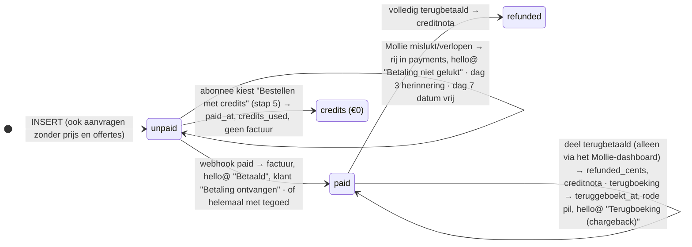
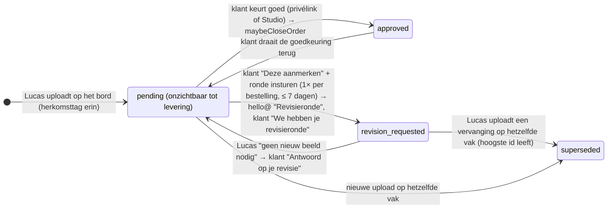

# VISUAILS — volledig overzicht, stand 24 oktober 2026

> **Bijgewerkt 25 okt 2026, 22:40 (de controle van levering 74: twintig punten opgelost, `kladblok/LEVERING-74.md` §7b).** **Levering 74 staat in zijn map, niet live** (`kladblok/LEVERING-74.md`): de opening met scrollvideo, Hoe het werkt in drie witte kaarten per dienst met de lagen in 3D en kort "Gemaakt met AI", de stroom (één scroll, één sectie, alleen op de computer), minder tekst op de voorpagina, iconen zonder plaatje, de nieuwe hoeken op de hele site, glas op wat zweeft, rustiger knoppen met een gloed in blauw uur; §16.3 punt 1 en §31.8 aangepast. **Lucas, 16:57: geen "met de hand"-labels of andere verdedigende zinnen over AI; streng op letten.** Nieuwe uitleg gaat zoals de lagen: eerst vlak, dan uit elkaar in 3D, laten zien waar AI zit, weer vlak. Volgorde (Lucas, 19:15): eerst 74 uitrollen, dan de cloudsessie starten; `kladblok/PROMPT-CLOUD-CODE.md` is daarop bijgewerkt en stopt als de opening niet op main staat. "Met de hand" is ook uit /how-it-works, de FAQ en de doorloop (`kladblok/TEKSTEN-74.md`); de cookiekaart staat rechtsonder.
>
> **Eerder op 25 okt.** Leveringen 65, 66 en 68 staan live (uitrol 25 okt 10:37, commit 4d05476); §15.2, §16, §23, §29.4 en §31 zijn aangepast. Nieuw: lijst 56 "Tekstronde en beeldkaart" (zelf tekst, beelden en iconen; https://claude.ai/artifact/ATQhaeTovWp1mSwVN5qESV) en `kladblok/PLAN-OPENING-SCROLL.md` (de opening met scrollvideo en Hoe het werkt per dienst, plus de nieuwe hoekregel: opgeslagen voor later, niet beginnen voordat Lucas het zegt). **Let op:** `kladblok/PROMPT-CLOUD-CODE.md` (25 okt 12:36, uit een andere chat) laat een cloudsessie de leveringen 69 tot en met 73 bouwen op de branch `claude/voor-de-launch`; levering 71 daar is hetzelfde werk als lijst 56. Lucas kiest één route; bouw het niet dubbel.

Dit document beschrijft VISUAILS van top tot teen zoals het **nu** is: het bedrijf, elke dienst, de prijzen, het abonnement, de website, de bestelstroom, VISUAILS Studio (klantportaal), de privélink, het adminportaal, de mails, de automatisering, de techniek, de regels, de huisstijl, waar Lucas naartoe wil en hoe Claude met hem werkt. Het is geschreven zodat een andere chat er zonder voorkennis mee kan werken. Het vervangt `VISUAILS-OVERZICHT-6-OKT.md`.

Bron: de code in zijn map `E:\Claude (VISUAILS)\visuails-astro` na levering 68 (24 okt), de notities `kladblok/LEVERING-48.md` t/m `LEVERING-68.md`, `DOORLOOP-27.md`, `VOORTGANG-8-OKT.md`, `LIVE-STAPPEN.md`, `uitrol-log.txt`, `docs/KLEURENSCHEMA.md` en `docs/DESIGN.md`, de afvinklijsten 1–47, 50, 54 en 55 en de Launchlijst, en wat Lucas zelf zei (met datum). Alle bedragen zijn excl. btw tenzij anders vermeld. Waar code en bedoeling nog uiteenlopen, staat dat in §17. Wat sinds het overzicht van 6 okt veranderde, staat per paragraaf verwerkt; de geschiedenis staat in §15 en §23.

**Leeswijzer.** §0: de vaste werkafspraken. §1–§14: hoe VISUAILS werkt. §15: wat er sinds 6 oktober gebouwd is en wat live staat. §16: wat nog moet. §17: waar code en bedoeling uiteenlopen. §18: begrippen. §19: drie bestellingen van begin tot eind. §20: statusdiagram. §21: wat er bewust níet is. §22: alle bedragen met bron. §23: beslissingenlog. §24: de looks per moment. §25: Lucas' werkdag. §26: toon en taal. §27: het waarom achter de regels. §28: het abonnement zonder week (gebouwd). **Nieuw:** §29 ontwerptaal en huisstijl (Blauw uur), §30 waar Lucas naartoe wil (launch), §31 hoe Claude met Lucas werkt. Snel antwoord op "mag ik dit bouwen?": eerst §21, §23, §29 en §30 lezen.

**Afkortingen.** LS = `kladblok/LIVE-STAPPEN.md` · L52 of lev. 52 = `kladblok/LEVERING-52.md` · V1…V51 = antwoorden op `kladblok/UPGRADE-BESLISLIJST-7-OKT.txt` (staan als commentaar in de code) · `v28-abotabs a` en dergelijke = afvinklijst 28, vraag abotabs, antwoord a · punt 9.01 = een punt uit die beslislijst · O12, F18, B45 = open punten en reparaties uit het overzicht van 6 okt en uit `DOORLOOP-27.md`.

## 0 · Vaste werkafspraken

Deze gelden altijd; §31 heeft de uitwerking.

- Lees eerst de huidige stand van zijn map (`E:\Claude (VISUAILS)\visuails-astro`); ga nooit uit van een eigen kopie. Claude commit, pusht en rolt nooit uit; Lucas doet dat zelf met `UITROLLEN.bat`. Claude zet nooit een sleutel.
- Prijzen alleen uit `src/data/pricing.js` en `src/data/plans.js`, nooit overgetypt. Kleuren alleen uit `docs/KLEURENSCHEMA.md`.
- Nooit zijn echte adres in testdata (gebruik Teststraat 1, 1234 AB Teststad, KVK 12345678). Testklanten: `hello+<type>@visuails.com`. Testaanbevelingen gemarkeerd "TEST — niet plaatsen".
- Credentials (Mollie live key, adminwachtwoord, 2FA, tokens) vult Lucas zelf in. Mollie blijft in testmodus tot hij live gaat. Nooit kaartnummers invoeren.
- Nederlands, beknopt, bij elk idee een eigen mening plus een alternatief; opties geven, niet dicteren; bij twijfel eerst vragen hoe het moet werken. Keuzes als afvinklijst. Bij een ombouw eerst een plan of schets, bouwen na zijn akkoord.
- Levertijd altijd "vaak binnen een dag, soms een paar dagen", nooit een belofte. Over wie het werk doet: "VISUAILS", "we" of de lijdende vorm ("wordt nagekeken"); nooit "onze beeldredactie" en nooit de ik-vorm (8 okt, toets `beeldredactie`). Niets onder 11,5 px, contrast ≥ 4,5:1 (gemeten). Geen logo's ontwerpen, alleen herkleuren. "Carrousel" met dubbele r. Geen beeldspraak ("magie"). Maten uitrekenen, nooit gokken.

---

## 1 · Wat VISUAILS is

**Bedrijf.** VISUAILS (visuails.com) is een eenmanszaak van Lucas in Enschede, KVK 99742993 (`src/data/schema.js:285`). Btw-nummer NL005407575B96: het staat in de voet van elke pagina (`src/layouts/Layout.astro:1504`), in de structured data (`src/data/schema.js:284`), in de FAQ en in de privacyverklaring. Alleen de factuur leest het uit het geheim `VISUAILS_VAT` (`src/lib/invoice.js:121`). E-mail hello@visuails.com. Mails aan klanten gaan uit van `VISUAILS <orders@visuails.com>`; meldingen en een bcc van elke factuur gaan naar hello@ (`wrangler.toml`: `FROM_EMAIL`, `NOTIFY_EMAIL`, `INVOICE_BCC`). WhatsApp Business +31 6 25436130 (`src/data/whatsapp.js:44`). Er is geen personeel; "VISUAILS", "wij" en "de studio" zijn Lucas. "Onze beeldredactie" mag sinds 8 okt niet meer (§26).

**Wat het doet.** Een done-for-you dienst voor kleding- en e-commercemerken. De klant stuurt telefoonfoto's van zijn product; VISUAILS maakt daar met AI productbeelden van (catalogsets, lifestylecarrousels en, op aanvraag, video) en levert ze nagekeken terug in VISUAILS Studio en via een privélink. Generatie in Magnific, nabewerking in Photoshop en DaVinci Resolve (§30.3). De klant boekt geen shoot en leert geen AI-tool.

**Positionering.** De kop van de voorpagina is "Al je productbeelden. Zonder shoot.", met een wisselwoord: productbeelden · catalogfoto's · lifestylebeelden · productvideo's (`src/data/brand.js:59-70`). Daaronder staat "Stuur je productfoto's. Krijg catalog, lifestyle en video terug. Knoop, stiksel en kleur nagekeken." met de feitenregel "Vanaf €39 per product · levertijd · Geen minimum" (`src/components/VoorpaginaHal.astro:117-119`). Verkoopargumenten: een prijs per product die daalt met het aantal; snel, vaak binnen een dag, soms een paar dagen; elk beeld door ons nagekeken; een EU-bedrijf; vaste looks, zodat alles bij elkaar past; geen kortingscodes en geen acties (/pricing, 17 okt). Doelgroep volgens het overzicht van 6 okt: jonge merken met een jong publiek (vandaar het jonge modellenroster), webshops met veel producten en bureaus die voor klanten bestellen. Bureaus mogen bestellen voor hun klanten, met één proef per bedrijf (Lucas, 4 sep; FAQ "Kan ik als bureau voor mijn klanten bestellen?"). Open is beslispunt 10.09 / V38 (beslislijst 7 okt): of één bestelling producten van verschillende klanten mag mengen, en een alinea voor /pricing en /contact.

**Alleen zakelijk.** Consumenten zijn uitgesloten. Iedereen tekent één zakelijke verklaring, met bewijs per land: een KVK-nummer in Nederland, een door VIES bevestigd btw-nummer in de EU, en een vrij registratienummer daarbuiten (`src/data/business.js`).

**Welke AI-modellen.** Namen of versies van modellen (zoals Nano Banana) staan nergens op de site of in de code; zo stuurt niemand concurrenten op zijn productie. Alleen de familienaam "Gemini" staat in de privacyverklaring en de verwerkersovereenkomst, bij de maker Google. Let op: dit overzicht en dat van 6 okt noemen de modelnaam wél, en `kladblok/` gaat mee naar de openbare repo (§16.2). Privacyverklaring en verwerkersovereenkomst noemen Magnific AI, S.L.U. (Spanje) als ontvanger. Als subverwerkers via Magnific noemen ze de makers Google (Gemini) en ByteDance (BytePlus Pte. Ltd.), zonder modelnaam (`src/data/subverwerkers.js`; ByteDance sinds 11 okt).

**Productie.** Eén product kost Lucas 10–20 minuten van generatie tot afgewerkt beeld (overzicht 6 okt). Voor een catalogproef noemt `src/lib/proefStand.js` 20–30 minuten. De capaciteit staat in de code als punten per dag (§3.6).

**Stand.** VISUAILS verkoopt nog niet; met verkopen begint hij in Q4 2026 (§30). Mollie stond op 15 okt nog in testmodus (LEVERING-51). Of dat nu nog zo is, is in de code niet te zien: de sleutel is een geheim. Live staat t/m levering 64 (§15).

**Stem en regels voor tekst.** Serieus en direct. Geen beeldspraak, geen "magie", niets dat zegt dat een merk "groter lijkt". Nooit zeggen dat er één persoon werkt, en /about mag VISUAILS niet kleiner laten lijken (14 okt). De naam Lucas staat alleen op /about ("Opgericht door Lucas", `src/components/OverHal.astro:113`). Aanhef "Hallo"/"Hello" (17 okt). Nederlands met "carrousel". Engels is de hoofdtaal van de code en de site (`/`); Nederlands staat onder `/nl`. Alle teksten loopt Lucas zelf na (18 okt). Meer in §26.

---

## 2 · De diensten

Elke dienst in één blok: wat het is, wat de klant levert, wat hij krijgt, wat het kost, hoe snel. Dit is wat de site **nu** aanbiedt. Wat Lucas bij de launch wil aanbieden, staat in §30.2; het verschil staat in §2.11. Alle bedragen komen uit `src/data/pricing.js` (regelnummers in §22).

### 2.1 Catalog — "catalogset"
- **Wat:** productfoto's op een egale achtergrond, voor de productpagina of een marktplaats. Per product **vanaf 4 beelden**: voorkant, achterkant, detail en één op model (`CATALOG_IMAGES`, `LEVERVLAKKEN`). Eén look: Classic, of een eigen look (§2.6). Eén verhouding per bestelling: 1:1 (standaard), 4:5 of 3:4 (`src/data/ratios.js`). Staat Zalando als kanaal in zijn vaste look, dan ligt de verhouding vast op 1:1,44 (aanbevolen 1801 × 2600 px; `CHANNEL_RATIOS`). 2048 px aan de lange zijde; 4K bestaat bij catalog niet, alleen op aanvraag via WhatsApp (`RESOLUTIE_COPY`). Levering als JPG; PNG of WebP vraagt de klant na levering per bestelling aan in Studio (`src/lib/formaten.js`).
- **Klant levert:** per product een voorkant, achterkant en close-up (verplicht) en een draagfoto (optioneel), met zijn telefoon; plus hoogstens 4 eigen referentiefoto's per product (`src/data/shots.js`). Verder: de productsoort (§2.11), de kleur zoals in zijn webshop met Pantone- of hexcode (die kleur geldt bij een revisie, §3.5), de achtergrond en het gezicht. Naar welke kanalen hij verkoopt, vraagt de werkplaats niet meer (lev. 59); dat komt uit zijn vaste look in Studio.
- **Achtergrond:** Wit `#FFFFFF` (standaard) · **Lichtgrijs `#F5F5F5`** · Beige `#EDE4D8` · eigen hexcode (`src/data/backgrounds.js`). Per beeld mag de klant een andere achtergrond kiezen, ook een eigen hexcode (`src/data/beeldachtergrond.js`). Amazon, bol en Zalando eisen een witte hoofdafbeelding: de bestelling begint dan op wit en de voorkant blijft wit (`witteHoofdafbeelding()`). Oude bestellingen houden hun kleur en naam: Gebroken wit `#F7F5F1` (aanbevolen tot 17 okt) en Grijs `#EDEDED`.
- **Twee grijzen, niet verwarren.** `#F5F5F5` is de Lichtgrijs waaruit de klant kiest (17 okt, gemeten bij Farfetch). `#EFEFEF` is alleen de gemeten grond van de voorbeeldset met de roze jeans op de site (`GROND`, `src/data/voorbeeldset.js:44`). In de Studio-tekening op /studio heet die kleur "Eigen kleur" (`src/components/FigDash.astro:161-163`). Zie ook §29.1.
- **Extra hoeken** (alleen catalog): op model Driekwart, Van achteren of Detail op model; op de ondergrond Binnenkant of Tweede detail; in elke groep ook een eigen hoek met een omschrijving en een verplichte foto (`src/data/angles.js`). Flat-lay staat er niet meer tussen: die zit al in de set. €39 · €34 · €29 · €19 per foto per product, volgens de trede van de bestelling; hoogstens 4 per product; 2 credits per foto.
- **Prijs per product:** €89 (1–4) · €65 (5–9) · €51 (10–19) · €39 (20+). Op de site: "Vanaf €39". Met credits: 4.
- **Levering:** onder 10 producten zo snel mogelijk, vaak binnen een dag, soms een paar dagen; vanaf 10 een vaste leverdatum uit de agenda (§3.6).

### 2.2 Lifestyle — "lifestylecarrousel"
- **Wat:** per product **4 beelden in één look** (sinds 14 okt; was 3): 01 Op model · voorkant, 02 Op model · achterkant, 03 Alleen het product (in de scène van de look), 04 Detail op model (`LIFESTYLE_IMAGES`, `LEVERVLAKKEN`). Bestellingen van vóór 14 okt houden hun 3 beelden (`lifestyleBeeldenVan`). Een vaste set: geen extra hoeken. Looks: Dunes, Flash, Glow, Phone-made of een eigen look (§2.6). Verhouding 1:1, 4:5, 3:4, 16:9 of 9:16, per beeld te kiezen. 4K (4096 px) op alle vier de beelden: €9 per product, vlak, 1 credit.
- **Klant levert:** dezelfde foto's als bij catalog; de draagfoto heet hier "Aanbevolen", overslaan mag. Hij kiest look, gezicht en verhouding.
- **Complete look** (sinds 17 okt): 2 of 3 producten uit dezelfde lifestylebestelling, door één model op één plek gedragen. Elk stuk telt mee in de staffel en houdt zijn vier beelden; per look komen er 2 beelden bij (van top tot teen, en de stukken samen). **€50 per look**, of 4 credits. Geen maximum aantal looks; elk stuk zit in hooguit één look. Een set onder één artikelnummer is gewoon één product, zonder toeslag. Niet bij catalog en niet bij de proef (`src/data/looks.js`). De complete look vervangt de outfittoeslag. Plekken in het beeld die geen stuk uit de bestelling vult: "wij kiezen", of een eigen stuk van de klant (gratis).
- **Prijs per product:** €109 · €82 · €64 · €49. Op de site: "Vanaf €49". Met credits: 5.
- **Levering:** als catalog.

### 2.3 Complete — **bestaat niet meer**
- Sinds 14 okt (afvinklijst 23, Lucas: "het is het één of het ander"). Geen trede, geen bundelkorting. `/start/complete` stuurt met een 301 door naar `/start` (`public/_redirects`). Oude `drop`/`complete`-bestellingen blijven leesbaar; de agenda weegt ze 7 punten (`OUDE_BUNDEL_PUNTEN`).

### 2.4 Video — **op aanvraag, totdat de videostijlen af zijn**
- Vier richtingen op /video (`src/data/videoStyles.js`): Motion (8 seconden, verticaal), Lifestyle Video (de scène in beweging), Campaign (meerdere shots, één grade) en een eigen concept (Custom). Motion en Lifestyle Video tonen "Op aanvraag", Campaign en Custom "Offerte per project". Op /video staat: elke look levert één clip van acht seconden.
- **Hoe het werkt:** `/start/video` is een aanvraagformulier (naam, merk, e-mail, telefoon, stijl, aantal clips 1, 2, 3, 4, 5, 6, 8, 10 of 12 of "weet ik nog niet", toelichting). Geen betaling. Lucas antwoordt schriftelijk met een prijs; in /admin zet hij een offerte (volledig of met aanbetaling) en de klant krijgt een betaallink. Video krijgt nooit een vaste leverdatum (`tierFor()`).
- €69 (motion) en €149 (lifestyle video) bestaan alleen intern en staan nergens op de site. Zodra Lucas de videostijlen heeft gemaakt, krijgt elke stijl een eigen prijs en komt video met vaste prijzen in het bestelformulier; dan gaat `VIDEO_OP_AANVRAAG` op `false`.
- Credits: motion-clip 5, lifestyle-clip 12. Met credits bestellen kan in het formulier alleen bij catalog en lifestyle; een video-offerte met credits betalen in /admin is niet gevonden in de code (§17).
- Wat Lucas bij de launch wil (MOTION · 8 s, SHIFT · 8 s, CUSTOM per seconde) staat in §30.2.

### 2.5 Hooks — op aanvraag
- Een korte verticale clip (6–8 s) die doorloopt in de post eronder. Op /hooks heet dit format "De doorloper"; de kop is "Video die opvalt in de feed". Als "binnenkort" staan er vier andere formats onder, zonder datum of prijs: De lus, Drieluik, De onthulling, Stapel (`src/data/komendeStijlen.js`).
- Vanaf €119 per product, een variant €49. Geen bestelknop, alleen via contact; in het menu "Op aanvraag" (`src/i18n/ui.js:418`). Een hook heeft nog geen gewicht in de agenda (`KIND_PUNTEN.hooks = null`), dus ook geen vaste datum.
- In het launchschema heet de hook bij de launch IG SPLIT: een deel van het product zweeft uit de bovenste post over de zwarte balk, als foto of (duurder) als video (§30.2).

### 2.6 Eigen look (custom look) — op aanvraag
- De klant wil een eigen wereld (catalog- of lifestylelook), exclusief voor zijn merk. Twee ingangen: hij geeft het concept, of VISUAILS bedenkt het (meer denkwerk, meer kosten). Stappen: aanvraag via `/start/custom-look` (vanaf /catalog/custom met `?voor=catalog`; geen betaling) → haalbaarheidscheck → offerte met aanbetaling → ontwerp in overleg, met één correctieronde → de look komt in het account van de klant (`customer_styles`, status proposed → active) en is daarna in het bestelformulier te kiezen als `cs-<id>`. Niet haalbaar: terugbetaling. De factuur noemt de look als tweede regel.
- Prijs: het gewone tarief plus een eventuele toeslag per product, €0–€500, vastgelegd in de offerte (`src/lib/admin.js:7810`). Met toeslag kan de bestelling niet met credits (§4.3). Bij kopiëren van een bestelling gaat de eigen look mee.
- Tekst: Lucas koos op 6 okt "vanaf het gewone tarief"; `src/data/catalogStyles.nl.js` zegt op één plek nog "tegen het gewone tarief" (§17).

### 2.7 Merkmodel (brand model) — €450 eenmalig
- Een eigen AI-gezicht, exclusief voor het merk. `/start/brand-model`: briefing in twee routes ("ik weet wie" met acht vragen, of "bedenk het voor mij" met vier; `src/data/brandModelBrief.js`), daarna direct naar Mollie: €450 + 21% = €544,50; met een door VIES bevestigd EU-btw-nummer of buiten de EU €450. Er is geen apart 0%-vinkje meer.
- Lucas maakt richtingen, één correctieronde, en zet het model op de klantpagina in /admin ("in ontwerp" → "klaar"). Bij "klaar" gaat de bestelling op geleverd en krijgt de klant "Je merkmodel staat klaar — <naam>". Daarna is het model te kiezen als gezicht bij elke bestelling en in de vaste look.
- Inbegrepen bij Merk; bij Pro alleen bij een jaar vooruit (`hasBrandModel()` in `src/data/plans.js`).
- Op /custom-models staat de gezichtscontrole ("drie verschillende gezichtszoekmachines", zonder namen); het logboek daarvoor (`src/data/modelChecks.js`) is nog leeg (§16).
- Op de Launchlijst (22 okt) staat "Prijs vastzetten" bij BRAND MODEL nog open. Sinds 23 aug is het €450 (§23); de opmerking over €1.250 ("aan de dure kant") is van augustus. Vraag Lucas of €450 blijft (§30.2).

### 2.8 Probeer VISUAILS · €1 (proef)
- Eén product, een volledige set: 4 catalogfoto's of een lifestylecarrousel van 4 foto's (`TEST_SAMPLE`). €1 + btw (€1,21 in Nederland). Begint bij een look (`/test-sample?style=…`). Geen productsoort, geen extra hoeken, geen complete look, geen voorrang, geen revisieronde, geen vaste datum. Afgerond bij levering.
- **Eén per bedrijf.** Bij het verlaten van stap 3 vergelijkt `/api/proef-check` e-mail, telefoon en registratienummer met eerder betaalde proeven (`src/lib/proefGebruikt.js`). Plus-adressen tellen als het gewone adres (`normalizeEmail`, `src/lib/payer.js`). Na betaling vergelijkt de webhook ook de betaler; een tweede proef wordt dan geannuleerd en teruggestort (`functions/api/webhook/mollie.js`, `payer_hash`).
- **Stand:** in /admin/proef open, dicht, of alleen de lifestyleproef open (`src/lib/proefStand.js`). Is de proef dicht, dan staat er een wachtlijst op /test-sample; bij heropenen gaat er één mail naar de lijst: "De nieuwe proefronde van VISUAILS is open". Wie al klant is (cookie `vis_in`), ziet de €1 niet meer, maar "Bestel opnieuw met je look". Op de videopagina's heet de knop "Probeer VISUAILS · €1, met foto's".

### 2.9 Abonnement — zie §4.

### 2.10 Gedeelde maandset en Editions
- **Gedeelde maandset:** 20 merkneutrale beelden per maand voor elke abonnee, zonder product erin (`STOCK_OFF_BRAND`). Lucas uploadt ze in /admin/maandset; de klant downloadt ze in Studio (Abonnement › Overzicht). Ze krijgen de herkomsttag `trainedAlgorithmicMedia` (`MAANDSETTAG`, `src/lib/iptc.js`).
- **Editions:** 20 beelden per maand voor het eigen merk, zonder het product van de klant: waar het gedragen wordt en welk gevoel (14 okt). €149 per maand + €295 opzet. Staat als "binnenkort" op de site en in het menu (`src/i18n/ui.js:420`). Niet met credits. In het launchschema komt Editions na de launch, als add-on bij het abonnement.
- "Maandelijks meedenken" bestaat niet en staat ook niet meer in de code (`src/data/plans.js:568-575`).

### 2.11 De looks (stijlen)

| Dienst | Look | Eén zin |
|---|---|---|
| Catalog | Classic | Strak en consistent: vast licht, vaste hoek, de klant kiest de achtergrondkleur |
| Catalog | Eigen look ("Custom Brand") | Een cataloglook die onmiskenbaar van het merk is, eenmalig ontworpen |
| Lifestyle | Dunes | Zon, zand en ingetogen luxe; aardse tinten, lange schaduwen |
| Lifestyle | Flash | Directe flits, harde schaduwen; nightlife en editorial |
| Lifestyle | Glow | Golden hour op afroep; warm, laag zonlicht |
| Lifestyle | Phone-made | Ziet eruit als een gewone telefoonfoto; UGC-look, één lichtbron |
| Lifestyle | Eigen look ("Custom") | Een eigen wereld, gebouwd rond het product |
| Video | Motion · Lifestyle Video · Campaign · Custom | allemaal op aanvraag |
| Hooks | De doorloper | op aanvraag |

**In de maak** (`src/data/komendeStijlen.js`, zonder datum, prijs of knop): catalog "Still" (het model staat stil, geen pose), lifestyle "Studio" en "Nacht", hooks De lus, Drieluik, De onthulling en Stapel. Het bestand noemt ook video "Draaitafel", "Kleurwissel" en "Detail", maar geen pagina toont die (alleen /catalog, /lifestyle en /hooks lezen het bestand). Het galerijfilter "Beam" is geen bestelbare look.

**Nu op de site tegenover het launchschema (22 okt).** Het schema staat in §30.2, de looks per moment in §24.

| Dienst | Nu op de site | Launchschema |
|---|---|---|
| Catalog | Classic, eigen look; in de maak Still | CLASSIC, CASUAL, CUSTOM |
| Lifestyle | Dunes, Flash, Glow, Phone-made, eigen look; in de maak Studio, Nacht | FLASH, PHONE-MADE, AUGUST, CUSTOM; later DUSK, TWELVE, GLOW, HAZARD, IDLE, DUNES |
| Video | Motion, Lifestyle Video, Campaign, Custom (op aanvraag) | MOTION · 8 s, SHIFT · 8 s, CUSTOM; Campaign later als eigen categorie |
| Hooks | De doorloper; in de maak vier formats | IG SPLIT; later BODYSEARCH |
| Custom model | Merkmodel €450 | BRAND MODEL (prijs nog vast te zetten); later FANTASY |
| Abonnement | drie plannen en op maat, zelf in te stellen; Editions "binnenkort" | drie plannen of op maat; Editions later als add-on ("op maat via mail of WhatsApp" was een advies van Claude op de Launchlijst, niet zijn keuze; het formulier bestaat al) |

Kort: CASUAL, AUGUST, SHIFT, IG SPLIT (als naam) en Fantasy staan niet op de site; Dunes, Glow, Lifestyle Video en Campaign staan er wel, maar horen niet bij de launch. Lucas koos op 22 okt dat stijlen buiten de launchset van de site gaan tot na de launch. Dat is nog niet gebouwd; pas de site niet aan zonder zijn akkoord.

**Modellen.** Tien vaste gezichten, gratis bij elke bestelling: Aaron, Ava, Elias, Ryan, Dana, Lisa, Maegan, Rae, Fabi, Seme (`ROSTER`, `src/data/models.js`). "Wij kiezen er een" is ook een keuze. Een merkmodel komt er als tegel bij. De portretten staan op één grond, `#F8FCFE` (LEVERING-48).

**Producttypen** (bepalen de uitsnede, en in een complete look welke plek een stuk inneemt; `GARMENT_IDS`, `src/data/garments.js`): broek of jeans, short, rok, top/shirt/trui, jas of mantel, jurk of jumpsuit, schoenen, sokken of panty, riem, tas, pet/hoed/zonnebril, sieraad of horloge, sjaal, ondergoed of badkleding, iets anders. De styling eromheen kiezen wij: effen sneaker, effen T-shirt of effen rechte broek, in een andere toon dan het product (overzicht 6 okt). De klant mag eigen stukken meesturen (gratis).

---

## 3 · Prijzen, btw en levering (de regels)

### 3.1 De staffel (ladder)
Eén tarief per product, bepaald door het aantal producten in de bestelling; het tarief geldt voor élk product (`LADDER`, `src/data/pricing.js:125-131`).

| Trede | Catalog | Lifestyle | Extra foto (alleen catalog) |
|---|---|---|---|
| 1–4 | €89 | €109 | €39 |
| 5–9 | €65 | €82 | €34 |
| 10–19 | €51 | €64 | €29 |
| 20+ | €39 | €49 | €19 |

- Het bestelformulier gaat tot **20 producten** (`FORM_MAX_PRODUCTS`); daarboven eerst contact via WhatsApp of mail. Eén venster in de agenda houdt hoogstens 40 producten (§3.6).
- Op de site staan alleen "vanaf"-prijzen (de onderste trede), nooit een bereik (regel van Lucas, 9 aug). Onder elk vanaf-bedrag staat dezelfde regel: "Eén product kost €89 bij catalog of €109 bij lifestyle; het tarief zakt naarmate je meer bestelt, tot het bedrag hierboven vanaf 20 producten." (`eenProductRegel()`). Een leeg formulier staat op 1 product.
- Kost een groter aantal evenveel of minder, dan zegt het formulier dat in één regel (`groterGoedkoper()`). Met de staffel van nu is dat bij 4, 8, 9 en 16–19 producten (nagerekend).
- /start noemt ook de prijs met een abonnement: "Of vanaf €23,32 per product" (catalog; lifestyle €29,14). Dat is 4 of 5 credits tegen het tarief van Merk (€1.690 / 290 = €5,8276 per credit), naar boven afgerond op centen (`aboVanafPerProduct()`).
- Geen kortingscodes, geen acties: "Minder per product betaal je alleen met een plan" (/pricing, 17 okt).

### 3.2 Toeslagen
- **4K** (4096 px): €9 per product, vlak, op alle vier de lifestylebeelden; alleen lifestyle; 1 credit.
- **Extra hoeken:** per foto per product volgens de staffel hierboven, hoogstens 4 per product; alleen catalog; 2 credits per foto.
- **Complete look:** €50 per look van 2 of 3 stukken; alleen lifestyle; 4 credits (§2.2).
- **Eigen look:** een toeslag per product, €0–€500, vastgelegd in de offerte (§2.6). Alleen in euro's.
- **Voorrang:** 20% van het nettobedrag inclusief de toeslagen, naar boven afgerond op hele euro's, minimaal €49, maximaal €249 (`VOORRANG`, `voorrangBedrag()`). Een schakelaar in het formulier; alleen bij catalog of lifestyle tot 20 producten, op een bestaande look; niet bij de proef, en niet als de agenda vol zit. Belofte: betaald op een werkdag vóór 15:00, dan geleverd de volgende werkdag vóór 17:00 (Nederlandse tijd; werkdagen zijn ma–vr zonder Nederlandse feestdagen, `feestdagenNL()`); later betaald, dan een werkdag later. Niet gehaald: de toeslag gaat terug. Voorrang bestaat alleen in euro's: met voorrang gaat de hele bestelling via Mollie, ook bij een abonnee.
- Het plafond bijt alleen nog met toeslagen. Kaal geven 19 lifestyleproducten (€1.216) €244, zoals de noot in `pricing.js:1786` zegt. Met 4K op alle 19 (€1.387) wordt het €249; dat zegt de noot niet (nagerekend met `quoteOrder()`; §17).

### 3.3 Btw
- Alle prijzen op de site zijn excl. btw: "Alle bedragen zijn excl. btw." plus een uitleg per land (`vatLead()`, `vatDetail()`). Stap 5 en de mail noemen het bedrag incl. btw ("Je betaalt bij Mollie …"); bij 0% "geen Nederlandse btw".
- **De regel** (`vatDecision()`, `src/data/vat.js:222`): Nederland of geen land: 21%. Een EU-bedrijf buiten Nederland: 0% verlegd (art. 196; telt voor de ICP-opgaaf), alleen met een door VIES bevestigd btw-nummer én het zakelijk-vinkje met de verleggingszin (`verleggingTelt()`). Zonder bevestiging: 21%. Buiten de EU: 0% ("niet belastbaar in Nederland"). Het aparte 0%-vinkje bestaat niet meer (sinds 8 okt).
- In stap 3 wordt het nummer meteen bij VIES nagekeken (`/api/btw`); het land is voorgevuld uit het ip-adres (`/api/land`).
- **Btw-lijst** in /admin, vóór de betaling (`vatGate()`): VIES gaf geen antwoord; VIES keurde het nummer af; een land buiten de EU gekozen terwijl het ip-adres in de EU ligt; een verlegging zonder bevestiging (kan alleen langs het formulier heen); of het zakelijke bewijs klopt niet. Lucas keurt goed (0% blijft), rekent alsnog btw, of wijst af (mail "Een vraag over je btw-gegevens"). Daarna krijgt de klant een betaallink. Beoordelen doet hij binnen 24 uur (`REVIEW_HOURS`); de bestelling vervalt 7 dagen na goedkeuring als er niet betaald is. Aanvragen zonder prijs (video, eigen look) komen niet op de btw-lijst.
- Een klant van buiten de EU betaalt meteen. Bij 0% biedt Mollie geen iDEAL aan; past het betaalmiddel niet bij het land, dan ziet Lucas dat na de betaling (`paymentMismatch()`).

### 3.4 Betalen
- Via Mollie. Of Mollie nog in testmodus staat, is in de code niet te zien; op 15 okt was dat zo (LEVERING-51). De live-sleutel zet Lucas zelf. Betaalmiddelen: wat in het Mollie-account aanstaat (LIVE-STAPPEN noemt iDEAL, kaart, Bancontact, PayPal, SEPA-incasso en overboeking). Bij 0% btw biedt de code geen iDEAL aan, alleen kaart, Bancontact, overboeking, PayPal en enkele andere (`NON_NL_METHODS`, `src/lib/mollie.js:251`); de proef biedt iDEAL, Bancontact en kaart.
- Na "Bestellen en betalen" gaat de klant direct naar Mollie. De bevestigingsmail heeft ook een betaallink (`/api/order-pay?ref=`, elke klik een verse betaling).
- Niet betaald: op dag 3 één herinnering met een verse betaallink; een gereserveerde leverdatum komt na 7 dagen vrij, zonder mail; de bestelling vervalt na 14 dagen, of 7 dagen na btw-goedkeuring, met een mail (`src/data/termijnen.js:41-44`).
- **Abonnee:** betaalt in stap 5 met credits ("Bestellen met credits"). De bestelling staat dan op `payment_status = 'credits'`, zonder Mollie en zonder eigen factuur: de termijnfactuur is de factuur (§4.3). Te weinig credits: bijkopen in stap 5, of de hele bestelling via Mollie.
- **Tegoed** (euro's op het account, gezet door Lucas, hoogstens €1.000 per boeking) gaat bij ingelogd bestellen automatisch af van het bedrag incl. btw. Dekt het alles, dan is er geen Mollie-stap. Tegoed is 24 maanden geldig. Credits en tegoed worden nooit gemengd: met credits blijft het tegoed staan.
- **Factuur** direct na betaling: pdf in de mail, bcc naar hello@. Nummerreeks `VIS-2026-0001`, en `PROEF-2026-0001` zolang Mollie in testmodus staat (`src/lib/invoice.js`). Eén doorlopende reeks voor facturen, abonnementsfacturen, bijkopen en creditnota's. Een complete look staat als eigen regel op de factuur. Een factuurregel als "3 × €89" met de toeslagen apart (B45) staat op later.
- Facturen gaan ook naar e-Boekhouden; die koppeling staat uit tot Lucas het token zet (§7).

### 3.5 Revisie en nazorg
- **Eén revisieronde per bestelling**, aan te vragen binnen 7 dagen na levering (`REVISIE_DAGEN`), per beeld in Studio ("Wat wil je anders aan dit beeld?"), met een notitie per beeld. Kleur wordt gemeten tegen de kleur die de klant opgaf (Pantone of hex), en alleen zonder opgave tegen zijn foto's. Een andere look is een nieuwe bestelling.
- Het beleid in vier treden (`REVISIEBELEID`, op /faq, in voorwaarden §10 en in Studio): de ronde zit erbij; onze fout lossen we altijd kosteloos op, ook na die ronde; andere wensen tegen vooraf afgesproken kosten; niet na te maken, dan een passende of volledige terugbetaling.
- **Stil afronden:** vraagt de klant binnen 7 dagen niets aan, dan rondt de nachttaak de bestelling af en geldt de levering als aanvaard (`src/lib/close.js`, voorwaarden §10). Lucas kan een afgeronde bestelling in overleg weer openen ("Weer openen" in /admin).
- Lucas kan revisierechten per klant intrekken bij misbruik. Bij de €1-proef is er geen revisie.
- De klant hoeft niet alle beelden te gebruiken; hij kan ze later alsnog inzetten.

### 3.6 Levertijd en capaciteit
- **Onder 10 producten:** geen vaste datum. Formulier: "Zodra het klaar is: vaak binnen een dag, soms een paar dagen. Je krijgt een bericht." Levering in Studio en via de privélink. Intern streeft Lucas naar binnenkomst plus één open dag (`QUEUE_AIM_DAYS`); dat is geen belofte.
- **Vanaf 10 producten:** stap 4 toont vrije vensters van twee open dagen. Het gekozen venster staat 7 dagen vast tot de betaling binnen is; daarna schuift de datum nooit meer op. Eerste kiesbare dag: vandaag + 3 volle dagen (`LEAD_DAYS`); horizon 60 dagen; de twee dagen liggen hoogstens 7 kalenderdagen uit elkaar.
- **Capaciteit** (`src/data/capacity.js`, punten uit `KIND_PUNTEN` in `pricing.js`): 100 punten per dag. Een catalog- of lifestyleproduct weegt 4 punten (een oude lifestylebestelling met 3 beelden 3, een oude bundel 7), een motion-clip 4, een lifestyle-clip 10; hooks zijn ongewogen. Een complete look telt als een half product (2 punten). Per dag passen 25 producten: 5 (20 punten) blijven vrij voor kleine bestellingen, 80 punten zijn te reserveren. Een venster van 2 dagen houdt 160 punten = 40 producten. Het weekend telt mee; alleen dichtgezette dagen (`blackout_days`) niet.
- **Open:** de agenda telt een look als half product, maar de leverdatum die een nieuwe bestelling krijgt aangeboden rekent nog alleen met het aantal producten (LEVERING-60; §17).
- **Een ontbrekende foto:** Lucas stuurt één appje met een vaste tekst; komt er na 1 dag niets, dan maakt de studio de beelden met wat er is (`FOTO_WACHT_DAGEN`). Foto's nasturen kan tot "Geleverd".
- **Bewaartermijn:** geleverde beelden 90 dagen te downloaden in Studio; aangeleverde foto's 90 dagen na afronden; een klantaccount 2 jaar na de laatste bestelling (geteld, niet automatisch gewist; `src/lib/retention.js`). Het automatisch wissen staat nog uit (`PURGE_ENABLED = "false"`, §12). VISUAILS bewaart geleverde beelden zonder einddatum in het eigen archief (privacyverklaring).

### 3.7 Rechten en AI-act
- De klant krijgt volledige commerciële gebruiksrechten op de beelden.
- Elke upload in /admin krijgt de herkomsttag `trainedAlgorithmicMedia` ("door een AI-model gemaakt") in jpg, png en mp4 (`src/lib/xmp.js`, `LEVERTAG` in `src/lib/iptc.js`). Webp, avif en mov krijgen geen tag; op het bord staat dan "geen AI-tag". PNG en WebP op verzoek gaan via `FORMATEN.bat`, met tag. /ai-act legt de klant uit wat art. 50 vraagt als hij publiceert.
- Portretrecht (voorwaarden §5): lijkt een gezicht toevallig op een bestaand persoon en beroept die zich op zijn portretrecht, dan vervangen we alle beelden met dat gezicht op onze kosten, meestal binnen 2 weken. Trekt een klant zijn toestemming in om zijn beelden te laten zien, dan haalt Lucas ze binnen een week van site en social (`src/data/termijnen.js`).

---

## 4 · Het abonnement

Een abonnement is een maandbudget in credits. De abonnee bestelt via het gewone bestelformulier en betaalt met credits. Er is geen vaste week, geen lijst en geen weekstart meer (sinds 8 okt, §28). In het menu staat het onder Prijzen, naast Per product: het abonnement is een manier van betalen, geen apart product. Bedragen uit `src/data/pricing.js`, de structuur uit `src/data/plans.js`.

### 4.1 Plannen

| Plan (id) | Per maand | Credits | Per credit | Bijvoorbeeld | Merkmodel inbegrepen |
|---|---|---|---|---|---|
| Starter (`starter`) | €390 | 45 | €8,67 | 11 catalogsets of 9 carrousels | nee |
| Pro (`studio`) | €790 | 120 | €6,58 | 30 catalogsets of 24 carrousels | alleen bij een jaar vooruit |
| Merk (`brand`) | €1.690 | 290 | €5,83 | 72 catalogsets of 58 carrousels | ja |
| Op maat (`maat`) | €272 (30) tot €1.748 (300) | 30–300 | €9,07 tot €5,83 | — | nee |

- **Credits per dienst:** catalogset 4, lifestylecarrousel 5, extra foto 2, 4K 1, complete look 4 (`SERVICE_CREDITS`, `EXTRA_CREDITS`, `LOOK_CREDITS`). Motion-clip 5, lifestyle-clip 12 en hook 10 staan ook in de tabel, maar video en hooks zijn op aanvraag; in het formulier kan alleen catalog en lifestyle met credits (`CREDIT_DIENSTEN`, `src/data/creditKosten.js`).
- **Besparing** tegenover dezelfde credits los besteed aan catalogsets (`planSaving()`): Starter €171 (30%), Pro €380 (32%), Merk €1.118 (40%). /plans: "Kies je maandbudget.", 30–40% goedkoper dan dezelfde catalogsets los.
- **Op maat:** elk heel aantal van 30 tot 300 credits, op /start/plan en bij overstappen in Studio (sinds 15 okt; `CUSTOM_CREDITS_STEP` 5 is alleen nog de afronding van een voorstel). De prijs per credit loopt recht tussen de drie plannen; onder Starter met dezelfde helling (duurder per credit), boven Merk vlak. Precies het aantal van een plan kost precies dat plan (`customCreditsTotal()`). De duurste credit op maat is altijd minstens 5% goedkoper dan de goedkoopste credit los (bouwcontrole).
- **Niet in een plan:** Editions, een eigen look laten ontwerpen, campagnevideo, voorrang. Het merkmodel alleen waar het inbegrepen is. Een eigen look die al op het account staat, kost de credits van de dienst; heeft hij een toeslag, dan gaat de bestelling via Mollie (§4.3).
- **Plafond op het aantal abonnees:** alle abonnementen samen hoogstens 1.200 credits per maand, tenzij Lucas een ander getal zet in /admin › Klanten (`ABO_CREDITS_PLAFOND`, `src/data/plans.js:412`). "Nog N plekken" staat pas op /start/plan bij 3 of minder (`PLEKKEN_TONEN_TOT`). Bij 1.200 en nul abonnees zijn dat 26 Starter-, 10 Pro- of 4 Merk-plekken; er staat dus niets. Bijgekochte credits tellen niet mee.

### 4.2 Termijnen
Er zijn twee termijnen in het aanbod (`OFFERED_TERM_IDS`, sinds 8 okt):
- **Maandelijks:** elke maand opzegbaar.
- **12 maanden vooruit:** betaal 10, krijg 12: Starter €3.900, Pro €7.900, Merk €16.900, in één keer (`prepayTotalCents()`). De credits komen per maand binnen, nooit een jaar tegelijk. Met prijsslot; Pro krijgt het merkmodel. Geen geld terug bij opzeggen: het jaar loopt gewoon door ("Je opzegging is genoteerd"). Een vooruitbetaald jaar verlengt nooit vanzelf; in de laatste maand komt er een mail.
- De oude termijn "12 maanden, maandelijks geïncasseerd" (`yearly`) wordt niet meer aangeboden. Een abonnement dat er al op loopt, werkt door tot het einde.
- **Betalen:** bij maandelijks is de eerste maand meteen de machtigingsbetaling via Mollie; daarna incasso via een Mollie-subscription. Mislukt een incasso, dan probeert Mollie het tot vijf keer, één keer per dag (LEVERING-51); de klant krijgt "Je betaling van €… is niet gelukt". Stopt Mollie, dan gaat het abonnement op pauze (reden `payment_failed`) met de mail "Je abonnement staat stil"; de credits blijven bewaard (`src/lib/cancelMail.js`).
- **Credits geldig:** zolang het abonnement loopt, vervalt er niets. Je spaart hoogstens 3 maanden aan credits: Starter 135, Pro 360, Merk 870, op maat naar rato (`spaarPlafond()`). Brengt een termijn je boven het plafond, dan vervalt het deel erboven op de dag van die termijn; 7 dagen vooraf komt er één mail ("Op <datum> komen er N credits bij — gebruik er vóór die dag M"). Na pauze of opzegging blijft alles geldig tot 3 maanden na de laatste termijn: één datum, ook met één mail 7 dagen vooraf. Dit geldt voor beide termijnen (§17: `TERMS.*.rollover` in `plans.js` noemt nog 1 en 3 maanden, alleen voor oude schermen).

### 4.3 Hoe een maand werkt
1. Bij betaling van een termijn komen de credits binnen in het creditboek (`credit_boek`, `src/lib/creditboek.js`), met de mail "Je credits voor <maand> staan klaar". Bij een jaar vooruit doet de nachttaak dat elke maand.
2. De abonnee bestelt ingelogd via het gewone formulier (`/account/order`), met dezelfde looks, leverdatums en regels als iedereen. Er is geen aparte abonnementscapaciteit: vanaf 10 producten krijgt hij een venster uit dezelfde agenda (§3.6). Credits staan al in stap 1; zijn vaste look staat ingevuld.
3. In stap 5 betaalt hij met **"Bestellen met credits"**. Bijgekochte credits gaan altijd eerst op; daarna de credits met de oudste vervaldatum (`src/lib/creditboek.js:144-150`). De bestelling staat op `payment_status = 'credits'`, met `credits_used`, zonder Mollie en zonder eigen factuur; in Studio en /admin met de pil "Credits".
4. **Nooit mengen.** Kiest de klant voorrang of een eigen look met toeslag, dan gaat de hele bestelling via Mollie, tegen het gewone tarief. Te weinig credits: bijkopen in stap 5, producten weghalen ("Haal N producten eraf"), of de hele bestelling via Mollie.
5. Geannuleerd: de credits komen terug. Kon een product niet gemaakt worden, dan zet Lucas de credits terug in /admin ("Credits terug"). Lucas kan credits ook bijstellen, altijd met een toelichting.
6. **Studio › Abonnement** heeft vier tabs: Overzicht (saldo, bestellen, de maandset) · Credits (bijkopen, het creditboek, wat een credit koopt, "Bespreek met ons") · Facturen · Je plan (plan, termijn, overstappen, pauzeren, opzeggen) (`src/pages/account/plan.astro`).

**Bijkopen** (`src/lib/bijkopen.js`): pakketten van 10, 25 of 50 credits, tegen de prijs per credit van het eigen plan, met 0, 5 of 10% korting, naar boven afgerond op hele euro's. Starter €87 · €206 · €390, Pro €66 · €157 · €297, Merk €59 · €139 · €263 (excl. btw). Hoogstens 100 credits per kalendermaand. Bijkopen is nooit goedkoper dan een abonnement met evenveel credits (bouwcontrole `assertBijkoop()`). Kost het volgende plan hoogstens €25 per maand meer dan plan plus pakket, dan zegt Studio dat overstappen voordeliger is. Alleen bij een lopend abonnement, ook bij een jaar vooruit. Een eigen Mollie-betaling (iDEAL of kaart; bij 0% kaart of Bancontact), met een factuur "Extra credits". Bijgekochte credits zijn 3 maanden geldig vanaf binnenkomst, met hun eigen datum, en tellen niet mee voor het spaarplafond.

**Overstappen** (`src/lib/overstap.js`): de klant kiest zelf in Studio (Je plan → Overstappen) een ander plan of een abonnement op maat. De overstap gaat in bij de volgende termijn; Mollie wordt meteen bijgewerkt en de klant kan hem terugdraaien. Alleen bij een lopend maandabonnement dat aan Mollie gekoppeld is; niet bij een jaar vooruit. Meer credits moet nog onder het plafond passen. Bij minder credits vervalt bij de overstap wat boven het nieuwe spaarplafond uitkomt; Studio zegt dat vooraf bij de keuze (`src/lib/account.js:10545`). Mails: "Je overstap staat klaar" en "Je overstap is teruggedraaid"; geen aparte mail als hij ingaat. Opzeggen haalt een klaarstaande overstap weg. In de voorwaarden §9a.

**Pauzeren en opzeggen** doet de klant zelf in Studio, met een verplichte reden. Een pauze gaat in bij de volgende afschrijving ("Je pauze staat klaar"). Na 3 maanden pauze komt één mail "hervatten of opzeggen?"; er gebeurt niets vanzelf (`PAUZE_MAX_MAANDEN`). Hervatten maakt een nieuw Mollie-abonnement. Bij opzeggen biedt Studio eerst pauzeren aan; daarna typt de klant OPZEGGEN.

**Terugboeking:** boekt een klant een termijn terug via zijn bank, dan stopt de incasso, gaat het abonnement op pauze (reden `chargeback`) en worden de credits van die termijn bevroren. De klant krijgt "Je abonnement staat even stil"; in /admin staat een rode pil "Betaling teruggeboekt — niet leveren". Met "Weer laten lopen" (`/admin/customers/<id>/abo-weer`) zet Lucas het terug. Een terugbetaalde termijn: een creditnota voor het ongebruikte deel; die credits vervallen.

**Lucas in /admin:** het blok Abonnement op de klantpagina (credits bijstellen, termijnen, weer laten lopen), de pagina /admin/abonnees, en het plafond bij Klanten.

### 4.4 Wat er nog niet is
- Een betaalmethode wijzigen kan de klant niet zelf (niet gevonden in de code).
- Een offerte met credits betalen in /admin: niet gevonden (alleen genoemd in `src/data/creditKosten.js:25-26`).
- Restanten van het weeksysteem staan nog in de code en worden bijna niet meer gebruikt: de `queue*`-functies in `src/lib/subscription.js` (met `QUEUE_MAX = 40`), de tabel `plan_queue` en de kolom `subscriptions.window_day` (§17).
- Het launchschema (22 okt) noemt "drie standaard abonnementen of op maat", en Editions later als add-on. Op de site stelt de klant op maat zelf in op /start/plan en in Studio (§2.11, §30.2). Claudes advies op de Launchlijst om op maat via mail of WhatsApp te laten lopen, is niet door Lucas gekozen.

---

## 5 · De website (visuails.com)

**Techniek in één zin:** Astro-site op één Cloudflare Worker (`visuails-site`), Engels op `/`, Nederlands op `/nl/…`. De sitemap telt **88 URL's (44 per taal)** (`dist/sitemap.xml`, build 24 okt). Statische pagina's; alleen `/api`, `/account`, `/admin`, `/o` en de Nederlandse 404 (`/nl/[...pad]`) draaien op de server. Alle 82 `.astro`-pagina's buiten Studio gebruiken de "hal"-stijl (`huid="hal"` in `Layout.astro`); hoe die eruitziet staat in §29, niet hier.

**Menu (NL, `src/i18n/ui.js`):** Wat we maken · Hoe het werkt · Prijzen · Galerij · Contact · Inloggen · EN|NL · Bestellen (naar `/start`).
- **Wat we maken** in vier groepen: Foto's (Catalog, Lifestyle) · Video (Video "voorlopig op aanvraag", Hooks "Op aanvraag") · Elke maand (Editions "Binnenkort") · Bij elke bestelling (Jouw merkmodel).
- **Hoe het werkt:** Van bestelling tot levering · De modellen · Je foto's aanleveren. `/studio`, `/compare` en `/ai-act` staan hier niet meer (sinds 8 okt, punt 1.11).
- **Prijzen:** Per product (`/pricing`) · Abonnement (`/plans`). Het abonnement staat sinds 8 okt onder Prijzen, niet onder Wat we maken: "een manier van betalen, geen apart product".
- **Voet** (`Layout.astro`): kolom Wat we maken (dezelfde items + Galerij + Probeer VISUAILS · €1) · Bedrijf (Over ons, Prijzen, Abonnement, Shootdag vs VISUAILS, VISUAILS Studio, Gidsen, FAQ, Contact) · Contact (hello@, WhatsApp, Enschede) · de Studiobrief-rij · de juridische regel (Privacy, Algemene voorwaarden, Verwerkersovereenkomst, Cookies, AI Act). De €1-links dragen `data-vis-uit`: wie al klant is (herkend via het cookie `vis_in` en `/account/me`), ziet ze niet.
- **Het bestelformulier heeft geen menu en geen voet** (`werkplaats` in `Layout.astro`, levering 59): een eigen balk met de V, de stappen en "Hulp nodig?" (zie §6.2).

### 5.1 De pagina's (`src/pages`, elke pagina ook onder `/nl/`)

| Pagina | Wat erop staat |
|---|---|
| `/` | Opening met de laptopstanden (zie 5.3), kop "Al je ⟨productbeelden · catalogfoto's · lifestylebeelden · productvideo's⟩. Zonder shoot." (wisselwoord, `brand.js`), zin "Stuur je productfoto's. Krijg catalog, lifestyle en video terug. Knoop, stiksel en kleur nagekeken.", drie knoppen (Start een bestelling · Probeer VISUAILS · €1 · Sluit een abonnement af) en drie feiten (vanaf €39 per product, de levertijd, geen minimum); "Hoe het werkt" (drie stappen in beweging, "Wij doen de rest"); "Het formaat dat jij nodig hebt. Geleverd." (`FormatenHal.astro`); "Drie soorten beeld" (drie platte kaarten); "Kies een look" + "Een gezicht zit erbij"; "Nog vragen?" (FAQ, AI Act, shootdag); aanbevelingen (onzichtbaar tot er één is, zie 5.4); het €1-slotblok (`HalProef.astro`; een klant ziet daar zijn eigen look in plaats van €1); vier vertrouwensregels (`VoorpaginaHal.astro`) |
| `/catalog`, `/lifestyle`, `/video` | Dienstpagina's met dezelfde laptop (alleen de eigen set), de looks met "Kies deze look", "In de maak", eigen look, prijs, FAQ, slotband. Detailpagina's: `/catalog/classic`, `/catalog/custom`; `/lifestyle/dunes`, `/flash`, `/glow`, `/phone-made`, `/custom`; `/video/motion`, `/lifestyle`, `/campaign`, `/custom` |
| `/hooks`, `/editions` | Hooks (op aanvraag) en Editions (binnenkort) |
| `/custom-models` | Merkmodel: wat het is, €450, gezichtscontrole-strook, briefing-knop |
| `/plans` | Abonnement: "Kies je maandbudget." (de plannen als één vorm), wat een credit is, "Je hebt al een abonnement" (overstappen/bijkopen in Studio), wat eraan komt, €1-slot |
| `/pricing` | "De prijs per product." (staffeltabel), "Wat dat wordt.", "Wat er verder een tarief heeft." (merkmodel, video, toeslagen), "Geen kortingscodes, geen acties", abonnementsband, aanbevelingen, €1-band; ook de ingang naar `/compare` |
| `/per-product` | De vier foto's per product en de extra hoeken |
| `/compare` | Shootdag vs. VISUAILS, self-serve tool vs. VISUAILS |
| `/how-it-works` | Van bestelling tot levering, met het blok over de planning (anker `#planning`) |
| `/studio` | **Wat VISUAILS Studio is** (`StudioHal.astro`, de schermen gelijk aan het echte Studio). Tot 8 okt was dit de planningspagina |
| `/models` | De tien gezichten + merkmodelband |
| `/upload-guidelines` | De fotogids (wel/niet, de vier shots) + pdf, uit één bron (`src/data/fotogids.js`) |
| `/gallery`, `/guides`, `/faq` | Galerij met filters; gidsen; FAQ met 70 vragen in 10 groepen (62 verschillende; vijf vragen staan bij meer dan één dienst) |
| `/start` | Keuzescherm: per dienst de bestelbare looks met "Kies deze look" (+ €1-proef, "Meer over deze look"), daaronder een rustige rij (abonnement, video, eigen look, merkmodel, proef, App ons) en de vijf stappen. Op de telefoon een veegrij per groep |
| `/start/catalog`, `/start/lifestyle` | Het bestelformulier in de werkplaats (§6). `/start/plan` abonnement; `/start/video`, `/start/custom-look` aanvraag; `/start/brand-model` briefing; `/test-sample` de €1-proef |
| `/about`, `/contact` | Over ons (`OverHal`, "Opgericht door Lucas"); WhatsApp + mail + contactformulier |
| `/terms`, `/privacy`, `/data-processing-agreement`, `/ai-act`, `/cookie-policy` | Juridisch (§14) |
| `/thank-you` | Bedankpagina (§6.4), noindex, niet in de sitemap |

**Niet in de sitemap, wel in de code:** `/404` en `/nl/404`; `/nl/[...pad]` (Nederlandse 404 voor elk onbekend adres onder `/nl/`, status 404); `/voorbeeld/uitleg` en `/voorbeeld/voorpagina` (+ NL), noindex en nergens gelinkt; `/laptop-bron/[lang]` bestaat alleen bij een build met `LAPTOP_BRON=1` (de bron van de laptopstanden, zie 5.3).

### 5.2 Doorverwijzingen (`public/_redirects`, alle 301)
- `/portal` → `/studio/` (de oude Studio-pagina); `/start/complete` → `/start/` (compleet bestaat niet meer).
- `/voorbeeld` → `/`, en elke oude `/voorbeeld/<pagina>` → de pagina zelf (de voorbeeldronde van 12–14 okt; 232 van de 275 regels in het bestand).
- Oud: `/order`, `/order-catalog`, `-custom`, `-lifestyle`, `-video` → `/start`; `/order-status` → `/o`; `/demo` → `/how-it-works`; `/proef` → `/`; `/nl/account` → `/account?lang=nl`.
- Regel van het bestand zelf: elke regel schrijft `301` uit (de standaard is 302), en een bronpad mag nooit een bestaande pagina zijn, want een regel gaat vóór de pagina.

### 5.3 De opening: de laptopstanden
- `HalLaptop.astro` staat op `/`, `/catalog`, `/lifestyle` en `/video` (daar alleen de eigen set). Elke stand is een vooraf gemaakte foto, geen nagebouwd scherm: dat haperde op telefoon en pc (15 okt).
- Per taal 9 standen: catalog 0–3, lifestyle 0–3, video 0. Elk in 1000, 1600 en 2304 px, als webp en avif: **108 bestanden** in `public/img/hal/stand/` (`src/data/halStanden.js`).
- Maken: `npm run laptop-standen` (`scripts/laptop-standen.mjs`, start `astro dev` met `LAPTOP_BRON=1`, fotografeert op dubbele resolutie). De vingerafdruk staat in `src/data/halStanden.bron.json` (toets `laptopstanden`). Een stand zonder foto valt uit de reeks.
- De ondergrond is sinds 23 okt de foto met twee handen (laptop links, telefoon rechts, `scripts/laptop-foto.py`); daarvoor de POV-foto van 20 okt. Levering 68 maakte alle standen opnieuw in Blauw uur. Wat er live staat: tot levering 64 (zie §15); de scherpere standen (65), de telefoonversies (66) en de handenfoto in Blauw uur (68) staan alleen in zijn map.
- Op de telefoon (tot 900 px): kop, knoppen, dan de foto tot de rechterrand (levering 64). Het ontwerp en de wens voor een opening over de volle breedte (Schets 58): §29.6 en §16.

### 5.4 Wat er verder op de site staat
- **Melding onderin** (`KlantMelding.astro`, 14 okt): een ingelogde klant met een bestelling ziet "Welkom terug" met de stand van zijn bestelling; wie niet is ingelogd of nog niets bestelde, ziet na 60% scrollen "Eerst zien? Eén product voor €1" (weggeklikt: 30 dagen weg). Niet op `/start`, `/test-sample` en `/thank-you`.
- **Zwevende WhatsApp-knop** op de site, niet op `/contact` en niet in het formulier.
- **Plaatshouders:** `PLAATSHOUDERS = true` in `src/data/beeld.js`. Buiten het pad naar betalen zijn plaatshouders verborgen tot er een beeld is (1.02); `/admin/diagnose` toont wat ontbreekt. Eigen beelden die nog open staan: `lucas.webp`, `hooks-kop.webp`, `editions-maandgrid.webp` (§16).
- **Analytics:** Cloudflare Web Analytics (cookieloos), alleen na toestemming in de cookiebalk (`PUBLIC_CF_ANALYTICS_TOKEN` in `.env`); eigen trechterteller per stap (`funnel_hits`, anoniem) op `/admin/funnel`.
- **Aanbevelingen:** blok op `/` en `/pricing` (`src/data/aanbevelingen.js`). Een klant schrijft er een na afronden en geeft toestemming; Lucas keurt hem goed op `/admin/testimonials`, daarna `npm run testimonials` en uitrollen. Het blok verschijnt pas vanaf één echte aanbeveling, stilstaand; vanaf 5 een lopende band. Publiceren is nooit automatisch.
- **Reviews:** Google Business Profile en Trustpilot; knoppen in Studio en op de privélink na afronden, geen TrustBox-script. Review vragen doet Lucas via WhatsApp vanuit /admin (§10).

---

## 6 · De bestelstroom (klant)

### 6.1 Regel: eerst een look, dan het formulier
"Bestellen" in de bovenbalk gaat naar `/start`: per dienst de bestelbare looks, elk met "Kies deze look" → `/start/lifestyle/?style=dunes` met die look gekozen. Op de dienstpagina's staat dezelfde knop bij elke look. De €1-proef begint ook bij een look (`/test-sample?style=…`, 1.06). Video, eigen look en merkmodel zijn aanvragen (`/start/video`, `/start/custom-look`, `/start/brand-model`), zonder bedrag.

### 6.2 Het formulier (`/start/catalog`, `/start/lifestyle`): de werkplaats
Sinds levering 59 (17 okt) staat het formulier in de **werkplaats**: geen menu en geen voet van de site, maar een eigen balk met de V (naar home), de stappen en "Hulp nodig?" (WhatsApp, mail, FAQ, op de telefoon ook de taal) (`WkBalk.astro`). Rail in de werkplaats: **Wat je bestelt · Je foto's · Je gegevens · Leverdatum · Betalen**; elders "Bestelling · Je foto's · Jouw gegevens · Levertijd · Betalen" (`OrderFlow.astro`). Werkt ook zonder JavaScript (alles onder elkaar). Onder elke stap "Kom je er niet uit? App ons" (1.08). Ingelogde klanten krijgen hun gegevens en vaste look voorgevuld ("Uit je merkkit"); bovenaan "Al eerder bij ons besteld? Log in".

1. **Wat je bestelt** — vier blokken: 01 Stijl (catalog) of Look (lifestyle) · 02 Aantal (1–20; "meer dan 20?" → WhatsApp/mail) met de prijs per product · 03 Gezicht ("Wie draagt het?", of laat ons kiezen) · 04 Levering (de leverregel; vanaf 10 producten een leverdatum na je gegevens; voorrang als schakelaar). Rechts "Wat je krijgt": per hoek een tegel, bij catalog met de achtergrond per hoek (wit, lichtgrijs `#F5F5F5`, beige of een eigen kleur), de vorm van het beeld, "Een hoek erbij", het totaal excl. btw en Verder. Een abonnee ziet credits in plaats van euro's. Op de telefoon een pil "01 Wat je bestelt · 1 van 4" en onderaan een balk met het totaal.
2. **Je foto's** — één product tegelijk, met een tipbalk die om de 7 s wisselt (`ProductUploader.astro`, `pipeline.js`). Per product: vakken voorkant, achterkant, detail (verplicht) en gedragen (optioneel; bij lifestyle "Aanbevolen"), een vak per gekozen hoek, hoogstens 4 referentiefoto's; productnaam, soort, materiaal, kleur met Pantone of hex (5.03), bij lifestyle 4K en verhouding per beeld. Bij lifestyle: **complete look** (2–3 stukken uit deze bestelling samen, €50 per look of 4 credits, twee beelden erbij; §2.2). Een map kiezen of slepen: mapnaam en bestandsnaam bepalen product en vak; wat niet past komt in "Nog niet geplaatst" en gaat niet mee. Elke foto gaat meteen via `/api/upload` naar R2. Ontbreekt iets: tussenscherm "N producten zijn nog niet af", doorgaan mag.
3. **Je gegevens** — voornaam, achternaam, merk, e-mail, "Telefoon of WhatsApp" (verplicht: "we nemen contact met je op als er iets met je bestelling is"), adres, land (voorgevuld uit het ip, `/api/land`). NL: KVK verplicht, btw optioneel. EU: btw-nummer, live nagekeken bij VIES (`/api/btw`), of "Ik heb geen btw-nummer" + registratienummer. Buiten de EU: vrij. Bij een €1-proef controleert `/api/proef-check` hier al of het bedrijf er een had.
4. **Leverdatum** — alleen vanaf 10 producten: zes vensters van twee dagen uit de echte agenda (`clearedWindows`, `limit = 6`), eerder/later bladeren. Onder 10: overgeslagen ("zodra het klaar is: vaak binnen een dag, soms een paar dagen").
5. **Controleer en betaal** — samenvatting, "Je betaalt bij Mollie €… incl. 21% btw" (of de regel voor verlegd of buiten de EU), tegoedregel, het verplichte vinkje "ik bestel zakelijk" (met daarin de verleggingszin bij een geldig EU-btw-nummer; 8.06), knop **Bestellen en betalen** → direct naar Mollie. Een abonnee met genoeg credits ziet **Bestellen met credits** (zie 6.3). Dubbelklik geeft één bestelling. Terug vanaf Mollie zonder te betalen: banner "Deze bestelling staat al klaar" met betaalknop.

**Daarnaast:** het formulier onthoudt keuzes en foto's 6 dagen in de browser (`vis-bestelling`, `cookies.js`), niet de gegevens ("Je was bezig met een bestelling"). "Opnieuw bestellen met alle instellingen" en "Meer producten in deze look" (Studio, privélink; `herbestel.js`) openen het formulier met de instellingen van een eerdere bestelling ("Instellingen overgenomen"; producten en foto's voeg je zelf toe, voorrang staat uit).

**De €1-proef** (`/test-sample`): niet in de werkplaats, 4 stappen (geen leverdatum), eerst "Catalogset of Lifestylecarrousel", 1 product, één per bedrijf. Kan dicht of alleen lifestyle staan (§10, `/admin/proef`).

### 6.3 Wat de server doet (`functions/api/order.js`)
Rate limit 10 per 10 min (3 als de botcheck aan staat maar er geen geldig token meekwam) · honeypot · hoogstens 1.200 velden · Turnstile-botcheck op catalog, lifestyle, proef en contact (uit zolang de sleutels er niet zijn; LIVE-STAPPEN 6b) · validatie (e-mail, telefoon, btw-vorm) · klant: **zonder inlog maakt het formulier een klant en laat een bestaande klant zoals hij is** (19 okt, klant tegen klant) · uploads → `files` · tier (≥ 10 = vaste datum) · venster opnieuw toetsen (`409 window-gone` → terug naar stap 4) · VIES en btw-besluit · offerte (`quote.js`) · credits-voorcontrole · tegoed · `orders` + `order_events` + `admin_log` · testmodus-merk (`orders.testmodus = 1` bij een Mollie-testsleutel) · credits afboeken · portaaltoken · **studiomail** · venster 7 dagen vasthouden · Mollie-betaling · **klantmail** · door naar Mollie of `/thank-you`.

- **Betalen met credits** (sinds 8 okt): alleen als de klant ingelogd is (het formulier post dan naar `/account/order`) en álles met credits kan. Voorrang of de toeslag van een eigen look → de hele bestelling via Mollie; te weinig credits → bijkopen in stap 5 of Mollie; nooit gemengd (`creditKosten.js`). Lukt het, dan staat de bestelling meteen op `payment_status = 'credits'` met `credits_used`, `total_cents = 0`, zonder Mollie en zonder eigen factuur (`creditboek.js`). Lukt het afboeken net niet (een tweede tabblad), dan wordt het een gewone Mollie-bestelling.
- **Studiomail** "Nieuwe bestelling · <dienst> — VIS-…" (of "Nieuwe aanvraag · …"; met "[VENSTER KWIJT] " ervoor als de datum net volliep): **geen foto-bijlagen meer** (9.07), wel per product wat er is en wat ontbreekt, de btw-uitkomst, "betaald met credits" en een knop naar `/admin/orders/<id>/files`.
- **Klantmail** "We hebben je bestelling — VIS-…" (of "…je aanvraag"). Gaat de klant meteen naar Mollie, dan wacht die mail op de uitkomst (15 okt, B04): betaald → alleen de betaalmail met factuur en het overzicht; mislukt, afgebroken of verlopen → dan pas deze bevestiging met betaalknop (`uitgesteld.js`, via de webhook).
- **Kenmerk** `VIS-XXXX-XXX` (base36). Aanvragen (video, eigen look) krijgen geen bedrag en geen betaling; contactformulier en checklist gaan door hetzelfde endpoint. Een bestelling die niet weggeschreven kon worden, geeft de studiomail "!! Bestelling niet weggeschreven — VIS-…".

### 6.4 Bedankpagina `/thank-you`
Koppen per uitkomst (`ThankYouPage.astro`): "Betaald — we gaan aan de slag." (na polls op `/api/order-status`), "Betaald met je credits — we gaan aan de slag." (geen aparte factuur), "Nog één stap: betalen." (open, knop), "Je betaling wordt bevestigd.", "De betaling is niet afgerond.", "Bedankt — je bestelling staat erin." (btw-controle, betaallink binnen een werkdag), "Bedankt — we hebben je aanvraag." (voorstel en prijs, meestal binnen een werkdag), merkmodel-variant, "Bedankt — we hebben je bericht." (contact: "meestal binnen het uur", bewust zo gelaten, O12), "Deze moesten we annuleren" (tweede proef, euro terug), "Deze bestelling is geannuleerd". Daaronder "Zo gaat het verder" in drie standen (`src/lib/verder.js`, dezelfde zinnen als de mails), rechts kenmerk, mailadres, levertijd en WhatsApp. Onderaan de herkomstvraag (Instagram/Google/iemand vertelde het/ergens anders; alleen analytics) en vanaf 12 producten een abonnementsregel (`UPGRADE_TRIGGER_PRODUCTS`).

---

## 7 · Betaling, facturen, tegoed — hoe het achter de schermen loopt

Drie soorten "saldo", nooit door elkaar: **euro's via Mollie**, **credits** van een abonnement (`credit_boek`) en **tegoed** in euro's (`customer_credits`). Credits worden nooit euro's en tegoed wordt nooit credits (`creditboek.js`, 2.02).

### 7.1 Mollie
- **Testmodus tot Lucas live gaat.** Of de sleutel test of live is, staat niet in de code (secret `MOLLIE_API_KEY`); op 15 okt stond hij nog op test (LEVERING-51). De live-sleutel op `visuails-site` én `visuails-cron` zet Lucas zelf (LIVE-STAPPEN stap 9). Een bestelling met een testsleutel krijgt `orders.testmodus = 1` en haar factuur komt uit de PROEF-reeks (7.3).
- **De betaallink in mails** is altijd `/api/order-pay?ref=…`: elke klik maakt een verse Mollie-betaling, omdat een Mollie-link zelf binnen een kwartier tot een paar uur verloopt.
- **Methoden:** het formulier noemt iDEAL, Bancontact en creditcard. Bij 0% btw (verlegd of buiten de EU) geen iDEAL. Bijkopen: iDEAL of kaart, zonder iDEAL kaart of Bancontact (`mollie.js`).

### 7.2 De webhook (`functions/api/webhook/mollie.js`)
Haalt elke betaling zelf op bij Mollie en handelt dan af:
- **`paid`** → bestelling betaald, venster definitief, tegoed afgeboekt, studiomail "Betaald · VIS-… · €…", factuur maken en mailen: "Betaling ontvangen — VIS-…" met pdf. Was de bevestiging uitgesteld (§6.3), dan staat het overzicht in deze mail en komt er geen tweede. Lukt de factuur niet, dan dezelfde mail zonder pdf ("de factuur komt in Studio").
- **`failed` / `canceled` / `expired`** → studiomail "Betaling niet gelukt · VIS-…" (hoogstens één per etmaal, niet als er al betaald of geannuleerd is) en de uitgestelde bevestiging met betaalknop. De bestelling blijft open.
- **Dubbel betaald, of betaald op een geannuleerde bestelling** → automatisch terugstorten, klantmail "We storten €… terug — VIS-…", studiomail.
- **Terugboeking (chargeback) op een bestelling** → rode pil "Betaling teruggeboekt — niet leveren" in /admin (`orders.teruggeboekt_at`) en studiomail; draait Mollie het terug, dan verdwijnt de pil. Er wordt niets automatisch teruggedraaid.
- **Terugbetaling bevestigd** → creditnota + "Je creditnota — VIS-…".
- **Tweede €1-proef van hetzelfde bedrijf** → geannuleerd, de euro terug, studiomail "Tweede proefvisual tegengehouden"; de klant ziet het op de bedankpagina en de tijdlijn.
- **Abonnement:**
  - een termijn → credits in het creditboek (met het spaarplafond), factuur, en "Welkom bij VISUAILS: je abonnement loopt — <ref>" (eerste) of "Je credits voor <maand> staan klaar — <ref>"; een klaarstaande overstap gaat hier in;
  - een mislukte incasso → studiomail; de klant krijgt "Je betaling van €… is niet gelukt"; stopt Mollie na de nieuwe pogingen, dan pauze met reden `payment_failed` en "Je abonnement staat stil";
  - een teruggeboekte termijn → pauze met reden `chargeback`, credits van die termijn bevroren, incasso gestopt, "Je abonnement staat even stil"; Lucas zet hem terug met "Weer laten lopen" (`/admin/customers/<id>/abo-weer`);
  - een terugbetaalde termijn → studiomail "Geld terug op een abonnement"; de ongebruikte credits van die termijn vervallen (V49 = a);
  - een bijkoop (7.4).
- **Daarna, achteraf:** de boeking naar e-Boekhouden (7.6), zonder de webhook op te houden.

### 7.3 Facturen en creditnota's
- **Factuur** (`invoice.js` + `invoicePdf.js`, pdf-lib, sinds levering 68 in Blauw uur): nummer, datum, beide partijen, btw- en KVK-nummer van VISUAILS (btw-nummer uit secret `VISUAILS_VAT`), regels (dienst — N producten; look als tweede regel; een regel per complete look), netto/btw/totaal, de verleggingszin waar nodig. Opgeslagen in R2 `invoices/<jaar>/<nummer>.pdf`; byte-gelijk opnieuw te maken uit `snapshot_json`. Elke factuur gaat ook als bcc naar hello@ (`INVOICE_BCC`).
- **Nummers:** `VIS-2026-0001`, één reeks zonder gaten voor facturen, abonnementsfacturen en creditnota's samen. Testbestellingen krijgen `PROEF-2026-0001` uit een tweede reeks (`invoice_series` met het negatieve jaar), zodat ze nooit in de boekhouding komen.
- **Geen factuur bij een creditsbestelling:** de termijnfactuur dekt het. Een bijkoop heeft wel een eigen factuur ("Extra credits · 25 · Pro").
- **Creditnota's** uit dezelfde reeks, btw naar verhouding.
- **Waar:** in Studio onder Facturen (met pdf); in `/admin/facturen` per kwartaal met de totalen 1a, 3b/ICP en buiten de EU, en een CSV voor de aangifte.
- **Open:** B45, de factuurregel "3 × €89" met toeslagen als eigen regels, staat op later (LEVERING-48).

### 7.4 Credits (abonnement)
- **Het creditboek** (`credit_boek`, migratie 0061; `src/lib/creditboek.js`): elke bij- en afschrijving met datum en reden (termijn, bestelling, annulering, niet-gemaakt, bijstelling, terugbetaald, bevroren, vrijgegeven, plafond, bijgekocht). Afboeken gaat atomair; twee bestellingen tegelijk kunnen nooit meer afboeken dan er is.
- **Oudste eerst.** Zolang het abonnement loopt, vervalt niets; je spaart hoogstens 3 maanden aan credits (spaarplafond = 3 × de credits per maand: Starter 135, Pro 360, Merk 870, `spaarPlafond()` in `pricing.js`). Wat een termijn boven het plafond brengt, vervalt op de dag van die termijn. Bij pauze of opzeggen blijft alles geldig tot 3 maanden na de laatste termijn. Zeven dagen vooraf gaat er een mail (§11).
- **Bestellen met credits:** §6.3. Bij annuleren kiest Lucas "credits terug" of "niets"; de bestelkaart in Studio zegt dan "Teruggezet". Voor een product dat niet gemaakt kan worden: `/admin/orders/<id>/credits-terug`.
- **Bijkopen** (`bijkopen.js`, migratie 0067): pakketten van 10, 25 of 50 credits, tegen de prijs per credit van het eigen plan, met 0, 5 of 10% korting, hele euro's naar boven, hoogstens 100 per kalendermaand. Nagerekend met `bijkoopPrijs()`: Starter €87 · €206 · €390, Pro €66 · €157 · €297, Merk €59 · €139 · €263 (excl. btw). Nooit goedkoper dan een groter abonnement (bouwcontrole). Kan in Studio (`/account/plan/bijkopen`) en in stap 5 van het formulier. Een eigen losse Mollie-betaling, geen incasso; btw zoals het abonnement. Bijgekochte credits gaan eerst op, zijn 3 maanden geldig vanaf binnenkomst en tellen niet mee voor het plafond. Alleen bij een lopend abonnement.
- **Lucas stelt bij** op de klantpagina in /admin ("Credits bijstellen", altijd met toelichting).

### 7.5 Tegoed (euro's)
- `customer_credits`: Lucas boekt bij of af op de klantpagina (max €1.000 per boeking, reden verplicht). Bij een bijboeking krijgt de klant "Er staat €… tegoed voor je klaar".
- 24 maanden geldig (`TEGOED_GELDIG_MAANDEN`). Wordt bij ingelogd bestellen automatisch van het totaal incl. btw afgehaald; dekt het alles, dan is de bestelling meteen betaald, zonder Mollie. Bij een creditsbestelling gaan de credits eerst en blijft het tegoed staan (V40 = a).
- Bij annuleren met "tegoed" komt het geld als tegoed terug. In Studio staat het tegoed op Facturen en in de saldostrook van het Overzicht.

### 7.6 e-Boekhouden (staat uit)
- `src/lib/eboekhouden.js` (migratie 0056, tabel `boekhouding_boekingen`) zet elke VIS-factuur, creditnota en abonnementsfactuur als boeking in Lucas' e-Boekhouden-administratie, met de Mollie-betaling ertegenover (via een tussenrekening Mollie). Nooit twee keer: unieke sleutel en eerst zoeken.
- **Uit zolang `EBOEKHOUDEN_API_TOKEN` niet gezet is**; dan gebeurt er niets. Lucas zet het token zelf, na een proefadministratie (`kladblok/E-BOEKHOUDEN-KOPPELEN.md`). Een open vraag voor een boekhouder: de btw-code voor diensten buiten de EU (`BU_EU_VERK`).
- Draait achteraf (webhook) en 's nachts (cron `boekhoudingNacht`, één nieuwe poging per mislukte boeking). Mislukte boekingen staan met een knop "Opnieuw" op `/admin/facturen`; de stand staat ook op `/admin/diagnose`.

### 7.7 Annuleren en vervallen
- **Annuleren** doet alleen Lucas, met reden. Bij betaald met geld: terugbetalen / tegoed / niets; bij credits: credits terug / niets. Klantmail "Je bestelling is geannuleerd — VIS-…" met wat er met het geld gebeurt. Een deel terugbetalen (O53) bestaat niet.
- **De cron** (§12): herinnering op dag 3 ("Je bestelling wacht nog op betaling", met beide datums); het gereserveerde venster komt na 7 dagen zonder mail vrij; onbetaald vervalt de bestelling na 14 dagen, of 7 dagen na een btw-akkoord (`termijnen.js`), met `cancelled_at` en de mail "Je bestelling is vervallen — VIS-…".

---

## 8 · VISUAILS Studio — het klantportaal (`/account`)

**Wat het is.** Het ingelogde scherm van de klant: Astro-pagina's op `StudioLayout.astro`, **zonder JavaScript** (links, formulieren en `
`; CSP zonder script), NL/EN. Sinds 14 okt in de hal en **alleen licht** (`studio-hal.css`; het donkere scherm en de schakelaar zijn weg, afvinklijst 26); de kleuren volgen Blauw uur (§29). Zijbalk: Overzicht · Bestellingen · Je vaste look · Je gegevens · Facturen · Abonnement; onderaan merk + e-mail + Uitloggen; de zijbalk klapt dicht tot de V. NL|EN staat in de zijbalk. Bovenbalk: de paginakop, een chip (bijv. hoeveel bestellingen lopen) en één actieknop (zoals een nieuwe bestelling). Bovenaan elke pagina kan een **studiomelding** staan (info / druk / storing, NL + EN, met eindtijd; gezet in `/admin/melding`, `src/lib/melding.js`). Per scherm kan één uitlegtip staan, weg te klikken (cookie `vis_tips`). Geen animatie tussen tabs (15 okt).

**Inloggen.** Geen wachtwoord: e-mailadres → mail "**<code> is je inlogcode voor VISUAILS**" met een code van 6 cijfers (10 min, 5 pogingen) en een link (60 min) (`account.js`). Sessie 30 dagen (max 180). Na een nieuw abonnement een welkomstlink van 48 uur. Het antwoord is altijd "kijk in je mail", ook bij een onbekend adres. Inloggen zet naast de sessie het cookie `vis_in` (alleen "1", heel het domein); alleen dan vraagt de site `/account/me`, verbergt ze de €1-proef voor wie al bestelde en toont ze de melding onderin (§5.4). Een sleutel in de terugkeerlink na de eerste betaling is gebouwd en weer weggehaald (L52, veiligheid).

| Pagina | Wat de klant ziet en kan |
|---|---|
| **Overzicht** | "Welkom (terug), <voornaam>", chip met het aantal lopende bestellingen. Eerst **"Nu te doen"**: de bestelling waar de klant het eerst iets moet doen, met de Nu-zin, de datums en hoogstens twee knoppen (3.01), en "En nog N bestellingen". Dan de **saldostrook**: tegoed in € en credits als getal, elk alleen als het er is (2.02). Tellers Te betalen · Te beoordelen · Bij ons in de maak · Geleverd, alleen als ze boven 0 zijn. Daarna "Je laatste bestelling" met tijdlijn, de laatst geleverde beelden en de recentste bestellingen. |
| **Bestellingen** | Lopende bestellingen bovenaan, afgeronde en geannuleerde ingeklapt onder "Afgerond (N)". Per bestelling een uitklapkaart: kenmerk, dienst, aantal, statuspil (+ pil **Credits** bij een creditsbestelling), de Nu-zin met één knop. Open: Downloaden (zip) bovenaan; betaalblok zolang er niet betaald is; tijdlijn Ontvangen → In productie → Wordt nagekeken → Geleverd; **foto's nasturen** per leeg vak tot Geleverd, ook vervangen of verwijderen (2.05, `ontbreekt.js`); "Keur alle N resterende beelden goed"; per product wat wij leverden en wat de klant stuurde, per beeld Goedkeuren / Ongedaan maken / "Deze aanmerken" met een notitie per beeld; revisieronde → nakijkpagina → versturen; bij een complete look een map per look. Na afronden het **afrondscherm** (map, bewaardatums, review): tevredenheid (score 1–5, toelichting, aanbeveling met toestemming), knoppen Google en Trustpilot. Verder: **"Ook als PNG / WebP"** aanvragen (`/account/orders/<id>/formaat`; jpg is de standaard), **"Meer producten in deze look?"** en **"Opnieuw bestellen met alle instellingen"** (`herbestel.js`), WhatsApp/mail onder elke bestelling. Filters per status. |
| **Je vaste look** | Eigen modellen (merkmodel), eigen looks, en per dienst de standaard: gezicht, achtergrond (catalog), look (lifestyle), verhouding, kanalen ("Where you sell it" blijft, v37-kanalen b). Vult zichzelf na de eerste betaalde bestelling als hij nog leeg is (2.08). Geen videoblok. |
| **Je gegevens** | Samenvatting met "Wijzigen": naam, merk, website, telefoon, adres, land, btw-nummer (of "geen"), KVK. E-mailadres wijzigen met een bevestiging (60 min) naar het nieuwe adres en een terugzetlink (14 dagen) naar het oude. Geen "account verwijderen" (alleen via Lucas). |
| **Facturen** | Facturen, abonnementsfacturen, bijkoopfacturen en creditnota's met pdf; vlaggen "Btw verlegd", "Buiten de Europese btw". Het **tegoed** staat hier, met de boekingen. |
| **Abonnement** | Zonder abonnement: uitleg + knoppen. Met abonnement **vier tabs** (15 okt, v28-abotabs a; gewone links met `?tab=`): **Overzicht** (saldo, bestellen met je vaste look, de creditkaart, de maandset met zip-download) · **Credits** (bijkopen 10/25/50, het creditboek met elke bij- en afschrijving, wat een credit koopt, "Bespreek met ons") · **Facturen** (termijnen en bijkopen) · **Je plan** (plan, termijn, bedrag, volgende afschrijving; **overstappen** naar een ander plan per volgende termijn, tot die dag terug te draaien, niet bij een vooruitbetaald jaar; **pauzeren**, gaat in bij de volgende afschrijving, hoogstens 3 maanden; **opzeggen** met verplichte reden, eerst pauzeren aangeboden, dan "Typ OPZEGGEN"). Bovenaan elke tab de stand (pauze, opgezegd, teruggeboekt, gestopt) met Hervatten. De oude tabs Planning en Producten, de lijst, "Jouw week" en verzetten bestaan niet meer (§28). |

**Studio stuurt deze mails** (onderwerpen en momenten in §11):
- **inloggen:** de inlogcode; e-mailadres wijzigen (2 mails);
- **revisie:** "We hebben je revisieronde" (klant) en "Revisieronde · VIS-… · n beelden" (studio), ook bij één aangemerkt beeld;
- **foto's:** "Foto's binnen · VIS-… · n" of "Foto's gewijzigd · VIS-…" (studio);
- **tevredenheid:** "Lage score bij …" (score 1–3), "Klacht bij …" (toelichting), "Toestemming ingetrokken bij …" (studio);
- **abonnement:** pauze, hervat, opgezegd, overstap en overstap teruggedraaid (klant + studio); "Credits bespreken · …" (studio); bijkopen geeft na betaling "Je N extra credits staan klaar".

Geen mail bij: goedkeuren, vaste look of gegevens opslaan, een PNG/WebP-verzoek (dat staat op `/admin/formaten`).

**Foutpagina's** (404, adreswijziging, "even rustig aan", revisie nakijken): dezelfde kaartvorm als het inlogscherm (`vorm="kaart"`).

---

## 9 · De privélink (`/o/<token>`)

Elke bestelling heeft een link zonder inloggen (token van 43 tekens; in de database alleen de SHA-256, `src/lib/token.js`). Hij staat in de bevestigings-, betaal- en levermail: "de sleutel tot je bestelling — deel hem alleen met wie mee moet kijken".

**Geldigheid.** Alle links van een bestelling verlopen samen 90 dagen na afronden, en uiterlijk 365 dagen na uitgifte. Een lever- of herlevermail maakt een nieuwe link en laat de oude leven. De knop "nieuwe link" in /admin (`/admin/orders/<id>/fresh-link`) trekt de oude links in en mailt "Je nieuwe link — VIS-…"; zo'n met de hand uitgegeven link heeft een eigen termijn van **30 dagen** (`HANDLINK_DAGEN` in `admin.js`), zodat hij ook na de 90 dagen werkt.

**Pagina "Je bestanden"** (`src/lib/portal.js` + `public/portal.css`, in de ontwerptaal sinds levering 57, Blauw uur sinds 68):
- kop met kenmerk, dienst, aantal en statuspil; bovenaan **"wat nu"**: de Nu-zin met de datums en hoogstens twee knoppen (3.01), dezelfde als in Studio;
- de beelden als tegels, per product een kop en per beeld wat het is; bij een complete look een map per look (levering 60); per beeld Goedgekeurd/Revisie/Nieuw, Goedkeuren / Ongedaan maken, "Alles goedkeuren";
- de revisieronde: "Deze aanmerken" onder elk beeld + een notitie per beeld (B44), versturen; zonder script, dus browser-validatie; "Je revisieronde ligt bij ons / is verwerkt";
- tijdlijn (Ontvangen · Geleverd · Revisie · Bijgewerkt);
- downloads: de hele map als zip (`/o/<token>/zip`), alleen de formaten die er echt zijn;
- na afronden het **afrondscherm**: de map met de bewaardatums, tevredenheid (score, toelichting, Google/Trustpilot) en "Bestel in deze look" (`herbestel.js`). Bij de €1-proef staat die herbestelknop bovenaan (3.08); een proef is afgerond zodra hij geleverd is;
- één uitlegtip voor wie de link voor het eerst opent (cookie `vis_tips`, levering 49).

**Wat er niet is:** PNG/WebP aanvragen kan alleen in Studio (niet gevonden in `portal.js`); de privélink logt niet in.

**Techniek.** Geen script: de CSP heeft geen `script-src`; `media-src` voor video. Werkt ook voor aanvragen (video, eigen look: toont de aanvraag). Staat er nog een betaling open, dan is "Betalen" (naar `/api/order-pay`) een van de knoppen. Is de levering ingetrokken (geannuleerd en afgerekend), dan geven pagina, losse beelden en zip alle drie een kale pagina "geannuleerd" (status 410).

---

## 10 · Het adminportaal (`/admin`) — Lucas' werkscherm

**Inloggen:** e-mail + wachtwoord (PBKDF2, rij in `admin_users`) + tweestapscode (TOTP, 10 herstelcodes, in te stellen op `/admin/security`; een code geldt maar één keer, migratie 0052). Cookie 14 dagen (`adminAuth.js`). Lucas logt zelf in; Claude vraagt erom. In de hal, licht en donker (`?thema=`), accent en focus in blauw uur (§29).

**Zijbalk** (`admin.js`, `NAV`): Dashboard · Planning · Klanten · **Abonnees** · Maandset · Aanbevelingen · **Formaten** · Btw · Meer (Facturen, Trechter, Berichten, Logboek, Twee stappen, Diagnose, Melding in Studio, **Proef dicht of open**) · Uitloggen. Eén JavaScript-bestand (`admin-voorvertoning.js`) voor het beoordeelbeeld bij uploaden; de rest zonder script (CSP).

### 10.1 De Nu-doen-lijst
Bovenaan het dashboard, bovenaan het nachtrapport en als "Volgende stap: …" bovenaan elke bestelpagina; één functie voor alle drie (`src/lib/nudoen.js`, 8 okt, punt 4.05). Vaste volgorde, één knop per regel:

| # | Soort | Wanneer | Knop |
|---|---|---|---|
| 1 | btw | btw-controle open (belofte: binnen 24 uur) | Beoordelen |
| 2 | abonnement | terugboeking, mislukte incasso, of een lopend abonnement zonder incasso bij Mollie (na 1 dag); alleen dashboard en nachtrapport | Bekijken (klantpagina) |
| 3 | leveren | klaar om te leveren (In controle), of nieuwe beelden / een afgehandelde revisie nog niet gemeld | Leverkeuring / N nieuwe beelden melden |
| 4 | revisie | open revisierondes, oudste eerst | Revisie openen |
| 5 | oppakken | betaald en nog niet opgepakt, vaste datum eerst | Oppakken (zet In productie) |
| 6 | foto's | foto's ontbreken sinds een dag of langer | Foto's vragen |
| 7 | offerte | aanvraag zonder offerte | Offerte maken |
| 8 | review | afgerond, review nog niet gevraagd (14 dagen lang) | Review vragen (WhatsApp) |

Onbetaalde bestellingen staan er niet in: wachten op een klant is geen werk. Een lege lijst zegt "Niets wacht op jou".

### 10.2 De pagina's

| Pagina | Wat het doet |
|---|---|
| **Dashboard** | De Nu-doen-lijst; acht tegels (vandaag binnen, in productie, wordt nagekeken, open werk, onbetaald, revisies, nog te melden, geleverd niet betaald); open revisieverzoeken als kaarten; bestellingenlijst met zoeken, filters, statusfilter, "verberg proefbestellingen", per rij status + notitie, annuleren/verbergen/verwijderen. Zijkolom: Eerst af (deadlines), wacht op betaling (met WhatsApp/mail-regel), bewakers (betaald-maar-geannuleerd, aanbevelingen, formaten, accounts over de bewaartermijn, cron- en back-upleeftijd). |
| **Planning** | Twee weken raster met bezetting in punten per dag en chips per bestelling; verzetten naar een andere dag; rechts "Aflopend" met filters, per item verlengen + WhatsApp/mail-knop met voorgeschreven tekst (niets gaat automatisch); "Dagen dichtzetten" met reden (het weekend is open, 38b). Verzetten stuurt geen mail. |
| **Klanten** | Lijst (merk, e-mail, bestellingen, betaald, laatste) met de **plafondregel**: "Abonnees samen: N credits per maand van het plafond 1.200" en daaronder, ingeklapt, het veld om het plafond te zetten (`/admin/abo-plafond`; leeg = de standaard `ABO_CREDITS_PLAFOND` = 1.200 in `plans.js`). Past een nieuw abonnement er niet meer bij, dan zegt `/start/plan` "vol"; "nog N plekken" pas bij 3 of minder. Nieuwe klant. **Klantpagina:** bestellingen; gegevens corrigeren; nieuwe inloglink mailen; tegoed boeken (§7.5); btw: een land buiten de EU dat afwijkt van het ip goedkeuren (`btw-land`); **Abonnement** (plan, stand, saldo, termijnen met factuur, "Credits bijstellen", "Weer laten lopen" na een terugboeking); revisierechten intrekken; vaste look (alleen lezen); eigen modellen/merkmodel; eigen looks; bestelling namens de klant; onomkeerbaar (deactiveren, AVG-wissen). |
| **Abonnees** (nieuw, 15 okt) | Alle abonnementen op één pagina: klant, plan, stand, volgende afschrijving, saldo en wat aandacht vraagt. Bovenaan wat geld kost (terugboeking, mislukte incasso, zonder incasso), dan lopend, op pauze, wachtend, opgezegd. Alleen overzicht; handelen gebeurt op de klantpagina (`src/lib/abonnees.js`). |
| **Bestelling** (`/admin/orders/<id>/files`) | "Volgende stap" bovenaan; kop met pillen (status, betaling, Credits, proef, de rode pil "Betaling teruggeboekt — niet leveren"); status bijwerken + notitie die de klant leest; betaallink opnieuw (zie §11 en §17); aanvraag/offerte (bedrag, volledig of aanbetaling → betaallink; restant); briefing merkmodel; "Wat de klant koos"; **Het werk erin zetten** (werkmap, map uploaden, losse upload); **Het bord** (per product de brief en de vakken, per beeld de chip AI-tag, een rij "Per beeld" en een rij per complete look); Wanneer (verzetten/loslaten); **De klant op de hoogte brengen** (bekijken zoals de klant het ziet, "Op geleverd zetten en klant mailen" of "N nieuwe beelden melden", nieuwe link); review vragen via WhatsApp (de knop schrijft "review gevraagd" en opent wa.me met de vaste tekst; daarna grijs met datum); **Weer openen** bij een afgeronde bestelling (ingeklapt, vinkje "Ja, weer openen", geen mail); notities (klant leest / intern); tijdlijn; administratie (btw, factuur afmaken/opnieuw versturen, creditnota's, uniekheidscontrole merkmodel, **credits terug** voor een product dat niet gemaakt kan worden); onomkeerbaar (annuleren met reden en geld- of creditkeuze, verbergen, verwijderen). |
| **Formaten** (nieuw, 11 okt) | Open verzoeken "Ook als PNG / WebP" per bestelling en formaat. "Klaar" mailt de klant "Je PNG-bestanden staan klaar"; zette `FORMATEN.bat` het verzoek op Klaar, dan staat er "Klant mailen". Er wordt niets vanzelf omgezet (`src/lib/formaten.js`). |
| **Btw** | Btw-lijst: goedkeuren (0% blijft), btw alsnog rekenen, afwijzen (mail "Een vraag over je btw-gegevens"). Aanvragen zonder prijs staan er niet op. |
| **Facturen** | Per kwartaal, totalen 1a / 3b-ICP / buiten de EU, CSV voor de aangifte; het blok **Boekhouding (e-Boekhouden)** met mislukte boekingen en "Opnieuw" (§7.6). |
| **Maandset** | Per maand 20 beelden uploaden, publiceren/terugtrekken. |
| **Aanbevelingen** | Goedkeuren/intrekken. Op de site komen ze pas na `npm run testimonials` en uitrollen (§5.4). |
| **Trechter** · **Berichten** · **Logboek** | Bereik per stap van het formulier (7/30/90 dagen) · contactformulier en checklist-aanmeldingen (alleen lezen) · de laatste 200 handelingen. |
| **Diagnose** | "Klaar voor live" (elke regel gekleurd), nachtwerk/wissen/mail, de gratis grenzen, e-Boekhouden, welke secrets gezet zijn (ook Turnstile), de omgeving, de betaalmethoden, vier probes. Ook de knop om open testbestellingen vóór live in één keer te annuleren; `/admin/proef/opruimen` verbergt ze. |
| **Melding in Studio** | Eén melding (info/druk/storing, NL+EN, hoogstens 220 tekens, eindtijd). |
| **Proef dicht of open** (nieuw, 8 okt) | De €1-proef op Open (catalog en lifestyle) · Alleen lifestyle · Dicht. Dicht: `/test-sample` toont "De proef opent in rondes" met een veld voor je adres, en de bestelroute weigert een nieuwe proef. Wie wacht, telt mee; na openzetten "Mail de wachtlijst (N)" → "De nieuwe proefronde van VISUAILS is open", daarna worden die adressen gewist. Niets gaat vanzelf (`src/lib/proefStand.js`, migratie 0054). |

### 10.3 Het leverproces (de hoofdweg is /admin, besluit F18)
1. Download de **werkmap** `<REF> - <Merk>.zip` (`/admin/orders/<id>/scaffold`, `scaffold.js`): `LEESMIJ.txt`, `LICENTIE.txt`, per product `p1 - <naam>/` met `_briefing.txt`, `_aangeleverd/` (de foto's van de klant) en de vakmappen. Catalog: `1 voorkant`, `2 achterkant`, `3 detail`, `4 op-model` (+ `5 <hoek> [extra1]`). Lifestyle: `1 model-voorkant [front]`, `2 model-achterkant [back]`, `3 product [product]`, `4 detail [detail]` (oude bestellingen: `beeld-1` t/m `beeld-3`). Per complete look `lA - Look A/` met briefing, de foto's van alle stukken en `1 van-top-tot-teen [look-geheel]`, `2 stukken-samen [look-samen]`. Plus `_los/`.
2. Maak de beelden. Het Photoshop-script `01-catalog-afwerken.jsx` leest de werkmap (catalog; lifestyle gaat niet door Photoshop, V35 = b); ruwe beelden in `_ruw/`.
3. **Map uploaden** op de bestelpagina: de server leest product en vak uit het pad (of de bestandsnaam); LEESMIJ, LICENTIE, briefings, `_aangeleverd/` en `_ruw/` komen niet mee. De browser maakt per beeld een webp-beoordeelbeeld (max 1600 px). De server zet de **herkomsttag** (IPTC `DigitalSourceType` = `trainedAlgorithmicMedia`) in elke jpg, png en mp4 (`src/lib/xmp.js`, `files.ai_tag`, chip "AI-tag"); webp en avif kunnen dat niet. Leverbeelden zijn standaard jpg. Onbekende bestanden komen onder "indeling bijstellen".
4. De klant ziet namen als `<REF>-p1-voorkant.jpg` (lifestyle `…-p1-model-voorkant.jpg`, look `…-lA-van-top-tot-teen.jpg`); in R2 onder `delivery/<ref>/…`. Een nieuwere upload in hetzelfde vak zet de oude op "superseded".
5. **"Op geleverd zetten en klant mailen"** → "Je bestelling staat klaar — VIS-…" met privélink; status Geleverd. Later: "N nieuwe beelden melden" → "Je revisie staat klaar" of "Nieuwe beelden voor je bestelling".
6. **Afronden.** Keurt de klant alles goed, dan is de bestelling afgerond (`closed_at`) en start de 90-dagenklok. Anders **stil afronden**: de cron (`stilAfronden`, `src/lib/close.js`) rondt een geleverde, betaalde bestelling af als er 7 kalenderdagen na het laatste (levermail, herlevermail, geleverd bestand, revisieronde, antwoord, weer openen) niets gebeurde en er geen revisie openstaat; hoogstens 25 per nacht, niet bij verborgen bestellingen. **Geen mail**; een interne regel op de tijdlijn en de kenmerken in het nachtrapport. Volgens de algemene voorwaarden (artikel 10) geldt de levering dan als aanvaard. **Weer openen** (`/admin/orders/<id>/weer-openen`, `orders.reopened_at`, migratie 0066) zet hem terug op Geleverd; de klant kan dan tot een nieuwe datum een revisieronde aanvragen, maar geen tweede als de eerste al gebruikt is.
7. **Revisie**, op één plek (4.08): de klant markeert beelden + notitie → studiomail → op het dashboard vervang je het beeld, of "Geen nieuw beeld nodig" met reden → "Antwoord op je revisie — VIS-…".
8. **PNG of WebP op verzoek:** `FORMATEN.bat` (`scripts/formaten.mjs`): WebP (kwaliteit 90) uit de PNG, de tag in beide, uploaden, verzoek op Klaar, geen mail; daarna "Klant mailen" op `/admin/formaten`.

### 10.4 Statussen (`orders.status`) en wie ze zet

| Status | In Studio | In /admin | Wie |
|---|---|---|---|
| `received` | Ontvangen (of "Wacht op betaling" zolang onbetaald) | Binnen | de bestelstroom |
| `in_production` | In productie | In productie | Lucas (ook via "Oppakken") |
| `human_check` | Wordt nagekeken | In controle | Lucas |
| `delivered` | Geleverd; afgerond zodra alles goedgekeurd is of na 7 stille dagen | Geleverd | Lucas ("op geleverd zetten"), merkmodel locked; weer openen door Lucas |
| `cancelled` | Geannuleerd | Geannuleerd | Lucas (annuleren), cron (vervallen), webhook (tweede proef), Diagnose (testbestellingen vóór live) |

Revisie is geen status maar een toestand van beelden (`review_state = revision_requested`). Betaalstatus apart: `unpaid / paid / credits / refunded / failed`; `plan` komt niet meer voor: migratie 0061 (live sinds 14 okt) zette die rijen op `credits` (§28).

---

## 11 · Alle mails (wie krijgt wat, wanneer)

**Afzender en vorm.** Afzender `VISUAILS <orders@visuails.com>`, antwoorden naar hello@visuails.com, via Resend (`src/lib/mail.js`), in de taal van de bestelling (NL/EN). Studiomails gaan altijd in het Nederlands naar `NOTIFY_EMAIL` (hello@), meestal met de klant als antwoordadres. Elke factuur gaat ook als bcc naar hello@ (`INVOICE_BCC`). De vorm (`src/lib/mailTemplate.js`, kleuren Blauw uur sinds levering 68, zie §29):
- brief van **440 px** breed (17 okt, v33-maat c; was 600, daarna 544), op de telefoon 100%;
- kop: het woordmerk op een wit plaatje (`woordmerk-plaat.png`, leesbaar in de donkere stand van Gmail) met een lijn die begint met de snede (`snede.png`);
- aanhef **"Hallo <voornaam>," / "Hello …,"**, met een dagdeel ("Goedemiddag …") als de klant de mail op dat moment zelf in gang zette (`aanhef.js`; "Hoi" is weg);
- het kenmerk in mono onder de kop; aan het eind van elke klantmail "Vragen? Antwoord op deze mail of app ons." (met een WhatsApp-link die het kenmerk noemt);
- voet: het woordmerk afgesneden (`voet-woordmerk.png`), Algemene voorwaarden · Privacyverklaring, "VISUAILS · Enschede, NL · KVK 99742993 · hello@visuails.com" en de tagline.
- De regel "Zet orders@visuails.com in je contacten" staat **alleen nog in de eerste mail aan een nieuw adres**, op `/thank-you` en op "kijk in je mail" (`mailNote.js`, 8 okt, 7.07).

**Hoeveel.** In de code staan **45 verschillende onderwerpen naar de klant** (elk ook in het Engels) en **33 naar hello@** (alleen Nederlands), samen 78; zie de tabellen. Andere tellingen in de map tellen anders: `tests/lib/alle-mails.mjs` spreekt van "71 soorten" (17 okt), en `.render/mails/` (`scripts/mail-render.mjs`) heeft 83 mails, elk als drie plaatjes (licht, Gmail-donker en 390 px; 249 png): de 66 soorten uit `tests/lib/alle-mails.mjs` plus Engelse en cronvarianten. Vijf soorten zitten niet in die renderset en zijn met de hand nagekeken: de studiomail van een nieuwe bestelling, "!! Bestelling niet weggeschreven", de btw-vraag, het antwoord op een revisie en de merkmodelmail.

### 11.1 Naar de klant

| Moment | Onderwerp (NL) | Bron |
|---|---|---|
| Bestelling geplaatst | "We hebben je bestelling — VIS-…" (betaallink, privélink, wat hij koos). **Gaat hij meteen naar Mollie, dan wacht deze mail**: betaald → hij vervalt (het overzicht staat in de betaalmail); mislukt/afgebroken/verlopen → hij gaat alsnog, met betaalknop | `order.js`, `uitgesteld.js` |
| Aanvraag geplaatst (video, eigen look, merkmodel) | "We hebben je aanvraag — VIS-…" | `order.js` |
| Betaald via Mollie (of helemaal met tegoed) | "Betaling ontvangen — VIS-…" met factuur-pdf; mislukte de factuur, dan zonder pdf | `invoiceMail.js`, `cancelMail.js` |
| Btw-controle afgerond | "Je btw-gegevens zijn goedgekeurd — VIS-…", of "…zijn bekeken — VIS-…" als er toch btw op staat (met betaallink) | `betaallink.js` |
| Btw-gegevens afgewezen | "Een vraag over je btw-gegevens — VIS-…" | `admin.js` |
| Offerte (video, eigen look; ook aanbetaling en restant) | "Je offerte — VIS-…" | `betaallink.js` |
| Onbetaald na 3 dagen | "Je bestelling wacht nog op betaling — VIS-…" (met tot wanneer de leverdatum vastgehouden wordt en wanneer hij vervalt) | cron, `betaallink.js` |
| Vervallen (14 dagen, of 7 na btw-akkoord) | "Je bestelling is vervallen — VIS-…" | cron |
| Geannuleerd door Lucas | "Je bestelling is geannuleerd — VIS-…" (met wat er met het geld of de credits gebeurt) | `cancelMail.js` |
| Creditnota uitgegeven | "Je creditnota — VIS-…" | `cancelMail.js` |
| Dubbel of na annuleren betaald | "We storten €… terug — VIS-…" | `cancelMail.js` |
| Geleverd (ook de proef) | "Je bestelling staat klaar — VIS-…" | `admin.js` |
| Herlevering | "Je revisie staat klaar — VIS-…" of "Nieuwe beelden voor je bestelling — VIS-…" | `admin.js` |
| Revisie beantwoord zonder nieuw beeld | "Antwoord op je revisie — VIS-…" | `admin.js` |
| Revisieronde ingediend (Studio of privélink) | "We hebben je revisieronde — VIS-…" | `cancelMail.js` |
| Nieuwe privélink door Lucas | "Je nieuwe link — VIS-…" | `admin.js` |
| Merkmodel klaar | "Je merkmodel staat klaar — <naam>" | `admin.js` |
| Tegoed bijgeboekt door Lucas | "Er staat €… tegoed voor je klaar" | `admin.js` |
| PNG/WebP klaar (Lucas zet op Klaar) | "Je PNG-bestanden staan klaar — VIS-…" / "Je WebP-bestanden …" | `formaten.js` |
| Inloggen | "<code> is je inlogcode voor VISUAILS" (zonder code: "Je inloglink voor VISUAILS") | `account.js` |
| E-mailadres wijzigen | "Bevestig je nieuwe e-mailadres" (nieuw adres); "Het e-mailadres van je VISUAILS-account is gewijzigd" (oud adres, terugzetlink) | `account.js` |
| Eerste termijn betaald | "Welkom bij VISUAILS: je abonnement loopt — <ref>" (met factuur en welkomstlink) | `invoiceMail.js` |
| Volgende termijn betaald | "Je credits voor <maand> staan klaar — <ref>" (zegt ook wat boven het spaarplafond verviel) | `invoiceMail.js` |
| Bijkoop betaald | "Je N extra credits staan klaar — <factuurnummer>" | `invoiceMail.js` |
| Incasso mislukt | "Je betaling van €… is niet gelukt — <ref>"; stopt Mollie: "Je abonnement staat stil — <ref>" | `cancelMail.js` |
| Termijn teruggeboekt via de bank | "Je abonnement staat even stil — <ref>" | `cancelMail.js` |
| Pauze, hervatten, opzeggen, overstappen (in Studio) | "Je abonnement staat op pauze" / "Je pauze staat klaar" (gaat in bij de volgende termijn) / "Je abonnement loopt weer" / "Je abonnement is opgezegd" / "Je opzegging is genoteerd" (vooruitbetaald jaar) / "Je overstap staat klaar" / "Je overstap is teruggedraaid" — elk met " — <ref>" | `account.js` |
| 3 maanden op pauze | "Je abonnement staat 3 maanden op pauze: hervatten of opzeggen? — <ref>" | cron |
| Twaalfde maand van een vooruitbetaald jaar | "De laatste maand van je vooruitbetaalde jaar — <ref>" | cron |
| Credits vervallen over 7 dagen (na pauze of stop) | "Je hebt nog N credits — ze vervallen over 7 dagen" | cron |
| Spaarplafond in zicht, 7 dagen voor de termijn | "Op <datum> komen er N credits bij — gebruik er vóór die dag M" | cron |
| Lucas mailt de proefwachtlijst | "De nieuwe proefronde van VISUAILS is open" | `proefStand.js` |
| Studiobrief / checklist / contact | "Je staat op de lijst voor de Studiobrief" (met afmeldlink); "Zo maak je de juiste productfoto's"; "We hebben je bericht" | `studiobrief.js`, `order.js` |

Een bestelling die met credits betaald is, krijgt alleen de bevestiging (met "betaald met credits", geen bedrag); er komt geen factuur.

### 11.2 Naar hello@ (studio)

| Moment | Onderwerp | Bron |
|---|---|---|
| Nieuwe bestelling of aanvraag | "Nieuwe bestelling · <dienst> — VIS-…" / "Nieuwe aanvraag · <dienst> — VIS-…" ("[VENSTER KWIJT] " ervoor als de datum net volliep); geen foto-bijlagen meer, wel per product wat ontbreekt en een knop naar /admin | `order.js` |
| Bestelling niet in de database gekomen | "!! Bestelling niet weggeschreven — VIS-…" | `order.js` |
| Betaling | "Betaald · VIS-… · €…"; "Betaling niet gelukt · VIS-…" (hoogstens één per etmaal) | `notify.js` |
| Geld dat niet klopt | "Dubbel betaald · …" / "Betaling op een geannuleerde bestelling · …"; "Terugboeking (chargeback) · VIS-… · €…"; "Even nakijken: btw · VIS-…" | `notify.js` |
| Tweede €1-proef | "Tweede proefvisual tegengehouden · VIS-…" | `notify.js` |
| Revisieronde | "Revisieronde · VIS-… · n beelden" | `notify.js` |
| Foto's in Studio | "Foto's binnen · VIS-… · n" / "Foto's gewijzigd · VIS-…" | `notify.js` |
| Abonnement start | "Nieuw abonnement · <ref> · <plan>"; "Even nakijken: abonnement · <merk> · <land> vanaf <ip-land>" | `notify.js` |
| Abonnement geld | "Incasso niet gelukt · <ref>" / "Abonnement gepauzeerd · <ref> · incasso mislukt"; "Geld terug op een abonnement · <ref> · volledig/gedeeltelijk"; "Termijn teruggeboekt · <ref> · €…" / "Terugboeking ongedaan · <ref>" | `notify.js` |
| Abonnement door de klant gewijzigd | "Abonnement gepauzeerd / hervat / opgezegd · <ref> · <merk>"; "Abonnement overstap naar <plan> · …" / "Abonnement overstap teruggedraaid · …" | `notify.js` |
| Klant wil overleggen | "Credits bespreken · <naam> · N credits" | `notify.js` |
| Tevredenheid | "Lage score bij VIS-… — n/5" (score 1–3); "Klacht bij VIS-… — n/5" (toelichting); "Toestemming ingetrokken bij VIS-… — binnen een week weghalen" | `feedback.js` |
| Formulieren | "Contact — <naam> · <onderwerp>"; "Studiobrief — <mail>"; "Checklist-aanmelding — <mail>" | `order.js`, `studiobrief.js` |
| Elke nacht | "Vandaag · <dag> — N wachten op jou" / "— niets open" / "— er ging iets mis · …" (het nachtrapport met de Nu-doen-lijst, §12) | cron, `nudoen.js` |

`notifyRevision()` ("Revisie gevraagd · …", één beeld) staat nog in `notify.js`, maar wordt nergens meer aangeroepen: Studio en de privélink sturen altijd de revisieronde.

### 11.3 Wat er sinds 6 okt veranderde (nagekeken in de code)
- **Weg:** "Je gereserveerde leverdatum is vrijgegeven" (de herinnering van dag 3 noemt nu beide datums; cron, 8 okt, V21-3); "Je vaste week begint bijna …"; studio "Week gekozen/verzet" en "Dag naar voren" (weeksysteem weg, §28); de fotobijlagen in de studiomail.
- **Nieuw onderwerp voor een bestaande mail:** "Je bestelling is geannuleerd — VIS-…" (was "Je bestelling VIS-… is geannuleerd"); "Je bestelling is vervallen — VIS-…"; "Je btw-gegevens zijn goedgekeurd/bekeken" (was "Je bestelling is nagekeken"); de inlogcode in het onderwerp; "Welkom bij VISUAILS: je abonnement loopt — <ref>"; "Je merkmodel staat klaar — <naam>"; "… vooruitbetaalde jaar — <ref>"; "Zo maak je de juiste productfoto's"; de creditherinnering alleen nog 7 dagen vooraf (was 7 en 2).
- **Nieuw (klant):** extra credits; overstap klaar/teruggedraaid; "Je pauze staat klaar"; pauzevraag na 3 maanden; "Je abonnement staat even stil"; tegoed; PNG/WebP klaar; nieuwe proefronde; spaarplafond.
- **Nieuw (studio):** "Foto's gewijzigd"; "Even nakijken: abonnement"; overstap; "Credits bespreken"; "Termijn teruggeboekt" / "Terugboeking ongedaan"; "Toestemming ingetrokken"; het nachtrapport komt elke nacht, ook zonder werk.
- **Anders in de stroom:** wie meteen betaalt, krijgt één mail (de betaalmail met het overzicht) in plaats van twee (15 okt, B04).

### 11.4 Wat géén mail stuurt
Een statuswissel naar In productie of In controle; verzetten in de planning; vensters vrijgeven; goedkeuren; vaste look of gegevens opslaan; stil afronden en weer openen; een overstap die ingaat (v30-ingaan a); een PNG/WebP-verzoek en `FORMATEN.bat`; review vragen (gaat via WhatsApp); de annulering van een tweede €1-proef (de klant ziet het op de bedankpagina en de tijdlijn).

**Let op (§17):** "Betaallink opnieuw mailen" op de bestelpagina in /admin gebruikt dezelfde functie als de btw-mail zonder vlag. Bij een gewone bestelling krijgt de klant daardoor "Je btw-gegevens zijn goedgekeurd — VIS-…" met de tekst "We hebben de gegevens … nagekeken. Alles klopt" (`betaallink.js`, `admin.js` `handlePayLinkResend`).

---

## 12 · Automatisering en koppelingen

### 12.1 De nachtelijke taak (`visuails-cron`)

- Een aparte Worker naast de site, met dezelfde D1-database en dezelfde R2-bucket (`cron/wrangler.toml`, `cron/index.js`). Geen publieke URL (`workers_dev = false`, `preview_urls = false`). Eén trigger: `10 3 * * *` = 03:10 UTC, dus 05:10 Nederlandse tijd in de zomer en 04:10 in de winter.
- Hij gaat bij elke uitrol mee: `UITROLLEN.bat` stap 7 draait `npm run cron:deploy` (§13). Lokaal proberen: `npm run cron:run`.
- Zestien taken, in deze volgorde (`cron/index.js:155`). Elke taak heeft een eigen `try`: valt er één om, dan lopen de andere door en staat de fout in het rapport.

| # | Taak | Wat hij doet |
|---|---|---|
| 1 | `remindUnpaid` | Dag 3 onbetaald: één mail "Je bestelling wacht nog op betaling — VIS-…" met een verse betaallink en beide datums (tot wanneer de leverdatum vastligt, wanneer de bestelling vervalt). Eén keer (`payment_reminder_at`). Niet voor de proef, niet tijdens een btw-controle, en met een live Mollie-sleutel niet voor bestellingen uit de testmodus. Zonder `MOLLIE_API_KEY` op de cron slaat hij over. |
| 2 | `releaseExpiredWindows` | Een gereserveerde leverdatum die na 7 dagen (`VENSTER_VASTHOUDEN_DAGEN`, `src/data/termijnen.js`) niet betaald is, komt vrij. De bestelling blijft staan; er komt een regel op de tijdlijn. Geen mail (sinds 8 okt, V21-3 = a). |
| 3 | `cancelStaleApprovals` | Onbetaald op dag 14 (`VERVAL_DAG`), of 7 dagen na een btw-akkoord: `cancelled` met `cancelled_at`, mail "Je bestelling is vervallen — VIS-…". Alleen bestellingen met een bedrag (`total_cents > 0`); een aanvraag zonder prijs vervalt niet. |
| 4 | `purgeExpiredFiles` | De bewaartermijn uitvoeren (bronfoto's 90 dagen na afronden, beelden 90 dagen na levering, `src/lib/retention.js`), hoogstens 400 bestanden per nacht. **Alleen als `PURGE_ENABLED = "true"`**; nu meldt hij alleen wat hij zou wissen (verslagmodus). |
| 5 | `sweepAbandonedIntake` | Uploads in `intake/` in R2 die ouder zijn dan 7 dagen en bij geen bestelling horen. Zelfde rem als taak 4. |
| 6 | `issuePendingInvoices` | Een factuur die langer dan 15 minuten op `pending` staat, alsnog uitgeven (pdf maken en wegzetten). De factuurmail gaat niet opnieuw. |
| 7 | `boekhoudingNacht` | e-Boekhouden: verzamelen wat sinds de vanafdatum is uitgereikt en betaald, boeken, en een mislukte boeking één keer opnieuw proberen (`src/lib/eboekhouden.js`). Doet niets zonder `EBOEKHOUDEN_API_TOKEN` op de cron. |
| 8 | `grantPrepaidMonths` | Een vooruitbetaald jaar krijgt elke termijn zijn credits. Bij de laatste maand een mail; na maand 12 gaat het abonnement dicht (`cancelled`, reden "jaar afgelopen"). |
| 9 | `incassoSignalen` | Een lopend maandabonnement zonder Mollie-incasso: elke nacht opnieuw koppelen. Een termijn die 3 dagen na de termijndag nog niet betaald is, en een pauze door een mislukte incasso: in het rapport. Er wordt niets vanzelf gepauzeerd. |
| 10 | `herinnerCredits` | Zeven dagen vooraf (`CREDIT_HERINNERING_DAGEN`): een mail als credits gaan vervallen (na pauze of opzegging) of als de volgende termijn de klant boven zijn spaarplafond brengt. Niet onder de goedkoopste dienst (4 credits). |
| 11 | `pauzeVraag` | Een klant die zelf pauzeerde en al 3 maanden stilstaat (`PAUZE_MAX_MAANDEN`): één mail "hervatten of opzeggen?". Niet bij een terugboeking of mislukte incasso. |
| 12 | `levermailBewaker` | Geleverd, maar de levermail ging niet weg (laatste 30 dagen): in het rapport. |
| 13 | `mailNietAan` | Een bounce of spammelding van het afgelopen etmaal, met de bestelling en knoppen om te bellen of te appen. Werkt alleen met de Resend-webhook (12.4). |
| 14 | `stilAfronden` | Geleverd, betaald (of met credits), geen open revisie en 7 dagen stil na de laatste levering of reactie: afgerond (`closed_at`), zonder mail. Hoogstens 25 per nacht (`src/lib/close.js`). |
| 15 | `bewaartermijnAccounts` | Telt klantaccounts die 2 jaar na de laatste bestelling over de termijn zijn. Wist niets; hoogstens één keer per week een regel. Wissen doet Lucas met de AVG-knop (`/admin/customers?f=bewaartermijn`). |
| 16 | `checkBackupAge` | Is de laatste geslaagde back-up ouder dan 10 dagen (`BACKUP_STALE_DAYS`) of is er nooit een geweest: een waarschuwing, hoogstens één keer per week. |

- Weg sinds 8 okt: de lege-lijstmail (`checkPlanQueues`) en "week te starten" (`weekTeStarten`). Het weeksysteem bestaat niet meer (§28).
- Elke taak telt mee op de meetlat (`src/lib/meetlat.js`): hoeveel database- en buitenverzoeken de nacht gebruikt. Wordt het krap, dan stopt een opruimtaak netjes en staat er een regel "DRUKTE" in het rapport.

### 12.2 Het nachtrapport

- Komt **elke nacht**, ook als er niets open staat (sinds 8 okt, V36 = a). Naar `NOTIFY_EMAIL` (hello@), als brief in de huisstijl (sinds 17 okt).
- Onderwerp: "Vandaag · ‹dag› — N wachten op jou", "— niets open" of "— er ging iets mis · …" (`rapportOnderwerp`, `src/lib/nudoen.js:478`).
- Inhoud, in deze volgorde: de Nu-doen-lijst (dezelfde als bovenaan /admin, acht soorten: btw, abonnement, leveren, revisie, oppakken, foto's, offerte, review), dan "ER GING IETS MIS", dan "Wat er gebeurd is" met de regels van de taken.
- De hartslag: na de taken schrijft de cron `cron_last_run`, `cron_modus` (Mollie test of live, wissen aan of uit, mail, plan) en `cron_meting` in `app_settings`. /admin en /admin/diagnose lezen dat. Komt er een ochtend geen rapport, dan draaide de nacht niet; /admin zegt het dan ook.
- Zonder `RESEND_API_KEY` op de cron staat het rapport alleen in de log van Cloudflare.

### 12.3 Twee schakelaars in `cron/wrangler.toml`

Beide staan als gewone variabele in `cron/wrangler.toml`, niet in de `wrangler.toml` van de site. Wat in het bestand staat, draait na de volgende uitrol live.

- **`PURGE_ENABLED = "false"`**: verslagmodus. Het rapport noemt wat er gewist zou worden; er gaat niets weg. Op `"true"` pas na `kladblok/LIVE-STAPPEN.md` stap 3 en 4 (een gecontroleerde back-up, een gelezen rapport), daarna `UITROLLEN.bat`. Staat `PURGE_ENABLED` nog als geheim in het dashboard van visuails-cron, dan weigert de uitrol; eerst dat geheim weghalen (LS stap 1). Zolang hij uit staat, belooft /privacy iets wat niet gebeurt: zie §17.
- **`WORKERS_PLAN = "gratis"`**: de grenzen waar de meetlat mee rekent. Gratis: 50 databaseverzoeken en 50 buitenverzoeken per run; `"betaald"`: 1.000 en 10.000 (`GRENZEN` in `src/lib/meetlat.js`). Lucas koos op 11 okt Workers Paid vóór de lancering; daarna wordt dit `"betaald"` (§16, §30).

### 12.4 Webhooks en koppelingen

- **Mollie-webhook** `/api/webhook/mollie`: betalingen, termijnen van abonnementen, terugbetalingen, terugboekingen (bij een bestelling `teruggeboekt_at` en de rode pil; bij een abonnement een pauze met reden `chargeback`), een klaarstaande overstap toepassen, en de boeking naar e-Boekhouden. De incasso's zelf lopen via Mollie-subscriptions. Een mislukte afschrijving probeert Mollie zelf opnieuw; lukt het niet, dan `paused` met reden `payment_failed` en een mail aan de klant.
- **Resend-webhook** `/api/webhook/resend`: bounces en spammeldingen → `mail_bounces` → rood bij de bestelling in /admin en een regel in het rapport. Werkt pas als de webhook in Resend bestaat en `RESEND_WEBHOOK_SECRET` op de site staat (LS stap 6). Of dat gedaan is, staat niet in de code; /admin/diagnose laat het zien.
- **e-Boekhouden** (`src/lib/eboekhouden.js`, tabel `boekhouding_boekingen`, migratie 0056): elke uitgereikte factuur, creditnota en abonnementsfactuur als boeking, met de Mollie-betaling ertegenover. Staat uit tot `EBOEKHOUDEN_API_TOKEN` gezet is, op de site én op de cron. Knoppen in /admin: `/admin/boekhouding/opnieuw` en `/test`. Stappenplan: `kladblok/E-BOEKHOUDEN-KOPPELEN.md`.
- **Studiobrief**: het formulier in de voet (`/api/studiobrief`, 5 per 10 minuten per ip) maakt een rij in `subscribers` (het bewijs van toestemming), een contact in Resend (in het segment NL of EN als `RESEND_SEGMENT_NL`/`_EN` gezet zijn), een welkomstmail en een regel naar de studio. De brief zelf schrijft Lucas, hoogstens één per maand.
- **Turnstile** (botcheck op de formulieren): zie §14.
- **Web Analytics**: alleen na toestemming in de cookiemelding, met `PUBLIC_CF_ANALYTICS_TOKEN` in `.env` (LS stap 6c).

### 12.5 De back-up

- **`BACKUP.bat`** in de projectmap, een keuzemenu: **1** instellen (een map in Google Drive kiezen, de wekelijkse taak in de Windows Taakplanner zetten, meteen de eerste back-up), **2** nu een back-up, **3** proef: de nieuwste back-up terugzetten in een lege lokale database (verandert niets live), **4** stoppen.
- De taak draait elke zondag om 13:00 en haalt een gemiste zondag in (`scripts/install-backup-task.ps1`). Hij roept `scripts/backup-weekly.bat` aan: `npm run backup -- --keep 3`.
- Wat erin zit: de database **zonder** inloggeheimen (de inhoud van zes tabellen gaat leeg mee: `admin_users`, `admin_recovery_codes`, `admin_sessions`, `account_sessions`, `account_tokens`, `rate_limits`), een inventaris van R2 (de bestanden zelf alleen met `--files`) en de map `C:\Users\Gebruiker\VISUAILS\Prompts`. Elke dump wordt meteen ingelezen en geteld; de uitkomst staat als chip bovenaan /admin.
- Drie kopieën (`BACKUP_KEEP = 3`, `src/lib/retention.js:117`). Daarom zegt /privacy dat iets wat gewist is "uiterlijk na 8 weken" ook uit de back-ups is (3 × 7 dagen plus 30 dagen in de prullenbak van Drive).
- De cron waarschuwt na 10 dagen zonder back-up (taak 16).
- Terugzetten in een noodgeval: eerst Time Travel van Cloudflare (7 dagen op het gratis plan), dan pas de back-up, en altijd met Claude erbij (LS stap 3; `LEESMIJ-TERUGZETTEN.txt` naast de back-ups).
- Of de back-up al is ingesteld en werkt, is uit de code niet af te lezen; de chip op /admin zegt het.

### 12.6 De herkomsttag

- Elk geleverd bestand krijgt de IPTC-waarde `DigitalSourceType = trainedAlgorithmicMedia` ("door een AI-model gemaakt"), sinds 11 okt (kiptc = a; daarvoor `compositeWithTrainedAlgorithmicMedia`). Eén plek: `LEVERTAG` en `MAANDSETTAG` in `src/lib/iptc.js`. /ai-act en /editions noemen de waarde via `TAG_WOORD`.
- **De Worker zet hem zelf** bij elke upload in /admin: "Map uploaden", een vak op het bord, een vervanging op een revisiekaart en de maandset (`src/lib/xmp.js`, 8 okt). JPG krijgt XMP in een APP1-segment, PNG een iTXt-blok, MP4 een XMP-box (sinds 11 okt). WebP, AVIF en MOV krijgen niets; het bord toont dan "geen AI-tag". Per bestand staat de uitkomst in `files.ai_tag` (migratie 0060).
- Bij twijfel (een lengte die niet klopt, een ontbrekende marker) blijft het bestand ongewijzigd. Nooit een half geschreven bestand.
- PNG en WebP op verzoek gaan via `FORMATEN.bat` (`scripts/formaten.mjs`); die zet de tag in beide (§13).
- `scripts/tag-delivery.mjs` (`npm run tag:delivery`) en `scripts/deliver.mjs` lezen dezelfde waarde en blijven als reserve; in de gewone werkdag zijn ze niet meer nodig.
- Elke metadatawijziging maakt een C2PA-handtekening ongeldig (kop van `src/lib/xmp.js`).

---

## 13 · Techniek

### 13.1 De stack

- **Astro 7.3.7** (`package.json` `"astro": "^7.3.7"`), `output: 'static'` met server-routes voor /api, /account, /admin en /o; adapter `@astrojs/cloudflare` ^14.3.4; Node 22 (`.nvmrc`). Wrangler ^4.148 als hulpmiddel.
- **Eén Worker `visuails-site`** op visuails.com en www.visuails.com. Het workers.dev-adres en de preview-adressen staan uit (`workers_dev = false`, `preview_urls = false`, `wrangler.toml`, 8 okt). Statische bestanden komen uit `dist/` vóór de Worker draait.
- **Tweede Worker `visuails-cron`**: de nachtelijke taken (§12), dezelfde database en bucket.
- D1-database `visuails`, R2-bucket `visuails-uploads`. Geen KV, geen Stripe (weg sinds 19 sep). Workers Logs staan aan (`[observability]` in beide toml-bestanden).
- Buiten: Mollie (betalen), Resend (mail), VIES (btw-nummers), Cloudflare Turnstile (botcheck), Cloudflare Web Analytics (na toestemming), e-Boekhouden (boekingen, staat uit tot het token er is).
- De code staat ook op `github.com/LucasVISUAILS/visuails-astro` (§31); zijn map is de waarheid.

### 13.2 De map

| Map | Wat erin staat |
|---|---|
| `src/pages` | De routes, met een Nederlandse spiegel onder `nl/`. O.a. `account/`, `admin/[...path].js`, `api/` (17), `o/[...token].js`, `start/`, `voorbeeld/`, `laptop-bron/` (alleen met `LAPTOP_BRON=1`) |
| `src/components` | Pagina's in de hal (`VoorpaginaHal`, `PricingHal`, `OverHal`, `LookDetailHal`, …) en het bestelformulier (`order/OrderFlow.astro`, `ModelPicker`, `PlanPicker`, `HoldingPage`) |
| `src/lib` | De serverlogica: `account.js` (Studio), `admin.js` (/admin), `portal.js` (privélink), `subscribe.js`/`subscription.js`/`slots.js` (abonnement), `creditboek.js`, `bijkopen.js`, `overstap.js`, `aboPlafond.js`, `abonnees.js`, `invoice.js`/`invoicePdf.js`/`invoiceMail.js`, `mollie.js`, `mail.js`/`mailTemplate.js`/`notify.js`, `betaallink.js`, `quote.js`, `vies.js`, `retention.js`, `close.js`, `delivery.js`/`scaffold.js`/`zip.js`, `xmp.js`/`iptc.js`/`provenance.js` (herkomsttag), `eboekhouden.js`, `formaten.js`, `herbestel.js`, `nudoen.js`, `nuzin.js`, `ontbreekt.js`, `meetlat.js`, `turnstile.js`, `proefStand.js`, `proefGebruikt.js`, `stopReden.js`, `waLink.js`, `melding.js` |
| `src/data` | Platte gegevens: `pricing.js` en `plans.js` (alle bedragen), `termijnen.js`, `capacity.js`, `styles.js`/`catalogStyles.js`/`videoStyles.js`, `looks.js`, `levervakken.js`, `backgrounds.js`/`beeldachtergrond.js`, `shots.js`, `angles.js`, `garments.js`, `models.js`, `modelChecks.js`, `status.js`, `cookies.js`, `subverwerkers.js`, `fotogids.js`, `iconen.js`, `halStanden.js`, `faq.js`, … |
| `src/styles` | `hal.css` (de site), `studio-hal.css` (Studio), `werkplaats.css` (het bestelformulier) en oudere bladen |
| `functions/api` | De 17 eindpunten (13.5); `src/pages/api` roept ze dun aan |
| `cron/` | `index.js` en `wrangler.toml` van de nachtelijke taak |
| `migrations/` | 64 bestanden, 0001 tot en met 0068 (13.3); `schema.sql` is het samengevoegde schema |
| `scripts/` | `uitrol.mjs`, `testreeks.mjs`, `opruimen.mjs`, `backup.mjs`, `terugzetten.mjs`, `formaten.mjs`, `migrate.mjs`, `laptop-standen.mjs`, `laptop-foto.py`, `brand-lockup-guard.mjs`, `tag-delivery.mjs`, `deliver.mjs`, `scripts/meten/` (meetscripts) |
| `public/` | `_headers`, `_redirects` (274 vaste regels en 1 met een jokerteken), `account.css`, `admin.css`, `portal.css`, `admin-voorvertoning.js`, letters, `img/` (o.a. `img/hal/stand/`) |
| `tests/` | 268 testbestanden (`*.test.mjs`), twee hulpbestanden (`drive-start.mjs`, `lib-static-server.mjs`) en `tests/lib/` |
| `docs/` | `KLEURENSCHEMA.md` (de enige kleurbron), `DESIGN.md`, `DEPLOY.md`, `AVG-VERWERKINGSREGISTER.md`, `AVG-DATALEKPROCEDURE.md`, `PRODUCT.md`, `STIJL.md`, `SCHRIJFWIJZER.md`, … |
| `kladblok/` | `LEVERING-nn.md`, `COMMIT-BERICHT.txt`, `uitrol-log.txt`, `LIVE-STAPPEN.md`, `E-BOEKHOUDEN-KOPPELEN.md`, `TEKSTEN-*.md`, de testomgeving (13.7) |
| `_opruimen/` | `LIJST.txt` en `VERPLAATS.txt` voor `OPRUIMEN.bat` |

### 13.3 Migraties

- 64 bestanden, van 0001 tot en met 0068. Nummers 0057, 0059, 0062 en 0064 bestaan niet.
- Nieuw sinds 6 okt (13): 0052 2FA-code eenmalig (`admin_users.totp_last_step`) · 0053 btw-land akkoord (`customers.btw_land_akkoord`) · 0054 `proef_wachtlijst` · 0055 toestemming om te tonen (`order_feedback`) · 0056 `boekhouding_boekingen` · 0058 `cancelled_at` bij vervallen bestellingen · 0060 `files.ai_tag` · 0061 `credit_boek` en `orders.credits_used` · 0063 stopreden, pauzevraag en terugboeking (`subscriptions.stop_reden`, `stop_toelichting`, `pauze_vraag_at`; `orders.teruggeboekt_at`) · 0065 `formaat_verzoeken` · 0066 `orders.reopened_at` · 0067 `credit_aankopen` en `credit_boek.soort` · 0068 overstap (`subscriptions.overstap_plan`, `_cents`, `_slots_json`, `_at`, `_van`).
- Live volgens `kladblok/uitrol-log.txt`: 0052 tot en met 0067 (zonder de gaten) bij de stop van 14 okt 20:52; 0068 op 15 okt. (`scripts/uitrol.mjs` zegt dat 0052 en 0053 al op 8 okt met de hand gedraaid waren; de log noemt ze toch als nieuw.)
- Een nieuwe migratie draait mee met `UITROLLEN.bat` (stap 5). Een migratie die een tabel ombouwt (RENAME, DROP TABLE) draait de knop nooit; die gaat met Claude erbij.

### 13.4 De tabellen

45 tabellen in `schema.sql`. De belangrijkste: `customers`, `orders` (met `details_json`), `files` en `file_assets`, `order_events`, `order_tokens` (privélink), `account_tokens`/`account_sessions`, `invoices`/`subscription_invoices`/`credit_notes`/`invoice_series`/`invoice_archive`, `payments`, `customer_credits` (tegoed in euro's), `subscriptions`/`subscription_months`/`subscription_slots`/`subscription_payments`, `credit_boek` (credits), `credit_aankopen` (bijkopen), `customer_style_locks` (vaste look), `customer_styles` (eigen looks), `custom_models` (merkmodellen), `order_feedback`, `revision_requests`, `order_notes`, `shared_sets`/`shared_files` (maandset), `formaat_verzoeken`, `proef_wachtlijst`, `boekhouding_boekingen`, `messages`, `subscribers`, `mail_bounces`, `blackout_days`, `admin_users`/`admin_sessions`/`admin_recovery_codes`/`admin_log`, `rate_limits`, `funnel_hits`, `email_changes`, `app_settings` (melding, stempels van cron en back-up, plafond).

`plan_queue` en `subscriptions.window_day` staan er nog, maar het weeksysteem is weg (§17).

### 13.5 De eindpunten (`functions/api`)

| Eindpunt | Wat |
|---|---|
| `POST /api/order` | Bestelling, proef, merkmodel, aanvraag zonder prijs, contactformulier, checklist. 10 per 10 minuten per ip |
| `GET /api/order-pay?ref=` | Maakt bij elke klik een verse Mollie-betaling (de link in de mails) |
| `GET /api/order-status?ref=` | De stand voor de bedankpagina (betaald, geannuleerd, te betalen) |
| `POST /api/upload` | Foto's in de wachtruimte, 40 per minuut per ip; `GET ?batch=` kijkt of ze er nog staan |
| `GET /api/capacity` | De agenda en de leverdatums |
| `POST /api/plan` | Een abonnement afsluiten |
| `GET /api/plan-plek` | Is er nog plek onder het plafond? |
| `POST /api/step` | Waar iemand het formulier verlaat (trechter) |
| `POST /api/studiobrief` | Aanmelden voor de Studiobrief |
| `GET /api/botcheck` | De publieke Turnstile-sleutel, of `null` als de botcheck uit staat |
| `POST /api/btw` | VIES-controle in stap 3 (alleen geldig of niet) |
| `GET /api/land` | Het land van de bezoeker, om het veld voor te vullen |
| `POST /api/proef-check` | Had dit adres al een €1-proef? (bij het verlaten van stap 3) |
| `GET /api/proef-stand` | Staat de proef open, dicht of alleen voor lifestyle? |
| `POST /api/proef-wachtlijst` | "Mail me als hij weer open is" |
| `POST /api/webhook/mollie` | Betalingen en termijnen (§12.4) |
| `POST /api/webhook/resend` | Bounces en spammeldingen (§12.4) |

### 13.6 Geheimen en variabelen (alleen namen)

- **Geheimen op `visuails-site`** (dashboard of `wrangler secret put`): `MOLLIE_API_KEY`, `RESEND_API_KEY`, `RESEND_WEBHOOK_SECRET`, `SELLER_ADDRESS`, `VISUAILS_VAT`, `VISUAILS_KVK`, `VISUAILS_IBAN` (optioneel), `PAYER_SALT` en `PORTAL_SALT` (optioneel), `ALLOWED_ORIGIN_HOSTS` (optioneel), `TURNSTILE_SITE_KEY` en `TURNSTILE_SECRET_KEY` (LS zet de eerste als type Text), `EBOEKHOUDEN_API_TOKEN`, `RESEND_SEGMENT_NL` en `RESEND_SEGMENT_EN` (optioneel). e-Boekhouden kent daarnaast optionele `EBOEKHOUDEN_*`-instellingen met een standaardwaarde (grootboeken, btw-codes, `EBOEKHOUDEN_VANAF`, `EBOEKHOUDEN_PROEFREEKS`; `src/lib/eboekhouden.js`).
- **Variabelen in `wrangler.toml`** (site): `NOTIFY_EMAIL`, `FROM_EMAIL`, `INVOICE_BCC`.
- **Bij het bouwen** (`.env`, gaat niet mee naar GitHub): `PUBLIC_CF_ANALYTICS_TOKEN`.
- **`visuails-cron`**: variabelen in `cron/wrangler.toml`: `NOTIFY_EMAIL`, `FROM_EMAIL`, `PUBLIC_ORIGIN`, `PURGE_ENABLED`, `WORKERS_PLAN`. Geheimen: `RESEND_API_KEY`, `MOLLIE_API_KEY`, `EBOEKHOUDEN_API_TOKEN`. Een Worker deelt geen geheimen met een andere: wat beide nodig hebben, staat er twee keer.
- Welke geheimen echt gezet zijn, staat niet in de code; /admin/diagnose toont het per naam ("gezet" of niet). Lucas zet ze zelf; Claude nooit.

### 13.7 Toetsen

- **`npm test`** = 268 schakels: `test:bouw` (de build) en daarna 267 testscripts. In `package.json` staan 270 `test:*`-scripts; `test:mollie-lezen` en `test:reeks` horen niet bij de keten. In `tests/` staan 268 testbestanden en twee hulpbestanden.
- **Sneller, dezelfde keten**: `TESTREEKS_TEGELIJK=4 node scripts/testreeks.mjs` (of `npm run test:reeks`). Eerst de build alleen, daarna tot vier tegelijk (standaard het aantal kernen min één, hoogstens vier). Een test die faalt, draait aan het eind nog één keer alleen; slaagt hij dan, dan telt hij als groen met een melding.
- Duur: op zijn pc 267 stappen in 7 min 32 s (`kladblok/uitrol-tests.txt`, uitrol van 20 okt); in de werkruimte van Claude ongeveer 25 minuten (§31). Stand na levering 68: 268 van 268 groen (L68).
- Toetsen die regels vasthouden, o.a.: `scheiding` (klant tegen klant, §14), `bedragen` en `hardgetypt` (geen overgetypte prijzen), `beeldredactie`, `sjabloon`, `hoekregel`, `mailsmerk`, `studiomerk`, `werkplaats`, `looks`, `laptopstanden`, `telefoonbeelden`, `uitrol`, `testreeks`, `subverwerkers`, `bewaartermijn`.
- **De testomgeving** (ongewijzigd): `node kladblok/_doorloop-worker.mjs` start de echte Worker op `localhost:4477` met een verse database (klanten VOLT en NOORD, een admin met proefwachtwoord), nep-Mollie en nep-Resend, en een paneel op `localhost:4478` (`/mails`, `/payments`, `/checkout/<tr>`, `POST /pay/<tr>/paid`, `/sql`). Helpers: `kladblok/_dl.mjs`, `_admin.mjs`, `_bestel.mjs`, `_studio.mjs`, `_dl-herstart.sh`.

### 13.8 Uitrollen

Lucas commit, pusht en rolt zelf uit, met een dubbelklik op **`UITROLLEN.bat`** (`scripts/uitrol.mjs`, 9.02, 8 okt). Claude doet dat nooit en zet nooit een sleutel. Elke stap stopt bij een fout en zegt waar.

| Stap | Wat |
|---|---|
| 0 · opruimen | Staat er in `_opruimen` nog iets dat eerst weg of verplaatst moet? Dan na J/N eerst opruimen. Is dit een git-map met GitHub erachter? Passen `astro`, `@astrojs/cloudflare` en `wrangler` in `node_modules` bij `package-lock.json`? Zo niet: eerst `NA-UPDATE-INSTALLEREN.bat` |
| 1 · geheimen | Gaat er iets mee dat niet naar GitHub mag (`.dev.vars`, `.env`, back-ups, databasebestanden, sleutels in de tekst, bestanden boven 25 MB)? |
| 2 · tests | De volledige reeks via `scripts/testreeks.mjs` (V2 = a: altijd alles) |
| 3 · tonen | Welke bestanden en welke nieuwe migraties meegaan (hij leest daarvoor de plattegrond van de live-database), dan "Doorgaan? J/N". Dit staat vóór commit en migraties, omdat terugdraaien de database niet terugzet |
| 4 · bewaren | Commit met het bericht uit `kladblok/COMMIT-BERICHT.txt` (al gebruikt: de datum), en push |
| 5 · migraties | Alleen de nieuwe, via `scripts/migrate.mjs`, en daarna nagekeken (V1 = b) |
| 6 · site | `npm run deploy` (build en `wrangler deploy`) |
| 7 · nachtwerk | `npm run cron:deploy` |
| 8 · nakijken | Zes adressen op visuails.com: `/`, `/nl/`, `/start/catalog/`, `/account/login`, `/admin/login`, `/api/capacity` |

- Daarna een eindscherm ("LIVE EN NAGEKEKEN" als alles goed ging) en een regel in `kladblok/uitrol-log.txt`. `node scripts/uitrol.mjs --droog` toont alles zonder iets te doen.
- **`TERUGDRAAIEN.bat`**: zet de site terug naar de versie van vóór de laatste uitrol (`wrangler rollback`). De database, de cron en GitHub gaan niet terug.
- `COMMIT-BERICHT.txt` beschrijft elke levering die nog niet live is. Nu zijn dat 65, 66 en 68 (§15).

### 13.9 De .bat-bestanden in de wortel

| Bestand | Wat het doet |
|---|---|
| `UITROLLEN.bat` | Alles in één (13.8) |
| `TERUGDRAAIEN.bat` | De site terug naar de vorige versie; de database niet |
| `OPRUIMEN.bat` | Verplaatst wat in `_opruimen/VERPLAATS.txt` staat naar de nieuwe plek, en wat in `_opruimen/LIJST.txt` staat naar `_opruimen/<datum>/`. Verwijdert niets; weggooien doet Lucas zelf |
| `NA-UPDATE-INSTALLEREN.bat` | Zet `node_modules` opnieuw neer volgens `package-lock.json` en bouwt één keer als controle. Pusht en rolt niets uit |
| `BACKUP.bat` | Instellen, nu een back-up, of de nieuwste op proef terugzetten (§12.5) |
| `FORMATEN.bat` | PNG en WebP leveren als een klant daarom vroeg (/admin/formaten): bestelnummer en map met PNG's; maakt WebP (kwaliteit 90) uit de PNG, zet de herkomsttag in beide, uploadt en hangt ze bij de beelden (de zip krijgt per product JPG, PNG en WEBP). Zet het verzoek op Klaar als elk beeld ze heeft. Het script mailt niet; de klant mailen is één klik in /admin/formaten ("Klant mailen") (`scripts/formaten.mjs`) |

Daarnaast `scripts/backup-weekly.bat`, die de Taakplanner en `BACKUP.bat` aanroepen.

---

## 14 · Veiligheid, privacy, juridisch

### 14.1 Veiligheid

- **Serverpagina's**: CSP `default-src 'none'`. Geen script in Studio en de privélink; in /admin één script (`admin-voorvertoning.js`, het beoordeelbeeld). `noindex`, `nosniff` en HSTS op /account, /admin en /o. Een POST komt alleen van de eigen site (origin-controle; `ALLOWED_ORIGIN_HOSTS` voor uitzonderingen).
- **Alleen via visuails.com**: het workers.dev-adres en de preview-adressen staan uit (`wrangler.toml`, 8 okt). Ook de cron heeft geen publiek adres.
- **Snelheidsgrenzen** per ip (en waar het kan per account): bestellen 10 per 10 minuten, uploaden 40 per minuut, Studio inloggen 10 per minuut plus 5 per adres per kwartier, /admin inloggen 10 per minuut plus 20 per adres per kwartier, de Studiobrief 5 per 10 minuten (`src/lib/account.js`, `src/lib/admin.js`, `functions/api/*`).
- **Tokens**: 256 bit, alleen gehasht opgeslagen (`src/lib/token.js`). Privélink 90 dagen na afronden, hoogstens 365 dagen na uitgifte; een met de hand nieuw gemailde link 30 dagen (`HANDLINK_DAGEN`, `src/lib/admin.js:5705`).
- **/admin**: wachtwoord, TOTP en 10 herstelcodes; cookie 14 dagen. Een 2FA-code geldt maar één keer (migratie 0052). Geen QR-code: er mag geen script draaien.
- **Botcheck (Turnstile)** op het bestelformulier (ook de €1-proef), het contactformulier, de Studiobrief en het starten van een uploadbatch (`src/lib/turnstile.js`, 8 okt, o03). Lucas' voorwaarde: *"Alleen doen wanneer dit echte klanten niet mogelijk gaat hinderen."* Dus: onzichtbaar; zonder beide sleutels staat hij uit; geen token is geen blokkade maar een strengere grens en een markering in /admin; een storing bij Cloudflare laat door. Alleen een uitdrukkelijk ongeldig token wordt geweigerd, met WhatsApp of mail als uitweg. De sleutels zet Lucas (LS stap 6b); of ze er staan, toont /admin/diagnose.
- **Klant tegen klant** (19 okt, L62): `tests/klant-scheiding.test.mjs` (`test:scheiding`, in de vaste reeks) laat klant B met zijn eigen sessie bij de gegevens van klant A proberen, op elke route die één klant leest of wijzigt: 144 controles. Twee gaten zijn dicht: bestellen zonder inlog met het adres van een bestaande klant verandert die klant niet meer (adres, eigen look en eigen gezicht gelden alleen met zijn sessie), en een abonnement afsluiten zonder inlog op een bestaand adres vraagt eerst in te loggen. **Bewust open**: `/api/order-status` en `/api/order-pay` (alleen ja/nee-standen; betalen voor een ander kost niemand iets) en `/account/plan/return` (het kenmerk staat alleen in de mail van de klant). RLS bestaat niet en is niet nodig: de browser praat nooit met de database.
- **Back-ups zonder inloggeheimen** (§12.5). De uitrol weigert sleutels, `.env`, back-ups en databasebestanden mee te sturen naar GitHub (stap 1, §13.8).
- Op 8 okt kwamen 14 beveiligingsreparaties mee (blok 1, `VOORTGANG-8-OKT.md`); de details staan niet per stuk in de bronnen. `test:beveiliging8okt` houdt er twee vast (de IPv6-teller per /64 en de randcache van /api/capacity); de rest zit in bestaande toetsen.

### 14.2 Cookies en opslag in de browser

| Naam | Soort | Wat | Hoe lang |
|---|---|---|---|
| `vis_account` | cookie, HttpOnly | sessie in Studio | 30 dagen (hoogstens 180) |
| `vis_in` | cookie | alleen "1": er is iemand ingelogd, zodat een bezoeker zonder account geen 401 krijgt (15 okt) | als de sessie |
| `vis_consent`, `vis_lang`, `vis_nav` | cookie | toestemming, taal, menu | 12 maanden |
| `vis_tips` | cookie | weggeklikte tips in Studio en op de privélink | 12 maanden |
| `vis-bestelling` | localStorage | het formulier waar je mee bezig was: keuzes en sleutels van al geüploade foto's, geen naam, adres of telefoon | 6 dagen |
| `vis-melding` | localStorage | de weggeklikte melding onderin; de proef-pop-up blijft 30 dagen weg | — |
| `vis-tips` | localStorage | weggeklikte tips in het formulier | — |

Bron: `src/data/cookies.js`. Het cookiebeleid noemt de localStorage-notities onder "In je browser bewaard, niet als cookie". Weg uit Studio: `vis_thema` en `vis_huid` (Studio is alleen licht, 14 okt).

### 14.3 Privacy (AVG)

- VISUAILS is verwerkingsverantwoordelijke voor klantgegevens en verwerker voor de personen op aangeleverde beelden (`docs/AVG-VERWERKINGSREGISTER.md`; datalekken: `docs/AVG-DATALEKPROCEDURE.md`).
- **Wie gegevens ontvangt**: één lijst in `src/data/subverwerkers.js`, die het privacybeleid (§5), de verwerkersovereenkomst (§8) en het register lezen (`test:subverwerkers`). Nu: Magnific AI (Spanje); Google en ByteDance (BytePlus) als makers van de modellen, via Magnific, zonder modelnaam; Cloudflare; Resend; Google Workspace; WhatsApp (Meta). Laatst gewijzigd 11 okt. Mollie is voor de betaling een eigen verantwoordelijke. Een nieuwe ontvanger meldt VISUAILS 14 dagen vooraf aan alle klanten (`MELDTERMIJN_DAGEN`). e-Boekhouden staat niet in de lijst: zie §17.
- **Bewaartermijnen** (`src/lib/retention.js`, privacy §6, voorwaarden §7):
  - bronmateriaal 90 dagen na het afsluiten van de bestelling uit de opslag; een eigen kopie zolang het account bestaat;
  - geleverde beelden 90 dagen in Studio; een kopie in het eigen werkarchief zonder einddatum;
  - de privélink 90 dagen na afronden;
  - het klantaccount 2 jaar na de laatste bestelling (een lopend abonnement telt als lopende klantrelatie); mail en WhatsApp ook 2 jaar;
  - back-ups: 3 kopieën, uiterlijk na 8 weken weg;
  - facturen 7 jaar (belastingwet).
- **Wat de code daarvan doet**: het wissen na 90 dagen staat klaar maar uit (`PURGE_ENABLED = "false"`, §12.3 en §17). Accounts na 2 jaar worden geteld en gemeld, niet vanzelf gewist; dat doet Lucas per klant met de AVG-knop in /admin (bestellingen met een factuur worden geanonimiseerd, de rest verwijderd).
- **Rechten**: inzage, correctie, wissen enzovoort via een mail naar hello@ (privacy §7). De klant kan zijn account niet zelf verwijderen (§21).
- Materiaal van klanten wordt niet gebruikt om modellen te trainen (privacy §5, met de voorwaarden van het platform als bron).

### 14.4 Juridische pagina's

NL en EN, "laatst bijgewerkt oktober 2026" (`src/data/juridischeDatums.js`), in de hal met 9–10 woorden per regel (v19-lang b).
- **Voorwaarden** (`/terms`): o.a. §5 jouw verantwoordelijkheden, met het portretrecht (een vervangen gezicht binnen ongeveer 2 weken, `PORTRET_VERVANGEN_WEKEN`); §7 bestanden en bewaren (gelijk aan privacy §6); §9a abonnementen (credits, spaarplafond, overstappen, mislukte afschrijving); §10 annuleren en herstel: een stil afgeronde bestelling geldt als aanvaard, en VISUAILS kan een afgeronde bestelling in overleg weer openen; §10a herroeping voor consumenten. VISUAILS levert alleen aan bedrijven.
- **Privacybeleid** (`/privacy`): §5 ontvangers uit de lijst hierboven, §6 bewaartermijnen, §7 rechten.
- **Verwerkersovereenkomst** (`/data-processing-agreement`, art. 28): §6 geheimhouding (wie onder verantwoordelijkheid van VISUAILS werkt; geen namen), §8 subverwerkers met de melding 14 dagen vooraf.
- **AI Act** (`/ai-act`, art. 50): de beelden zijn met AI gemaakt; wat de klant bij publicatie moet doen; de herkomsttag (§12.6). De zin over de gezichtscontrole van de vaste modellen verschijnt pas als het logboek in `src/data/modelChecks.js` gevuld is; nu is het leeg (§16).
- **Cookiebeleid** (`/cookie-policy`): alleen het noodzakelijke; analytics alleen na toestemming.
- **Toestemming om te tonen** (migratie 0055): een klant die een beoordeling of beelden laat tonen, kan dat intrekken; dan haalt VISUAILS ze binnen 7 dagen van site en social (`TOESTEMMING_WEG_DAGEN`), met een studiomail "Toestemming ingetrokken bij … — binnen … weghalen".

---

## 15 · Wat er sinds 6 oktober is gedaan (6–24 okt 2026)

Kort per periode. De details staan per levering in `kladblok/LEVERING-48.md` tot en met `LEVERING-68.md` (wat, waarom, gemeten, wat open staat, alle bestanden). Levering 47 is `kladblok/DOORLOOP-27.md`. De rondes van 8–12 okt hebben geen eigen leveringsnotitie: die staan in `kladblok/VOORTGANG-8-OKT.md`. De teksten per groep staan in `kladblok/TEKSTEN-*.md`, de commitberichten in `kladblok/COMMIT-BERICHT.txt` (alleen wat nog niet live is). De keuzes zelf staan in §23. De leveringsnummers 7–33, 35, 37 en 40 komen in de bronnen niet voor; de werkrondes van 12–14 okt heten daar naar hun afvinklijst.

### 15.1 Per periode

**6 okt.** De stand van het vorige overzicht: F64–F67 (abonnementsfoto's, verzetten) en de ontwerpkeuring van 3 okt. Die avond besloot Lucas het abonnement zonder week (§28). Of de deploy van 6 okt gebeurd is, staat nergens; `uitrol-log.txt` begint op 14 okt.

**7–8 okt · de beslislijst en de rondes A1–A4 en B** (`UPGRADE-BESLISLIJST-7-OKT.txt`, `VOORTGANG-8-OKT.md`). De kopie van de beslislijst in zijn map is niet ingevuld; zijn antwoorden (V1 … V51) staan als commentaar in de code.
- **A1, klaar voor live:** 14 beveiligingsfixes; de opruimlijst uit §17 van 6 okt (punt 9.01); `UITROLLEN.bat` (9.02); `LIVE-STAPPEN.md`; het blok "Klaar voor live" op /admin/diagnose.
- **A2, de eerste klant begrijpt alles:** de bedankpagina in drie standen met "Zo gaat het verder"; betaal- en bestelmail; kosten en "App ons" in het formulier; het aparte 0%-vinkje weg; foto's nasturen per vak en de bestelkaart in Studio; /start toont de looks; de €1-proef begint bij een look; proef dicht of open met wachtlijst; de fotogids op één A4.
- **A3, na de levering:** de Nu-zin, het afrondscherm met toestemming om te tonen, "Bestel met dezelfde look", stil afronden na 7 dagen, review vragen via WhatsApp, kleurtrouw (Pantone of hex).
- **A4, zijn werkdag:** de Nu-doen-lijst (dashboard en elk nachtrapport), revisie op één plek, de werkmap compleet, het Photoshop-script leest de werkmap, de herkomsttag gaat automatisch bij elke upload in /admin (F30 dicht).
- **B, het abonnement zonder week:** zie §28.
- De koppeling met e-Boekhouden (punt 8.08, `E-BOEKHOUDEN-KOPPELEN.md`). Die staat uit tot het token gezet is.

**11–12 okt** (`VOORTGANG-8-OKT.md`). Het bestelformulier: het gezicht in stap 1, één kaart per product, het onthoudt keuzes en foto's 6 dagen. "Ook als PNG / WebP" met /admin/formaten en `FORMATEN.bat`. De herkomsttag `trainedAlgorithmicMedia`, ook in mp4. Privacy, verwerkersovereenkomst en voorwaarden (stil afgerond geldt als aanvaard, portretrecht, "Weer openen" in /admin). Het spaarplafond en credits bijkopen. Back-ups in drie kopieën. Het oude Pages-project bij Cloudflare is dicht.

**12–14 okt · de hal** (afvinklijsten 5 en 7–26). Elke groep pagina's eerst als voorbeeld op `/voorbeeld/…`; na zijn akkoord werd het de echte pagina en stuurt het voorbeeld met een 301 door. Op 12 okt de voorpagina, daarna alle openbare pagina's; live met de uitrol van 14 okt. Lev. 34: de rondgang. Lev. 36: twaalf openingen met een beeld. Lev. 38/38b: lifestyle in 4 beelden, complete weg, het weekend open in de agenda. Lev. 39: uitleg in beweging (Zalando 1:1,44, alleen JPG). Lev. 41: Studio in de hal (alleen licht, melding onderin, proefblok). Lev. 42: /admin in de hal en een Nederlandse 404. Lev. 43–45: reparaties voor de eerste uitrol.

**14 okt, avond · de eerste uitrol met UITROLLEN.bat.** Na drie stops (een toets, de live-database niet te lezen, te veel dynamische regels in `_redirects`) om 21:11 live: alles tot en met levering 45, met de migraties 0052 tot en met 0067.

**15–16 okt · leveringen 46–52** (afvinklijsten 27–31). De laptop in de opening laadt rustig, met vooraf gefotografeerde standen (46, 48b). Geen €1 meer voor wie al klant is, de voorbeeldset op #EFEFEF, credits in stap 1 (48). /start als strook met drie banden, het abonnement in Studio in vier tabs, een achtergrond per beeld (49). Overstappen, een eigen kleur per beeld (50). Eén kolom voor de hele site, voorwaarden §9a, een controle van de abonnementen op live in testmodus (51). Een terugboeking stopt de incasso, /admin/abonnees, het cookie `vis_in` (52).

**16–17 okt · mails en ontwerptaal (52b–58).** De laptopfoto zonder paars (52b). Alle 83 mails gelijkgetrokken (52c). "Hallo/Hello" en mails van 440 breed (53). Iconen uit het kit, knoppen met één zachte hoek, labels in IBM Plex Mono (54). Mails en beweging in de ontwerptaal (55). De focusrand van 2 px en de hoekregel (56). Studio, /admin en de privélink in de ontwerptaal (57). Lichtgrijs #F5F5F5, bestellingen kopiëren, /start op de telefoon, paginatitels "Onderwerp | VISUAILS" (58).

**17–18 okt.** Het bestelformulier als werkplaats (59). De complete look (60). "Minder sjabloon": geen glas, geen zachte schaduw, geen zwevende hover (61).

**19–21 okt.** Schema A met bewogen achtergronden, en klant tegen klant: twee gaten dicht, toets `test:scheiding` (62). De POV-foto in de opening (63). De opening op de telefoon (64). Scherpe laptopstanden (65). AVIF op kwaliteit 64 en telefoonversies (66). De aangekondigde "levering 67" (tussenversies van 1560 px, lijst 45 vraag 2) is niet gebouwd.

**22–23 okt · geen levering.** Het launchschema (§30.2). De kleurschetsen Kelvin (lijst 50) en Blauw uur als palet (lijst 54); geen van beide stond op de site. Een nieuwe foto voor de opening uit `images\BG`. Lijst 46 (Homepage) en 47 (Lichtbak) staan als artifact (22 okt); hun uitkomst is niet in dit overzicht verwerkt. Lijst 48, 49, 51 en 52 zijn niet gevonden; lijst 53 wordt alleen in lijst 54 genoemd.

**24 okt · levering 68.** Blauw uur overal (lijst 55), het logo dat onder de muis van kleur schommelt, alle 18 laptopstanden opnieuw, het nieuwe logopakket en de posters (§29). Testreeks 268/268.

### 15.2 Wat staat live en wat alleen in zijn map

Bron: `kladblok/uitrol-log.txt` (één regel per keer UITROLLEN.bat; laatste regel 25 okt 10:37). Alleen de geslaagde uitrollen staan hieronder.

| Uitrol | Commit | Wat erin zat | Migraties |
|---|---|---|---|
| 14 okt 21:11 | b99bebc | alles tot en met levering 45: de rondes van 8 okt, 11–12 okt, de hal, lev. 34–45 | 0052–0056, 0058, 0060, 0061, 0063, 0065–0067 (gedraaid bij de stop van 20:52, commit eeb155a) |
| 15 okt 08:08 | 6eb23b8 | 46, 47, 48 | — |
| 15 okt 16:06 | 97921d8 | 48b, 49, 50 | 0068-overstap |
| 16 okt 01:36 | 0cb28fe | 51, 52 | — |
| 17 okt 08:35 | 6a24d72 | 52b, 52c, 53, 54, 55 | — |
| 18 okt 02:04 | 1ae93a8 | 56–60 | — |
| 20 okt 11:56 | c1086f6 | 62, 63, 64 (en vermoedelijk 61) | — |
| 25 okt 10:37 | 4d05476 | 65, 66 en 68 (Blauw uur, scherpe laptopstanden, telefoonversies); 395 bestanden, testreeks 268/268, adressen 6/6 | — |

- **De live site loopt tot en met levering 68** (uitrol 25 okt). Levering 61 ging vermoedelijk mee op 20 okt: haar commitbericht is van 18 okt 07:06, ná de uitrol van 02:04, en UITROLLEN commit de hele map.
- **Levering 67 bestaat niet.** 69 tot en met 73 zijn voor de cloudsessie (`kladblok/PROMPT-CLOUD-CODE.md`); levering 74 (25 okt) staat in zijn map, niet live.
- `kladblok/COMMIT-BERICHT.txt` beschrijft nog 65, 66 en 68; die staan sinds 25 okt live. Bij de volgende levering vervangen door alleen wat dan nog niet live is.
- Niet bekend: wat er vóór 14 okt live stond (het vorige overzicht bevestigt de deploy van 3 okt; die van 6 okt is onbekend). Deze tabel is de stand van de log op 24 okt; is er daarna uitgerold, dan staat dat onderaan `uitrol-log.txt`.
- Los van de code: Mollie stond op 15 okt nog in testmodus (lev. 51, deel 5). De testrecords op live staan in §16.1.

---

## 16 · Wat nog moet

Eén lijst, in volgorde: eerst wat Lucas zelf doet (Claude zet nooit een sleutel en rolt nooit uit), dan wat op zijn besluit wacht, dan wat Claude daarna kan bouwen. Bij elk punt de bron. Wat er met de lijst van 6 okt gebeurde, staat in 16.4. "Lev. 66" = `kladblok/LEVERING-66.md`; LS = `kladblok/LIVE-STAPPEN.md`.

### 16.1 Lucas zelf (in deze volgorde)

1. ~~Leveringen 65, 66 en 68 uitrollen~~ **Gedaan op 25 okt 10:37** (commit 4d05476, `uitrol-log.txt`).
2. **De open stappen van `kladblok/LIVE-STAPPEN.md`.** Stap 2 (uitrollen) is gedaan. Van de rest staat nergens vast of ze gedaan zijn; /admin/diagnose kleurt elke regel (blokken "Klaar voor live", "Nachtwerk, wissen en mail", "De secrets"). Zonder bewijs:
   - stap 1: een oud geheim `PURGE_ENABLED` weghalen bij visuails-cron (alleen als het er staat);
   - stap 3: `BACKUP.bat` instellen (Google Drive) en de proef tot "TERUGZETTEN WERKT"; daarna de oude back-ups in `backups\` weggooien, want daar zitten de wachtwoordhash en het tweestapsgeheim nog in;
   - stap 4: het eerste nachtrapport lezen (het wissen staat in verslagmodus);
   - stap 5: het wissen aanzetten. Hij zegt "back-up staat, verslag gelezen, zet het wissen aan"; Claude zet `PURGE_ENABLED` in `cron/wrangler.toml` op `"true"` (nu `"false"`); hij rolt uit;
   - stap 6: de Resend-webhook (`email.bounced` en `email.complained`) en het geheim `RESEND_WEBHOOK_SECRET`; stap 6b: Turnstile (`TURNSTILE_SITE_KEY` en `TURNSTILE_SECRET_KEY`); stap 6c: Web Analytics via `.env`, alleen als hij tellingen wil;
   - stap 7: de controle met bounced@resend.dev;
   - stap 8: de drukteproef (±1 uur, samen met Claude, Mollie nog op test).
3. **De vaste modellen door de drie gezichtszoekers** halen en de uitslag in `src/data/modelChecks.js` laten zetten (nu leeg). Tot dan noemen voorwaarden §5 en /ai-act de vaste modellen niet. (LS stap 9 "Vooraf"; afvinklijst 12)
4. **e-Boekhouden**: pakket kiezen (ZZP of Standaard), eerst een proefadministratie, dan `EBOEKHOUDEN_API_TOKEN` op visuails-site én visuails-cron; de btw-codes voor klanten buiten en binnen de EU laten bevestigen door een boekhouder. Tot dan staat de koppeling uit. (`E-BOEKHOUDEN-KOPPELEN.md`, stap 1–7)
5. **Eigen beelden**: de plaatshouders vervangen (`PLAATSHOUDERS = true` in `src/data/beeld.js`), eerst op het pad naar betalen (punt 1.02); het portret `public/img/lucas.webp` (staand, 1200 × 1500) voor /about; `hooks-kop.webp` en `editions-maandgrid.webp`. (code; `TEKSTEN-OPENINGEN.md`; afvinklijsten 15 en 22)
6. **De tekstronde**: alle tekst NL en EN zelf nalopen; de gedachtestreepjes per zin kiezen (`test:sjabloon` houdt het aantal tot dan vast); de regels met ● in `kladblok/TEKSTEN-*.md`. (18 okt; lev. 61, v39-streep b)
7. **Ongebruikte bestanden weggooien** (Claude verwijdert niets): vijf oude keuzepijlen in `public/img/ui/` (`-f2f2f2`, `-f2f3f5`, `-f2f1f8`, `-0f0c24`, `-000000`), het oude logopakket `images\Logo\visuails-logo-nieuw\` en de beelden in `public/img/achter/` (niet meer gebruikt). (lev. 68 §4; `docs/KLEURENSCHEMA.md`)
8. **Pas als hij echt live gaat** (LS stap 9, in deze volgorde):
   - **Cloudflare Workers Paid** ($5 per maand: Workers & Pages → Plans). Daarna zet Claude `WORKERS_PLAN` in `cron/wrangler.toml` op "betaald" (nu "gratis") en rolt hij uit. Claude herinnert hem hieraan zodra hij zegt dat alles echt live gaat (11 okt, afvinklijst 3 w1).
   - **9a, proefwerk opruimen**, terwijl de testsleutel er nog op staat. Testabonnementen **SUB-YM3O-MYF** en **SUB-PFDC-8X6** opzeggen (lev. 59, lev. 60; het overzicht van 6 okt noemde ook "Studio Proefmerk", klant 117; of dat SUB-YM3O-MYF is, staat nergens). Testrecords op live (lev. 51): klant 118 "QA51 Merk (TEST)" met SUB-3KN2-AUO (opgezegd), VIS-G5BU-A8Z (geannuleerd), PROEF-2026-0031 en -0032, één contactbericht. /admin/diagnose heeft een link per proefabonnement en de knop "Annuleer de … open proefbestellingen". Zijn Chrome stond op 15 okt in Studio ingelogd als die testklant (lev. 51).
   - **9b**: in Mollie op Live de betaalmethoden aan (iDEAL, kaart, Bancontact, PayPal, SEPA-incasso, overboeking).
   - **9c**: de Mollie live-sleutel op visuails-site én visuails-cron.
   - **9d, de rookproef**: een bevriend bedrijf bestelt via /test-sample en betaalt €1,21; hij betaalt het terug in /admin.

### 16.2 Wacht op een besluit van Lucas

| Wat | Stand | Bron |
|---|---|---|
| **De repo op GitHub is openbaar**, en `kladblok/` gaat bij elke uitrol mee (dit overzicht met de modelnaam en zijn lokale paden, de LEVERING-notities met testabonnementen en werkwijze). Privé zetten (GitHub → Settings → Change visibility; hij doet het zelf) of `kladblok/` buiten git houden | 25 okt: hij zet hem zelf privé. Daarna kan een nieuwe chat de code niet meer anoniem clonen: haal hem via de brug uit zijn map, of laat hem toegang geven (§31.3) | `.gitignore` (uit `kladblok/` blijven alleen png's, `tekst/*.txt`, de concepten, `drukteproef/`, `uitrol-log.txt` en `uitrol-tests.txt` buiten git; alle .md-notities gaan mee); §31.1 |
| **Schets 58**: de opening over de volle breedte; de foto "leeft in het scherm", geen fade, armen uit de zijkanten | vervallen: op 25 okt vervangen door de opdracht voor de opening met scrollvideo (`kladblok/PLAN-OPENING-SCROLL.md`), opgeslagen voor later | lev. 68 §4; 24 en 25 okt; §29.6 |
| **Lijst 56** "Tekstronde en beeldkaart": zelf alle tekst nalopen (NL en EN) en beelden en iconen vervangen, het plan dat hij op 18 okt vroeg | gepubliceerd 25 okt, wacht op invullen (https://claude.ai/artifact/ATQhaeTovWp1mSwVN5qESV, database `afvinklijst/ronde56`); hetzelfde werk staat als levering 71 in `kladblok/PROMPT-CLOUD-CODE.md`: één route kiezen | 25 okt |
| **Het merkboek** (deck) naar Blauw uur | nog violet | lev. 68 §4 |
| **De site in lijn met het launchschema**: welke looks eraf (Dunes, Glow, Lifestyle Video, Campaign) en erbij (CASUAL, AUGUST, SHIFT, IG SPLIT) | niets veranderd; niet zonder zijn akkoord | 22 okt; §24.2, §30.2 |
| **Prijs BRAND MODEL** | "Prijs vastzetten" staat open op de Launchlijst; de code zegt €450 (`pricing.js`, besluit 23 aug); €1.250 vond hij in augustus aan de dure kant. Vragen of €450 blijft | Launchlijst 22 okt; §23 |
| **V-merk en woordmerk samen** | op 12 okt "mogen nu wel bij elkaar"; `scripts/brand-lockup-guard.mjs` en KLEURENSCHEMA houden "nooit naast elkaar in één blok" | 12 okt; §29.2 |
| Afvinklijst 6, Instagram-reeks 1 | niet ingevuld | `VOORTGANG-8-OKT.md` |
| Afvinklijst 32: de revisiezin in de uitlegbalk; een veilige snelle inlog na de eerste betaling | uitkomst niet gevonden | lev. 52 |
| Lijst 44 vraag 1: een grotere bronfoto voor de opening | antwoord niet gevonden | lev. 65 |
| Lijst 45 vraag 2 = a: de tussenversies van 1560 px ("levering 67") | niet gebouwd; nog gewenst? | lev. 66 |
| Een complete look als half product ook in de aangeboden leverdatum | "zeg het als je het daar ook in wilt" | lev. 60 |
| De taalknop op de telefoon staat in "Hulp nodig?" | "zeg het als je hem liever ergens anders hebt" | lev. 59 |
| Het logo als los blok (v29-logo = a) | wacht op een schermafdruk van hem | lev. 50 |
| B45: factuurregel "3 × €89" met toeslagen als eigen regels | op later | lev. 48 |
| O12: "meestal antwoord binnen het uur" staat op /contact, /about, /compare, /faq, in het formulier en op de bedankpagina | in `TEKSTEN-OVER-ONS.md` "bewust zo gelaten"; een expliciet besluit van Lucas niet gevonden | `ThankYouPage.astro`, `ContactHal.astro`, `CompareHal.astro`, `FaqHal.astro` |
| O53: "Deel terugbetalen" in /admin | niet gebouwd (niet gevonden in `src/lib/admin.js`); geen besluit gevonden | overzicht 6 okt §16.2 |
| 10.09 bureaus (V38) en G1 capaciteitspunten opnieuw ijken (V8) | antwoord niet gevonden | beslislijst 7 okt |
| Het abonnement zonder week opruimen: `plan_queue` en `window_day` droppen | voorstel 6 okt: na een maand; niet gedaan | §28.6 |
| "De app", genoemd als volgende stap (v20-volgende b, v21-volgende a, `TEKSTEN-LIFESTYLE-VIER.md`, `TEKSTEN-OVER-ONS.md`) | wat ermee bedoeld wordt, staat nergens: vragen | afvinklijsten 20 en 21 |
| Vermoedelijk vervallen door Blauw uur: "glas 2" (lijst 42) en "de kaart met de echo en de status-plaatjes" (lev. 54) | bevestigen | lev. 62, lev. 54, lev. 68 |

### 16.3 Wat Claude daarna kan bouwen

0. **Zelf tekst, beelden en iconen beheren** (lijst 56; tekstblad, TEKST.bat, BEELDEN.bat, beeldkaart, iconenblad): staat ook als levering 71 in `kladblok/PROMPT-CLOUD-CODE.md`. Niet dubbel bouwen; Lucas kiest de route. (25 okt)
1. ~~De opening met scrollvideo en Hoe het werkt per dienst~~ **Gebouwd als levering 74** (25 okt; `kladblok/LEVERING-74.md`, `kladblok/PLAN-OPENING-SCROLL.md`). Nog van Lucas: lifestyle-beelden en videoclips van de roze jeans (lifestyle toont nu de look Flash, video "binnenkort") en of de stroom tot en met Wat we maken blijft (`STROOM.tot` in `HalOpening.astro`). De cookiekaart staat sinds 25 okt, 20:00 rechtsonder. Eerst 74 uitrollen, dan de cloudsessie (69 – 73).
2. **Het merkboek op Blauw uur**, als hij ja zegt. De skill `visuails-ontwerptaal` noemt nog de violette kleuren; bijwerken op zijn verzoek (§29).
3. **De site naar het launchschema**, na zijn akkoord: looks van de site halen en nieuwe stijlen zetten zodra ze af zijn (§24.2).
4. **Na zijn live-stappen**: `PURGE_ENABLED` aan (LS stap 5) en `WORKERS_PLAN` "betaald" (LS stap 9).
5. **O56, de mail vóór het wissen**: uiterlijk twee maanden na de eerste echte levering (V5 = b, punt 7.09; LS stap 5).
6. **De dode abonnementscode opruimen** (§28.6), na zijn besluit.
7. **Kleine reparaties die al bekend zijn** (mogen meteen, §31.4): de zwevende WhatsApp-knop raakt op 1488–1500 px de zin onder de balk (lev. 63); de welkomstmail (`invoiceMail.js:339`, `:342`) en de tips in de creditherinnering (`creditTips` in `cron/index.js`) noemen credits voor video, wat in het formulier niet kan (§28.6, §17 punt 8); "tegen het gewone tarief" in `src/data/catalogStyles.nl.js:125` en "at the regular rate" in `src/data/catalogStyles.js:142` (§17 punt 2); geen telefoonversie voor `catalog-before-1x1` en `hal/sfeer-bewogen`, en `custom-models-04` en `-05` hebben geen kleinere versie (lev. 66).
8. **Als de drukteproef bij het uploaden iets laat breken**: punt 1.03 (een paar uploads tegelijk, vanzelf opnieuw proberen, per vak "Bezig / Klaar / Mislukt — opnieuw"). (LS stap 8)
9. **De "later"-punten uit de beslislijst, op hun moment** (`UPGRADE-BESLISLIJST-7-OKT.txt`): na ±10 bestellingen 4.03, 4.04, 4.06, 4.10, 5.04, 10.07; bij de eerste EU-klant 8.04, 8.05, 8.07; na de lancering in een rustige week 9.06, 9.08, 9.09, 9.10, 7.03, 7.08, 2.04.
10. **Na de launch** (§30.1): videostijlen en per stijl een prijs, DUSK (bouwen in november, live begin december), Editions, Fantasy, en als laatste CAMPAIGN.

### 16.4 De lijst van 6 okt: wat ermee gebeurde

| Punt (6 okt) | Stand 24 okt | Bron |
|---|---|---|
| Deploy met F64–F67 | of die van 6 okt gebeurde is onbekend; alles daarna ging live met UITROLLEN (vanaf 14 okt). F67 is vervallen met het weeksysteem (`handlePlanQueue` bestaat niet meer) | `uitrol-log.txt`; `src/lib/account.js` |
| Resend-webhook (O59) | LS stap 6; niet bevestigd | LS |
| `PURGE_ENABLED` (O55) | nog `"false"` | `cron/wrangler.toml` |
| Testabonnementen opzeggen | open (16.1, punt 8) | lev. 59, lev. 60 |
| HomeV2.astro weg | gedaan | code |
| Plaatshouders (O65) | deels: verborgen buiten het pad naar betalen (1.02); de foto's zelf open | code |
| O47 formulier leeg na verversen | gedaan (localStorage, 6 dagen) | 1.04 |
| O60 401 in de console | gedaan (cookie `vis_in`) | lev. 52 |
| F30 herkomsttag | gedaan: automatisch bij elke upload in /admin | 4.01 |
| F44 adres op de factuur | gedaan | `src/lib/invoice.js` |
| O15 testimonials | blok gebouwd op home en /pricing, onzichtbaar tot hij er één publiceert | V10 = a |
| O56 mail vóór het wissen | later (16.3, punt 5) | V5 = b |
| "Jouw maand" in Studio | opgegaan in de abonnementspagina met vier tabs | 2.07, lev. 49 |
| Opruimlijst §16.4 (complete, videoprijzen, ADVISORY, merkmodelprijs, `deliver.mjs`, PRODUCT.md) | gedaan | punt 9.01 (commentaar in de code) |
| Ronde 10, het abonnement zonder week | gebouwd op 8 okt (§28) | `VOORTGANG-8-OKT.md` |
| De concepten van stap 9 (`CONCEPT-RONDE-9.md`) | niet per regel nagelopen; wat in de beslislijst van 7 okt terugkwam, is gebouwd | `VOORTGANG-8-OKT.md` |

---

## 17 · Nacontrole — waar code en bedoeling uiteenlopen

Dit document beschrijft hoe VISUAILS nu werkt. Hieronder staat waar de code (of een tekst op de site, of een document in zijn map) iets anders doet of zegt dan wat Lucas besloot of wil. Per punt: wat de code doet, wat de bedoeling is, de bron, en wat Lucas moet beslissen. Niets hiervan is elders in dit document als "zo hoort het" opgeschreven.

**Uit de lijst van 6 okt (26 punten).** Opgelost of vervallen: 1–14, 16–18, 20 en 22–25 (8 okt, punt 9.01; nagekeken in de code van 24 okt). Bewust zo gebleven: 15 en 26 (§17.6). Nog open: 19 en 21. Van de open besluiten uit §16 van toen staan O12, O53 en O56 nog open, en `PURGE_ENABLED` staat nog uit. Die staan hieronder, met wat er sinds 6 okt bij kwam.

### 17.1 Geld, klant en mail

**1. "Meestal binnen het uur" (O12)**
- Code: de site belooft op zo'n tien plekken antwoord "meestal binnen het uur, buiten openingstijden de volgende ochtend" (o.a. `ThankYouPage.astro:158`, `ContactHal.astro:49`, `OverHal.astro:107`, `CompareHal.astro:371`, `FaqHal.astro:61`, `OrderFlow.astro:1641`).
- Bedoeling: op 6 okt adviseerde Claude "meestal dezelfde werkdag" en geen tijdsbelofte in zijn naam. Bij afvinklijst 22 (14 okt) bleef de zin staan, met de notitie "feit, geen cliché" (`kladblok/TEKSTEN-OVER-ONS.md`, "Bewust zo gelaten").
- Beslissen: blijft "binnen het uur" de belofte? Zo ja, dan is O12 gesloten. Zo nee: één zin, op alle plekken tegelijk.

**2. Eigen look: "het gewone tarief" (oud punt 19)**
- Code: de kaart van de eigen cataloglook zegt "daarna elk product … tegen het gewone tarief" (`src/data/catalogStyles.nl.js:125`; EN `catalogStyles.js:142` "at the regular rate"). Elders staat "vanaf het gewone tarief" (`catalogStyles.nl.js:160`, `PricingHal.astro:137`, `HoldingPage.astro:270`), en een eigen look kan €0–€500 toeslag per product hebben (`src/lib/quote.js`, /admin).
- Bedoeling: "vanaf het gewone tarief" (6 okt).
- Beslissen: alleen akkoord om de twee kaartzinnen naar "vanaf" te zetten.

**3. "Betaallink opnieuw mailen" stuurt de btw-mail** (fout)
- Code: de knop in /admin (`handlePayLinkResend`, `src/lib/admin.js:2589`) roept `stuurBetaallink` aan zonder aan te geven wat voor mail het is. Bij een gewone bestelling krijgt de klant dan het onderwerp "Je btw-gegevens zijn goedgekeurd — VIS-…" en de zin "We hebben de gegevens … nagekeken. Alles klopt" (`src/lib/betaallink.js:144–155`, `:199`), ook als er nooit een btw-controle was.
- Bedoeling: de knop is voor "ik kan niet betalen" of "ik ben de mail kwijt" (kop van `handlePayLinkResend`, 1 okt). De btw-zin hoort alleen na een btw-akkoord.
- Beslissen: alleen akkoord voor een reparatie (de knop een eigen mailsoort geven, of de herinneringsmail gebruiken).

**4. Het voorrangsplafond bijt wél**
- Code: de noot bij `assertVoorrang` (`src/data/pricing.js:1786`) zegt dat het plafond van €249 sinds 14 okt niet meer bijt (19 lifestyleproducten = €1.216 → €244). Met 4K, looks of extra hoeken bijt het wel: 19 lifestyleproducten met 4K = €1.387, 20% is €277,40, de klant betaalt €249 (nagerekend met `quoteOrder`).
- Bedoeling: niet vastgelegd; de noot noemt een lager plafond "een prijsbesluit (afvinklijst 24)".
- Beslissen: het plafond zo houden (dan alleen de noot verbeteren), of anders.

**5. Deel terugbetalen (O53)**
- Code: /admin kan bij annuleren alles terugbetalen, tegoed geven of niets. Een gedeeltelijke terugbetaling kan alleen in het Mollie-dashboard; de webhook verwerkt die dan wel (`refunded_cents`, creditnota). Geen knop gevonden.
- Bedoeling: advies van 6 okt "ja"; in de beslislijst van 7 okt punt 8.03, advies "later". Een besluit van Lucas staat nergens.
- Beslissen: bouwen (wanneer), of zo laten.

**6. e-Boekhouden staat niet in de lijst van ontvangers** (nieuw gevonden)
- Code: zodra `EBOEKHOUDEN_API_TOKEN` gezet is, stuurt `src/lib/eboekhouden.js` per klant een relatie (bedrijfsnaam, contactnaam, adres, e-mail, btw- en KVK-nummer; `relatieVelden`, r. 328) en elke factuur naar e-Boekhouden. `src/data/subverwerkers.js` (privacy §5, verwerkersovereenkomst §8, register §5) noemt e-Boekhouden niet.
- Bedoeling: de lijst noemt elke partij die persoonsgegevens krijgt, en een nieuwe partij wordt 14 dagen vooraf aan klanten gemeld (`MELDTERMIJN_DAGEN`, kop van `subverwerkers.js`).
- Beslissen: e-Boekhouden toevoegen en melden vóórdat hij het token zet. De koppeling staat nu uit, dus er is nog niets verstuurd.

**7. Een abonnee kan zijn betaalmethode niet zelf wijzigen**
- Code: geen knop in Studio gevonden. De mail bij een mislukte afschrijving zegt "beantwoord deze mail of app ons" (doorloop 27, B20).
- Bedoeling: op 6 okt "nog niet besloten" (§21 van toen). Plan wijzigen en credits bijkopen zijn sindsdien gebouwd; dit niet.
- Beslissen: zo laten (via mail en Lucas), of laten bouwen.

**8. Credits voor video: beloofd, maar niet te besteden**
- Code: het formulier neemt credits alleen voor catalog en lifestyle (`CREDIT_DIENSTEN`, `src/data/creditKosten.js:31`). Video staat op aanvraag; de route "een offerte met credits betalen in /admin" is niet gebouwd (alleen genoemd in `creditKosten.js:25`). Toch zegt de welkomstmail dat de credits "besteedt aan catalog, lifestyle en video" (`src/lib/invoiceMail.js:339`, `:342`), staan de videocredits nog in `SERVICE_CREDITS`, en rekenen de tips in de creditherinnering met alle diensten uit `SERVICE_CREDITS`, dus ook motion, lifestyle-clip en hook (`creditTips`, `cron/index.js:1634`). De creditkaart zelf toont video als "op aanvraag" (`src/data/creditKaart.js`).
- Bedoeling: het voorstel van 6 okt (`VISUAILS-OVERZICHT-6-OKT.md` §28.2 punt 5): een offerte met credits kunnen betalen in /admin. Video op aanvraag tot de stijlen en hun prijs er zijn.
- Beslissen: de offerte-met-credits bouwen, of de mails en tips beperken tot catalog en lifestyle.

**9. Een look telt in de agenda, niet in de aangeboden leverdatum**
- Code: een complete look weegt in de agenda een half product (`src/data/capacity.js:625`, `LOOK_PRODUCT_DEEL = 0.5` in `looks.js`). De datum die de klant in het formulier krijgt, rekent alleen met producten (L60).
- Bedoeling: L60 vroeg "zeg het als je het daar ook in wilt"; geen antwoord gevonden.
- Beslissen: ook in de aangeboden datum meetellen, ja of nee.

### 17.2 Wissen, live en plan

**10. Het wissen staat uit (`PURGE_ENABLED`), en daarmee een belofte**
- Code: `PURGE_ENABLED = "false"` in `cron/wrangler.toml`. De cron wist geen bronfoto's, beelden of verlaten uploads; het rapport noemt alleen wat hij zou wissen (§12.3).
- Bedoeling: /privacy §6 en voorwaarden §7 beloven: bronmateriaal 90 dagen na afsluiten weg, beelden 90 dagen na levering uit Studio. Volgorde in `kladblok/LIVE-STAPPEN.md`: eerst een gecontroleerde back-up (stap 3), een gelezen rapport (stap 4), dan op `"true"` (stap 5).
- Beslissen: niets nieuws; LS stap 3–5 afwerken. Tot dan klopt de belofte niet.

**11. Geen mail vóór het wissen (O56)**
- Code: niet gebouwd.
- Bedoeling: Lucas koos V5 = b: die mail moet er uiterlijk twee maanden na de eerste echte levering zijn (LS stap 5, punt 7.09).
- Beslissen: niets; inplannen zodra de eerste echte levering er is.

**12. `WORKERS_PLAN = "gratis"`**
- Code: `cron/wrangler.toml` en `src/lib/meetlat.js` rekenen met het gratis plan (V3 = a, 8 okt). LIVE-STAPPEN stap 8 zegt ook nog "je koos V3 = a".
- Bedoeling: 11 okt: Workers Paid ($5 per maand) vóór de lancering, dan wordt de variabele `"betaald"` (§16, §30).
- Beslissen: niets; bij de lancering omzetten (Lucas in Cloudflare, de regel in het bestand na zijn "ja").

**13. Een met de hand nieuw gemailde privélink** (ter controle)
- Eerder als "niet gevonden" gemeld, maar het staat er: `HANDLINK_DAGEN = 30` (`src/lib/admin.js:5705`), met de mailzin "Deze link vervangt de vorige en werkt 30 dagen" (r. 6019). Geen verschil.

### 17.3 Resten van het weeksysteem en dode code

**14. `plan_queue`, `window_day` en de `queue*`-functies**
- Code: de tabel `plan_queue` en de kolom `subscriptions.window_day` staan nog in `schema.sql` (r. 1258, 1087). De functies `queueAdd`, `queueLock`, `queueWindow` enz. staan nog in `src/lib/subscription.js` (r. 299–1067, `QUEUE_MAX = 40` r. 714) en worden in `account.js:176` nog geïmporteerd. Nog levend aangeroepen: `loadQueue` in `planState()` (`subscription.js:593`); `queueTerugNaAnnulering` (`admin.js:1725`) hangt aan `payment_status = 'plan'` (`admin.js:1601`), maar migratie 0061 (r. 78, live sinds 14 okt) zette alle 'plan'-rijen op 'credits' en niets schrijft 'plan' meer, dus die tak doet in de praktijk niets; de AVG-knop wist rijen uit `plan_queue` (`admin.js:2421`); de cron leest `plan_queue` bij het opruimen van uploads (`sweepAbandonedIntake`); de welkomstmail leest `window_day` zonder het te gebruiken (`invoiceMail.js:446`).
- Bedoeling: het weeksysteem bestaat niet meer (6 okt, §28).
- Beslissen: opruimen (de functies weg, daarna een migratie die tabel en kolom laat vallen, met Claude erbij), of laten staan als geschiedenis. Eerst de vijf aanroepen hierboven weghalen, anders breekt het.

**15. Twee regels voor hoe lang credits geldig zijn**
- Code: het creditboek rekent met 3 maanden voor iedereen plus het spaarplafond (`CREDITS_GELDIG_MAANDEN`, `pricing.js:482`). De termijnen in `plans.js` dragen nog `rollover` 1 (maandelijks) en 3 (r. 129, 162, 225), en `rolloverMonths()`/`rolloverDetail()` worden nog aangeroepen in `subscription.js` (r. 78, 490–498) en `slots.js`.
- Bedoeling: 3 maanden voor iedereen en het spaarplafond (12 okt, ab-v1 = c).
- Beslissen: niets inhoudelijks. Wel een opruimklus: nagaan welk scherm de oude regel nog toont (niet nagekeken) en die weghalen.

**16. Statuswaarden die nooit voorkomen, en één die ontbreekt (oud punt 21)**
- Code: `src/data/status.js` kent `awaiting_payment`, `trialing`, `past_due`, `canceled`, `expired` (r. 46–90), die niet in de database komen. De waarde `credits` (betaald met credits) staat er niet in; een onbekende waarde valt terug op "wacht". Op de klantpagina in /admin staat de betaalstatus `credits` daardoor als het kale woord "credits" met een wachtpil (`admin.js:7847`); de bestelpagina zegt wel "betaald met credits" (`admin.js:4597`).
- Bedoeling: één statusset die klopt (20 sep).
- Beslissen: alleen akkoord voor een kleine reparatie.

**17. `notifyRevision()` wordt nergens aangeroepen**
- Code: de studiomail per aangemerkt beeld ("Revisie gevraagd · …", `src/lib/notify.js:337`) wordt in `portal.js:70` geïmporteerd maar niet gebruikt; de studio krijgt één mail per ronde (`notifyRevisionRound`, "Revisieronde · VIS-… · N beelden").
- Bedoeling: één mail per ronde (ronde 8, M-B1).
- Beslissen: alleen akkoord om de dode functie weg te halen.

### 17.4 Site, merk en beeld

**18. De oude regel over hoe de nakijker heet (opgelost in dit overzicht)**
- De vaste werkafspraken bovenaan het overzicht van 6 okt gaven nog de regel van 3 okt over hoe de nakijker heet. Lucas verving die op 8 okt (o10): geen meervoud dat een team suggereert, geen ik-vorm; wel "VISUAILS", "we" en de lijdende vorm. De code volgt 8 okt (`tests/beeldredactie.test.mjs`; de status heet "Wordt nagekeken", `LeveringHal.astro:116` zegt "door ons nagekeken"). De vaste werkafspraken bovenaan en §26 volgen nu ook 8 okt. Niets te beslissen.

**19. Lichtgrijs heeft twee waarden**
- Code: de kleur die een klant kiest is Lichtgrijs `#F5F5F5` (`src/data/backgrounds.js`, 17 okt, gemeten bij Farfetch). De voorbeeldset op de site (de roze jeans) staat op `#EFEFEF` (`GROND`, `src/data/voorbeeldset.js:44`, 15 okt, gemeten op de echte modelfoto).
- Bedoeling: 17 okt "pas dit overal consistent toe". §29 rekent `#EFEFEF` van de geleverde set tot inhoud die blijft.
- Beslissen: de voorbeeldset zo laten, of opnieuw laten maken op `#F5F5F5`.

**20. V-merk en woordmerk samen**
- Code: `scripts/brand-lockup-guard.mjs` laat de build falen als het V-merk en het woordmerk in hetzelfde blok staan; op dezelfde pagina mag. `docs/KLEURENSCHEMA.md` r. 278: "Woordmerk en los V-merk nooit naast elkaar".
- Bedoeling: 12 okt: ze "mogen nu wel bij elkaar", zolang het consistent blijft; de V direct vóór het woordmerk vindt hij minder mooi. Op 14 okt koos hij de V in de balk en het woordmerk in de voet.
- Beslissen: blijft de regel "nooit in hetzelfde blok" (dan klopt de code), of mag het wel (dan moeten guard en KLEURENSCHEMA mee)?

**21. Wat de site verkoopt tegenover het launchschema**
- Code: lifestyle Dunes, Flash, Glow, Phone-made en Custom (`src/data/styles.js`); catalog Classic en Custom (`catalogStyles.js`); video Motion, Lifestyle Video, Campaign en Custom (`videoStyles.js`); merkmodel €450 (`AMOUNT.brandModel`, `pricing.js:1463`).
- Bedoeling: het launchschema van 22 okt (§30.2): catalog Classic, Casual, Custom; lifestyle Flash, Phone-made, August, Custom; video Motion, Shift, Custom; hooks IG Split; stijlen buiten de launchset gaan van de site tot na de launch; de prijs van het merkmodel ligt nog niet vast.
- Beslissen: wanneer de site om gaat (de nieuwe stijlen hebben nog geen beelden; `PLAATSHOUDERS = true` in `src/data/beeld.js`), en de merkmodelprijs. Niet zelf aanpassen zonder zijn akkoord.

**22. De opening: zachte rand of niet**
- Code: na levering 68 is de grond achter de laptopfoto puur wit, maar "de zachte rand blijft" (L68 §4).
- Bedoeling: 24 okt: geen fade; de foto "leeft in het scherm", armen uit de zijkanten.
- Beslissen: hoort bij Schets 58 (de opening over de volle breedte), die op zijn akkoord wacht (§16).

**23. De tussenversies van 1560 px**
- Code: `LookDetailHal.astro:81` gebruikt "bewust NIET de -w1560" (die is uit de webp gemaakt); een levering 67 bestaat niet.
- Bedoeling: afvinklijst 45 vraag 2 = a: de 1560-px-versies opnieuw maken (L66).
- Beslissen: nog doen (als levering 69 of later), of laten vallen.

**24. Ongebruikte bestanden**
- Code: vijf oude keuzepijlen in `public/img/ui/` (`keuzepijl-f2f2f2`, `-f2f3f5`, `-f2f1f8`, `-0f0c24`, `-000000`) en de map `public/img/achter/` worden niet meer gebruikt (L62, L68, KLEURENSCHEMA). Buiten de code: het oude logopakket `images\Logo\visuails-logo-nieuw\`.
- Bedoeling: weg, maar Claude verwijdert niets.
- Beslissen: in `_opruimen/LIJST.txt` zetten (dan verplaatst `OPRUIMEN.bat` ze), of zelf weggooien.

### 17.5 Documenten die achterlopen op de code

**25.**
- `kladblok/LIVE-STAPPEN.md` stap 4 noemt het nachtrapport "Nachtelijke taken"; het onderwerp is nu "Vandaag · ‹dag› — …" (§12.2). Stap 8 noemt nog V3 = a (zie punt 12). Stap 9a zegt "in Studio bij Facturering het abonnement opzeggen"; dat is nu Abonnement › Je plan › Opzeggen.
- De skill `visuails-ontwerptaal` noemt nog de violette kleuren van vóór schema A (inkt `#0F0C24`, violet `#4A1FFF`) en het merkboek (artifact) is nog violet. `docs/KLEURENSCHEMA.md` gaat voor (§29).
- `docs/KLEURENSCHEMA.md` r. 197 noemt nog "Studio donker"; Studio is sinds 14 okt alleen licht (`StudioLayout.astro`, §21.3). Alleen /admin heeft een donkere stand.
- Het commentaar in `cron/index.js` noemt `scripts/backup-weekly.cmd`; het bestand heet `backup-weekly.bat`.
- Beslissen: alleen akkoord om ze bij te werken; het merkboek naar Blauw uur is een eigen vraag (§16).

### 17.6 Bewust zo, geen verschil

- **Geen "verwijder mijn account" (oud punt 15).** Ongewijzigd. Klopt met wat Lucas wil (afgewezen: de klant zijn eigen account laten verwijderen) en met /privacy §7 ("mail ons"). Staat in §21.
- `'drop'` staat nog in `ORDER_SERVICES` (`functions/api/order.js:172`): bewust, voor oude rijen. Een nieuwe bestelling met `service=drop` wordt geweigerd (r. 360).
- De status heet in /admin "In controle" en voor de klant "Wordt nagekeken": bewust (oud punt 26).

**Niet in de code te zien** (zie §16 en /admin/diagnose): of de Resend-webhook en `RESEND_WEBHOOK_SECRET` gezet zijn, of de back-up loopt, of Turnstile aan staat, of Mollie nog op test staat, en of de testabonnementen zijn opgezegd.

---

## 18 · Begrippenlijst

**Diensten en beeld**
- **Catalog**: vier beelden per product (voorkant, achterkant, detail, op model) op een effen achtergrond: Wit `#FFFFFF`, Lichtgrijs `#F5F5F5`, Beige `#EDE4D8` of een eigen hexcode, ook per beeld een andere (`src/data/backgrounds.js`, `beeldachtergrond.js`). Per product geprijsd met een staffel; extra hoeken te koop.
- **Lifestyle**: het product in een scène, op een model. Vier beelden per product: op model voorkant, op model achterkant, alleen het product, detail op model (sinds 14 okt; oude bestellingen houden er drie, `lifestyleBeeldenVan`). 4K €9 per product.
- **Look**: heeft twee betekenissen. (1) De **stijl** die je kiest, zoals Classic, Dunes of Flash (in de code `style`; in het formulier heet het bij catalog "Stijl", bij lifestyle "Look"). (2) De **complete look** (hieronder).
- **Complete look**: 2–3 producten uit dezelfde lifestylebestelling samen op één model; €50 of 4 credits per look, met twee beelden erbij: "van top tot teen" en "de stukken samen" (`src/data/looks.js`, 17 okt). Niet bij catalog en niet bij de proef. Weegt in de agenda een half product. Vervangt de outfittoeslag.
- **Vaste look**: wat een klant per dienst één keer vastlegt in Studio (stijl, achtergrond, gezicht, verhouding, waar hij verkoopt), zodat alles bij elkaar past. Vult zichzelf bij de eerste betaalde bestelling (`customer_style_locks`).
- **Eigen look**: op aanvraag ontworpen; één ontwerpbedrag, daarna vanaf het gewone tarief, eventueel met een toeslag van €0–€500 per product (`customer_styles`).
- **Merkmodel**: een vast gezicht van de klant zelf, €450, daarna te kiezen als "Van jou" (`custom_models`).
- **Hoeken / vakken**: catalog voorkant, achterkant, detail, op model; extra hoeken Driekwart, Van achteren, Detail op model, Binnenkant, Tweede detail of een eigen hoek (`src/data/angles.js`). **Gedragen** is de draagfoto die de klant stuurt; **op model** is wat hij terugkrijgt.
- **Maandset**: 20 merkneutrale beelden per maand voor elke abonnee, door Lucas geüpload in /admin/maandset (`shared_sets`/`shared_files`).
- **Editions**: 20 beelden per maand op het eigen merk, zonder het product; €149 per maand plus €295 opzet. Staat op "binnenkort".
- **Hooks**: korte verticale video die doorloopt in de post eronder; vanaf €119, variant €49; op aanvraag.
- **€1-proef / Probeer VISUAILS**: één product, vier catalog- of vier lifestylebeelden, €1 plus btw, één per bedrijf. De **proefstand** (dicht, open, alleen lifestyle) zet Lucas in /admin/proef; bij dicht is er een **wachtlijst** (`proef_wachtlijst`).
- **Drop / complete**: het oude pakket catalog plus lifestyle. Bestaat niet meer (14 okt); oude rijen blijven leesbaar.
- **Herkomsttag**: de IPTC-waarde `trainedAlgorithmicMedia` in elk geleverd bestand; de Worker zet hem bij elke upload in /admin (§12.6).
- **Formaten**: PNG of WebP die een klant in Studio aanvraagt; Lucas levert ze met `FORMATEN.bat` (`formaat_verzoeken`).

**Prijs en geld**
- **Staffel / ladder**: de prijs per product daalt met het aantal producten in één bestelling (`LADDER` in `pricing.js`).
- **Voorrang**: 20% toeslag (minimaal €49, maximaal €249): betaald op een werkdag vóór 15:00, dan geleverd de volgende werkdag vóór 17:00; later betaald, een werkdag later (`VOORRANG`, §3.2).
- **Btw**: 21% in Nederland; 0% verlegd in de EU met een btw-nummer dat VIES kent; 0% buiten de EU. **Btw-lijst**: bestellingen waarvan Lucas de btw-gegevens eerst nakijkt (binnen 24 uur), voordat er een betaallink komt.
- **Tegoed**: geld in euro's op het account (`customer_credits`), 24 maanden geldig; wordt bij een volgende bestelling verrekend. Tegoed wordt nooit credits, en credits worden nooit euro's.
- **Credits**: de eenheid van het abonnement. Starter 45, Pro 120, Merk 290 per maand. Een product kost catalog 4, lifestyle 5, motion 5, lifestyle-clip 12, hook 10; extra foto 2, 4K 1, complete look 4.
- **Creditboek**: elke bij- en afschrijving van credits met datum en reden (`credit_boek`, 8 okt). Een bestelling schrijft af van de partij die het eerst vervalt (**oudste eerst**).
- **Spaarplafond**: zolang het abonnement loopt vervalt niets, maar je spaart hoogstens 3 maanden aan credits (Starter 135, Pro 360, Merk 870). Wat een termijn erboven brengt, vervalt op die dag. Bij pauze of stop blijven de credits tot 3 maanden na de laatste termijn geldig (12 okt).
- **Bijkopen**: extra credits in pakketten van 10, 25 of 50 (0, 5 of 10% korting), hoogstens 100 per maand, losse Mollie-betaling (`credit_aankopen`, 12 okt).
- **Overstap**: naar een ander plan of een ander aantal credits, door de klant in Studio, per de volgende termijn en tot dan terug te draaien (15 okt). Niet bij een vooruitbetaald jaar.
- **Plafond (abonnementen)**: de rem op het aantal abonnees, in credits, standaard 1.200 (`ABO_CREDITS_PLAFOND`); in te stellen in /admin › Klanten. "Nog N plekken" verschijnt pas bij 3 of minder.
- **Terugboeking**: de bank draait een betaling terug (chargeback). Bij een bestelling een rode pil "Betaling teruggeboekt — niet leveren"; bij een abonnement een pauze met reden `chargeback`, de incasso gestopt en de credits bevroren tot Lucas het weer laat lopen.

**Planning en levering**
- **Venster / leverdatum**: vanaf 10 producten (**attended**) kiest de klant na zijn gegevens een leverdatum uit de agenda; gereserveerd bij bestellen, vast bij betalen, 7 dagen vastgehouden. Onder 10 (**unattended**): geen datum, "vaak binnen een dag, soms een paar dagen".
- **Punten**: de maat van de agenda. Catalog en lifestyle 4 per product; 100 per dag (25 producten), 160 per venster (40 producten); een look een half product (`src/data/capacity.js`).
- **Bord**: de leverpagina van een bestelling in /admin: per product een vak per beeld (catalog voorkant, achterkant, detail, op model en de extra hoeken; lifestyle de vier vakken), plus vakken per look.
- **Werkmap**: de zip "VIS-… - Merk.zip" met `LEESMIJ`, `LICENTIE`, `_briefing.txt`, `_los/` en `_aangeleverd/`; het Photoshop-script leest hem.
- **Revisieronde**: één ronde opmerkingen van de klant, binnen 7 dagen na levering; per beeld "Deze aanmerken".
- **review_state**: de stand per beeld: `pending`, `approved`, `revision_requested`. **Superseded**: een beeld dat door een vervanging niet meer getoond wordt, maar bewaard blijft.
- **Afgerond**: geen status maar `closed_at` op een geleverde bestelling. **Stil afronden**: de cron rondt af na 7 dagen zonder revisie of reactie, zonder mail; volgens de voorwaarden geldt de levering dan als aanvaard. **Weer openen**: Lucas opent een afgeronde bestelling in /admin weer (`reopened_at`).

**Plekken en schermen**
- **VISUAILS Studio**: het klantportaal op `/account` (inloggen met een code per mail). `/studio` is de pagina óver Studio.
- **Privélink**: `/o/<token>`, de bestelpagina zonder inloggen.
- **Nu-doen-lijst**: wat er op Lucas wacht, in vaste volgorde, bovenaan /admin en in het nachtrapport (`src/lib/nudoen.js`). **Volgende stap**: dezelfde regel op één bestelpagina.
- **Nu-zin**: één zin bovenaan een bestelling in Studio en op de privélink: wat er nu gebeurt en wat de klant moet doen (`src/lib/nuzin.js`).
- **Nachtrapport**: de mail van de cron aan hello@, elke nacht (§12.2).
- **Melding (Studio)**: een balk bovenaan Studio die Lucas in /admin zet: info, druk of storing, eventueel met eindtijd. **Melding onderin (site)**: voor een klant de stand van zijn laatste bestelling; voor een nieuwe bezoeker een proef-pop-up die na wegklikken 30 dagen wegblijft.
- **Werkplaats**: de vorm van het bestelformulier voor catalog en lifestyle sinds 17 okt: een eigen balk, rechts "Wat je krijgt", links vier blokken (L59).
- **De hal**: de vormgeving van de site sinds 12–14 okt; in zijn map (levering 68) in het kleurenschema **Blauw uur**, live tot de volgende uitrol nog schema A (§15.2). De ontwerptaal (snede, hoekregel, inktblok) staat in §29.
- **Laptopstand**: een vooraf gefotografeerd beeld van de schermen in de opening (`public/img/hal/stand/`).

**Werkwijze**
- **Levering**: een pakket wijzigingen van Claude, met `kladblok/LEVERING-nn.md`. Live t/m 64; 65, 66 en 68 staan alleen in zijn map; de volgende is 69.
- **Afvinklijst**: een keuzeronde als artifact met een database: per voorstel Goed / Kan beter / Niet doen plus een notitieveld, en a/b/c-vragen met advies (§31.6); de volgende is 56. **Schets**: een voorbeeldpagina van een ombouw; de volgende is 59. **Voorbeeld**: een pagina onder `/voorbeeld/…` (noindex) vóór iets live gaat.
- **UITROLLEN**: de knop waarmee Lucas test, commit, pusht en live zet (§13.8); **uitrol-log**: `kladblok/uitrol-log.txt`, één regel per keer.
- **Testomgeving**: de echte Worker lokaal op poort 4477, met nep-Mollie, nep-Resend en een paneel op 4478 (§13.7).

**Vervallen** (bestaan niet meer, alleen nog als geschiedenis): de lijst / wachtrij (`plan_queue`), vastzetten, weekstart, vaste week (§28); de outfittoeslag; het pakket complete.

---

## 19 · Drie bestellingen van begin tot eind (met de echte bedragen)

Bedragen nagerekend met `quoteOrder()` (`src/lib/quote.js`) en `pricing.js` op 24 okt; verandert `pricing.js`, dan veranderen ze mee. Mailonderwerpen zoals in de code (`functions/api/order.js`, `src/lib/admin.js`, `betaallink.js`, `cancelMail.js`, `invoiceMail.js`, `notify.js`, `cron/index.js`). "Dag 0" is de dag van bestellen. De stappen van het formulier: **1 Wat je bestelt · 2 Je foto's · 3 Je gegevens · 4 Leverdatum (alleen vanaf 10) · 5 Betalen** (`OrderFlow.astro:1608`).

### 19.1 Nederlandse webshop · 12 hoodies · catalog · met leverdatum

| Moment | Wat er gebeurt | Wie krijgt welke mail |
|---|---|---|
| Dag 0, /catalog | Kiest de stijl **Classic** → `/start/catalog`, de werkplaats. Rechts staat meteen "Wat je krijgt" met €89 (een leeg formulier staat op 1 product). | — |
| Stap 1 | Vier blokken: 01 Stijl (Classic), 02 Aantal: **12** (trede 10–19, €51 per product), 03 Gezicht: "Wij kiezen", 04 Levering: vanaf 10 kies je na je gegevens een leverdatum. In "Wat je krijgt": de vorm voor de hele bestelling (1:1 standaard; hij kiest 4:5) en per hoek een kleur. Hij kiest **Lichtgrijs `#F5F5F5`**; het paneel zegt dat Amazon alleen `#FFFFFF` als hoofdfoto accepteert. Naar wie hij verkoopt, vraagt de werkplaats niet meer (L59). | — |
| Extra hoek? | Niet gekozen. Met "Een hoek erbij" (Driekwart) voor alle 12: + 12 × €29 = €348, samen €960 excl. | — |
| Stap 2 | Eén product tegelijk: voorkant, achterkant en detail verplicht, gedragen optioneel; naam, kledingsoort, materiaal, kleur (eventueel Pantone of hex); hoogstens 4 referentiefoto's. Een tipbalk wisselt om de 7 s. Mist er iets, dan zegt een tussenscherm wat (`ontbreekt.js`); nasturen kan later in Studio, tot de levering. Het formulier onthoudt keuzes en foto's 6 dagen op dit apparaat. | — |
| Stap 3 | Bedrijf, KVK (verplicht in NL), naam, adres, "Telefoon of WhatsApp", e-mail. | — |
| Stap 4 | Kiest een **leverdatum** uit de agenda: een venster van 2 dagen, de eerste mogelijke dag is vandaag + 3; het weekend is open. Voorrang (een schakelaar in blok 04) zou 20% = €123 zijn; niet gekozen. | — |
| Stap 5 | Eén vinkje: hij bestelt zakelijk (de herroepingsverklaring zit in dezelfde zin). 12 × €51 = **€612 excl.** + 21% = **€740,52**. Betalen via Mollie (iDEAL of kaart). De bestelling staat op `received`, `unpaid`; de datum is gereserveerd en blijft **7 dagen** vastgehouden. De bedankpagina zegt "Zo gaat het verder". | hello@ "Nieuwe bestelling · Catalog — VIS-…" (geen foto's meer; per product wat er is en wat ontbreekt, met een knop naar /admin). Klant "We hebben je bestelling — VIS-…" met de betaallink (`/api/order-pay?ref=…`) |
| Betaald | Webhook: `payment_status = paid`, `window_expires_at` leeg (de datum ligt vast), factuur `VIS-2026-00nn` (`PROEF-…` zolang Mollie op test staat). `status` blijft `received`. Staat in de Nu-doen-lijst als "Oppakken". | hello@ "Betaald · VIS-… · €740,52". Klant "Betaling ontvangen — VIS-…" met de pdf (bcc hello@) |
| Niet betaald? | Dag 3: herinnering met beide datums. Dag 7: de cron geeft de datum vrij; de bestelling blijft. Dag 14: `cancelled` met `cancelled_at` ("vervallen"). | Klant "Je bestelling wacht nog op betaling — VIS-…" (dag 3) en "Je bestelling is vervallen — VIS-…" (dag 14). Bij het vrijgeven geen mail |
| Productie | Lucas klikt "Oppakken" (→ **In productie**, geen mail), werkt vanuit de werkmap ("VIS-… - Merk.zip"), uploadt per vak op het bord. De herkomsttag gaat er vanzelf in (chip "AI-tag"). Eventueel **In controle** (Nu-doen: "Leverkeuring"). De klant ziet nog niets. | — |
| Leveren | "Op geleverd zetten en klant mailen": `delivered`, `delivered_at`; alle levende beelden worden zichtbaar en krijgen hun 90 dagen. | Klant "Je bestelling staat klaar — VIS-…" met de privélink. Mislukt de mail: rood op de bestelpagina, knop "opnieuw", regel in het nachtrapport |
| Klant kijkt | Privélink of Studio: per beeld goedkeuren of "Deze aanmerken" met een notitie; één revisieronde, binnen 7 dagen. Hij merkt 3 beelden aan en stuurt de ronde in. | hello@ "Revisieronde · VIS-… · 3 beelden". Klant "We hebben je revisieronde — VIS-…" |
| Revisie | Lucas handelt het af op één plek (Nu-doen: "Revisie openen"): 3 nieuwe beelden op hetzelfde vak (de oude → `superseded`), of "geen nieuw beeld nodig" met een reden; daarna "3 nieuwe beelden melden". Kleur wordt gemeten tegen de opgegeven kleur. | Klant "Je revisie staat klaar — VIS-…" (of "Antwoord op je revisie — VIS-…") |
| Afgerond | Alle levende beelden goedgekeurd ("Alles goed") → `closed_at`, geen mail. Zegt de klant niets, dan rondt de cron 7 dagen na de laatste levering stil af. Studio toont het afrondscherm met downloads, "Hoe vond je het?" (14 dagen), "Ook als PNG / WebP" en "Opnieuw bestellen met alle instellingen". Nu-doen: "Review vragen" (via WhatsApp). | — |
| Daarna | Bronfoto's 90 dagen na `closed_at` weg, beelden 90 dagen na levering uit Studio, zodra `PURGE_ENABLED` aan staat (nu niet, §17). De privélink verloopt 90 dagen na afronden. Lucas kan de bestelling weer openen (`reopened_at`). | — |

### 19.2 Duits merk · 6 producten · lifestyle Glow · 4K · btw verlegd

| Moment | Wat er gebeurt | Mail |
|---|---|---|
| /lifestyle → Glow → `/start/lifestyle?style=glow` | Stap 1: 01 Look Glow, 02 Aantal **6** (trede 5–9, €82), 03 Gezicht **Ava**, 04 Levering: onder 10 geen datum, "Zodra het klaar is: vaak binnen een dag, soms een paar dagen. Je krijgt een bericht." **4 beelden per product**: op model voorkant, op model achterkant, alleen het product, detail op model. Vorm per beeld (1:1, 4:5, 3:4, 16:9, 9:16); beeld 2 van product 3 op 9:16. **4K aan**: €9 per product, voor alle vier. Lifestyle heeft geen kleur per hoek en geen extra hoeken. | — |
| Complete look? | Kan: 2–3 stukken uit deze bestelling samen op één model, €50 per look, twee beelden erbij. Met één look zou het €596 worden. Niet gekozen. | — |
| Stap 2 | Foto's per product en gratis referentiefoto's; contextstukken ("broek erbij") horen alleen in de beelden op model. | — |
| Stap 3 | Land **DE** (voorgevuld uit het ip-adres), btw-nummer DE… → de VIES-controle in stap 3 zegt geldig. In stap 5 staat de verleggingszin in het zakelijke vinkje; met dat vinkje: **0% verlegd**. Engels formulier → `orders.lang = en`, dus alle mails en de factuur in het Engels. | — |
| Stap 5 | 6 × €82 = €492 + 6 × €9 = €54 → **€546 excl., €546 te betalen** (in NL zou het €660,66 zijn). Mollie-checkout in het Engels; iDEAL wordt bij 0% niet aangeboden. | hello@ "Nieuwe bestelling · Lifestyle — VIS-…". Klant "We've got your order — VIS-…" met de betaallink |
| VIES onbereikbaar of twijfel | `orders.review_state = pending` (de btw-controle; niet te verwarren met `files.review_state` per beeld): geen betaallink. Bovenaan de Nu-doen-lijst ("btw", belofte binnen 24 uur): goedkeuren (0%), toch btw rekenen (21%) of afwijzen. Na akkoord de betaallink; betalen binnen 7 dagen. | hello@ "Even nakijken: btw · VIS-…". Klant daarna "Your VAT details have been approved — VIS-…" (of "We have reviewed your VAT details — …" als er toch btw komt) |
| Betaald → geleverd → revisie → afgerond | Als 19.1. Op de factuur "reverse charge" en beide btw-nummers; de ICP-opgaaf doet Lucas zelf. | De Engelse versies van dezelfde mails |

### 19.3 Abonnee · Pro · maandelijks · één maand

Sinds 8 okt zonder week: een abonnee bestelt via het gewone formulier en betaalt met credits (§28).

| Moment | Wat er gebeurt | Mail |
|---|---|---|
| `/plans` → `/start/plan` | Kiest **Pro** (`studio`), **maandelijks**: €790 per maand excl. (€955,90 incl. in NL) = **120 credits**. In het aanbod staan alleen maandelijks en 12 maanden vooruit (€7.900: betaal 10, krijg 12). Is het plafond van 1.200 credits bijna vol, dan staat er "nog N plekken" (pas bij 3 of minder). Hoort het e-mailadres al bij een klant, dan eerst inloggen. De eerste betaling is de eerste maand en zet de SEPA-machtiging. `subscriptions.status = pending`. | — |
| Betaald | Webhook: `active` met `started_at`, termijn in `subscription_payments` en `subscription_months`, een partij van 120 credits in het creditboek, factuur. De terugkeerpagina wacht tot dit binnen is. Lukt het koppelen van de incasso bij Mollie niet meteen, dan probeert de cron het elke nacht opnieuw. | Klant "Welkom bij VISUAILS: je abonnement loopt — SUB-…" met de factuur. hello@ "Nieuw abonnement · SUB-… · Pro" |
| Studio → Je vaste look | Per dienst één keer stijl, achtergrond, gezicht, verhouding; vult zichzelf bij de eerste bestelling als hij leeg is. | — |
| Bestellen | Ingelogd op de site: het gewone formulier (`/account/order`). Het formulier toont credits in plaats van euro's. Eerste bestelling: **12 hoodies catalog** = 12 × 4 = **48 credits**; vanaf 10 kiest hij een leverdatum. Stap 5 "Bestellen met credits": `payment_status = credits`, `paid_at` meteen, `credits_used = 48`, `total_cents = 0`, geen Mollie en geen losse factuur (de termijnfactuur is de factuur). Afgeschreven van de partij die het eerst vervalt. | Klant "We hebben je bestelling — VIS-…" met wat er is afgeschreven en wat er overblijft. hello@ "Nieuwe bestelling · Catalog — VIS-…" |
| Tweede bestelling | **8 producten lifestyle** = 8 × 5 = **40 credits**; onder 10, dus geen datum. Saldo: 120 − 88 = **32**. | Zelfde mails |
| Te weinig credits? | In stap 5 bijkopen: 10, 25 of 50 credits (Pro €66, €157 of €297), hoogstens 100 per maand, of de hele bestelling via Mollie. Nooit gemengd: kiest hij voorrang of een eigen look met toeslag, dan gaat de hele bestelling via Mollie. Een complete look kan wel met credits (4 per look). | Bij bijkopen: klant "Je N extra credits staan klaar — …" met de factuur "Extra credits" |
| Productie → levering → revisie → afgerond | Als 19.1, zonder betaling. In Studio en /admin een pil "Credits". Annuleert Lucas, dan kiest hij: credits terug of niets. | Als 19.1 |
| Maandset | Tab Overzicht: de 20 gedeelde beelden van deze maand downloaden (door Lucas geüpload in /admin/maandset). | — |
| De volgende termijn | Een maand na de eerste betaling (de termijndag volgt die dag) incasseert Mollie €955,90: 120 credits erbij, factuur. Zolang het abonnement loopt vervalt niets; hij spaart hoogstens 360 credits (spaarplafond). Brengt een termijn hem erboven, dan vervalt wat erboven komt op die dag; zeven dagen vooraf krijgt hij een mail. | Klant "Je credits voor ‹maand› staan klaar — SUB-…". Vooraf, bij het plafond: "Op ‹datum› komen er 120 credits bij — gebruik er vóór die dag N" |
| Incasso mislukt | Mollie probeert opnieuw; lukt het niet, dan `paused` met reden `payment_failed`, in het nachtrapport en de Nu-doen-lijst ("Incasso mislukt"). Lukt een latere termijn, dan weer `active`. | Klant "Je betaling van €… is niet gelukt — SUB-…" of "Je abonnement staat stil — SUB-…" |
| Overstappen | Studio → Abonnement → Je plan → Overstappen: ander plan of ander aantal credits, per de volgende termijn, tot dan terug te draaien. Niet bij een vooruitbetaald jaar. | Klant "Je overstap staat klaar — SUB-…" (of "…is teruggedraaid"). hello@ "Abonnement overstap naar … · SUB-…" |
| Pauzeren / opzeggen | Zelf in Studio, met een verplichte reden. Een pauze gaat in bij de volgende termijn en duurt hoogstens 3 maanden; dan één mail "hervatten of opzeggen?". Opzeggen ("Typ OPZEGGEN"; pauzeren wordt eerst aangeboden): er wordt niets meer afgeschreven, de credits blijven tot 3 maanden na de laatste termijn bruikbaar. Bij een vooruitbetaald jaar loopt het jaar door. Betaalmethode wijzigen kan niet zelf (§17). | Klant "Je pauze staat klaar — SUB-…", "Je abonnement is opgezegd — SUB-…" (vooruit: "Je opzegging is genoteerd — …"), na 3 maanden pauze "Je abonnement staat 3 maanden op pauze: hervatten of opzeggen? — SUB-…" |

### 19.4 De twee kleine stromen

- **Probeer VISUAILS · €1**: `/test-sample` → 1 product, 4 catalog- of 4 lifestylebeelden, gezicht mag, geen revisie, geen datum. €1 + €0,21 btw = **€1,21** direct via Mollie. Alleen als de proef open staat (open, dicht of alleen lifestyle, in /admin/proef; bij dicht een wachtlijst). Wie al klant is, ziet geen €1. Een tweede proef wordt al bij het verlaten van stap 3 herkend (`/api/proef-check`); komt er toch een betaling door, dan herkent de webhook hem op e-mail, telefoon, KVK of betaler, en stort automatisch terug (hello@ "Tweede proefvisual tegengehouden · VIS-…"). Er komt altijd een account bij. De proef is afgerond zodra hij geleverd is. Factuur in de PROEF- of VIS-reeks.
- **Merkmodel €450**: `/start/brand-model` → briefing (8 vragen bij "ik weet wie", 4 bij "bedenk het voor mij") → betaallink **€544,50 incl.** → Lucas maakt het gezicht en zet het vast → de bestelling geleverd en afgerond. Klant "Je merkmodel staat klaar — ‹naam›". Daarna is het te kiezen als "Van jou" in elk formulier en in de vaste look.

---

## 20 · Statusdiagram (wie zet wat, en welke mail erbij hoort)

Drie velden lopen naast elkaar: `orders.status` (het werk), `orders.payment_status` (het geld) en per beeld `files.review_state` (de keuring). Betaling verandert het werk nooit; alleen Lucas zet een bestelling door. "Afgerond" is geen status maar `closed_at` op een geleverde bestelling. Statuslabels in /admin: Binnen · In productie · In controle · Geleverd · Geannuleerd (`src/lib/admin.js`); de klant leest bij `human_check` "Wordt nagekeken". Welke pil bij welke waarde hoort: `src/data/status.js` (zie §17 punt 16).

```mermaid
stateDiagram-v2
    direction LR
    [*] --> received: klant bestelt (formulier, of ingelogd via /account/order) · Lucas namens een klant
    received --> in_production: Lucas, statuslijst of "Oppakken" in de Nu-doen-lijst — geen mail
    in_production --> human_check: Lucas — geen mail (Nu-doen: "Leverkeuring")
    human_check --> delivered: Lucas "Op geleverd zetten en klant mailen" → delivered_at, beelden zichtbaar, mail "Je bestelling staat klaar"
    in_production --> delivered: idem
    received --> delivered: idem (minstens één beeld)
    delivered --> delivered: "N nieuwe beelden melden" → mail "Je revisie staat klaar"
    delivered --> afgerond: klant keurt alle levende beelden goed ("Alles goed") · of de cron na 7 stille dagen (stil afronden) → closed_at, geen mail
    afgerond --> delivered: klant draait een goedkeuring terug (zolang het mag) · of Lucas "Weer openen" → reopened_at, regel op de tijdlijn, geen mail
    received --> cancelled: Lucas annuleert (reden + terugbetalen / tegoed / niets; bij credits: terug / niets) → "Je bestelling is geannuleerd" · cron dag 14 onbetaald → cancelled_at, "Je bestelling is vervallen" · webhook bij een tweede proef
    in_production --> cancelled: Lucas annuleert
    human_check --> cancelled: Lucas annuleert
    cancelled --> [*]
```

Leveren bij een teruggeboekte betaling (`teruggeboekt_at`, rode pil "Betaling teruggeboekt — niet leveren") kan alleen met een extra vinkje op de bestelpagina.

`plan` (€0, uit de oude weekstart) komt niet meer voor: migratie 0061 (live sinds 14 okt) zette alle 'plan'-rijen op 'credits'. De code kent de waarde nog (`src/data/status.js`, `admin.js:1601`, `src/lib/close.js`). Een creditsbestelling die geannuleerd wordt, krijgt de credits terug als Lucas dat kiest ("Teruggezet").

**Zichtbaar voor de klant** is een beeld als het levend is (`superseded_at` leeg, niet verlopen) én het beeld `announced_at` heeft, of de bestelling `delivery_mailed_at` heeft, of op `delivered`/`cancelled` staat (`ZICHTBAAR_VOOR_KLANT`, `src/lib/delivery.js:252`). Vóór de eerste levering ziet de klant dus niets; daarna is een nieuw beeld meteen zichtbaar, ook vóór de herlevermail.

**Abonnement** (`subscriptions.status`):
- `pending` → (eerste betaling, webhook zet `started_at`) `active`.
- `active` → `paused`, met een reden: `customer` (de klant, met reden; gaat in bij de volgende termijn), `payment_failed` (Mollie's pogingen op), `refunded` (termijn helemaal terugbetaald), `chargeback` (terugboeking: incasso gestopt, credits bevroren).
- `paused` → `active`: de klant hervat (`customer`); een geslaagde termijn na `payment_failed`; Lucas "Weer laten lopen" na `chargeback`. Na 3 maanden pauze door de klant: één mail "hervatten of opzeggen?" (`pauze_vraag_at`); verder gebeurt er niets vanzelf.
- → `cancelled`: de klant zegt op (reden verplicht, "Typ OPZEGGEN"). Een vooruitbetaald jaar blijft `active` met een opzegdatum en gaat na de twaalfde termijn dicht door de cron ("jaar afgelopen").
- **Overstap** (`overstap_*`, migratie 0068): klaargezet door de klant → toegepast door de webhook bij de eerste termijn na de overstap → of teruggedraaid door de klant; opzeggen haalt hem weg.

**Credits** (`credit_boek`): + een termijn, credits terug, een bijstelling door Lucas, of bijgekocht · − een bestelling (oudste partij eerst), een bijstelling, het ongebruikte deel van een terugbetaalde termijn, of wat boven het spaarplafond komt · vervallen 3 maanden na de laatste termijn als het abonnement niet meer loopt.

**Wat nooit automatisch gebeurt**: de status doorzetten na betaling; een levermail bij een upload; een aanbeveling publiceren; wissen zonder `PURGE_ENABLED`; een account wissen na 2 jaar (alleen tellen); een abonnement pauzeren als een incasso uitblijft (alleen melden). Afronden gebeurt sinds 8 okt wél vanzelf: stil, na 7 dagen.

---

## 21 · Bestaat bewust niet (en waarom)

Een volgende chat moet dit niet "vergeten" noemen en bijbouwen. Reden in Lucas' woorden of uit het codecommentaar. Ontwerpkeuzes die hij afwees (kleuren, effecten, vormen) staan uitgebreider in §29.

### 21.1 Code en werking

| Wat er niet is | Waarom | Waar het staat |
|---|---|---|
| JavaScript in Studio en de privélink; in /admin één bestand (het beoordeelbeeld) | CSP `default-src 'none'`: er draait daar niets, en dat draagt het hele ontwerp | `account.js`, `portal.js`, CSP in `admin.js` |
| QR-code bij de 2FA van /admin | geen script toegestaan; de sleutel wordt getypt | `admin.js:1031` |
| Mail aan de klant bij een statuswissel (in productie, in controle) | bewuste belofte op /studio: geen bericht bij een statuswissel; de klant ziet het in Studio | kop van `notify.js` |
| Status schuift door na betaling | betaald is niet opgepakt; Lucas zet In productie zelf ("Oppakken") | `functions/api/webhook/mollie.js:1692`, `nudoen.js` |
| Levermail bij elke upload | uploaden en aankondigen zijn twee beslissingen | `admin.js:688` |
| Review-herinneringsmail | tekst in twee talen is een inhoudelijke keuze; in de plaats: "Review vragen" via WhatsApp in de Nu-doen-lijst (V27 = b) | kop van `cron/index.js`; `nudoen.js` |
| De factuurmail opnieuw uit de cron | geen kolom die vastlegt of hij verstuurd is, dus dubbel risico; de cron geeft alleen de factuur alsnog uit | kop van `cron/index.js` |
| Een factuur "uit het niets" | een factuur hoort bij een betaling | `admin.js:3384`, `6289` |
| Account verwijderen door de klant | alleen deactiveren of AVG-wissen door Lucas; /privacy §7 zegt "mail ons" | `admin.js`, `/privacy` |
| Accounts samenvoegen | alleen een verwijzing (`merged_into`), niets verplaatsen (12 aug) | `admin.js:7190` |
| Een tegoedboeking wijzigen of verwijderen | het spoor moet blijven; corrigeren met een tegenboeking | `admin.js:8256` |
| Aanbevelingen automatisch publiceren | publiceren is een bewuste stap; nooit filteren op score. Het blok op home en /pricing blijft onzichtbaar tot hij er één goedkeurt (V10 = a) | `src/data/aanbevelingen.js` |
| TrustBox-script van Trustpilot | nul externe scripts; alleen een knop | `reviews.js` |
| Testmodus-schakelaar | de Mollie-sleutel bepaalt of er echt geld komt | `mollie.js:103` |
| Btw voor Noord-Ierland (XI); VIES-controle voor NL; een storing lezen als "geldig" | bewust | `vat.js`, `vies.js` |
| Wissen na 90 dagen zonder `PURGE_ENABLED` | eerst een gecontroleerde back-up (§12.3) | `cron/wrangler.toml` |
| Klantaccounts automatisch wissen na 2 jaar | een verwijdering is een handeling met een mens erachter; de cron telt en meldt, Lucas wist met de AVG-knop | `cron/index.js` (`bewaartermijnAccounts`), `retention.js` |
| Automatisch pauzeren als een incasso uitblijft | kan ook een trage bank zijn; een besluit voor Lucas, met Mollie ernaast | `cron/index.js` (`incassoSignalen`) |
| Credits en euro's mengen in één bestelling | voorrang of een eigen-looktoeslag = de hele bestelling via Mollie; tegoed wordt nooit credits en andersom (§28.2 punt 3; 2.02) | `src/data/creditKosten.js:15–26`, `creditboek.js` |
| Meteen ingelogd na de eerste betaling, met een sleutel in de terugkeerlink | gebouwd en weer weggehaald: iemand kon zo in andermans account komen (L52) | — |
| RLS (rechten per rij in de database) | niet nodig: de browser praat nooit met D1; de toets `test:scheiding` is het vangnet (L62) | `tests/klant-scheiding.test.mjs` |
| Overstappen bij een vooruitbetaald jaar | er is geen maandelijkse afschrijving om aan te passen; overstappen kan bij de verlenging | `overstap.js` |
| Een eigen mail als een overstap ingaat | de mail "Je overstap staat klaar" en de termijnfactuur zeggen het al (v30-ingaan a, L51) | — |
| Statusmail of mail bij het vrijgeven van een leverdatum | de herinnering van dag 3 noemt beide datums al (V21-3 = a) | `cron/index.js` (`releaseAll`) |
| Foto's als bijlage in de studiomail | een knop naar /admin en een lijst van wat er is (V20 = a) | `functions/api/order.js:174` |
| Een apart 0%-vinkje | de verleggingszin zit in het zakelijke vinkje; 0% alleen met VIES én vinkje (V19 = a) | `OrderFlow.astro` |
| Een revisieronde die de rest goedkeurt (de goedkeurknop weg) | advies "niet" (beslislijst 7 okt, 3.02); goedkeuren per beeld blijft | — |
| LICENTIE.txt in de levering | hoort als levering bedacht te worden, niet als bijproduct van een map | `scaffold.js:238` |

### 21.2 Aanbod en prijs

| Wat er niet is | Waarom | Waar het staat |
|---|---|---|
| Het pakket catalog + lifestyle (complete, drop) | "verkoop ik helemaal niet meer" (1 okt); "het is het één of het ander" (14 okt) | `pricing.js` `LADDER`; `order.js:360` weigert `drop` |
| Vaste week, wachtrij, weekstart voor abonnees | "maakt het abonnement alleen maar ingewikkelder" (6 okt); abonnees bestellen zoals iedereen en betalen met credits | §28 |
| "Maandelijks meedenken" (ADVISORY) | bestaat niet (6 okt) | `plans.js` |
| Video met een vaste prijs in het formulier | op aanvraag tot de videostijlen en hun prijs er zijn | `VIDEO_OP_AANVRAAG` in `pricing.js` |
| Hooks en campagnevideo in de agenda | nog geen gewicht (`hooks: null`); met de hand ingepland | `KIND_PUNTEN` in `pricing.js` |
| Eigen look als knop in het formulier; 4K bij catalog | eigen look = aanvraag → offerte → op het account; 4K bij catalog alleen via WhatsApp | `pricing.js` (`RESOLUTIE`), `quote.js` |
| Kortingscodes en acties | "Geen kortingscodes, geen acties. Minder per product betaal je alleen met een plan." (17 okt); een eerste-bestelling-korting: "de proef is genoeg" (7 aug) | /pricing (L58) |
| Prijs incl. btw naast netto; een prijsbereik | btw verschilt per land; altijd één vanaf-prijs | `faq.js`, `pricing.js` |
| Livechat, telefoonlijn | kanalen zijn mail en WhatsApp (bij een probleem belt Lucas een Nederlandse klant zelf, V26 = b) | overzicht 6 okt §21; `contactvoorkeur.js` |
| Een aftelklok of "48 uur"; "dichtstbijzijnde datum" als niets past | geen beloftes die niet te houden zijn; levertijd "vaak binnen een dag, soms een paar dagen" | `capacity.js:119` |
| Publiceren welke AI-modellen | concurrenten niet op de eigen productie sturen; de lijst noemt makers, geen modellen (12 aug, 8 okt) | `subverwerkers.js` |
| schema.org `foundingDate`, `numberOfEmployees`, `aggregateRating` | niets te schatten | `schema.js:278` |
| Een betaalmethode zelf wijzigen | **nog niet besloten** (geen bewuste nee); nu via mail of WhatsApp | §17 punt 7 |

Wat er op 6 okt in deze lijst stond en **nu wél bestaat**: plan wijzigen (overstap, 15 okt), credits bijkopen (12 okt), de herkomsttag bij upload via /admin (8 okt). De automatische weekstart is vervallen met het weeksysteem.

### 21.3 Vorm en beeld (afgewezen sinds 6 okt)

- **Kleuren**: violet ("simpelweg te generiek en ai tool achtig", 22 okt); Blauw uur als palet (lijst 54, "te generiek, vooral als een ai schema", 24 okt); een warme kleur (lijst 55). Het schema van nu staat in §29.
- **Effecten**: glas (sinds levering 68 nergens), bewogen achtergronden, zachte schaduwen, een verloop als vulling, regenboog (18 okt, 24 okt); ✦-sterretjes, emoji en zwevende hovers (L61); een glitch of effect bij het laden; beweging in het logo zelf (het logo staat stil, alleen de kleur schommelt, L68); een gloed achter het logo ("heel erg generiek en saai") en sluiter-, wis- en witbalanseffecten op het logo ("net een PowerPoint-effect", 23 okt).
- **Vormen**: pilknoppen en het rondje om de pijl (17 okt); dunne outline-iconen in pastelcirkels.
- **Beweging**: een animatie tussen de tabs in Studio (15 okt); de revisie in de animatie van stap 3 op de voorpagina (15 okt).
- **Studio donker**: Studio is alleen licht; de schakelaar is weg (14 okt). /admin houdt licht en donker.
- **De opening**: een fade om de laptopfoto (24 okt; de foto "leeft in het scherm"); paars in de laptopfoto ("te druk", 16 okt); lichtflitsen en een donkere voorpagina (23 okt).
- **Achtergronden**: letterlijke studio-achtergronden zoals een jaloezie, tl-buis of kelvintrap ("te amateuristisch en generiek", 23 okt).
- **Beeld**: foto's met een echt merk erop (phone-made-01 weg, 14 okt); objectreferenties op wit (19 okt); beelden van Ovyon of andere referenties op de site of in zijn project (alleen privé, 19 okt).
- **Tekst**: "Hoi" als aanhef ("wat cliché"; nu "Hallo/Hello", 17 okt); de zwevende WhatsApp-knop op /contact en in het formulier (L58).

---

## 22 · Alle bedragen en getallen, met bron en vindplaats

Alles netto, tenzij er "incl." staat. Bron = constante of functie in de code, met regelnummer in de stand van 24 okt (na levering 68). "pricing.js" is `src/data/pricing.js`, "plans.js" is `src/data/plans.js`; andere paden staan voluit. "Zichtbaar" = waar een klant het ziet. Bedragen met "nagerekend" zijn met de functies zelf uitgerekend, niet overgenomen. Bij een verschil wint de code.

**Prijzen per product en toeslagen**

| Wat | Waarde | Bron | Zichtbaar |
|---|---|---|---|
| Catalog per product (4 beelden) | 1–4 €89 · 5–9 €65 · 10–19 €51 · 20+ €39 | `LADDER.catalog` pricing.js:127; `CATALOG_IMAGES` :3207 | /pricing, /, /catalog, /faq, /terms, formulier |
| Lifestyle per product (4 beelden; vóór 14 okt 3) | €109 · €82 · €64 · €49 | `LADDER.lifestyle` :130; `LIFESTYLE_IMAGES` :3221; `lifestyleBeeldenVan()` :3231 | /pricing, /lifestyle, formulier |
| Vanaf-prijs op de site | catalog €39, lifestyle €49 (onderste trede) | `ladderFloor()` :169; `eenProductRegel()` :186 | overal |
| Compleet | bestaat niet meer: geen trede, geen korting | noot :119-124 | — |
| Formuliermaximum | 20 producten; daarboven eerst contact | `FORM_MAX_PRODUCTS` :146 | formulier, dienstpagina's |
| "Groter is even duur of goedkoper" | bij 4, 8, 9 en 16–19 producten (nagerekend) | `groterGoedkoper()` :225 | formulier |
| Vaste leverdatum vanaf | 10 producten | `WINDOW_THRESHOLD` :943 | /pricing, /how-it-works, /terms, mails |
| Extra hoek per foto per product | €39 · €34 · €29 · €19 (trede van de bestelling), max 4 per product, alleen catalog | `EXTRA_PHOTO_LADDER` :1849; `MAX_EXTRA_PER_PRODUCT` :1854; `UITBREIDBARE_DIENSTEN` src/data/angles.js:84 | /pricing, hoekenkiezer, /per-product |
| 4K | €9 per product, vlak, alleen lifestyle, alle 4 beelden | `HOOG_PER_PRODUCT` :1586 | /pricing, formulier, /terms |
| Resolutie | 2048 px standaard, 4096 px (4K) | `RESOLUTIE` :1566 | /pricing, /how-it-works |
| Complete look | €50 per look van 2–3 stukken, 2 beelden erbij, alleen lifestyle | `LOOK_PRIJS` :1533; `LOOK_BEELDEN`, `LOOK_MIN`, `LOOK_MAX` src/data/looks.js:57-60 | /pricing, /lifestyle, /faq, formulier |
| Outfittoeslag | vervangen door de complete look; `OUTFIT_SURCHARGE` (= €50) en `MAX_OUTFIT_PRODUCTS` (3) alleen nog voor een video-offerte | :1535-1536 | — |
| Eigen-looktoeslag | €0–€500 per product, uit de offerte | src/lib/admin.js:7810; klem in src/lib/quote.js:374 | offerte, factuur |
| Voorrang | 20% van het netto incl. toeslagen, naar boven op hele euro's, min €49, max €249; tot 20 producten (10 clips); betaald vóór 15:00 → volgende werkdag vóór 17:00 | `VOORRANG` :1634-1654; `voorrangBedrag()` :1712 | formulier, /terms |
| Voorrang in de praktijk | kaal hoogstens €244 (19 lifestyleproducten, €1.216); met 4K, looks of extra hoeken €249 (nagerekend met `quoteOrder()`) | noot :1786 (noemt alleen het kale geval) | — |
| Referentiefoto's | hoogstens 4 per product | `MAX_REF_PER_PRODUCT` src/data/shots.js:370 | formulier |
| Ontbrekende foto | na het appje 1 dag wachten, dan maken wat er is | `FOTO_WACHT_DAGEN` src/data/termijnen.js:51 | /admin |

**Losse diensten**

| Wat | Waarde | Bron | Zichtbaar |
|---|---|---|---|
| Probeer VISUAILS | €1 (€1,21 incl. NL); 4 catalog- of 4 lifestylebeelden; één per bedrijf | `AMOUNT.testSample` :1317; `TEST_SAMPLE` :3377; `quoteTestSample()` src/lib/quote.js | overal "€1" |
| Video motion / lifestyle-video | €69 / €149, alleen intern; de site zegt "op aanvraag" | `AMOUNT.video` :1340; `AMOUNT.videoLifestyle` :1364; `VIDEO_OP_AANVRAAG` :1246 | /video "Op aanvraag" |
| Aantal clips in de aanvraag | 1, 2, 3, 4, 5, 6, 8, 10, 12 of "weet ik nog niet" | `clipCounts` src/components/order/HoldingPage.astro:313 | /start/video |
| Hooks | vanaf €119, variant €49 | `AMOUNT.hooks`, `AMOUNT.hooksVariant` :1397-1398 | /hooks, /pricing |
| Editions | €149 per maand + €295 opzet | `AMOUNT.editions`, `AMOUNT.editionsSetup` :1436-1437 | /editions ("binnenkort") |
| Maandset / Editions | 20 + 20 beelden per maand | `STOCK_OFF_BRAND`, `STOCK_ON_BRAND` :931-932 | /plans, /editions, Studio |
| Merkmodel | €450 eenmalig (€544,50 incl. NL) | `AMOUNT.brandModel` :1463; `quoteBrandModel()` src/lib/quote.js:491 | /custom-models, /pricing |
| Merkmodel, bouwcontrole | nooit duurder dan 10 lifestyleproducten (€640, 10 × €64) | `assertLadder()` :3064-3071 | — |
| Briefing merkmodel | 8 vragen ("ik weet wie") of 4 ("bedenk het voor mij") | `TRACKS` src/data/brandModelBrief.js:130-132 | /start/brand-model |
| Fotoshoot elders (vergelijking) | €2.500–8.000 | `AMOUNT.shootDayLow/High` :1467-1468; `SHOOT_DAY` :3466 | /, /pricing, /compare |

**Abonnement**

| Wat | Waarde | Bron | Zichtbaar |
|---|---|---|---|
| Plannen per maand | Starter €390 · Pro €790 · Merk €1.690 | `PLAN_AMOUNT` :278; namen src/data/planNames.js | /plans, /start/plan |
| Credits per maand | 45 · 120 · 290 | `PLAN_CREDITS` :463 | /plans |
| Prijs per credit | €8,67 · €6,58 · €5,83 | afgeleid in `plans()` :3002 | /plans |
| Credits per dienst | catalog 4 · lifestyle 5 · motion 5 · lifestyle-clip 12 · hook 10 · extra foto 2 · 4K 1 · complete look 4 | `SERVICE_CREDITS` :395; `EXTRA_CREDITS` :414; `LOOK_CREDITS` :1534 | /plans, Studio, formulier |
| Met credits te bestellen | alleen catalog en lifestyle | `CREDIT_DIENSTEN` src/data/creditKosten.js:31 | formulier |
| Besparing tegenover los | Starter €171 (30%) · Pro €380 (32%) · Merk €1.118 (40%) | `planSaving()` :2936 (nagerekend) | /plans, /start/plan, /thank-you |
| Met abonnement vanaf, per product | catalog €23,32 · lifestyle €29,14 | `aboVanafPerProduct()` :3690 (nagerekend) | /start |
| Op maat | 30–300 credits, elk heel aantal; 30 → €272, 300 → €1.748; lineair tussen de plannen | `CUSTOM_CREDITS_MIN/MAX/STEP` :3631-3633; `customCreditsTotal()` :3670; `OVERSTAP_MAAT` src/lib/overstap.js | /plans, /start/plan, Studio |
| Termijnen in het aanbod | maandelijks en 12 maanden vooruit | `OFFERED_TERM_IDS` plans.js:243 | /plans, /start/plan |
| Jaar vooruit | betaal 10, krijg 12: €3.900 · €7.900 · €16.900 | `TERMS.prepaid.discountMonths` plans.js:221; `prepayTotalCents()` :302 | /start/plan |
| Merkmodel inbegrepen | Merk altijd; Pro alleen bij jaar vooruit | `hasBrandModel()` plans.js:382 | /plans |
| Credits geldig | zolang het loopt vervalt niets; na pauze of stop tot 3 maanden na de laatste termijn | `CREDITS_GELDIG_MAANDEN` :482; src/lib/creditboek.js (kop) | /plans, Studio, mails |
| Spaarplafond | 3 × maandcredits: 135 · 360 · 870 | `spaarPlafond()` :495 | /plans, Studio |
| Doorschuiven 1 / 3 maanden | geldt niet meer; staat er nog voor oude schermen (§17) | `TERMS.*.rollover` plans.js:129, 162, 225 | — |
| Bijkopen | 10 / 25 / 50 credits, 0 / 5 / 10% korting, hoogstens 100 per kalendermaand; Starter €87 · €206 · €390, Pro €66 · €157 · €297, Merk €59 · €139 · €263 | `BIJKOOP_PAKKETTEN`, `BIJKOOP_KORTING_PCT`, `BIJKOOP_MAX_PER_MAAND` :3787-3791; `bijkoopPrijs()` :3802 (nagerekend) | Studio (Credits), stap 5 |
| Bijgekochte credits geldig | 3 maanden vanaf binnenkomst, eigen datum | src/lib/bijkopen.js (kop) | Studio |
| Overstap-hint | als het volgende plan hoogstens €25 per maand meer kost dan plan + pakket | `OVERSTAP_HINT_MARGE` :3794 | Studio |
| Plafond abonnees | 1.200 credits per maand (instelbaar in /admin › Klanten); "nog N plekken" pas bij 3 of minder | `ABO_CREDITS_PLAFOND` plans.js:412; `PLEKKEN_TONEN_TOT` :419 | /start/plan, /admin |
| Pauze | hoogstens 3 maanden, dan één mail | `PAUZE_MAX_MAANDEN` src/data/termijnen.js:99 | Studio, mail |
| Mislukte incasso | Mollie probeert tot 5 keer, één keer per dag | LEVERING-51 (A08); geen constante | mails |
| Mails over credits | 7 dagen vóór een termijn boven het spaarplafond, en 7 dagen vóór credits vervallen na pauze of stop | `CREDIT_HERINNERING_DAGEN` cron/index.js:1611 | mails |
| Machtigingsbedrag | minimaal €1; de eerste maand is de machtiging | `MANDATE_AMOUNT` :874 | — |
| Abonnementsregel in de bestelmail | vanaf 12 producten in losse bestellingen onder de 10 binnen 3 maanden; hoogstens één keer per 3 maanden | `UPGRADE_TRIGGER_PRODUCTS` :2840; functions/api/order.js:2690-2720 | bevestigingsmail, /thank-you |
| Producten en clips per plan (oud) | 5 · 12 · 30; Pro 2 clips; staat op geen pagina meer | `PLAN_PRODUCTS` :279; `PLAN_CLIPS` :281 | — |
| Bodemcontrole plannen | €65 per product; een vooruitbetaald jaar mag tot 70% daarvan | `PLAN_BODEM_CENTS` plans.js:370; `PREPAY_FLOOR_SHARE` :121 | — |

**Btw, betalen en termijnen**

| Wat | Waarde | Bron | Zichtbaar |
|---|---|---|---|
| Btw | 21%; EU met VIES-bevestigd nummer en zakelijk vinkje 0% verlegd; buiten de EU 0%; bij twijfel 21% | `VAT_RATE` :1135; `vatDecision()` src/data/vat.js:222; `verleggingTelt()` | stap 5, factuur |
| Btw-beoordeling / betalen na akkoord | 24 uur / 7 dagen | `REVIEW_HOURS` src/data/vat.js:353; `BETALEN_NA_BTW_AKKOORD` src/data/termijnen.js:42 | mail |
| Venster vasthouden onbetaald | 7 dagen | `VENSTER_VASTHOUDEN_DAGEN` src/data/termijnen.js:41 | formulier, mail |
| Herinnering / vervallen | dag 3 / dag 14 (7 na btw-akkoord) | `HERINNERING_DAG`, `VERVAL_DAG` src/data/termijnen.js:43-44 | mails |
| Tegoed | 24 maanden geldig; hoogstens €1.000 per boeking | `TEGOED_GELDIG_MAANDEN` src/data/tegoed.js:128; src/lib/admin.js:7305 | Studio (Facturen) |
| Factuurnummers | VIS-2026-0001; PROEF-2026-0001 in testmodus | `formatNumber()` src/lib/invoice.js:222 | factuur |

**Revisie, bewaren en inloggen**

| Wat | Waarde | Bron | Zichtbaar |
|---|---|---|---|
| Revisieronde | 1 per bestelling, binnen 7 dagen; daarna stil afgerond | `REVISIE_DAGEN` :2164; `STIL_AFRONDEN_DAGEN` src/lib/close.js:187 | /faq, /terms, Studio |
| Bewaren | aangeleverde foto's 90 dagen na afronden; beelden 90 dagen na levering; account 2 jaar na de laatste bestelling (geteld, niet gewist) | `UPLOAD_DAYS` src/lib/retention.js:70; `DELIVERY_DAYS` :83; `ACCOUNT_YEARS` :101 | /privacy, Studio, mails |
| Back-ups | 3 kopieën, elke 7 dagen | `BACKUP_KEEP` src/lib/retention.js:117; `BACKUP_EVERY_DAYS` :119 | /privacy |
| Privélink | 90 dagen na afronden, hoogstens 365 | `PORTAL_TTL_DAYS` src/lib/token.js:46; `PORTAL_MAX_LIFE_DAYS` :66 | — |
| Handmatige nieuwe link (knop in /admin) | 30 dagen, ook na de 90 dagen | `HANDLINK_DAGEN` src/lib/admin.js:5705 | mail "Je nieuwe link" |
| Inloggen | code 10 min / 5 pogingen; link 60 min; sessie 30 dagen (hoogstens 180); admin 14 dagen | src/lib/account.js:253, 314-315, 370; `SESSION_COOKIE_DAYS` src/data/cookies.js:36; `ADMIN_SESSION_TTL_DAYS` src/lib/adminAuth.js:43 | inlogkaart |
| Toestemming ingetrokken | binnen 7 dagen van site en social | `TOESTEMMING_WEG_DAGEN` src/data/termijnen.js:84 | Studio, /privacy |
| Portretrecht | beelden vervangen, meestal binnen 2 weken | `PORTRET_VERVANGEN_WEKEN` src/data/termijnen.js:106 | /terms §5 |

**Capaciteit** (`src/data/capacity.js`, punten uit `KIND_PUNTEN` in pricing.js)

| Wat | Waarde | Bron | Zichtbaar |
|---|---|---|---|
| Punten per dag | 100 | `PUNTEN_PER_DAG` capacity.js:69 | agenda |
| Punten per stuk | catalog 4 · lifestyle 4 (oud 3) · motion 4 · lifestyle-clip 10 · hooks ongewogen · oude bundel 7 · complete look +2 (half product) | `KIND_PUNTEN` pricing.js:629-635; `OUDE_BUNDEL_PUNTEN` :739; `rowPunten()` capacity.js:604-635; `LOOK_PRODUCT_DEEL` src/data/looks.js:72 | agenda |
| Per dag | 25 producten; 5 (20 punten) vrij voor kleine bestellingen; 80 punten te reserveren | capacity.js:91, 107, 232, 242 | /how-it-works |
| Venster | 2 open dagen = 160 punten = 40 producten; de dagen hoogstens 7 kalenderdagen uit elkaar | capacity.js:124, 245, 259, 279 | formulier stap 4 |
| Eerste dag / horizon | vandaag + 3 volle dagen / 60 dagen | `LEAD_DAYS` capacity.js:162; `HORIZON_DAYS` :165 | formulier stap 4, Studio |
| Streefdag onder 10 producten | binnenkomst + 1 open dag (intern, geen belofte) | `QUEUE_AIM_DAYS` capacity.js:182 | /admin |

**Beeld en vorm**

| Wat | Waarde | Bron | Zichtbaar |
|---|---|---|---|
| Achtergronden catalog | Wit #FFFFFF · Lichtgrijs #F5F5F5 · Beige #EDE4D8 · eigen hex; per beeld te kiezen | `RECOMMENDED` src/data/backgrounds.js:42-80; src/data/beeldachtergrond.js | formulier, Studio |
| Oude achtergronden (alleen als naam) | Gebroken wit #F7F5F1 (tot 17 okt) · Grijs #EDEDED | `OUDE_ACHTERGRONDEN` src/data/backgrounds.js:92-99 | Studio, /admin |
| Voorbeeldset (roze jeans) | #EFEFEF, gemeten; geen keuze voor de klant | `GROND` src/data/voorbeeldset.js:44 | voorbeelden op de site, o.a. /catalog, /gallery, /studio |
| Verhoudingen | catalog 1:1 · 4:5 · 3:4 (één per bestelling); lifestyle ook 16:9 · 9:16 (per beeld); Zalando 1:1,44, aanbevolen 1801 × 2600 px | src/data/ratios.js:79, 135, 194 | formulier |
| Modellen | 10 vaste gezichten | `ROSTER` src/data/models.js:67 | /models, formulier |
| Producttypen | 15 | `GARMENT_IDS` src/data/garments.js:218 | formulier |
| Mails | 440 px breed | `BREED` src/lib/mailTemplate.js:141 | alle mails |

---

## 23 · Beslissingenlog — wat Lucas tijdens het bouwen heeft veranderd

Chronologisch, alleen keuzes die een eerdere keuze vervangen of een regel zetten. Bron: de `Lucas: *"…"*`-citaten in de code, de migratiekoppen, de werklijsten, en vanaf 7 okt de beslislijst (V-codes, antwoorden in de code), de afvinklijsten (nummers en codes zoals "v28-abotabs a") en de notities `kladblok/LEVERING-48.md` tot en met `LEVERING-68.md` ("lev. 48" enz.). Lees dit vóórdat je iets "verbetert": de meeste dingen die raar lijken, zijn een bewuste omkering van iets wat eerder niet werkte.

### Juli 2026 — fundament
- Repo gestart 21 jul. Orderpijplijn, capaciteitspoort, privélink (26 jul); admin-login, klantaccounts, betalingen (27 jul, "Accounts regelen met een klantendashboard").
- Revisierondes tellen geschrapt: was 3 bij attended/0 bij unattended; Lucas: "revision rounds show insecurity" (26 jul). Op 24 aug weer omgedraaid naar precies 1.
- Losse prijzen omhoog zodat het drop-pakket de betere deal leek (27 jul). Video €49 → €69 ("moet sowieso duurder dan €49", 30 jul). Full-outfit-toeslag €50 (30 jul).
- Huisstijl 1: Harbor-teal, Archivo + Bodoni Moda italic (29–30 jul).

### Augustus 2026 — van drops naar ladder, en de regels
- **Drop-model weg** (Drop Pilot €650 / Full Drop €1.850 / retainer €2.200): Lucas en zijn omgeving vonden het verwarrend → **staffel per product + maandplannen** (±2 aug). Lifestyle-instap €112 → €109 ("rare prijs").
- Eerst "21% btw voor iedereen, achteraf verleggen" → **VIES bij het afrekenen** (7 aug). Later (29 sep): buiten de EU meteen betalen, kaartland achteraf controleren.
- **20% eerste-bestelling-korting geschrapt**: "zelfverzekerd over de prijzen, de proef is genoeg" (7 aug). Proef €0,99 → **€1** (8 aug), "één beeld" → 1 volledig product, "verification" → "fee to prevent abuse" (9 aug), "Proefvisual" → **"Probeer VISUAILS · €1"** (3 sep), €1 incl. → excl. btw (19 sep).
- Elke betaalde bestelling krijgt goedkeuren/aanmerken per beeld (7 aug). Twee naamvelden, adres in losse regels, 6-cijferige inlogcode naast de magic link (7 aug).
- "Voor wie is dit?" uit het formulier: VISUAILS bedient jonge merken, doelgroep hoort alleen bij custom/merkmodel (8 aug). Geen materiaal achteraf opsturen (8 aug). Invulscherm per product is de hoofdweg, map-upload achter een knop (8 aug). Kanaal in de brand kit: Amazon/bol/Zalando = wit (8 aug). Bij 0% btw geen iDEAL (8 aug).
- **Altijd één vanaf-prijs, nooit een bereik** (9 aug). Klant ziet beelden alleen om revisie te vragen; downloaden via de map, `/d` weg (9 aug). Harde leverbelofte "twee werkdagen" van /about (9 aug).
- **5e trede (35+ producten, €55) geschrapt** omdat de capaciteit die nooit toeliet; bodem €65 vanaf 20 (12 aug). Consumenten uitgesloten: "hard in de EU, verklaring wereldwijd" (12 aug). Accounts nooit samenvoegen, alleen verwijzen (12 aug). Creditnota's in dezelfde nummerreeks (12 aug). DPA noemt "altijd de laatste modellen", niet het gereedschap (12 aug).
- Verhouding: catalog één per bestelling, lifestyle per foto; in de vaste look (13 aug). Gratis referentiefoto's (13 aug). Levermap per product, dan per formaat (13 aug).
- **Abonnement gebouwd** ("zoveel mogelijk geautomatiseerd", 16 aug); /start/plan echte SEPA-stroom (17 aug); ongebruikte maanden schuiven door i.p.v. harde reset (17 aug); **geen minimale looptijd** meer (18 aug); opgezegd abonnement loopt de betaalde maand uit (18 aug). ADVISORY toegevoegd (18 aug) — op 6 okt: bestaat niet.
- **Eigen look uit het formulier, op aanvraag** (18 aug). Editions "binnenkort" (18 aug). /plans eigen pagina (20 aug). **Maandset 100 → 20, Editions 40 → 20** ("100 klinkt goedkoop", 20 aug). Prijs uit de hero (20 aug). Menu 7 → 5 (21 aug). Nooit meer factureren dan er binnen is (20 aug).
- **Merkmodel €1.250 + €250 credit → €450 eenmalig**, eigen stroom: "1 bedrag en 1 product. Simpel." (23 aug).
- **Precies 1 revisieronde**: "until it's right" is "niet haalbaar voor me" (24 aug). "Handmatig gecontroleerd" → "zorgvuldig gecontroleerd" (25 aug, tegen advies in, Lucas' keuze). Vaste woorden: "visuals/beelden" algemeen, "images/foto's" bij catalog en lifestyle (25 aug). Revisie per foto, in één keer teruggestuurd (25 aug).
- Slots per soort, vastzetten via bevestiging, 1 maand doorschuiven (29 aug). Saldo getoetst bij vastzetten, niet bij de weekstart (29 aug). Studio licht + donker (30 aug). Weekend telt mee ("werkdagen" → "dagen"); minimaal 2 dagen wachten; venster = 2 open dagen (31 aug). Maand op maat (31 aug).

### September 2026 — Studio, credits, huisstijl, tekst
- Lenis eruit ("maakt de site sloom"), 2FA met herstelcodes (1 sep). /hooks (vanaf €119, variant €49) en /editions (€149 + €295) eigen pagina's (2 sep).
- **Formulier stopt bij 20 producten** (was 52), daarboven eerst contact (3 sep). **"2–4 dagen" → "zo snel mogelijk (vaak binnen een dag, soms een paar dagen)"** (3 sep). Vaste look bij lifestyle = de look, niet de achtergrond (3 sep).
- **Eerste abonnementsbetaling = de eerste maand** (geen €1-machtiging, 4 sep). Revisiebeleid in vier treden (4 sep). **Bewaren 12 maanden → 90 dagen** (4 sep). Hooks in het menu "op aanvraag" (4 sep). Eigen stijlen: intake → offerte → op het account (4 sep). Maandset in Studio, betaalherinnering dag 3, KVK op de klant, oude portaallinks blijven werken, bounces (4 sep).
- **Huisstijl 2 → 3 → 4 → 5** (5–21 sep): donkere site "onprofessioneel" → licht; Komma-geel #DEDA14 → #C8F206 → #D2E04A-familie (6 sep); sectie 22 Anybody + Instrument Sans + Martian Mono (7 sep); stelsel.css (13 sep); **"Mercury Hard": violet #4A1FFF op koud grijs, inkt puur zwart** (20 sep); Figtree i.p.v. Instrument Sans (21 sep). Alle foto's plaatshouder sinds 5 sep omdat de kleuren niet meer kloppen. V-beeldmerk: 5 sep "niet meer", 19 sep terug in bovenbalk + favicon. Logobestanden nooit aanpassen, alleen herkleuren; V en woordmerk nooit samen.
- **Capaciteit 100 punten/dag** door Lucas gezet (was afgeleid 126), puntensysteem per dienst (7 sep). Lifestyle-video €149 ("69 slaat nergens op", 7 sep). "48 uur is een streven" (7 sep) → helemaal van de site (30 sep).
- **Catalog altijd 2K, 4K alleen lifestyle €9/product**; voorrang 20% min €49 max €249; extra foto volgt de staffel (9 sep). Jaar vooruit = "betaal 10, krijg 12", gewone jaartermijn verliest korting (10 sep). Proef max 1 product serverside (10 sep). Testbestellingen in Mollie-testmodus krijgen een eigen factuurreeks, PROEF-2026-…, zodat de echte VIS-reeks geen gaten krijgt (migratie 0046, 10 sep). **9e deur catalog+lifestyle weg: "past niet bij een serieuze agency"** (10 sep). Telefoon verplicht (11 sep). Btw-nummer in landvorm (12 sep).
- Revisie binnen **7 dagen** (niet 14, 16 sep). **Voor, achter én close-up verplicht; draagfoto optioneel** (17 sep; was alleen voorkant). Lookkeuze telt mee in het bedrag (17 sep).
- **19 sep, doorlichting (8 besluiten): Stripe eruit, Mollie de enige**; **creditsysteem i.p.v. slots per soort** (complete niet meer in het abonnement); video op aanvraag "tot de pijplijn staat"; direct naar Mollie; draagfoto optioneel; planning en agenda samen; look-kaart; factuur pas bij betaling + creditnota bij tegoed; pagina's korter. **Altijd eerst een look kiezen, dan pas het formulier** ("al vaker aangegeven"). Studio als bestelpad met de vaste look als poort en gezicht per product. Klant mag in de planning alleen naar voren slepen. Creditbalk i.p.v. vijf meters.
- Eerste inplanbare dag +3 (20 sep). Brand 270 → 290 credits; plankaarten in credits (23 sep). Minder tekst: "het concept is simpel" (23 sep). Studiobrief hooguit één per maand (23 sep). Offerte "volledig" of "aanbetaling" (24 sep). Vooruitbetaald jaar loopt door bij opzeggen (24 sep, "anders te veel werk ineens").
- **Voorrang met harde termijn** (vóór 15:00 betaald → volgende werkdag vóór 17:00, 29 sep). Elk abonnement heeft een vaste week (ook Starter; standingWindow weg, 29 sep). KVK altijd gevraagd in NL (29 sep). "Stockfoto's" → "maandset" (29 sep). Plan "Studio" → **"Pro"** (id blijft `studio`, 30 sep). **Leverdatum gereserveerd bij bestellen, 7 dagen vast, daarna definitief** (30 sep). Eén vinkje zakelijk + herroeping (30 sep). Voorrang onder "Meer opties" (30 sep).

### Oktober 2026 — ronde 7–9 (tot en met 6 okt)
- **"Catalog + lifestyle" uit alle deuren, galerij en schema: "verkoop ik helemaal niet meer"** (1 okt). DSA-contactpunt in de voorwaarden (1 okt). "Vaak binnen een dag" nooit zonder "soms een paar dagen" (1 okt).
- Telefoon ook verplicht in "Je gegevens"; /admin wordt de hoofdleverweg (F18); "Je spreekt Lucas" van /contact (2 okt). "Onze beeldredactie" i.p.v. "een mens/een specialist" (3 okt; vervangen op 8 okt, zie hieronder). Naam Lucas alleen op /about; "carrousel" met dubbele r; één vanaf-prijs bovenaan de dienstpagina's; herontwerp Studio/privélink/admin (3 okt).
- **6 okt:** complete niet meer verkopen; video op aanvraag tot de videostijlen er zijn, dan prijs per stijl; /admin is de hoofdleverweg; maandset, Editions, Hooks bestaan; ADVISORY niet.

### Oktober 2026 — na 6 okt: abonnement zonder week, de hal, Blauw uur
- **6 okt (avond): het weeksysteem van het abonnement gaat weg**: "niet wat ik wil, maakt het abonnement alleen maar ingewikkelder". Abonnees bestellen via het gewone formulier en betalen met credits (§28). Vervangt de vaste week voor elk abonnement (29 sep). Eigen look houdt een toeslag per product; de man/vrouw-vraag bij broeken weg. Bij twijfel eerst Lucas vragen hoe het moet werken.
- **7–8 okt, de beslislijst over het abonnement** (`UPGRADE-BESLISLIJST-7-OKT.txt`, rondes A1–A4 en B; zijn antwoorden staan als V-codes in de code): credits 3 maanden geldig (V43 = a; vervangen op 12 okt); **twee termijnen**, maandelijks en jaar vooruit (V44 = a; de jaartermijn zonder korting van 10 sep vervalt); een plafond in credits als rem op abonnees (V45 = a); voorrang niet met credits, dan alles via Mollie (V46 = a); credits eerst, tegoed blijft staan (V40 = a); pauze hoogstens 3 maanden (V42 = b); terugboeking = pauze met bevroren credits (V50 = a).
- **7–8 okt, de rest van de beslislijst:** **stil afronden** na 7 stille dagen (V24 = a); de €1-proef is afgerond bij levering (V29 = a). Review vragen alleen via WhatsApp, Google eerst (V27 = b, V25 = a). Toestemming intrekken: binnen een week van site en social (V30-2 = a). Proef dicht of open met wachtlijst (V9 = a). Aanbevelingen bouwen maar onzichtbaar "tot ik er 1 echt accepteer en erin zet" (V10 = a). Het aparte 0%-vinkje weg (V19 = a); studiomail zonder fotobijlagen (V20 = a). /studio wordt de pagina over VISUAILS Studio (V39 = b); het abonnement staat onder Prijzen, "een manier van betalen, geen apart product". Plaatshouders buiten het pad naar betalen verbergen (V13 = a). Back-up naar Google Drive, zonder inloggeheimen (V6 = c); boekhoudkoppeling (V7 = a). De uitrolknop draait altijd alle tests (V2 = a) en de migraties (V1 = b). Rookproef van €1,21 (V4 = a). Mail vóór het wissen uiterlijk twee maanden na de eerste echte levering (V5 = b). Workers en Resend op het gratis plan (V3 = a; vervangen op 11 okt). **Herkomsttag automatisch bij elke upload** (4.01); hij wilde "een knop, app of executable" in plaats van CMD. Keuzes voortaan als invullijst (afvinklijst). **Geen "onze beeldredactie" meer** (8 okt, o10): een meervoud dat een team suggereert kan misleidend zijn; wel "VISUAILS", "we" en de lijdende vorm, nooit de ik-vorm (vervangt 3 okt; toets `beeldredactie`).
- **11 okt:** het formulier onthoudt keuzes en foto's, niet de gegevens (V51 = a). PNG en WebP op aanvraag. Herkomsttag `trainedAlgorithmicMedia` (kiptc = a; was `compositeWithTrainedAlgorithmicMedia`). Stil afgerond geldt als aanvaard, met "Weer openen" in /admin (w2 = b); portretrecht in voorwaarden §5. **Workers Paid vóór de lancering** (afvinklijst 3, w1; vervangt V3).
- **12 okt:** **spaarplafond** (afvinklijst 4, ab-v1 = c, ab-v2 = a): zolang het abonnement loopt vervalt niets, sparen tot 3 maanden; vervangt "3 maanden na binnenkomst" (8 okt). **Credits bijkopen**: 10, 25 of 50, met 0, 5 of 10% korting, hoogstens 100 per maand (ab-v3 = c, ab-v4 = b); vervangt "bijkopen: niet besloten". Back-ups 3 kopieën (k-back = a). **De hal wordt de voorpagina** (afvinklijst 5, "direct live"), letter Urbanist, het ™ weg. V-merk en woordmerk "mogen nu wel bij elkaar" (vervangt "nooit samen"; de guard houdt de oude regel, zie §16.2). Tekst op een beeld hard in de tegenovergestelde kleur, nooit een mengkleur. Maten altijd uitrekenen, nooit gokken.
- **13 okt:** alle openbare pagina's in de hal (afvinklijsten 7–19). Lopende tekst 5–7 woorden per regel, "echt overal", koppen hoogstens twee regels (k-vd). glow-01 weg (v8-glow b); glow-06 weg om de rechten (afvinklijst 15). "De scroll stoppen" wordt "opvallen in de feed" (v8-scroll a).
- **14 okt:** **lifestyle 4 beelden, complete weg**: "Klanten kunnen niet compleet bestellen, het is het één of het ander" (afvinklijst 23); vervangt de carrousel van 3. "In het weekend wordt gewoon doorgewerkt" (lev. 38b). "/about kleineert VISUAILS": nooit direct zeggen dat er één persoon werkt (afvinklijst 22). Het V-merk links in de balk, het woordmerk in de voet. Geen foto met een echt merk erop (phone-made-01 weg). Wie al besteld heeft, ziet geen €1-proef meer maar een route die past. Studio alleen licht (afvinklijst 26). Hooks wordt een klantdienst; nieuwe stijl DUSK; hoogstens één nieuwe stijl per maand. Tot en met Q3 geen verkopen, in Q4 sales.
- **15 okt:** de catalog-voorbeeldset op #EFEFEF, gemeten op de echte modelfoto (lev. 48). Geen animatie tussen Studio-tabs (lev. 48). **Het abonnement in Studio in vier tabs** (v28-abotabs a; vervangt de ene pagina van 8 okt, 2.07). Flat lay uit de extra hoeken; "Los detail" heet "Tweede detail" (lev. 49). Een eigen kleur per beeld (v29-hex b). **Overstappen door de klant zelf**, per volgende termijn, zonder eigen mail bij het ingaan (v29-overstap a, v30-voorwaarden a, v30-ingaan a); vervangt "plan wijzigen alleen door Lucas" (advies 6.11). Afvinklijst 31, alles a: een terugboeking stopt de incasso, /admin/abonnees, het cookie `vis_in`. De terugkeer met een sleutel na de eerste betaling: gebouwd en weer weggehaald, omdat iemand zo in andermans account kon komen (lev. 52). Stap 3 op de voorpagina alleen goedkeuren, zonder revisie (lev. 52).
- **16 okt:** het paars uit de laptopfoto: "maakt het te druk" (lev. 52b). Catalog genereren op donkergrijs; achtergrond en schaduw komen er in Photoshop op.
- **17 okt:** **de ontwerptaal vastgelegd** (§29). **Aanhef "Hallo/Hello"**: "Hoi vind ik wat cliché en kan wel iets netter" (afvinklijst 33; vervangt "Hoi"); mails 440 breed (v33-maat c). Knoppen met één zachte hoek, gelijke knoppen aan elkaar met de snede (afvinklijst 34; vervangt de pilknoppen van 20 sep); labels in IBM Plex Mono (v34-mono a); de hoekregel; focusrand één lijn van 2 px (lev. 56); Studio, /admin en de privélink in dezelfde taal (v35-studio a). **Gebroken wit wordt Lichtgrijs #F5F5F5**: "zoals farfetch heeft. Pas dit overal consistent toe" (afvinklijst 36, b-kleur; vervangt #F7F5F1). "Geen kortingscodes, geen acties" op /pricing (afvinklijst 37). Het bestelformulier als werkplaats (afvinklijst 36 B). **De complete look**: €50 per look of 4 credits (afvinklijst 38); vervangt de outfit-toeslag van €50 per product (30 jul). Controles van borden en prompts veel preciezer.
- **18 okt:** **minder sjabloon** (afvinklijst 39): geen glas, één zachte hoek ook voor vlakken, geen zachte schaduw, geen regenboog, geen zwevende hover; de abonnementen als één vorm met de kop "Kies je maandbudget."; gedachtestreepjes kiest hij per zin in de tekstronde (v39-streep b). **De tekstronde**: alle tekst NL en EN loopt hij zelf na; "dat laat hij niet aan AI over".
- **19 okt:** **schema A** (afvinklijst 41: wit, zwart, violet #4400FF; vervangt Mercury Hard) met bewogen achtergronden (afvinklijst 42). Klant tegen klant: "dicht de gaten" (lev. 62). Objectreferenties nooit op een witte achtergrond; karakterbladen altijd drie shots. Beelden van Ovyon alleen als privéstudie.
- **20–21 okt:** de POV-foto in de opening (lev. 63); op de telefoon eerst kop en knoppen, dan de foto (afvinklijst 43); "De foto's zijn van enorm lage kwaliteit. Dit is niet goed voor vertrouwen bij de klant": scherpere standen en telefoonversies (lev. 65; afvinklijst 44 vraag 2 = b, 45 vraag 1 = b).
- **22 okt:** **het launchschema** (§30.2), met zijn zeven keuzes op de Launchlijst. Violet is "simpelweg te generiek en ai tool achtig". De homepage groter maar rustiger.
- **23 okt:** altijd 60 · 30 · 10 per sectie; effecten subtieler (gloed achter het logo "heel erg generiek en saai", sluiter en wis op het logo "net een PowerPoint-effect"); geen letterlijke studio-achtergronden. Kelvin (lijst 50) gekozen, maar bleef een schets. Een nieuwe foto voor de opening (twee handen, laptop en telefoon).
- **24 okt:** **Blauw uur** (lijst 55; vervangt schema A en Kelvin): "het voelt niet als een ai tool kleur en ook niet als een copy cat van een ander merk." Het logo beweegt niet meer; onder de muis schommelt de kleur (vervangt de echolijn van 17 okt). Geen fade om de laptopfoto (wacht op Schets 58). Blauw uur als palet (lijst 54) vond hij eerst "te generiek, vooral als een ai schema".
- **25 okt:** uitrol van 65, 66 en 68. Lijst 56: zelf tekst nalopen en beelden en iconen vervangen. De opdracht voor de opening met zijn scrollvideo en Hoe het werkt per dienst (lagen uit elkaar; catalog: achtergrond, schaduw, product "gemaakt door middel van AI"), opgeslagen voor later; vervangt Schets 58. **Hoeken**: de zachte hoek alleen nog op specifieke plekken zoals knoppen, kaarten en grote vlakken heel rond (vervangt "één zachte hoek, verder recht" van 17 okt, nog niet gebouwd). **Accentwoorden**: geen gekleurde woorden zoals AI-tools, maar een blauwe animatie zoals de kleurschommel van het logo, binnen het kleurenschema. Repo: hij zet hem zelf privé. Plan: `kladblok/PLAN-OPENING-SCROLL.md`.

### De huisstijlen op een rij (alle vervangen behalve de laatste)
| Wanneer | Grond / accent | Letters |
|---|---|---|
| jul | monochroom OKLCH, chroom als materiaal | Instrument Serif + Inter |
| 30 jul | "harbor": ink #191510 op paper #F1F4F4, teal #3C6B76, clay #9C7A72 | Archivo + Bodoni Moda italic |
| aug | koel near-black, lichtblauw accent, twee verlopen (naar onlinepaymentplatform.com); later lime #C6F100; hoeken 16/8/4 | Big Shoulders / Archivo |
| 5–6 sep | licht; Komma-geel #DEDA14 → #C8F206 → #D2E04A; paneel #212121 | Hanken Grotesk + Space Mono → Hubot Sans + Satoshi + Sometype Mono |
| 7 sep | sectie 22 (Zeyox) | Anybody + Instrument Sans + Martian Mono |
| 20 sep – 13 okt | "Mercury Hard": #F2F3F5 / #E4E7EC, inkt #000, violet #4A1FFF (#A694FF donker); knoppen pilvormig, kaarten 12 px | Anybody + Figtree + Martian Mono |
| 12 okt (voorbeeld), 14 – 18 okt (live) | "de hal": wit, inkt #0F0C24, violet #4A1FFF, lila #A694FF, nacht #2A0E8F, mist #F1EEFF; verlopen, korrel en glas | Urbanist; labels IBM Plex Mono vanaf 17 okt |
| 19 – 23 okt | schema A: wit, nevel #F2F2F2, lijn #DDDDDD, zwart #000000, grijs #616161, violet #4400FF; bewogen achtergronden, glas alleen op het €1-blok | Urbanist + IBM Plex Mono |
| — | Kelvin (lijst 50) en Blauw uur als palet (lijst 54): alleen schetsen, nooit op de site | — |
| **24 okt → nu** | **Blauw uur: wit #FFFFFF, inkt #0B0F17, blauw uur #25508B, grijs #636974, lijn #E6E8EC; één inktblok per pagina; geen verloop, geen glas (§29)** | **Urbanist + IBM Plex Mono**; `docs/KLEURENSCHEMA.md` is de enige kleurbron |

Let op: "nu" betekent in zijn map. Live staat tot de volgende uitrol nog schema A (§15.2).

---

## 24 · De looks, per moment

Lucas' regel (1 sep): een beeldstijl vertrekt vanuit een **moment** dat herinnerd en belangrijk is, waarin de klant zichzelf kan verplaatsen, en waarvoor mensen zich aankleden (een feest wel, verhuizen of sporten niet). Plek, licht en pose volgen daaruit. In beeldprompts werkt een nicheterm alleen uitgepakt met wie het doet en met welk lichaamsdeel. Elke vaste look binnen een dienst kost hetzelfde en weegt even zwaar in de agenda (`STYLE_PUNTEN = {}` in `pricing.js`; Lucas: "alle lifestyle-looks even zwaar"). Hoe hij een stijl maakt (borden, prompts, karakterbladen): §30.3.

Dit hoofdstuk heeft twee lagen die van elkaar verschillen. **24.1** is wat de site nu verkoopt (de code na levering 68). **24.2** is het launchschema van 22 okt: wat er bij de launch op moet staan. De site is nog niet aangepast; dat wacht op zijn akkoord (§16.2).

### 24.1 Op de site nu (code)

**Catalog** (`src/data/catalogStyles.nl.js`, `komendeStijlen.js`)

| Look | Status | Wat het is | Klant kiest |
|---|---|---|---|
| **Classic** (`classic`) | te bestellen, de enige vaste | "Elk product in dezelfde strakke stijl." 4 foto's per product: voorkant, achterkant, detail, op model. "Puur, gelijkmatig licht en een kader dat nooit verschuift"; hoek en uitsnede vast per producttype | achtergrond Wit #FFFFFF (standaard) · Lichtgrijs #F5F5F5 · Beige #EDE4D8 · eigen hex, ook per beeld (`backgrounds.js`, `beeldachtergrond.js`); één verhouding per bestelling: 1:1 / 4:5 / 3:4; model, "Wij kiezen" of het merkmodel; kanalen; extra hoeken (Driekwart, Van achteren, Detail op model, Binnenkant, Tweede detail, eigen hoek) |
| Eigen look (`custom`, EN "Custom Brand") | op aanvraag | "Een catalog-look die onmiskenbaar van jou is": achtergrond, schaduw, props; daarna elk product tegen het gewone tarief, eventueel met een toeslag per product (§17) | via `/start/custom-look` |
| Still | "in de maak" | het model staat stil, geen pose: "de houding die grote merken al jaren gebruiken" | — |

Voorbeeldset op de site: de roze jeans (`ba2-*`, `src/data/voorbeeldset.js`), sinds 15 okt op lichtgrijs **#EFEFEF**, gemeten op de echte modelfoto; de modelfoto komt eerst op wit en na de revisie op grijs. Oude bestellingen op gebroken wit #F7F5F1 houden hun kleur; het oude #EDEDED heet "Grijs" (`OUDE_ACHTERGRONDEN`). De productsoort bepaalt de uitsnede (`garments.js`): broek, rok en short van de taille omlaag zonder gezicht; schoenen en sokken voeten; riem taille; top bovenlichaam; jas, jurk en tas volledig; hoofddeksel hoofd; sieraad en sjaal detail. Contextstukken (een schoen bij een broek) zijn gratis; bij catalog is er sinds 17 okt geen outfittoeslag meer. Lucas' catalogregels: op broekfoto's geen gezicht, styling gratis (17 aug); meerdere on-model-generators met verschillende poses (23 sep; 6 okt nog niet af, stand nu niet bekend).

**Lifestyle** (`src/data/styles.nl.js`): **4 beelden** per product, in deze volgorde: Op model · voorkant, Op model · achterkant, Alleen het product, Detail op model (`LEVERVLAKKEN` in `pricing.js`, sinds 14 okt; oude bestellingen houden er 3).

| Look | Tagline en moment | Voor | Plek en licht | Beelden op de site |
|---|---|---|---|---|
| **Dunes** | "Zon, zand en ingetogen luxe." | premium breiwerk, linnen en lederwaren | woestijn, steen, pleisterwerk; zand, bot, terracotta; lang laag licht, lange schaduwen; veel lege ruimte voor tekst | `lifestyle-dunes-01`, `-02` |
| **Flash** | "Directe flits, harde schaduwen." De nightlife-look, "confronterend van opzet" | streetwear, sneakers en accessoires | nacht, zwart als compositie; harde on-camera flits | `lifestyle-flash-01…08` |
| **Glow** | "Golden hour, op afroep." "De look van een avond die goed verliep" | avondkleding, badmode en statementstukken | balkons, linnen, late interieurs; laagstaande zon, amber | `lifestyle-glow-02…05` (01 weg 12 okt, 06 weg 13 okt om de rechten) |
| **Phone-made** | "Ziet eruit alsof het zo gemaakt is. Dat is het niet." | producten die verkopen op herkenbaarheid | daglicht door een raam, een aanrecht, een licht scheef kader; één lichtbron; 4:5 en 9:16 | `lifestyle-phone-made-02…14` (01 weg 14 okt: een echt merk) |
| Eigen look (`custom`) | "Je eigen wereld, gebouwd rond je product." | assortimenten waar de scène het verhaal is | vanuit jouw referenties | op aanvraag; één ontwerpbedrag, daarna het gewone lifestyletarief; een eigen tegel in Studio |
| Studio · Nacht | "in de maak" | — | één kleur, één licht, één model · stad na zonsondergang, neon, natte stoep | — |

**De complete look** (sinds 17 okt, `src/data/looks.js`): twee of drie stukken uit dezelfde lifestylebestelling op één model; €50 per look of 4 credits; twee beelden erbij ("Look · van top tot teen" en "Look · de stukken samen"); elk stuk houdt zijn eigen vier beelden. Alleen bij lifestyle, niet bij de proef. Verhouding: standaard per bestelling (1:1, 4:5, 3:4, 16:9, 9:16), per beeld te wijzigen. De lifestylefoto's zijn echte beelden; de rest van de site is grotendeels plaatshouder (`PLAATSHOUDERS = true`). De kleuraccenten per look die op het oude /lifestyle stonden, zitten niet meer in `LifestyleHal.astro`. Lucas' fotografieregel (8 sep): de **plek** blijft in het palet, de **kleding** is vrij en mag verzadigd zijn; licht hard en vormgevend met diepe zwarten; kader dichtbij (borst of taille).

**Modellen** (`src/data/models.js`, 10 vaste gezichten, gedeeld rooster): Aaron (warm, toegankelijk) · Ava (editorial, elegant) · Elias (verfijnd, klassiek) · Ryan (sportief, energiek) · Dana (zelfverzekerd, modern) · Lisa (natuurlijk, toegankelijk) · Maegan (gedurfd, statement) · Rae (zacht, ingetogen) · Fabi (clean, eigentijds) · Seme (scherp, editorial). De portretten staan sinds 15 okt op één grond #F8FCFE, gelijk op pupilafstand (lev. 48). Plus "Wij kiezen" en het eigen merkmodel (€450, één gezicht per bedrag). Het rooster is bewust jong; een gezicht kan volgende maand bij een ander merk staan. Video en hooks hebben geen gezichtsvraag.

**Video** (`src/data/videoStyles.nl.js`; alles op aanvraag, `VIDEO_OP_AANVRAAG = true`): Motion ("Acht seconden onverdeelde aandacht"), Lifestyle Video ("De scène, in beweging gezet"), Campaign (offerte per project), Eigen look (offerte). "Elke look levert één clip van acht seconden" (afvinklijst 16). In `komendeStijlen.js` staan ook Draaitafel, Kleurwissel en Detail, maar geen pagina toont ze. Lucas' 8-secondenopbouw (9 sep, in `VISUAILS\Prompts\Video`): vijf shots met beweging in elk shot; het hoofdproduct wordt nooit overschaduwd door een bijstuk; 8 seconden omdat dat de kijkduur op short-form is.

**Hooks** (`HooksHal.astro`; op aanvraag, vanaf €119, variant €49): op de pagina staat één format, de doorloper (het product loopt door van de ene Instagram-post in de andere). In de maak: De lus, Drieluik, De onthulling, Stapel.

### 24.2 Het launchschema (22 okt) naast de site

Het volledige schema en zijn zeven keuzes staan in §30.2. Hieronder per dienst wat er dan moet veranderen.

| Dienst | Nu op de site | Bij de launch | Later | Verschil |
|---|---|---|---|---|
| Catalog | Classic, Eigen look; in de maak Still | **CLASSIC** (ghost mannequin; on-model staat stil en kijkt in de lens), **CASUAL** (flat lay; on-model met heel lichte beweging), **CUSTOM** | — | CASUAL erbij; in het schema is Classic een ghost mannequin, de site zegt dat nog niet; Still staat niet als eigen stijl in het schema (het on-model-beeld van CLASSIC staat wel stil). Casual en Classic kosten hetzelfde |
| Lifestyle | Dunes, Flash, Glow, Phone-made, Eigen look; in de maak Studio, Nacht | **FLASH**, **PHONE-MADE**, **AUGUST** (luxe), **CUSTOM** (drie eigen werelden rond één product, uit Moodbord 12: voorstel van Claude op de Launchlijst) | DUSK (bouwen in november, live begin december), daarna TWELVE, GLOW, HAZARD, IDLE, DUNES: één per maand | AUGUST erbij; Dunes en Glow van de site tot ze terugkomen; Studio en Nacht staan niet in het schema |
| Video | Motion, Lifestyle Video, Campaign, Eigen look (alle op aanvraag) | **MOTION · 8 s** (één doorlopend shot, het model doet één handeling), **SHIFT · 8 s** (bewerkte look, meerdere shots, close-ups), **CUSTOM** (per seconde, minimaal 8 s) | — | SHIFT erbij; Lifestyle Video en Campaign eraf; CAMPAIGN wordt een eigen categorie |
| Hooks | de doorloper; in de maak De lus, Drieluik, De onthulling, Stapel | **IG SPLIT** (een deel van het product komt uit de bovenste post en zweeft over de zwarte balk; als foto, of duurder als video) | BODYSEARCH (eerst als eigen content) | of IG SPLIT dezelfde is als de doorloper, is niet nagegaan; de prijs voor foto of video staat nog niet op de site |
| Merkmodel | "Jouw merkmodel", €450 | **BRAND MODEL** ("prijs vastzetten" staat open; nu €450, sinds 23 aug) | FANTASY ("everything but a human") | prijs |
| Abonnement | Starter, Pro, Merk, en op maat zelf in te stellen op /start/plan; Editions "binnenkort" | drie standaard abonnementen, of op maat | EDITIONS als add-on | geen; vragen of het formulier voor op maat op /start/plan blijft |
| Campaign | als videostijl (offerte) | — | alles op maat voor één merk; eenmalige voorbetaling plus een maandbedrag, minimaal een maand; als laatste | — |

Stijlen buiten de launchset gaan van de site tot na de launch en komen daarna één per maand terug, met DUSK als eerste (keuze a op de Launchlijst). Afgevinkt op 22 okt: bord, prompts en recept van CLASSIC, FLASH, PHONE-MADE en AUGUST, de prompts van SHIFT, prompts en recept van IG SPLIT (§30.2).

---

## 25 · Lucas' werkdag (wat niet in de code staat)

Wat hieronder uit de code komt is zeker; wat uit gesprekken komt staat met datum. Hoe hij per stijl beelden maakt: §30.3. Hoe Claude met hem werkt: §31.

**Ochtend.** Elke nacht om 03:10 UTC draait `visuails-cron` en stuurt een nachtrapport naar hello@, sinds 8 okt **elke nacht**, ook als er niets is: onderwerp "Vandaag · <dag> — …", of "— niets open". Komt het niet, dan draaide de nacht niet (`cron/index.js`). Het rapport begint met de **Nu-doen-lijst**, in vaste volgorde: btw · abonnement (terugboeking, mislukte incasso, of lopend zonder incasso) · leveren · revisie · oppakken · foto's ontbreken · offerte · review vragen (`src/lib/nudoen.js`). Daaronder wat elk van de 16 nachttaken deed (§12), met de verslagmodus van het wissen en de leeftijd van de back-up. Dan /admin: dezelfde Nu-doen-lijst bovenaan het dashboard, met één knop per regel, en de acht tegels. Op elke bestelpagina staat "Volgende stap: …". Verder: de btw-lijst, offertes (video, eigen look, merkmodel), /admin/abonnees, /admin/formaten (PNG- en WebP-verzoeken), /admin/proef (proef dicht of open).

**Maken.** Per product 10–20 minuten van generatie tot afgewerkt beeld (aug); lifestyle via Magnific Spaces 5–10 minuten, catalog met de hand meer dan 20 minuten (sep). 35+ uur per week beschikbaar voor productie (aug). Generatie met Nano Banana in Magnific, met een bord per stijl in Magnific Spaces (§30.3). Catalog wordt afgewerkt in Photoshop met `tools/photoshop/01-catalog-afwerken.jsx`: het leest de werkmap en per product de INSTELLINGEN-regel uit `_briefing.txt` (achtergrond, verhouding, maat), en doet per vak uitsnijden → canvas → kader → achtergrond → schaduw → verkleinen → sRGB-jpg. Het schaalt nooit op; het ruwe beeld gaat naar `_ruw/`. Lifestyle gaat niet door Photoshop (V35 = b): rechtstreeks uit Spaces, met Lightroom voor kleur en korrel. Video in DaVinci Resolve. Photoshop en DaVinci draaien lokaal; Adobe en Blackmagic staan daarom niet in de subverwerkerslijst. Prompts per dienst in `C:\Users\Gebruiker\VISUAILS\Prompts`. Welke modellen hij gebruikt, wordt niet gepubliceerd.

**Leveren** (in /admin, op de bestelpagina):
1. "Oppakken" zet de status op In productie (lev. 47).
2. De werkmap downloaden: één zip "VIS-… - Merk.zip" (`src/lib/scaffold.js`). Per product `1 voorkant`, `2 achterkant`, `3 detail`, `4 op-model`, extra hoeken als `5 driekwart [extra1]`; bij lifestyle `1 model-voorkant [front]`, `2 model-achterkant [back]`, `3 product [product]`, `4 detail [detail]`; per complete look een map `lA - Look A` met `1 van-top-tot-teen [look-geheel]` en `2 stukken-samen [look-samen]`. Verder `_aangeleverd/` (de foto's van de klant), `_briefing.txt`, `_los/`, LEESMIJ en LICENTIE.
3. De gevulde map terugzetten met "Map uploaden", of per vak uploaden. De naam wordt `<REF>-p1-voorkant.<ext>` (bij lifestyle `-model-voorkant`); "indeling bijstellen" als de gok fout is; "Bekijken zoals de klant het ziet". Bij elke upload zet de Worker de herkomsttag `trainedAlgorithmicMedia` in jpg, png en mp4 (chip "AI-tag"; webp, avif en mov krijgen er geen). `npm run tag:delivery` is niet meer nodig.
4. "Leverkeuring" in de Nu-doen-lijst, dan "Op geleverd zetten en klant mailen" (kan pas met minstens één beeld; na een terugboeking alleen met een extra vinkje). Na een revisie: "N nieuwe beelden melden".
5. Geleverd wordt als JPG. Vraagt een klant PNG of WebP (in Studio, "Ook als PNG / WebP"), dan `FORMATEN.bat`: bestelnummer, de map met PNG's uit Magnific; het maakt WebP (kwaliteit 90), zet de tag, uploadt en zet het verzoek op Klaar.
6. Na het afronden: "Review vragen" via WhatsApp met één klik (3.06). Reageert de klant 7 dagen niet, dan rondt de cron stil af; "Weer openen" kan in /admin.

**Klantcontact.** E-mail (hello@; antwoorden op orders@ komen daar) en WhatsApp Business; geen livechat, geen telefoonlijn. In /admin staan WhatsApp-knoppen met een vooringevulde tekst op vijf momenten (7.05). Het telefoonveld heet "Telefoon of WhatsApp": Lucas belt Nederlandse klanten en appt de rest (V26 = b, notitie in de code). Bestellen namens een klant kan in /admin, met telefoonveld. Een abonnee die op "Bespreek met ons" drukt, geeft een studiomail "Credits bespreken". Mail in hello@ wordt sinds 19 okt elk uur automatisch gesorteerd (geplande taak "Mail sorteren"), om minder tijd aan klantenservice te besteden.

**Wekelijks en maandelijks.**
- **Back-up**: `BACKUP.bat` naar Google Drive, elke zondag om 13:00 via de Taakplanner (een gemiste zondag haalt hij in), 3 kopieën, zonder inloggeheimen en mét de map Prompts. /admin waarschuwt na 10 dagen zonder back-up (`BACKUP_STALE_DAYS` in `cron/index.js`, `staleHours` in `src/lib/admin.js`; instellen: `LIVE-STAPPEN.md` stap 3; §12).
- **Uitrollen** na een levering van Claude: `OPRUIMEN.bat` (als er iets te verplaatsen is) → `NA-UPDATE-INSTALLEREN.bat` (alleen na een update van de pakketten) → `UITROLLEN.bat`. Mislukt er iets na het uitrollen: `TERUGDRAAIEN.bat` (zet de database niet terug). Zie §13.
- De **maandset** van 20 beelden uploaden in /admin/maandset en publiceren; de Studiobrief hoogstens één keer per maand.
- **Boekhouding**: hij doet die zelf in e-boekhouden.nl en verstuurt de btw-aangifte per kwartaal zelf. Inkoopfacturen staan in `C:\Users\Gebruiker\VISUAILS\Boekhouding\Boekhouding 2026\Inkoopfacturen\`, per leverancier een map, hernoemd naar factuurnummer en factuurdatum; "(DONE)" achter de naam betekent geboekt en aangegeven. Claude vult per factuur alles in e-Boekhouden in; Lucas controleert en slaat zelf op of verstuurt. Altijd dubbel controleren, ook incl. of excl. btw (okt). De verkoopfacturen gaan vanzelf naar e-Boekhouden zodra de koppeling aan staat (nu uit, §16.1).
- **ICP-opgaaf** voor verlegde btw: per kwartaal bij de Belastingdienst. /admin toont een ICP-regel per bestelling; een kwartaallijst is niet gebouwd (punt 8.07, "bij de eerste EU-klant").
- **Testabonnementen en -bestellingen** opruimen vóór live (§16.1, punt 8).

---

## 26 · Toon en taal

De vormgeving van tekst (letters, kleuren, maten in mails) staat in §29; hier gaat het om woorden.

- **Je, nooit u**; Engels "you". **Aanhef "Hallo <voornaam>," / "Hello <first name>,"** (sinds 17 okt, `src/lib/aanhef.js`; was "Hoi"). Een dagdeel ("Goedemorgen" enz.) alleen als de klant nu leest: een mail die hij zelf in gang zet, of een WhatsApp die Lucas nu vanuit /admin stuurt; in de tijd van zijn land, nooit 's nachts. Nacht- en cronmails altijd "Hallo". Voorvoegsels en initialen blijven heel; zonder naam "Hallo,". Vooringevulde WhatsApp-berichten van de klant beginnen met "Hallo VISUAILS, …" (`src/data/whatsapp.js`).
- **Geen ondertekening** ("Groeten", "Lucas", "team"). Elke klantmail eindigt met de vragenregel "Vragen? Antwoord op deze mail of app ons." (de link naar WhatsApp draagt het kenmerk), dan de voet: voorwaarden, privacy, `VISUAILS · Enschede, NL · KVK 99742993 · hello@visuails.com`, de tagline (`src/lib/mailTemplate.js`). Afzender `VISUAILS <orders@visuails.com>`, antwoorden naar hello@. Het onderwerp heeft het nummer achteraan na een streep: "Je bestelling is geannuleerd — VIS-…" (lev. 52c). "Zet orders@visuails.com in je contacten" staat alleen nog in de eerste mail aan een nieuw adres, op /thank-you en op "kijk in je mail" (`src/data/mailNote.js`, 8 okt). VISUAILS appt nooit uit zichzelf over een statuswissel.
- **Nederlands is de brontaal** van alles wat een klant leest; Engels de vertaling. Site: `/` Engels, `/nl` Nederlands (cookie `vis_lang`, alleen de Engelse voorpagina stuurt door). Studio: `?lang` → cookie → referer van /nl → Accept-Language (taal hoort bij het apparaat, niet bij de klant). Privélink, mails en factuur: taal van de bestelling (`orders.lang`, standaard Engels). Cron-abonnementsmails: taal van de laatste factuur. Mollie: `nl_NL`/`en_US`. /admin, studiomails en de werkmap alleen Nederlands.
- **Serieuze partner, geen beeldspraak**: geen "magie", niets dat zegt dat een merk groter "lijkt"; "de scroll stoppen" werd "opvallen in de feed" (13 okt, v8-scroll a). Verboden lege woorden (`docs/STIJL.md`): oplossing, ervaring, naadloos, innovatief, state-of-the-art, uniek, passie, kwaliteit die je verdient, wij denken met je mee, de toekomst van, revolutionair, moeiteloos, in een handomdraai. Wél zijn woorden: gedoe, gewoon, rust, tijd, drempel, vastlopen, uit handen nemen. "Geen kortingscodes, geen acties" (17 okt). Geen uitkomstbeloftes (volgers, viraal) behalve als "kans".
- **Wie het werk doet.** "VISUAILS", "wij" en "de studio" zijn Lucas, en de lijdende vorm ("wordt nagekeken", "door ons nagekeken"). **Niet** "onze beeldredactie" of "our image editors" (een meervoud dat een team suggereert) en niet de ik-vorm: Lucas, 8 okt (o10); `tests/beeldredactie.test.mjs` laat elke klanttekst met die woorden falen. Zijn naam alleen op /about ("Opgericht door Lucas") en waar het juridisch moet. De contactteksten laten voelen dat het hele traject met de klant wordt doorlopen, ook als er iets misgaat, maar zeggen nooit direct dat er één persoon werkt; /about mag VISUAILS niet kleiner maken (14 okt, afvinklijst 22). Zo zegt /gallery "Door ons nagekeken, beeld voor beeld" (lev. 39) en heet het klantlabel "Wordt nagekeken".
- **Interne woorden nooit op de klantzijde**: drop, venster, wachtrij, staffel/ladder, trede, scope, briefing, pipeline, brand kit, attended/unattended, intake. Vaste woorden (`src/data/lexicon.js`): "beelden/visuals" overkoepelend, "foto's/images" bij catalog en lifestyle, "video's", "maandsetbeelden"; Nederlands aan elkaar ("catalogfoto's", "lifestylecarrousel"), Engels los; apostrof altijd `’`; "carrousel" met dubbele r; "vanaf 4 foto's". Sinds 8–15 okt ook: "VISUAILS Studio" (nooit dashboard of portaal; doorloop 27, B22), "geldig tot en met" (doorloop 27, B21), "Op model" voor wat je terugkrijgt tegenover "Gedragen" voor de foto die je stuurt (v9-model a), "Afgerond" (niet "Afgesloten", lev. 41), "Voorbeeldbeelden" (v10-noot a), "Tweede detail" (lev. 49), "Lichtgrijs" (lev. 58), "Telefoon of WhatsApp".
- **Beloftes**: levertijd alleen via `turnaround()`: "Zo snel mogelijk (vaak binnen een dag, soms een paar dagen)"; in het formulier "Zodra het klaar is: vaak binnen een dag, soms een paar dagen. Je krijgt een bericht." (lev. 59). Nooit "binnen N dagen", "24 uur", "volgende werkdag" (behalve de voorrangstermijn), "gegarandeerd", "identiek/exact/pixel voor pixel". Bewaartermijnen en juridische datums nooit getypt (uit `retention.js` en `juridischeDatums.js`). De contactbelofte "meestal antwoord binnen het uur" staat nog op de site (O12, §16.2).
- **Bedragen** via `euro()`: NL `€1.850` / `€39,99`, EN `€1,850` / `€39.99`, hele bedragen zonder decimalen, geen spatie na €; alleen netto op de site; alleen "vanaf", nooit een bereik; de vanaf-prijs is overal de onderste trede (`eenProductRegel()`).
- **Tekstmaat**: lopende tekst 5–7 woorden per regel, overal, niet koppen (13 okt); koppen hoogstens twee regels (13 okt, k-vd); kleine tekst (15,5 px en kleiner) op 23/26 em (lev. 49); de juridische pagina's 9–10 woorden per regel (v19-lang b); afbreken alleen bij woorden van tien letters of meer (lev. 51). Paginatitels "Onderwerp | VISUAILS" (lev. 58).
- **Gedachtestreepjes** (` — ` met spaties) staan bevroren: `test:sjabloon` laat er niet meer toe dan nu; Lucas kiest ze per zin in de tekstronde (v39-streep b).
- **Wie de teksten schrijft.** Claude levert nieuwe teksten in `kladblok/TEKSTEN-*.md` (= is gelijk gebleven, ● is nieuw, NL met EN). Lucas loopt alle tekst NL en EN zelf na op spelling en taal; "dat laat hij niet aan AI over" (18 okt). AI-tekst klinkt niet als spreektaal; launchteksten schrijft hij zelf.
- **Toetsen dwingen af**: woorden en schrijfwijze (`tests/woorden.test.mjs`), beloftes (`promises.test.mjs`), juridische datums, de aanhef (`aanhef.test.mjs`), paginatitels (`titels.test.mjs`), ✦, emoji en gedachtestreepjes (`test:sjabloon`), alle mails in één vorm (`test:mailsmerk`), geen Engels in /admin, mails en aanhef in de bestellingstaal. Contrast (≥ 4,5:1) en lettergrootte (≥ 11,5 px): §31.4.
- **Merkstem voor eigen content** (Instagram, Threads): jong, hoopgevend, zelfverzekerd; Engels als hoofdversie; drie pijlers (hook-video's met canvas break, lead magnet-pdf via comment-to-DM, educatieve tips). Dit is een andere stem dan de site. Zie §30.4.

---

## 27 · Het waarom achter de regels (ingevuld waar bekend, open waar niet)

"Bekend" = Lucas zei het (met datum) of het staat als reden in de code. "Aanname" = Claudes uitleg, niet door Lucas bevestigd. Het waarom van de vormgeving (Blauw uur, het logo, de beweging) staat bij de regels zelf in §29; dat van de werkwijze van Claude in §31.

| Regel | Waarom | Status |
|---|---|---|
| Eén revisieronde, binnen 7 dagen | "until it's right" was "niet haalbaar voor me" (24 aug); 14 dagen te lang (16 sep) | bekend |
| Stil afronden na 7 stille dagen; geldt als aanvaard | *aanname Claude*: de bestelling moet ooit dicht, zodat de 90-dagenklok loopt; 7 dagen = dezelfde termijn als de revisie (`STIL_AFRONDEN_DAGEN = REVISIE_DAGEN`). Lucas koos V24 = a en w2 = b | deels bekend |
| Vaste datum pas vanaf 10 producten; eronder "zo snel mogelijk" | kleine bestellingen tussendoor; nooit een termijn beloven, streven < 24 uur (3 sep) | bekend |
| Eerste kiesbare dag +3 | minimaal 2 dagen wachttijd om niet met te veel werk te zitten (31 aug); op 20 sep naar 3 | bekend |
| Venster 7 dagen vast zonder betaling, daarna definitief | een reservering mag niet eeuwig een dag bezetten; na betaling schuift niets meer (30 sep) | bekend |
| Het weekend telt mee in de agenda | "In het weekend wordt gewoon doorgewerkt" (14 okt) | bekend |
| 100 punten per dag; 4 per product; 5 producten vrij voor "zo snel mogelijk" | *aanname Claude*: 100 punten = 25 producten op een volle dag; de 5 vrije producten zorgen dat een kleine bestelling nooit achter een grote geplande bestelling vast komt te zitten, zodat "vaak binnen een dag" ook op een volle dag haalbaar blijft | aanname, te bevestigen |
| 90 dagen downloaden in Studio | de klant slaat zelf op; VISUAILS bewaart een eigen kopie lokaal, "zonder einddatum", zonder garantie (4 sep; privacy sinds 11 okt) | bekend |
| €1-proef, één per bedrijf, 1 volledig product | risico weg bij de eerste bestelling; €1 "zit psychologisch beter" dan €0,99; zelfde foto-eisen als een echte bestelling (8 aug) | bekend |
| Geen €1-proef voor wie al besteld heeft | zo iemand krijgt "een route die past bij wat ze nodig hebben" (14 okt) | bekend |
| Geen eerste-bestelling-korting, geen kortingscodes of acties | "zelfverzekerd over de prijzen; de proef is genoeg" (7 aug); "Minder per product betaal je alleen met een plan" (17 okt) | bekend |
| Eén vanaf-prijs, netto | btw verschilt per land; een bereik leest als onzeker (9 aug) | bekend |
| Formulier stopt bij 20 | boven ±20 eerst persoonlijk contact (3 sep) | bekend |
| Altijd eerst een look kiezen | de look is het product; de bestelknop gaat nooit direct naar het formulier (19 sep) | bekend |
| Voor, achter, close-up verplicht; draagfoto niet | de achterkant is niet af te leiden; een detail zonder detail wordt een stoffoto; pasvorm optioneel (aug, 17 sep) | bekend |
| Materiaal hoort vooraf compleet; nasturen kan per vak tot Geleverd | productie moet meteen kunnen starten (aug); ontbreekt er na een dag nog iets, dan één appje met vaste tekst en daarna maken wat er is (V31-1 = b, V31-3 = a, 8 okt) | bekend |
| Catalog altijd 2K | 4K voor een tegel van 600 px is opslag, geen kwaliteit (9 sep) | bekend |
| Lichtgrijs #F5F5F5 als tweede achtergrond | gemeten bij Farfetch: van 25 productbeelden 20 op #FFFFFF en 5 op #F5F5F5 (17 okt, `backgrounds.js`); neutraal, zonder de warme zweem van #F7F5F1 | bekend |
| Voorbeeldset op #EFEFEF | gemeten op de echte modelfoto: "Zorg ervoor dat alle achtergrond kleuren gemeten zijn en niet gegokt" (15 okt, `voorbeeldset.js`) | bekend |
| Zalando 1:1,44 vast | Zalando eist die verhouding (`TEKSTEN-UITLEG-IN-BEWEGING.md`, afvinklijst 24) | bekend |
| Lifestyle 4 beelden, complete weg | "Klanten kunnen niet compleet bestellen, het is het één of het ander" (14 okt); eerder "past niet bij een serieuze agency" (10 sep) en "verkoop ik helemaal niet meer" (1 okt) | bekend |
| Complete look €50 per look, 4 credits | lijst 38 (v38-prijs a, v38-credits a). Uit de code: de outfit was een los getal, nergens stond welke stukken samen hoorden, en formulier, FAQ en totaal noemden drie prijzen (`looks.js`) | bekend |
| Geen foto met een echt merk erop | "de hoodie met de rode cirkel is van een ander, echt merk" (14 okt); glow-06 om de rechten (13 okt) | bekend |
| Maandset 20, Editions 20 | 100 "laat het goedkoop klinken" (20 aug) | bekend |
| Credits i.p.v. slots per soort | de klant kan mengen; complete past daar niet in (19 sep) | bekend |
| Credits 45 / 120 / 290 | `pricing.js` eist dat elke credit minstens 5% goedkoper is dan los; Brand ging op 23 sep van 270 naar 290 om de prijs per credit (€5,83) duidelijk onder Pro (€6,58) te houden. *Aanname Claude*: 45 ≈ 11 catalogsets of 9 carrousels (een kleine webshop per maand), 120 ≈ 30 of 24, 290 ≈ 72 of 58 (een merk met wekelijkse drops) | deels bekend |
| Spaarplafond: zolang het abonnement loopt vervalt niets, sparen tot 3 maanden | één regel voor iedereen in plaats van 1 maand (maandelijks) en 3 (jaar) (voorstel 6 okt, gekozen in afvinklijst 4, 12 okt). *Aanname Claude*: credits die eindeloos opstapelen geven in één maand te veel werk ineens (dezelfde reden als het doorlopende jaar bij opzeggen) | deels bekend |
| Nooit credits en euro's in één bestelling | een deelbedrag zou een tweede factuur vragen, en de termijnfactuur is al de factuur (`creditKosten.js`) | bekend (code) |
| Voorrang niet met credits | V46 = a; een reden staat nergens | open |
| Bijkopen nooit goedkoper dan een groter abonnement | "Het moet er niet voor zorgen dat de klant het goedkoopste abonnement kan nemen en dan extra credits bij kan kopen en dan uiteindelijk daardoor goedkoper uit is dan een klant met een duurder abonnement" (12 okt, afvinklijst 4; `assertBijkoop` in `pricing.js` laat de bouw falen als het toch gebeurt) | bekend |
| Twee termijnen: maandelijks en jaar vooruit | de jaartermijn zonder korting voegde alleen uitleg toe (Claudes voorstel van 6 okt; Lucas koos V44 = a) | reden van Claude, gekozen |
| Jaar vooruit loopt door bij opzeggen | anders in één keer te veel werk als tegoed (24 sep) | bekend |
| Geen vaste week, geen wachtrij voor abonnees | "niet wat ik wil, maakt het abonnement alleen maar ingewikkelder" (6 okt) | bekend |
| Merkmodel €450 eenmalig | "1 bedrag en 1 product. Simpel."; €1.250 was te duur (aug). In het launchschema (22 okt) staat de prijs van BRAND MODEL nog open | bekend |
| Video op aanvraag | tot de videostijlen af zijn; dan een prijs per stijl (6 okt) | bekend |
| Herkomsttag automatisch bij upload | hij wilde "een knop, app of executable" in plaats van CMD "en hopen dat het gelukt is" (6 okt) | bekend |
| Review alleen via WhatsApp, Google eerst | V27 = b, V25 = a; een reden staat nergens | open |
| Aanhef "Hallo", dagdeel alleen als de klant nu leest | "Hoi vind ik wat cliché en kan wel iets netter" (17 okt). Een mail die om zes uur klaarstaat, leest hij misschien de volgende ochtend, en "Goedenavond" bij het ontbijt leest als een sjabloon (`aanhef.js`) | bekend |
| /about en de contactteksten maken VISUAILS niet kleiner | "/about kleineert VISUAILS"; "nooit heel direct aangeven dat ik de enige werknemer ben" (14 okt) | bekend |
| Teksten loopt Lucas zelf na | AI-tekst klinkt niet als spreektaal; "dat laat hij niet aan AI over" (18 okt) | bekend |
| Geen JS in Studio en op de privélink | veiligheid en eenvoud: CSP zonder scripts, alles werkt met formulieren | bekend (code) |
| Geen animatie tussen Studio-tabs | "als ik van tab wissel …" (15 okt, lev. 48) | bekend |
| Welke AI-modellen niet publiceren | concurrenten niet op de eigen productie sturen; altijd de nieuwste | bekend |
| Objectreferenties nooit op wit; karakterbladen met drie shots | wit kan objecten en personen plastic laten lijken; het outfitshot zonder gezicht voorkomt dat de AI gaat verschuiven, omdat een gezicht van veraf anders kan lijken (19 okt) | bekend |
| Catalog genereren op donkergrijs | om schaduw en vorm te versterken; achtergrond en schaduw komen er in Photoshop op (16 okt) | bekend |
| Workers Paid vóór de lancering | het gratis plan geeft per verzoek 10 ms rekentijd en 50 databaseverzoeken; een zip van 60 beelden loopt daar als eerste tegenaan (`LIVE-STAPPEN.md` stap 8) | bekend |
| Back-up zonder inloggeheimen; oude back-ups weggooien | in de oude back-ups staan de wachtwoordhash en het tweestapsgeheim op een onversleutelde schijf (`LIVE-STAPPEN.md` stap 3) | bekend |
| Wissen pas na een geteste back-up en een gelezen verslag | R2 heeft geen prullenbak: wat de taak wist, is weg (`LIVE-STAPPEN.md` stap 5) | bekend |
| Voorrang 20% met min €49 / max €249 | *aanname Claude*: een percentage schaalt mee met het werk, de bodem maakt het de moeite voor een kleine bestelling. Het plafond bijt alleen nog met toeslagen: kaal geeft de grootste foto-order €244 (19 lifestyleproducten, €1.216), met 4K, looks of extra hoeken €249 (noot `pricing.js:1786`; nagerekend met `quoteOrder()`) | aanname |
| Staffel op 5 / 10 / 20 | *aanname Claude*: ronde grenzen die een klant onthoudt en die samenvallen met twee andere drempels: 10 = vaste datum, 20 = formuliermaximum | aanname |
| Account niet zelf te verwijderen | *aanname Claude*: facturen moeten 7 jaar bewaard blijven, dus "verwijderen" is altijd anonimiseren, en dat moet een mens nakijken; /privacy zegt daarom "mail ons" | aanname |

Vervallen sinds 6 okt (zie §23): "Vaste week voor elk abonnement", "Doorschuiven 1 maand / 3 maanden", "Weekstart handmatig, geen weekstartmail".

---

## 28 · Het abonnement zonder week — gebouwd (8–15 okt), en wat over is

**Besluit Lucas (6 okt, avond):** het hele weeksysteem (vaste dag, lijst-vastzetten-weekstart, planning-tab, verzetten, lege-lijst-mail, "Start deze week" in /admin) gaat weg: "niet wat ik wil, maakt het abonnement alleen maar ingewikkelder". Een abonnee bestelt via het **gewone bestelformulier** en betaalt met **credits**; zijn bestellingen staan gewoon tussen de andere, met een label. De abonnementstab houdt een eigen functie: "bedenk zelf wat handig is, het abonnement voelt nog verwarrend".

**Gebouwd** in ronde B op 8 okt (punten B1, B2, 2.02, 2.07, 2.08, 6.01–6.08, 8.11; `VOORTGANG-8-OKT.md`), uitgebreid op 12 okt (spaarplafond, bijkopen) en 15 okt (vier tabs, overstappen, terugboeking; lev. 49–52). Live sinds de uitrollen van 14, 15 en 16 okt (§15.2). Hieronder alleen wat bij "zonder week" hoort; de plannen en bedragen staan in §4 en §22.

### 28.1 Wat het abonnement is (één zin)
**Een maandelijkse bundel credits tegen een lagere prijs per beeld, plus de maandset en een paar voordelen; bestellen gaat precies zoals voor iedereen.** Wat de klant moet leren: "ik heb N credits, een catalogset kost 4, een carrousel 5, ik bestel wanneer ik wil".

### 28.2 Bestellen met credits
1. De abonnee bestelt via `/start/catalog` of `/start/lifestyle` zoals iedereen; ingelogd gaat het naar `/account/order`. De vaste look vult zichzelf (2.08). Onder 10 producten "zo snel mogelijk", vanaf 10 een leverdatum: dezelfde regels als voor iedereen. Er is geen aparte abonnementscapaciteit meer.
2. Het formulier toont credits in plaats van euro's (stap 1 en stap 5, lev. 48). Stap 5 heet "Bestellen met credits" (`OrderFlow.astro`). De server rekent zelf opnieuw (`src/data/creditKosten.js`): catalogset 4, carrousel 5, extra foto 2, 4K 1, complete look 4 (sinds 17 okt). De credits gaan eraf in het creditboek, oudste eerst; de bestelling krijgt `payment_status = 'credits'`, `paid_at` meteen, `credits_used`, `total_cents = 0`; geen Mollie en geen factuur, want de termijnfactuur is de factuur (`src/lib/creditboek.js`, `functions/api/order.js`). Oude `plan`-rijen zijn door migratie 0061 (live sinds 14 okt) `credits` geworden.
3. **Nooit mengen.** Voorrang (V46 = a) en de toeslag van een eigen look bestaan alleen in euro's: kiest de klant er één, dan gaat de hele bestelling via Mollie tegen het gewone tarief. Te weinig credits: in stap 5 credits bijkopen, of de bestelling gewoon betalen (`creditKosten.js`, `src/lib/bijkopen.js`).
4. Annuleert Lucas een creditbestelling, dan gaan de credits terug; Studio toont "Teruggezet" zonder factuurlink (lev. 51). Een product dat niet gemaakt kan worden: `/admin/orders/<id>/credits-terug`.
5. Het label: een pil "Credits" in Studio (`Bestelling.astro`) en in /admin naast de referentie.
6. Met credits kunnen alleen catalog en lifestyle (`CREDIT_DIENSTEN`). Video, hooks en het merkmodel gaan via een aanvraag of een eigen betaling. Zie 28.6 voor wat daar nog niet klopt.

### 28.3 De abonnementspagina in Studio (`/account/plan`)
Sinds 15 okt vier tabs (v28-abotabs a); van 8 tot 15 okt was het één pagina (2.07).
- **Overzicht**: de saldo-strook (credits en tegoed, 2.02), bestellen met je vaste look, de maandset van deze maand (downloaden).
- **Credits**: bijkopen, het creditboek (elke bij- en afschrijving, met de bestelling en haar status), wat een credit koopt (de creditkaart, 6.01), "Bespreek met ons" (studiomail "Credits bespreken").
- **Facturen**: de termijnen, de bijkopen en het tegoed.
- **Je plan**: plan, termijn, bedrag, volgende afschrijving; overstappen; pauzeren en opzeggen.

Op elke tab: de meldingen en de stand van het abonnement (met Hervatten). Weg: de tabs Planning en Producten (de lijst), de kalender, "vaste week kiezen", verzetten. "Opnieuw bestellen met alle instellingen" en "Meer producten in deze look?" staan bij de bestellingen, voor iedere klant; een abonnee ziet daar credits per product (`src/lib/herbestel.js`).

### 28.4 De regels
- **Twee termijnen**: maandelijks en 12 maanden vooruit, "betaal 10, krijg 12" (`OFFERED_TERM_IDS` in `plans.js`). De jaartermijn zonder korting wordt niet meer aangeboden; `yearly` blijft voor lopende abonnementen.
- **Het spaarplafond** (12 okt; het voorstel van 6 okt was "3 maanden geldig voor iedereen"): zolang het abonnement loopt vervalt niets; je spaart hoogstens 3 × de maandcredits (Starter 135, Pro 360, Merk 870, op maat naar rato). Wat bij een termijn boven het plafond komt, vervalt; de klant krijgt 7 dagen vooraf een mail. Na pauze of opzeggen blijft alles geldig tot 3 maanden na de laatste termijn (`CREDITS_GELDIG_MAANDEN`, `spaarPlafond()` in `pricing.js`). `TERMS.*.rollover` (1/3/3) staat nog in `plans.js` voor oude schermen.
- **Bijkopen** (12 okt): 10, 25 of 50 credits tegen de prijs per credit van het eigen plan, met 0, 5 of 10% korting, hoogstens 100 per kalendermaand, nooit goedkoper dan een groter abonnement (`BIJKOOP_*`, `assertBijkoop`); een eigen Mollie-betaling en factuur "Extra credits".
- **Op maat**: 30–300 credits, elk heel aantal, op `/start/plan`.
- **Pauzeren** gaat in bij de volgende afschrijving, met een verplichte reden (`src/lib/stopReden.js`); hoogstens 3 maanden, dan de mail "hervatten of opzeggen?" (`PAUZE_MAX_MAANDEN`). **Opzeggen**: reden verplicht, eerst wordt pauzeren aangeboden, dan "Typ OPZEGGEN". Een vooruitbetaald jaar loopt door.
- **Overstappen** (15 okt): door de klant zelf, per volgende termijn, terug te draaien; niet bij een vooruitbetaald jaar (`src/lib/overstap.js`, migratie 0068).
- **Rem op abonnees**: een plafond in credits, standaard 1.200, instelbaar in /admin › Klanten; "nog N plekken" pas bij 3 of minder (`ABO_CREDITS_PLAFOND`, `PLEKKEN_TONEN_TOT` in `plans.js`). Vervangt het abonnementsbudget van 231 punten.
- **Terugboeking**: pauze met reden `chargeback`, de credits bevroren, de Mollie-incasso stopt; "Weer laten lopen" in /admin (8.11, lev. 52).
- **Tegoed en credits**: credits eerst, het tegoed blijft staan (V40 = a).

### 28.5 Wat in /admin, de nacht en de mails veranderde
- **/admin**: bij de klant een blok "Abonnement" (credits bijstellen via het creditboek, de termijnen, "weer laten lopen"); /admin/abonnees (stand, volgende afschrijving, saldo, signalen); abonnementen in de Nu-doen-lijst. Weg: "Abonnementsweek / Start deze week"; `/admin/customers/<id>/week` stuurt door.
- **De nacht** (`cron/index.js`): `checkPlanQueues` en `weekTeStarten` weg; erbij de pauzevraag, de spaarplafondmail en het koppelen van een abonnement zonder incasso. De creditherinnering komt alleen nog 7 dagen vooraf (was 7 en 2).
- **Mails**: weg "Week gekozen/verzet", "Dag naar voren" en de lege-lijstmail. Nieuw onder meer "Op <datum> komen er N credits bij — gebruik er vóór die dag M", "Je N extra credits staan klaar", "Je overstap staat klaar", "Je pauze staat klaar", "Je abonnement staat even stil". De welkomstmail zegt: "Bestel wanneer je wilt … Ben je ingelogd, dan betaal je met je credits."
- **Studio-adressen** `/account/plan/queue`, `/week` en `/foto` sturen door naar `/account/plan`.
- **Toetsen**: `test:zonderweek`, `test:zonderweekdist`, `test:creditsstap5`, `test:creditsbestellen`, `test:creditsadmin`, `test:creditsketen`, `test:creditboek`.

### 28.6 Wat nog over is
- **Dode code.** De `queue*`-functies in `src/lib/subscription.js` (r. 299–1067, met `QUEUE_MAX = 40` op r. 714, en `queueTerugNaAnnulering` los op r. 1429) en hun import in `src/lib/account.js` (r. 176–177). Nog levend aangeroepen op vijf plekken (§17 punt 14): `loadQueue` in `planState()`, de AVG-knop (wist rijen uit `plan_queue`), het opruimen van uploads (leest `plan_queue`), de welkomstmail (leest `window_day`) en `queueTerugNaAnnulering`, als Lucas in /admin een bestelling met `payment_status = 'plan'` annuleert (`admin.js:1601`); zulke rijen zijn er niet meer (migratie 0061, live sinds 14 okt), dus die tak doet in de praktijk niets.
- **Tabel `plan_queue` en kolom `subscriptions.window_day`** staan nog in `schema.sql`. Er komen geen nieuwe rijen bij (de AVG-knop wist nog rijen); `window_day` wordt nog gelezen in `src/lib/invoiceMail.js`, maar de tekst gebruikt het niet. Het voorstel van 6 okt was: een maand laten staan, dan droppen. Dat vraagt een migratie en zijn besluit (§16.2).
- **Een offerte met credits betalen in /admin** (voorstel van 6 okt): niet gebouwd; alleen genoemd in `creditKosten.js`. Tegelijk noemen de creditkaart (`SERVICE_CREDITS`: motion 5, lifestyle-clip 12, hook 10) en de welkomstmail ("die je besteedt aan catalog, lifestyle en video", `invoiceMail.js`) credits voor video. Een abonnee kan video dus nog niet met credits betalen. Zie §17.
- Uit de voordelen van het voorstel: herbestellen bestaat, maar voor iedere klant ("Opnieuw bestellen met alle instellingen"), niet als abonnementsvoordeel. Het merkmodel zit bij Merk altijd in het plan, bij Pro alleen nog bij een vooruitbetaald jaar, omdat de 12-maandentermijn niet meer wordt aangeboden (`hasBrandModel` in `plans.js`). Editions staat op "binnenkort". Voorrang inbegrepen bij Merk en een eigen look met korting: niet gebouwd.
- Een betaalmethode wijzigen kan de klant niet zelf (niet gevonden in de code).
- Bekende grens: een abonnement dat pas na zijn volgende termijndag aan Mollie gekoppeld wordt, mist die ene termijn; de nachtmail meldt het (lev. 51).

---

## 29 · Ontwerptaal en huisstijl — hoe VISUAILS eruitziet (stand 24 okt)

Lucas wil dat Claude ontwerpt als een high-end, award-winning designer voor VISUAILS: intens maar minimalistisch, editorial, herkenbaar als fashion photography, en **niet als een AI-tool** (17 okt). "Een schildje moet een schildje blijven": alles mag een nieuwe feeling krijgen, maar herkenbaar blijven. Alles komt uit het V-merk, niets uit een standaardset. De volledige kleurregels staan in `docs/KLEURENSCHEMA.md` (bovenaan, Blauw uur); de rest van het systeem in `docs/DESIGN.md`. De skill `visuails-ontwerptaal` bevat dezelfde regels, maar noemt nog de oude violette kleuren: **de kleuren in KLEURENSCHEMA.md gaan voor**.

### 29.1 Het kleurenschema: Blauw uur (lijst 55, 24 okt)

| Kleur | Waarde | Rol | Gemeten |
|---|---|---|---|
| Wit | `#FFFFFF` | de grond, overal, ook achter de foto's | — |
| Inkt | `#0B0F17` | alle tekst, het logo, de knoppen, het ene inktblok | 19,18:1 op wit |
| Blauw uur | `#25508B` | één plek per scherm (Bestellen bovenin), het logo onder de muis, links, focusrand, selectie | 8,08:1 op wit; wit erop 8,08:1 |
| Grijs | `#636974` | alleen kleine tekst | 5,52:1 op wit |
| Lijn | `#E6E8EC` | alleen scheiding, nooit tekst | 1,23:1 |

Afgeleid, elk één rol: vlak `#F4F5F7` (onder een pil, chip, knopje of lege fotoplek), lijn sterk `#C5C8CF` (rand die je moet zien), veldlijn `#858A94` (rand van een invulveld, 3,47:1), blauw diep `#1A4279` (blauwe knop onder de muis), blauw licht `#80A7DD` (alleen op inkt: focus, logo, links in donker). Donker (alleen /admin; Studio is sinds 14 okt alleen licht, §21.3; `docs/KLEURENSCHEMA.md` r. 197 noemt nog "Studio donker"): grond inkt, kaart `#16181E`, vlak `#1E2128`, letters `#F4F5F7`, accent blauw licht.

**De regels:** wit is de grond; 60 · 30 · 10 in elke sectie (wit · inkt en beeld · blauw); blauw snijdt, het vult niet (geen blauw kopwoord, icoon, stip, rand of vlak); **blauw en inkt nooit op elkaar of als gelijken naast elkaar** (2,37:1); één inktblok per pagina, afgesneden op 53° rechtsonder (36 × 48, groot 48 × 64), één zachte hoek linksboven; een kaart is wit met een haarlijn; geen verloop als vulling, geen glas, geen bewogen achtergrond, geen warme kleur; wat je kiest (een aangevinkte keuze, de gekozen kaart) is inkt; een stand is pil plus woord, massief alleen voor "geleverd", aandacht blauw op vlak; een fout in een formulier blijft rood met een woord erbij. Elk nieuw grijs heeft de toon van de inkt (263°). Lucas over dit blauw: *"het voelt niet als een ai tool kleur en ook niet als een copy cat van een ander merk."*

Wat bewust niet meegaat: de schermen van de laptop in de opening tonen de winkel van een klant ("JOUWMERK") en houden hun eigen kleuren; kleuren die inhoud zijn (achtergronden waaruit je kiest, kledingkleuren, het lichtgrijs `#EFEFEF` van de geleverde set) blijven staan.

**De schema's die eraan voorafgingen** (alle vervallen): Mercury Hard (violet `#4A1FFF` op koud grijs, 20 sep – 13 okt), de hal (14 – 18 okt, inkt `#0F0C24`, violet `#4A1FFF`, lila `#A694FF`, met verlopen, korrel en glas), schema A (19 – 23 okt, wit/nevel/zwart met violet `#4400FF`; violet vond hij op 22 okt "simpelweg te generiek en ai tool achtig"). Kelvin (lijst 50) en Blauw uur als palet (lijst 54) waren alleen schetsen. Zie §23.

### 29.2 Het logo

- Twee vormen: het **V-merk** (de V met het losse vlagje rechtsboven) en het **woordmerk** (VISUAILS in de eigen merkletter; in de hal is de V van het woordmerk het V-merk zelf). Ze mogen op dezelfde pagina staan (12 okt). Naast elkaar in hetzelfde blok laat `scripts/brand-lockup-guard.mjs` de build falen (dan staat de V er twee keer); of die regel blijft, wacht op Lucas (§16.2, §17.4).
- **Nooit een logo ontwerpen of een logobestand veranderen; alleen herkleuren.** Het logo is altijd één kleur: inkt (standaard), blauw uur of wit.
- **Onder de muis** (levering 68): het logo staat stil; het hele logo kleurt als één vlak van inkt naar blauw uur en terug, als een schommel, 3,6 s heen en terug (dekking `(1 − cos t)/2`, traag aan de uiteinden). Op inkt blauw licht. Minder beweging: meteen blauw. Op elk zichtbaar logo: balk, lade, voet, groot woordmerk, Studio, privélink, /admin. De vroegere elektrische lijn en echo's zijn weg.
- Het pakket: `images\Logo\visuails-logo-blauw-uur\` (svg, png transparant en op tegel, jpg, favicons; app-tegel hoek 23 %, het merk op 46 %, wit op blauw uur). Favicon: wit V-merk op blauw uur.

### 29.3 De maten van het merk (gemeten in de paden, nooit op het oog)

Linkerbeen 59,8° (60°), rechterbeen 66,5°: twee hoeken, geen spiegel. De snede 53,13° (3-4-5-driehoek) in het vlagje en de S-uiteinden. Lijndikte 21,8 % van de hoogte; de kier van de snede 7,6 %. Eén zachte bocht: R = 24,7 % van de hoogte (boog 201,21 in merkeenheden). De punt van de V steekt 16 onder de basislijn, het vlagje 16 boven de kaplijn. Woordmerk: zware stam, platte uiteinden, vierkante binnenvormen, per letter één afgeronde hoek, A zonder dwarsbalk.

**Vijf regels uit het logo** (Lucas: "onthoud"): 1) vlak, niet lijn (een lijn alleen als dunne, verschoven echo); 2) één snede op 53° per teken met een kleine verschuiving; 3) één zachte hoek, verder recht of scherp; 4) twee hoeken, geen spiegel (60° en 66,5°); 5) doorsteken: een punt mag buiten het kader.

### 29.4 Vormen en onderdelen

- **Hoeken, besluit 25 okt (gebouwd in levering 74: kaarten 24, vlakken 32, tegels 12, de zachte hoek op knoppen, chips, pillen, tabs en velden; `docs/KLEURENSCHEMA.md`, "De hoeken"):** de ene zachte hoek blijft alleen op specifieke plekken zoals knoppen; kaarten en grote vlakken krijgen gewoon ronde hoeken, "iets ronder dan in het voorbeeld" (zijn voorbeeld: ±19 px op een paneel van 415 × 311). Maten en uitwerking: `kladblok/PLAN-OPENING-SCROLL.md`, fase 1 en vraag 7. Wat hieronder staat over "één zachte hoek", geldt sinds levering 74 alleen nog voor knoppen en wat je bedient.
- **Knop**: één zachte hoek linksboven (bijv. `14px 3px 3px 3px`), de pijl in twee delen (schacht en kop met kier). Twee gelijke knoppen naast elkaar: aan elkaar met een scherpe snede ertussen, zoals in het logo; verder blijven de knoppen gewoon.
- **Hoeken in een kaart**: de hoek van een beeld of knop die het dichtst bij de ronde hoek van de kaart zit, is ook rond; nooit scherp naar rond.
- **Sectielabel**: schuine streep (het vlagje), nummer, naam in IBM Plex Mono in hoofdletters (`/ 02`), automatisch genummerd per pagina. Bij in beeld komen springt de streep aan als een tl-buis (E4).
- **Letters**: in de hal (de site) Urbanist voor alles, IBM Plex Mono voor labels (zelf gehost). Studio, /admin en de privélink volgen de hal-tokens.
- **Iconen**: gevuld, uit het eigen iconenkit (raster 24, één snede, één zachte hoek), minimaal 14 px. Het WhatsApp-icoon blijft het officiële.
- **Voet**: wit, het woordmerk groot in inkt, door de onderrand afgesneden.

### 29.5 Beweging

- Het merk **reageert op de hand** (hover, focus, klik) en **niets beweegt bij het laden**. Geen lus, behalve bij echte voortgang. Minder beweging: dezelfde eindstand zonder beweging.
- Het merk springt (in stappen, kort: hoogstens ongeveer 0,6 s; E1 tot 620 ms), het glijdt niet; uitzonderingen zijn de kleurschommel van het logo (3,6 s) en E5 (zo lang als het uploaden duurt); maar Lucas wil vooral **subtiel**: "Claude gebruikt vaak te overdreven effecten" (23 okt).
- De vier effecten van lijst 55: **E1** de snede-wis (koppen en beelden komen binnen langs 53°, 420–620 ms), **E4** de tl-buis (sectielabel), **E5** het vlagje vult (bij uploaden vult het vlagje van de V zich met de echte voortgang; geen spinner), **E6** het inktblok op 53° (staat stil). E2 (haarlijn bij hover) en E3 (scherpstellen) zijn bewaard voor later.

### 29.6 Beeld en editorial

- Editorial minimal: veel wit, één kolom tekst, groot maar rustig ("designs zijn beter als ze veel groter maar rustiger zijn", 22 okt).
- Mensen en producten uitgeknipt, groot, hier en daar aan de zijkant; waar de foto de vorm afsnijdt staat hij op de rand van het venster of een band, de rest steekt vrij over de secties heen.
- De taal van een fotostudio als ornament dat inhoud is: proefvel met framenummers, maatlijnen met mono-notities, kleurstalen met hex, kleine hoekbijschriften.
- **De opening** (de homepage): de witte laptopfoto (twee handen, een laptop en een telefoon, `images\BG\…50205.png`) met de webshop van een klant in het scherm en de telefoonfoto ernaast, zoals KOTA. De grond is na het decoderen precies `#FFFFFF`. Voor de telefoon is er een staande foto (`images\BG\Phone bg.png`) met dezelfde regels. Zijn wens (24 okt): de foto "leeft in het scherm", zonder fade eromheen, de armen komen uit de zijkanten — dat is de ombouw van Schets 58 die nog op zijn akkoord wacht (§16).
- **Wat niet**: dunne outline-iconen in pastelcirkels, ✦-sterretjes voor AI, zachte verlopen, glas, gloed achter het logo ("generiek en saai"), alles even rond en even groot, letterlijke studio-attributen als achtergrond (jaloezie, tl-buis, kelvintrap, filmrand: "amateuristisch"), sluiter-, wis- en witbalanseffecten op het logo ("net een PowerPoint-effect").
- **Referenties** (alleen voor privéstudie, nooit op de site of in zijn project): Ovyon Labs (site en Instagram), Gentle Monster (gevoel), KOTA (laptop tussen twee handen), Sixfold (groot en rustig), Magnific One (van banner naar logo), rondesignlab.

### 29.7 Posters en drukwerk

De posterreeks (12 posters, 4 stories, 2 posts, banner, e-mailkop, LinkedIn-kop, visitekaartje) staat in Blauw uur in `images\Posters\blauw-uur\`. Regels: poster 400 × 500 met marge 28, een balk boven (`/ 01 — 12` in IBM Plex Mono, nummer in blauw) en onder (regel en `visuails.com` in Urbanist), lijnen 0,6 px in veldlijngrijs op licht en wit op donker, kruisjes in blauw alleen op een echte hoek, elke lijn hangt aan iets echts (rand of hoek van merk, letter, scherm, foto, tegel), het V-merk nooit in het geometrische midden en nooit met lijnen erdoor, vlakken vlak (wit, inkt of blauw uur), x-ray: waar tekst of een lijn over een donker deel van een foto valt, wordt precies dat stukje wit; nooit een merk of balk over een gezicht. Het script rekent elke lijn en elk kruisje na.

---

## 30 · Waar Lucas naartoe wil (de richting, stand 24 okt)

### 30.1 De volgorde

1. **De site af op de nieuwe huisstijl** (Blauw uur, §29). Daarna de opening en de homepage volgens zijn wens (Schets 58, nog te beslissen), en de rest van de site rustiger: "minimalistischer en niet zo druk".
2. **De launchset afmaken** (de Launchlijst, https://claude.ai/artifact/W4ajKcVRGRWGKYoKcHS5sU): fase 1 tot en met 3 af betekent live. Fase 4 is bewust geparkeerd tot na de launch.
3. **De teksten zelf nalopen** (18 okt): alle tekst op de site, NL en EN, loopt hij zelf na op spelling en taal; dat laat hij niet aan AI over. Daarvoor wil hij ook de beelden en iconen zelf kunnen vervangen (veel plaatshouders en oude stijlen). Eerst een plan, pas na zijn akkoord bouwen.
4. **Live en verkopen**: Q4 2026 volledig met sales aan de slag (t/m Q3 nog geen verkopen). Organisch eerst (Instagram/Threads), daarna advertenties op Meta, TikTok en Google; 20+ uur per week content zodra de reclame loopt. Zodra hij zegt dat alles echt live gaat: **herinner hem aan Cloudflare Workers Paid** ($5/maand; Cloudflare → Workers & Pages → Plans; hij doet dat zelf).
5. **Na de launch**: één nieuwe stijl per maand (DUSK als eerste), meer hooks en video-ideeën, Editions, Fantasy, en als laatste CAMPAIGN.

### 30.2 Het launchschema (22 okt)

| Dienst | Bij de launch | Later |
|---|---|---|
| **Catalog** | **CLASSIC** (ghost mannequin; on-model staat stil en kijkt in de lens), **CASUAL** (flat lay; on-model met heel lichte beweging), **CUSTOM** (eigen look; voorbeeld: merkkleur als achtergrond in vervaagde tinten, filmkorrel, product nonchalant op de grond, on-model met eigen pose) | — |
| **Lifestyle** | **FLASH** (harde flits in het donker), **PHONE-MADE** (rauw, alsof met een telefoon), **AUGUST** (luxe), **CUSTOM** (drie eigen werelden rond één product, uit Moodbord 12: voorstel van Claude op de Launchlijst) | DUSK (blauw uur met een harde rode flits bij een tankstation; bouwen november, live begin december), TWELVE, GLOW, HAZARD, IDLE, DUNES: één per maand terug of nieuw |
| **Video** | **MOTION · 8 s** (goedkoop, één doorlopend shot, het model doet één handeling, de camera reageert; mag niet als standaard-AI voelen), **SHIFT · 8 s** (bewerkte look, meerdere shots, close-ups; montage in DaVinci), **CUSTOM** (per seconde, minimaal 8 s) | — |
| **Hooks** | **IG SPLIT** (een deel van het product komt uit de bovenste post en zweeft over de zwarte balk; als foto, of duurder als video) | BODYSEARCH (eerst testen als eigen content) |
| **Custom model** | **BRAND MODEL** ("prijs vastzetten" staat open op de Launchlijst; nu €450 in de code, sinds 23 aug; €1.250 vond hij in augustus te duur) | FANTASY ("everything but a human") |
| **Abonnement** | drie standaard abonnementen of op maat (het formulier voor op maat staat al op de site) | EDITIONS als add-on |
| **Campaign** | — | alles op maat voor één merk; eenmalige voorbetaling plus een maandbedrag, minimaal een maand; komt als laatste |

Zijn zeven keuzes op de Launchlijst (allemaal volgens advies, a): stijlen buiten de launchset gaan van de site tot na de launch, daarna één per maand terug met DUSK als eerste; MOTION is één doorlopend shot; één verzonnen merk uit de voorbeeldmerken loopt door alle custom-voorbeelden (later het CAMPAIGN-voorbeeld); Bodysearch eerst als eigen content; Fantasy na de launch; "één nieuwe stijl per maand" geldt pas vanaf de launch; Casual en Classic kosten hetzelfde.

**Afgevinkt** (22 okt): bord, prompts en recept van CLASSIC, FLASH, PHONE-MADE en AUGUST; de prompts van SHIFT; prompts en recept van IG SPLIT. **"Nu doen"** staat daarmee op CLASSIC · script 06 testen (`06-premium-vormschaduw` in Photoshop op één document; niet in `tools/photoshop/`, dat loopt van 01 tot 05: waar 06 staat, weet Lucas), daarna CLASSIC · voorbeeld (één product door het hele bord, 1K testen, dan 2K). Elk onderdeel is af als alle vinkjes staan; verbeteren pas met echte klantbeelden, hoogstens twee bijstelrondes per test; nieuwe ideeën in de parkeerplaats.

### 30.3 Zijn productie (hoe hij beelden maakt)

- Generatie via Nano Banana (2.1) in Magnific (Freepik), met bordsjablonen per stijl in Magnific Spaces; nabewerking in Photoshop (scripts per stijl) en DaVinci Resolve (video). Welke modellen hij gebruikt wordt niet gepubliceerd.
- Catalog: genereren op een donkergrijze achtergrond (schaduw en vorm), de klantkleur en de schaduw komen er in Photoshop in; realisme: stof zichtbaar, echte huid, een schaduw op het model zelf, geen slagschaduw (16 okt).
- Lifestyle: per stijl een vaste camerazet in alle prompts; per kledingstuk een eigen prompt ("Stijl - Upper body / Lower body / Accessories"); vier beelden per stijl (voorkant, product alleen, detail, achterkant met het model van achteren; de blik wisselt); de persoon met het product is het hoofdonderwerp, met masking en diepte zoals in Lightroom; een PRODUCTANALYSE door Claude schrijft per product de beschrijving, het kledingtype en één vaste rest-outfit (17 okt). Eén nieuwe stijl per maand.
- Karakterbladen altijd met drie shots: close-up van het gezicht, outfit zonder gezicht, achterkant (19 okt). Objectreferenties nooit op een witte achtergrond (19 okt).
- Een nieuwe merkwereld bouwt hij met **Moodbord 12** (één sfeerbeeld van hem → vier wereldbeelden zonder personen → 10–12 beelden die op elkaar aansluiten → karakters en een kleurblok), skill `moodbord-12`. Nieuwe lifestyle-stijlen met de skills `visuails-stijlschets` en `visuails-style`.
- Elke prompt en elk bord wordt **precies** gecontroleerd voordat hij er credits aan uitgeeft (17 okt, na een "gecontroleerd" bord dat toch misging).

### 30.4 Marketing

- Instagram-reeks 1 is gemaakt en geparkeerd (9 posts en 6 stories, Engels, in `images\Instagram\reeks-1`; afvinklijst 6 nog niet ingevuld). Vaste "new style release"-post en een vaste korte outro op elke eigen video: eerst het V-merk dat overgaat in het woordmerk.
- Hooks wisselen en testen welke verkopen. Reclamevideo met droge humor (de klant op de bank terwijl elders een shoot draait).
- De posterreeks in Blauw uur ligt klaar (§29.7).
- Merkstem voor eigen content: jong, hoopgevend, zelfverzekerd; Engels als hoofdversie.

---

## 31 · Hoe Claude met Lucas werkt (de werkwijze, stap voor stap)

Dit is hoe de leveringen 1 tot en met 68 gemaakt zijn. Volg het precies; elke regel komt voort uit iets wat een keer misging.

### 31.1 De plekken

| Wat | Waar |
|---|---|
| De site (de code, zijn werkmap) | `E:\Claude (VISUAILS)\visuails-astro` op zijn Windows-pc. Dit is de enige waarheid. |
| De code op GitHub | `github.com/LucasVISUAILS/visuails-astro` (**openbaar**, laatste push 25 okt 2026 09:36 UTC, commit 4d05476; Lucas zet hem privé). Loopt achter op zijn map zolang hij niet gepusht heeft. |
| Logo's | `E:\Claude (VISUAILS)\images\Logo\visuails-logo-blauw-uur\` (het pakket van nu, met `maak-logopakket.py`, `LEES-MIJ.txt`, `KLEURENSCHEMA.md`); `visuails-logo-nieuw\` (violet, schema A, mag weg); `visuails-logo\` (ouder) |
| Posters en andere beelden | `E:\Claude (VISUAILS)\images\Posters\blauw-uur\` (23 PNG's, twee contactbladen, `LEES-MIJ.txt`); het script in `visuails-astro\kladblok\levering-68\posters\` |
| Fotomateriaal | `E:\Claude (VISUAILS)\images\`: `BG\` (de witte laptopfoto en `Phone bg.png`), `Website Banners - Unspecified\`, `Instagram\reeks-1\`, `Glow/Flash/Dunes/Phone-made Lifestyle\`, `Models\`, `Before & After\`, `Video\` |
| Prompts | `C:\Users\Gebruiker\VISUAILS\Prompts\` (per dienst). Alleen bereikbaar als hij die map koppelt. |
| Boekhouding | `C:\Users\Gebruiker\VISUAILS\Boekhouding\Boekhouding 2026\Inkoopfacturen\` (zie §25) |

### 31.2 Zijn computer bereiken (de brug)

De chat draait in een eigen werkruimte in de cloud. Zijn pc is alleen bereikbaar via de brug van de Claude-desktopapp, met drie gereedschappen: een map bekijken (namen, groottes, wijzigtijden), bestanden ophalen naar de werkruimte (hoogstens 50 per keer) en bestanden terugzetten (hoogstens 50 per keer, 30 MB per bestand, alleen vanuit `/mnt/user-data/outputs/`). Er is **geen terminal** op zijn pc: niets draaien, niets verwijderen. Wat weg moet, noem je; hij gooit het zelf weg.

- Staat de brug niet open (zijn pc slaapt of de app is dicht), zeg dat en werk verder met wat je hebt.
- Elk beeld (ook een svg) dat via de brug in zijn map komt, krijgt herkomstgegevens (C2PA) mee. De pixels blijven gelijk; een svg van 214 bytes wordt ongeveer 8 kB. Dat is bekend en goed.

### 31.3 De code in de werkruimte krijgen

1. Voeg de repo toe (`LucasVISUAILS/visuails-astro`, alleen lezen) en clone hem. Nooit `git push`, nooit `git commit` in iets wat bij hem terechtkomt.
2. Leg zijn map ernaast: `device_list_dir` op de mappen waar je gaat werken en vergelijk grootte en wijzigtijd. Alles wat in zijn map nieuwer is dan de laatste push (of anders groot), haal je op en zet je over je kopie heen. Sinds de uitrol van 25 okt (commit 4d05476, 09:36 UTC) staat alles tot en met levering 68 op GitHub; vergelijk met `device_list_dir` alles in zijn map dat daarna gewijzigd is. Heeft hij de repo privé gezet (25 okt besloten), dan werkt anoniem clonen niet meer: haal de bestanden dan via de brug op. `kladblok/uitrol-log.txt` en `uitrol-tests.txt` staan nooit op GitHub (`.gitignore`); die lees je alleen in zijn map.
3. `npm ci` (of `npm install`) in de werkruimte. Daarna kun je bouwen en toetsen.
4. Lees vóór elke levering opnieuw de mappen die je gaat overschrijven. Is een bestand bij hem veranderd sinds je het ophaalde, haal het opnieuw op en werk daarop verder. Nooit een ouder eigen exemplaar over zijn bestand heen zetten (12 aug: een verouderde kopie overschreef vijf bestanden).

### 31.4 Een levering, van begin tot eind

1. **Eerst een plan** bij elke ombouw van een pagina of een groot onderdeel; pas na zijn akkoord bouwen. Kleine reparaties mag je meteen doen.
2. **Keuzes** gaan in een afvinklijst (§31.6), niet in lange tekst.
3. **Bouwen** in de werkruimte. Meten in plaats van gokken: contrast ≥ 4,5:1 (gemeten, WCAG), tekst ≥ 11,5 px, koppen hoogstens twee regels, 60 : 30 : 10 per sectie, maten uitgerekend (geen "op het oog").
4. **Kijken**: schermafdrukken op 1440 en 390 van wat je veranderde (Playwright, Chromium staat klaar in de werkruimte). Kijk er echt naar.
5. **Toetsen**: `npx astro build`, dan de hele testreeks: `TESTREEKS_TEGELIJK=4 node scripts/testreeks.mjs` (268 stappen, ongeveer 25 minuten). Een opdracht in de voorgrond stopt na 10 minuten: draai de reeks op de achtergrond met een lange tijdslimiet. Rode toetsen repareer je, of je zegt waarom de toets moet veranderen (en past de toets dan aan, met reden in de toets).
6. **Opschrijven**: `kladblok/LEVERING-<nr>.md` (wat, waarom, gemeten, wat open staat, alle bestanden) en `kladblok/COMMIT-BERICHT.txt` (één alinea per levering die nog niet live is). Het volgende nummer is **69**.
7. **Klaarzetten** in `/mnt/user-data/outputs/levering-<nr>/` met de paden van zijn map. Controleer vlak voor het terugzetten de wijzigtijden in zijn map nog één keer.
8. **Terugzetten** met de brug, in porties van hoogstens 50, en daarna de groottes in zijn map naleggen.
9. **Melden**: wat er veranderde, wat hij moet doen (uitrollen), wat open staat, en je eigen mening. Hij commit, pusht en rolt zelf uit (`UITROLLEN.bat`, §13).

### 31.5 Wat Claude nooit doet

- Committen, pushen of uitrollen. Credentials invullen (Mollie live key, adminwachtwoord, 2FA). Iets in Cloudflare veranderen zonder zijn "ja". Iets betalen. Magnific-credits uitgeven zonder toestemming.
- Een logo ontwerpen of een logobestand veranderen; alleen herkleuren.
- Zijn echte woon- of bedrijfsadres in een voorbeeld, mockup of testdata zetten (testadres: Teststraat 1, 1234 AB Teststad, KVK 12345678; testklanten `hello+<type>@visuails.com`).
- Beelden van anderen (Ovyon Labs, Sixfold, KOTA, Magnific One …) in zijn project of op de site zetten. Die zijn alleen voor een privéstudie.
- Processen afsluiten op naam; alleen op pid.

### 31.6 Afvinklijsten en schetsen

- Een keuzeronde is een **afvinklijst**: een gepubliceerde pagina (artifact) met een database, per voorstel een levend voorbeeld met Goed / Kan beter / Niet doen plus een notitieveld, en a/b/c-vragen met jouw advies en de reden. Hij vult in en zegt "ingevuld"; jij leest de antwoorden met het databasegereedschap van de artifacts. Het volgende nummer is **lijst 57** (lijst 56 = "Tekstronde en beeldkaart", 25 okt). Een voorbeeld om de opbouw van over te nemen: lijst 55 "Wit, inkt en kobalt" (https://claude.ai/artifact/YMrWFVU2VCZWzzpyVQaQqN).
- Een **schets** is een voorbeeldpagina van een ombouw (bijv. Schets 58, "Heldere homepage": https://claude.ai/artifact/1aEkWo3ksoZKQSxohowRMe). Het volgende nummer is **Schets 59**. Notities in een schets die alleen "in deze browser" bewaard worden, kun jij niet lezen: vraag hem dan om zijn keuzes.
- Bij elk voorstel je eigen mening: goed en waarom, en hoe het nog beter kan; of onhandig, en wat dan het logische alternatief is.

### 31.7 Gereedschap in de code dat je nodig hebt

| Wat | Hoe |
|---|---|
| Kleuren letterlijk omzetten | `kladblok/levering-68/kleurmap.py <bestand> [--droog] [--toon] [--sla-over regex]` (met `kleur.py`): grijs → koel grijs met dezelfde helderheid, oude accenten → blauw uur |
| Laptopfoto en schermen | `python3 scripts/laptop-foto.py <de witte foto>` (meet de schermhoeken, maakt `public/img/hal/pov-2304.webp` en de maskers) → `node scripts/laptop-standen.mjs` (start `astro dev` met `LAPTOP_BRON=1` op poort 4399, fotografeert 18 standen op DPR 2 → `public/img/hal/stand/` in 1000/1600/2304, webp + avif) → `src/data/halStanden.bron.json` (vingerafdruk, toets `laptopstanden`) |
| Logopakket | `python3 maak-logopakket.py --site <map van de site>` in de logomap |
| Posters | `kladblok/levering-68/posters/`: `python3 maak.py posters.html` → `node render.mjs posters.html <uitmap> 3` (lijnen en kruisjes worden nagerekend: 0 meldingen is de eis) |
| Favicons, mailplaatjes, deelplaatje, fotogids | `npm run favicons`/`scripts/make-favicons.mjs`, `npm run mail:assets`, `npm run og`, `npm run handleiding` |
| Testomgeving (echte Worker lokaal) | `node kladblok/_doorloop-worker.mjs` (§13) |

### 31.8 De belangrijkste pagina's (artifacts) die er al zijn

| Wat | Link |
|---|---|
| Launchlijst (22 okt, zijn schema tot launch; vinkjes en 7 keuzes in de database) | https://claude.ai/artifact/W4ajKcVRGRWGKYoKcHS5sU |
| Lijst 55 · Wit, inkt en kobalt (het kleurenschema van nu, ingevuld) | https://claude.ai/artifact/YMrWFVU2VCZWzzpyVQaQqN |
| Schets 58 · Heldere homepage (vervallen op 25 okt, zie `kladblok/PLAN-OPENING-SCROLL.md`) | https://claude.ai/artifact/1aEkWo3ksoZKQSxohowRMe |
| Lijst 56 · Tekstronde en beeldkaart (25 okt; database `afvinklijst/ronde56`) | https://claude.ai/artifact/ATQhaeTovWp1mSwVN5qESV |
| Lijst 57 · De opening en Hoe het werkt (25 okt, ingevuld 13:04) | https://claude.ai/artifact/3KBiMsoAYgGduox39HdtZF |
| Schets 59 · De opening met scrollvideo (25 okt; daarna gebouwd als levering 74, geen schetsen meer tenzij hij erom vraagt) | https://claude.ai/artifact/FpjRmRDd1yHWVv7vhGXZqA |
| Merkboek VISUAILS (deck; volgens levering 68 nog violet, gaat naar Blauw uur als Lucas het zegt) | https://claude.ai/artifact/Y5PzMknrdH9f85jVe1w2Jg |
| VISUAILS Productieboek (recepten per stijl) | https://claude.ai/artifact/MEuvo2Jah7EJQ8G7JsTzfb |
| Werklijst VISUAILS (15 okt) | https://claude.ai/artifact/UXYdpdvkH9RS7rvVStJCYE |
| Instagram reeks 1 (geparkeerd; afvinklijst 6 nog niet ingevuld) | https://claude.ai/artifact/1Voq6iHnmkhx2oA8id7mFN |
| VISUAILS Planner (zijn marketingplanner) | https://claude.ai/artifact/Dnan1p73hT33q4B2uLXTvs |

Oudere afvinklijsten staan in zijn lijst met artifacts: 1 tot en met 47 als "Afvinklijst N", daarna onder een eigen titel: lijst 50 = "Kleurenschema Kelvin", lijst 54 = "Kleurenschema Blauw uur", lijst 55 = "Wit, inkt en kobalt" (48, 49, 51–53 niet gevonden). Hun uitkomsten staan in de LEVERING-notities en in §23.

**Niet verwarren:** "Kleurenschema Blauw uur" (https://claude.ai/artifact/KmX7c39SdU3bMgm8r8gTGV) is lijst 54, een eerdere schets van het palet; het schema van nu staat in `docs/KLEURENSCHEMA.md` en lijst 55. De twee artifacts "VISUAILS Merkboek" van 17 okt zijn oudere versies; het merkboek van nu is Y5PzMknrdH9f85jVe1w2Jg.

---

## Afsluiting · Dit document bijhouden

- Dit overzicht is de stand van 24 oktober 2026, na levering 68. Het vorige (`VISUAILS-OVERZICHT-6-OKT.md`) is geschiedenis.
- Na elke levering hoort de notitie `kladblok/LEVERING-<nr>.md` erbij; dit overzicht hoeft niet bij elke levering opnieuw. Werk het bij als een chat wordt overgedragen, of als een besluit een paragraaf echt verandert (dan ook §23).
- Bij een verschil tussen dit document en de code wint de code; schrijf het verschil in §17 en vraag Lucas wat de bedoeling is.
- Bij een nieuwe chat: begin met `kladblok/PROMPT-UPGRADE-VISUAILS.md` (de versie van 24 okt, die de opdracht van 7 okt vervangt).
