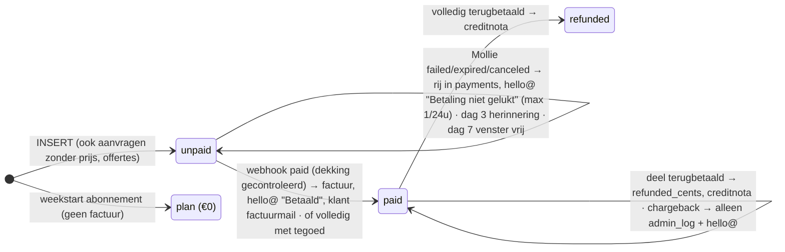
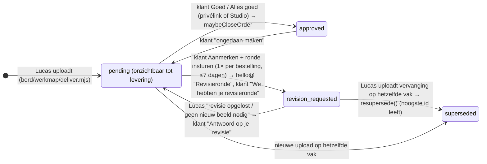

# VISUAILS — volledig overzicht, stand 6 oktober 2026

Dit document beschrijft VISUAILS van top tot teen zoals het **nu** is: het bedrijf, elke dienst, de prijzen, het abonnement, de website, de bestelstroom, VISUAILS Studio (klantportaal), de privélink, het adminportaal, de mails, de automatisering, de techniek en de regels. Daarna: wat er in ronde 9 (1–6 oktober) is gedaan en wat nog moet. Het is geschreven zodat een andere chat er zonder voorkennis mee kan werken.

Bron: de code in `visuails-astro` (commit van 3 okt, plus de werkkopie van 3–6 okt), `kladblok/WERKLIJST-RONDE-9.md`, `CONCEPT-RONDE-9.md`, `ONTWERPKEURING-3-OKT.md`, en vier antwoorden van Lucas op 6 oktober (video, complete, leverweg, wat bestaat). Alle bedragen zijn excl. btw tenzij anders vermeld. Waar iets in de code anders staat dan Lucas het bedoelt, staat dat in §17.

**Leeswijzer.** §1–§14: hoe VISUAILS werkt. §15–§16: gedaan en te doen. §17: waar code en bedoeling uiteenlopen. §18: begrippen. §19: drie bestellingen van begin tot eind met echte bedragen. §20: statusdiagram. §21: wat er bewust níet is. §22: alle bedragen met bron. §23: beslissingenlog (wat Lucas onderweg heeft omgegooid). §24: de looks per moment. §25: Lucas' werkdag. §26: toon en taal. §27: het waarom achter de regels (deels aannames, gemarkeerd). **§28: het abonnement zonder weeksysteem — besluit van 6 okt (avond) en mijn voorstel; dit vervangt §4.3 en §19.3 zodra het gebouwd is.** Snel antwoord op "mag ik dit bouwen?": eerst §21, §23 en §28 lezen.

**Vaste werkafspraken voor wie met deze code werkt** (gelden altijd):
- Lees eerst de huidige stand van Lucas' map (`E:\Claude (VISUAILS)\visuails-astro`); ga nooit uit van een eigen kopie. Lucas commit en pusht zelf; Claude nooit.
- Prijzen alleen uit `src/data/pricing.js` en `src/data/plans.js`, nooit overgetypt.
- Nooit zijn echte adres in testdata (gebruik Teststraat 1, 1234 AB Teststad, KVK 12345678). Testklanten: `hello+<type>@visuails.com`. Testaanbevelingen gemarkeerd "TEST — niet plaatsen".
- Credentials (Mollie live key, adminwachtwoord, 2FA) vult Lucas zelf in. Mollie blijft in testmodus. Nooit kaartnummers invoeren.
- Nederlands, beknopt, eigen mening plus een alternatief. Levertijd altijd "vaak binnen een dag, soms een paar dagen", nooit een belofte. Wie de beelden nakijkt heet "onze beeldredactie". Niets onder 11,5 px. Geen logo's ontwerpen. Geen "carrousel" met één r. Geen beeldspraak ("magie").

---

## 1 · Wat VISUAILS is

**Bedrijf.** VISUAILS (visuails.com) is een eenmanszaak van Lucas in Enschede, KVK 99742993, btw NL005407575B96, e-mail hello@visuails.com, bestelmails vanaf orders@visuails.com. WhatsApp Business +31 6 25436130. Er is geen personeel; "de studio", "wij" en "onze beeldredactie" zijn Lucas.

**Wat het doet.** Een done-for-you dienst voor kleding- en e-commercemerken: de klant stuurt telefoonfoto's van zijn product, VISUAILS maakt daar met AI (Nano Banana / Gemini via Magnific/Freepik, nabewerking in Photoshop en DaVinci Resolve) productbeelden van — catalogfoto's, lifestylebeelden en (op aanvraag) video — en levert die nagekeken terug. De klant hoeft geen shoot te boeken en geen AI-tool te leren.

**Positionering.** "Al je productbeelden. Zonder shoot." Verkoopargumenten: prijs per product die daalt met het aantal, snel ("vaak binnen een dag"), elke visual door een mens nagekeken, EU-bedrijf, vaste looks zodat alles bij elkaar past. Doelgroep: jonge merken met een jong publiek (vandaar het jonge modellenroster), webshops met veel producten, bureaus die voor klanten bestellen. Consumenten zijn uitgesloten: KVK voor NL, VIES-gecontroleerd btw-nummer voor de EU, vrij registratienummer daarbuiten.

**Welke AI-modellen.** Wordt bewust niet gepubliceerd; de verwerkersovereenkomst noemt de ontvangende partij (Magnific AI, S.L.U., Spanje) en niet het gereedschap.

**Productie.** Eén product kost Lucas 10–20 minuten van generatie tot afgewerkt beeld. Capaciteit is in de code vastgelegd als punten per dag (§3.6).

**Stem en regels voor tekst.** Serieus, direct, geen beeldspraak, geen "magie", niets dat zegt dat een merk "groter lijkt". De naam Lucas alleen op /about. Nederlands met "carrousel". Engels is de hoofdtaal van de code en de site (`/`), Nederlands onder `/nl`.

---

## 2 · De diensten

Elke dienst in één alinea: wat het is, wat de klant levert, wat hij krijgt, wat het kost, hoe snel. Looks (stijlen) staan in §2.7.

### 2.1 Catalog — "catalogset"
- **Wat:** productfoto's op een rustige achtergrond voor de productpagina of een marktplaats. Per product **vanaf 4 beelden**: voorkant, achterkant, detail en één op model. Vaste pose, vast licht, één beeldverhouding per bestelling (1:1 standaard, 4:5 of 3:4). 2048 px lange zijde; 4K bestaat bij catalog niet (alleen op aanvraag via WhatsApp).
- **Klant levert:** per product een voorkant, achterkant en close-up (verplicht), een draagfoto (optioneel), met zijn telefoon. Plus: productsoort (broek, top, jas, schoenen …), eventueel materiaal/kleur, achtergrondkleur (wit #FFFFFF standaard, gebroken wit #F7F5F1, beige #EDE4D8 of eigen hex; licht aanbevolen), het gezicht (één van tien modellen of "wij kiezen"), verkoopkanalen (Amazon/bol/Zalando zetten de achtergrond vast op wit).
- **Extra's:** extra hoeken per product (driekwart, van achteren, detail op model, flat-lay, binnenkant, los detail, of een eigen hoek met omschrijving) à €39/€34/€29/€19 per foto volgens dezelfde staffel; outfit-toeslag €50 per product (max 3 producten) — in de code aanwezig, niet bij catalog getoond.
- **Prijs per product:** €89 (1–4) · €65 (5–9) · €51 (10–19) · €39 (20+). Op de site: "Vanaf €39".
- **Levering:** onder 10 producten "zo snel mogelijk (vaak binnen een dag, soms een paar dagen)", vanaf 10 een vaste leverdatum uit de agenda (§3.6).

### 2.2 Lifestyle — "lifestylecarrousel"
- **Wat:** per product **3 beelden in één look**: de scène, op model, en een detail/close-up — als carrousel voor social of advertenties. Vier vaste looks (Dunes, Flash, Glow, Phone-made) of een eigen look (§2.6). Verhouding 1:1/4:5/3:4/16:9/9:16, per beeld te kiezen. 4K (4096 px) voor €9 per product.
- **Klant levert:** dezelfde foto's als bij catalog; kiest look, gezicht, verhouding.
- **Prijs per product:** €109 · €82 · €64 · €49. Op de site: "Vanaf €49".
- **Levering:** als catalog.

### 2.3 Complete (catalog + lifestyle) — **niet meer verkocht**
- Bestaat nog in de code als dienst `complete`/`drop` (7 beelden, €149 · €109 · €85 · €65, ±25% goedkoper dan los) en op `/start/complete` (noindex). Lucas op 6 okt: **niet meer verkopen.** Hoort opgeruimd te worden (§17).

### 2.4 Video — **op aanvraag, totdat de videostijlen af zijn**
- Vier richtingen op de site: Motion (8 seconden, product in beweging, loop, 9:16), Lifestyle Video (de scène in beweging), Campaign (meerdere shots, één grade), eigen concept. Vaste shotopbouw van Lucas (9 sep): model in witte studio met trage zoom → close-up materiaal met orbit → logo/design → gezicht van het gekozen model, met beweging in elk shot.
- **Hoe het werkt:** `/start/video` is een aanvraagformulier (naam, merk, e-mail, telefoon, stijl, aantal clips 1–12 of "weet ik nog niet", toelichting). Geen betaling. Lucas antwoordt schriftelijk met een prijs; in /admin zet hij een offerte (volledig of aanbetaling) en de klant krijgt een betaallink. Lucas op 6 okt: **alles op aanvraag, tijdelijk** — video blijft op aanvraag totdat Lucas de videostijlen heeft gemaakt; daarna beslist hij **per stijl een prijs** en gaat video (net als catalog en lifestyle) met vaste prijzen het bestelformulier in. De €69 (motion) en €149 (lifestyle video) in de code zijn interne richtprijzen uit een eerdere fase en horen tot die tijd niet op de site (§17). De code is erop voorbereid: `VIDEO_OP_AANVRAAG` in pricing.js op `false` en per stijl een prijs in `videoStyles.js` is wat er dan moet gebeuren.
- Video telt in de agenda als "unattended" (nooit een vaste datum).

### 2.5 Hooks — op aanvraag
- Korte verticale clip (6–8 s) die doorloopt in de post eronder ("canvas break"). Vanaf €119 per product, variant €49. Alleen via contact; staat in het menu als "op aanvraag". Lucas: bestaat.

### 2.6 Eigen look (custom look) — op aanvraag
- De klant wil een eigen wereld (catalog- of lifestyle-look) exclusief voor zijn merk. Twee ingangen: hij geeft het concept, of VISUAILS bedenkt het (meer denkwerk, meer kosten). Stappen: intake via `/start/custom-look` (aanvraag, geen betaling) → haalbaarheidscheck → offerte met aanbetaling → ontwerp in overleg met één correctieronde → de look wordt in het account van de klant gezet (`customer_styles`, status proposed → active) en is daarna in het bestelformulier kiesbaar als `cs-<id>`, tegen het gewone tarief plus een eventuele toeslag per product. Niet haalbaar → terugbetaling. De factuur noemt de look als tweede regel.

### 2.7 Merkmodel (brand model) — €450 eenmalig
- Een eigen AI-gezicht, exclusief voor het merk, "één gezicht per bedrag". `/start/brand-model`: briefing in twee routes ("ik weet wie" met acht vragen, of "bedenk het voor mij" met vier), daarna direct naar Mollie (€450 + 21% = €544,50; met geldig EU-btw-nummer of buiten de EU €450). Lucas maakt richtingen, één correctieronde, zet het model op de klantpagina in /admin ("in ontwerp" → "klaar"/locked); bij locked gaat de bestelling op geleverd en krijgt de klant "Je merkmodel staat klaar". Daarna kiesbaar als gezicht bij elke bestelling en in de vaste look. Inbegrepen bij het Merk-abonnement, en bij Pro op jaar/vooruit.

### 2.8 Probeer VISUAILS · €1 (test sample)
- Eén product, volledige set (4 catalog- of 3 lifestylebeelden), €1 + 21% btw, **één per bedrijf** (gecontroleerd op e-mail, telefoon, KVK en betaler-hash; een tweede wordt automatisch geannuleerd en teruggestort). Geen revisieronde, geen vaste datum. Doel: risico weg bij de eerste bestelling. Plus-adressen van hello@ tellen als hello@.

### 2.9 Abonnement — zie §4.

### 2.10 Gedeelde maandset en Editions
- **Gedeelde maandset:** 20 merkneutrale beelden per maand voor elke abonnee (geen product erin), te downloaden in Studio (tab Overzicht van het abonnement), geüpload door Lucas in `/admin/maandset`. Lucas: bestaat.
- **Editions:** 20 beelden per maand óp het eigen merk, €149/maand + €295 opzet. Staat als "binnenkort" op de site en in het menu. Lucas: komt eraan.
- **Maandelijks meedenken** (€450/maand, alleen Merk, max 4): staat in `plans.js` als ADVISORY — Lucas: **bestaat niet**; niet tonen.

### 2.11 De looks (stijlen)

| Dienst | Look | Eén zin |
|---|---|---|
| Catalog | Classic | Strak, consistent, zonder concessies — vast licht, vaste hoek, klant kiest de achtergrondkleur |
| Catalog | Eigen look | Een cataloglook die onmiskenbaar van het merk is, eenmalig ontworpen |
| Lifestyle | Dunes | Zon, zand en ingetogen luxe; aardse tinten, lange schaduwen |
| Lifestyle | Flash | Directe flits, harde schaduwen; nightlife/editorial |
| Lifestyle | Glow | Golden hour op afroep; warm laag zonlicht |
| Lifestyle | Phone-made | Ziet eruit alsof het zo gemaakt is — UGC-look, één lichtbron |
| Lifestyle | Eigen look | Je eigen wereld, gebouwd rond je product |
| Video | Motion / Lifestyle Video / Campaign / eigen concept | allemaal op aanvraag |

"In de maak" (teaser op de site, `komendeStijlen.js`): catalog "Still" (model staat stil, geen pose), lifestyle "Studio" en "Nacht", video "Draaitafel", "Kleurwissel", "Detail". Galerijfilter "Beam" is geen bestelbare look (stap 9, B7).

**Modellen.** Tien vaste gezichten, gratis in elke bestelling: Aaron, Ava, Elias, Ryan, Dana, Lisa, Maegan, Rae, Fabi, Seme. "Wij kiezen" is ook een keuze. Een merkmodel komt daar als tegel bij.

**Producttypen** (bepalen de uitsnede en de styling eromheen): broek/jeans, short, rok, top/shirt/trui, jas/mantel, jurk, schoenen, sokken, riem, tas, hoofddeksel, sieraad, sjaal, ondergoed, anders. Standaardstyling eromheen: effen sneaker, effen T-shirt, effen rechte broek, in een andere toon dan het product; de klant mag eigen stukken meesturen (gratis).

---

## 3 · Prijzen, btw en levering (de regels)

### 3.1 De staffel (ladder)
Eén tarief per product, bepaald door het aantal producten in de bestelling; het tarief geldt voor élk product.

| Trede | Catalog | Lifestyle | Extra foto |
|---|---|---|---|
| 1–4 | €89 | €109 | €39 |
| 5–9 | €65 | €82 | €34 |
| 10–19 | €51 | €64 | €29 |
| 20+ | €39 | €49 | €19 |

Het bestelformulier gaat tot **20 producten**; daarboven eerst contact (WhatsApp/mail). De absolute grens per venster is 52 producten (capaciteit). Op de site staan alleen "vanaf"-prijzen (de laagste trede), nooit een bereik — regel van Lucas, 9 aug.

### 3.2 Toeslagen
- 4K (4096 px): €9 per product, alleen lifestyle.
- Extra hoeken: per foto per product, staffel hierboven, max 4 per product.
- Outfit: €50 per product, max 3 (in de code; niet prominent op de site).
- Eigen look: toeslag per product zoals in de offerte vastgelegd (0–€500).
- **Voorrang:** 20% van het orderbedrag, minimaal €49, maximaal €249; alleen bij catalog/lifestyle tot 20 producten en een bestaande look. Belofte: betaald op een werkdag vóór 15:00 → geleverd de volgende werkdag vóór 17:00 (NL-tijd, feestdagen uitgezonderd); later betaald → een werkdag later. Niet gehaald → toeslag terug.

### 3.3 Btw
- Alle prijzen op de site excl. btw ("de btw verschilt per land").
- Nederland of geen land: 21%. EU-bedrijf met VIES-geldig btw-nummer: 0% (verlegd, art. 196; telt voor de ICP-opgaaf). EU zonder bevestiging: 21%. Buiten de EU: 0% ("niet belastbaar in Nederland").
- Stap 5 en de mail noemen het bedrag incl. btw ("Je betaalt bij Mollie €107,69 incl. 21% btw"); voor 0%-gevallen "geen Nederlandse btw".
- Een EU-klant met een nummer dat VIES niet bevestigt, of die het 0%-vinkje niet zet, komt op de **btw-lijst** in /admin: Lucas keurt goed (0% blijft), rekent alsnog btw, of wijst af (mail "Een vraag over je btw-gegevens"). Daarna krijgt de klant een betaallink; die bestelling vervalt 7 dagen na goedkeuring als er niet betaald wordt.

### 3.4 Betalen
- Via Mollie (nu in **testmodus**; de live key zet Lucas zelf). iDEAL, Bancontact, creditcard, PayPal e.a.; iDEAL uitgesloten bij 0%-btw om een NL-betaler op een 0%-factuur te vermijden.
- Na "Bestellen en betalen" gaat de klant direct naar Mollie; daarnaast staat een betaallink in de bevestigingsmail (`/api/order-pay?ref=`, elke klik een verse betaling). Niet betaald: herinnering na 3 dagen, vervallen na 14 dagen (of 7 na btw-goedkeuring) met een mail. Een gereserveerd venster vervalt na 7 dagen onbetaald.
- Tegoed (euro's op het account, gezet door Lucas) wordt bij ingelogd bestellen automatisch van het bedrag incl. btw afgetrokken; dekt het alles, dan is er geen Mollie-stap.
- Factuur direct na betaling (pdf in de mail, bcc hello@), nummerreeks `VIS-2026-0001` (en `PROEF-2026-0001` zolang Mollie in testmodus staat), één doorlopende reeks voor facturen, abonnementsfacturen en creditnota's.

### 3.5 Revisie en nazorg
- **Eén revisieronde per bestelling**, aan te vragen binnen 7 dagen na levering, voor kleur/print/pasvorm t.o.v. de eigen foto's; een andere look is een nieuwe bestelling. Beleid in vier treden: de ronde zit erbij; onze fout lossen we altijd kosteloos op; andere wensen tegen vooraf afgesproken kosten; niet na te maken → (gedeeltelijke) terugbetaling. Lucas kan revisierechten per klant intrekken bij misbruik.
- Bij de €1-proef geen revisie.
- Klant hoeft niet alle beelden te gebruiken; kan ze later alsnog inzetten.

### 3.6 Levertijd en capaciteit
- **Onder 10 producten (unattended):** "Zo snel mogelijk (vaak binnen een dag, soms een paar dagen)", geen vaste datum; levering in Studio + privélink.
- **Vanaf 10 producten (attended):** stap 4 van het formulier toont vrije "vensters" van twee dagen uit de agenda; het gekozen venster staat 7 dagen vast tot de betaling binnen is; de datum schuift daarna nooit op. Eerste kiesbare dag: vandaag + 3 volle dagen (`LEAD_DAYS`, sinds 20 sep); horizon 60 dagen; de twee dagen van een venster liggen hoogstens 7 kalenderdagen uit elkaar.
- **Capaciteit** (`src/data/capacity.js`): 100 punten per dag, 7 punten per product (catalog 4, lifestyle 3, complete 7, motion 4, lifestyle-video 10); 79 punten per dag voor vaste datums (3 producten = 21 punten blijven voor "zo snel mogelijk"); per venster van 2 dagen 158 punten = 22 complete-producten (catalog 39, lifestyle 52; `MAX_PRODUCTS_ANY_SERVICE` 52); weekend telt mee, alleen dichtgezette dagen (`blackout_days`) niet.
- **Bewaartermijn:** geleverde beelden 90 dagen in Studio, daarna verwijderd (de klant slaat zelf op; aangeleverde foto's 90 dagen na afronden). Oude bestanden eventueel nog lokaal bij Lucas, zonder garantie.

### 3.7 Rechten en AI-act
- De klant krijgt volledige commerciële gebruiksrechten op de beelden. Beelden dragen de IPTC-herkomsttag "composite with trained algorithmic media" **als ze via `npm run deliver` zijn geleverd**; via de /admin-upload (nu de hoofdweg) ontbreekt die tag (F30, open). /ai-act legt de klant uit wat art. 50 bij publicatie vraagt.

---

## 4 · Het abonnement

### 4.1 Plannen

| Plan (id) | Per maand | Credits | ≈ producten | Merkmodel inbegrepen |
|---|---|---|---|---|
| Starter (`starter`) | €390 | 45 | 5 | nee |
| Pro (`studio`) | €790 | 120 | 12 (+2 clips) | bij 12 maanden of vooruit |
| Merk (`brand`) | €1.690 | 290 | 30 | ja |
| Op maat (`maat`) | vanaf ±€272 | 30–300 in stappen van 5 | — | nee |

Credits per dienst: catalogset 4, lifestylecarrousel 5, motion-clip 5, lifestyle-clip 12, hook 10; extra foto 2, 4K 1. Niet in een plan: Editions, eigen look ontwerpen, campagnevideo, voorrang, merkmodel (behalve inbegrepen). Op maat: lineair tussen de drie plannen, elke credit minstens 5% goedkoper dan los.

### 4.2 Termijnen
- **Maandelijks:** elke maand opzegbaar; ongebruikte credits schuiven 1 maand door.
- **12 maanden:** zelfde maandbedrag, vaste looptijd, maandelijks geïncasseerd; credits schuiven 3 maanden door; prijsgarantie; Pro krijgt het merkmodel.
- **12 maanden vooruit:** betaal 10, krijg 12 (Starter €3.900, Pro €7.900, Merk €16.900 in één keer); zelfde perks. Opzeggen = het jaar loopt gewoon door (geen tegoed), laatste maand krijgt een mail.
- De eerste maand is meteen de SEPA-machtigingsbetaling via Mollie; daarna incasso via een Mollie-subscription. Mislukte incasso → abonnement op pauze + mails.

### 4.3 Hoe een maand werkt — **zo staat het nu in de code; vervalt per besluit van 6 okt (avond), zie §28**
1. Bij betaling van de termijn komen de credits binnen (`subscription_slots`, soort `credits`).
2. De klant zet producten op zijn **lijst** (naam, soort, dienst, notitie, gezicht, foto's) en **zet ze vast**; vastzetten schrijft de credits af, losmaken geeft ze terug (zolang de week niet gestart is).
3. Elke abonnee heeft een **vaste week**: de dag van de maand (1–28) waarop zijn producten worden gemaakt; te verzetten in Studio. Een product kan ook op een eigen dag (vanaf 3 dagen vooruit) of "zo snel mogelijk".
4. Lucas **start de week** op de klantpagina in /admin: alle vastgezette producten worden één bestelling (`payment_status = plan`, €0), met de vaste look en de foto's erbij (F65, hersteld 3 okt). De bestelling loopt daarna als elke andere (productie → levering → goedkeuren).
5. Vijf dagen vóór de week krijgt de klant een mail als de lijst leeg is; 7 en 2 dagen voor credits vervallen een herinnering. Bij de weekstart zelf krijgt de klant **nog geen mail** (concept C2).
6. Pauzeren/hervatten/opzeggen doet de klant zelf in Studio (typt OPZEGGEN); Lucas kan credits bijstellen en de week starten.
7. De **vaste look** (gezicht, achtergrond, look, verhouding, kanalen per dienst) moet compleet zijn voordat een product vastgezet kan worden; zonder vaste look blijft het een concept.

### 4.4 Wat er nog niet is (uit de ontwerpkeuring)
Geen plan wijzigen, geen extra credits kopen, geen betaalmethode wijzigen, geen weekstart-mail, geen "je week loopt"-stand, geen credit-ledger. Voorstel "Jouw maand" staat in `ONTWERPKEURING-3-OKT.md` §1.3 met schets `kladblok/ronde-9/schets-jouw-maand.html`.

---

## 5 · De website (visuails.com)

**Techniek in één zin:** Astro-site op één Cloudflare Worker (`visuails-site`), Engels op `/`, Nederlands op `/nl/…`, 90 URL's in de sitemap (45 per taal). Statische pagina's; alleen `/api`, `/account`, `/admin` en `/o` draaien op de server.

**Menu (NL):** Wat we maken (Catalog, Lifestyle, Video, Jouw merkmodel, Abonnement) · Hoe het werkt (Van bestelling tot levering, De planning en de capaciteit, VISUAILS Studio, De modellen, Je foto's aanleveren) · Prijzen · Galerij · Contact · Inloggen · EN|NL · Bestellen. Voet: ook Hooks (op aanvraag), Editions (binnenkort), Probeer VISUAILS · €1, Studiobrief-aanmelding, juridische links. Let op: de URL `/studio` is de planningspagina en `/portal` is de pagina over VISUAILS Studio (historisch).

| Pagina | Wat erop staat |
|---|---|
| `/` | Hero "Al je productbeelden. Zonder shoot." (laptop/telefoon-mockup), "Dit stuur jij, dit krijg je terug" (3 stappen), "Wat we maken" (3 kaarten), "Kies een look", "Een gezicht zit erbij", Editions-teaser, "Voor wie", FAQ-preview, "Eerst zien? Een product voor €1", voet |
| `/catalog`, `/lifestyle`, `/video` | Dienstpagina's: hero met 4 feiten (prijs vanaf, aantal foto's, levertijd, nagekeken), voorbeeld telefoonfoto → resultaat, looks met "Kies deze look", "In de maak", eigen look, prijsblok, FAQ, slotband. `/catalog/classic`, `/lifestyle/<look>`, `/video/<stijl>`: detailpagina per look |
| `/custom-models` | Merkmodel: wat, €450, briefing-knop |
| `/plans` | Abonnement: hero met "wat een credit oplevert", drie plannen + op maat, "stel je eigen samen" (schuif), waarom, termijnen, wat eraan komt, €1-slotband |
| `/pricing` | Staffeltabel catalog/lifestyle, "wat dat wordt" (voorbeelden), "wat er verder een tarief heeft" (merkmodel, video, toeslagen), abonnementsband, €1-band |
| `/per-product` | De vier foto's per product en de extra hoeken |
| `/compare` | Shootdag vs. VISUAILS, self-serve tool vs. VISUAILS |
| `/how-it-works` | Van bestelling tot levering (bestellen, wij maken, jij keurt goed), details |
| `/studio` | De planning en capaciteit (de agenda achter een leverdatum) |
| `/portal` | Wat VISUAILS Studio is (status, galerij, goedkeuren, revisie, downloads) |
| `/models` | De tien gezichten + merkmodelband |
| `/upload-guidelines` | Zo maak je de foto's die wij nodig hebben (wel/niet, 4 shots) + fotogids-pdf |
| `/gallery` | Beeldbibliotheek met filters per look |
| `/guides` | Praktische gidsen |
| `/faq` | 62 vragen in 10 groepen |
| `/start` | Keuzescherm: alle deuren (catalog, lifestyle, video, eigen look, merkmodel, abonnement, €1-proef, WhatsApp) |
| `/start/catalog`, `/start/lifestyle` | Het bestelformulier (§6); `/start/plan` abonnement; `/start/video`, `/start/custom-look` aanvraag; `/start/brand-model` briefing; `/test-sample` de €1-proef |
| `/about`, `/contact` | Studio in Enschede; WhatsApp + mail + contactformulier |
| `/terms`, `/privacy`, `/data-processing-agreement`, `/ai-act`, `/cookie-policy` | Juridisch (§14) |
| `/thank-you` | Bedankpagina na bestellen/aanvragen (§6.4) |

**Inhoud die nog ontbreekt (plaatshouders, O65):** home "Kies een look" en "Een gezicht zit erbij", lifestyle-looks Dunes/Flash/Glow, "Het assortiment in beweging", Editions-beeld, kop van /hooks en /guides, portret op /about. Lucas maakt die foto's zelf; tot dan toont de build een grijze plaatshouder.

**Ontwerpsysteem ("Mercury Hard", 20 sep; herontwerp Studio/privélink/admin 3 okt):** koele lichte grond #F2F3F5, inkt zwart, accent violet #4A1FFF (donker: #A694FF), violet alleen voor actie; statuspad leeg → getint → massief violet, revisie warm zand, geannuleerd grijs. Lettertypen: Anybody (koppen, 125% breed, kapitalen), Figtree (tekst), Martian Mono (labels). Ronde hoeken 999/12/10 px; Studio-kaarten 10 px. Donkere modus alleen in Studio, privélink en admin (grond #0C0D10, zijbalk #000). `KLEURENSCHEMA.md` is de enige bron van kleuren; `DESIGN.md` de rest van het systeem.

**Analytics:** Cloudflare Web Analytics (cookieloos), alleen met toestemming in de cookiebalk; eigen trechterteller per stap (`funnel_hits`, anoniem) te zien op /admin/funnel.

**Reviews:** Google Business Profile en Trustpilot bestaan; knoppen in Studio en privélink na een afgeronde bestelling; geen TrustBox-script (site blijft zonder externe scripts). Aanbevelingen (testimonials) worden in /admin goedgekeurd maar nergens automatisch geplaatst (O15).

---

## 6 · De bestelstroom (klant)

### 6.1 Regel: eerst een look, dan het formulier
Een bestelknop gaat nooit rechtstreeks naar het formulier. "Bestellen" → `/catalog#looks` of `/lifestyle#looks` → "Kies deze look" → `/start/lifestyle/?style=dunes` met die look voorgevinkt. `/start` blijft voor wie nog niets gekozen heeft.

### 6.2 De vijf stappen (`/start/catalog`, `/start/lifestyle`)
Rail: Bestelling · Materiaal · Jouw gegevens · Levertijd · Betalen. Werkt ook zonder JavaScript (alles onder elkaar). Ingelogde klanten krijgen hun gegevens en vaste look voorgevuld; bovenaan "Al eerder bij ons besteld? Log in".

1. **Hoeveel, en waarvoor** — look (bovenaan), aantal (1–20, snelknoppen; "meer dan 20?" → contact), lopend totaal excl. btw met de volgende trede, verkoopkanalen en achtergrond (catalog), "Meer opties": extra hoeken (catalog), beeldverhouding, voorrang. Leverregel.
2. **Stuur de productfoto's** — gezicht (verplicht), per product een kaart met vakken voorkant/achterkant/detail (verplicht) + gedragen (optioneel) + een vak per gekozen hoek + max 4 referentiefoto's; productnaam, productsoort, materiaal/kleurvragen, 4K-vinkje en verhouding per beeld (lifestyle). **Map-upload** of slepen: bestandsnaam en mapnaam bepalen product en vak (woorden als voor/achter/detail/gedragen, p1/p2, mapnaam = product); wat niet past komt in "Nog niet geplaatst". Elke foto gaat meteen via `/api/upload` naar R2 (batch). Ontbreekt iets: tussenscherm "N producten zijn nog niet af", doorgaan mag.
3. **Naar wie sturen we de factuur en de beelden** — naam, merk, e-mail, telefoon (verplicht, "we appen als iets onduidelijk is"), adres, land. NL: KVK verplicht, btw optioneel. EU: btw-nummer verplicht (of vinkje "geen btw-nummer" + registratienummer) en bij 0% het verklaringsvinkje. Buiten EU: vrij. "Bewaar mijn gegevens" (wordt een account).
4. **Levertijd** — alleen vanaf 10 producten: zes dagparen uit de agenda, eerder/later bladeren. Onder 10: overgeslagen ("zo snel mogelijk").
5. **Controleer en betaal** — strook met de eigen foto's, samenvatting, bedrag "Je betaalt bij Mollie €… incl. 21% btw" (of 0%-regel), tegoedregel, verplicht vinkje "ik bestel zakelijk" (+ voorwaarden/privacy), knop "Bestellen en betalen" → direct Mollie. Dubbelklik geeft één bestelling. Terug vanaf Mollie: banner "Deze bestelling staat al klaar" met betaalknop.

De €1-proef: 4 stappen (geen levertijd), eerst "catalogset of lifestylecarrousel", 1 product.

### 6.3 Wat de server doet (`functions/api/order.js`)
Rate limit 10/10 min · honeypot · validatie (e-mail, telefoon, btw-vorm) · klant upsert · uploads uit de batch → `files` · tier bepalen (≥10 = attended) · venster opnieuw toetsen (`409 window-gone` → terug naar stap 4) · VIES-check en btw-besluit · offerte berekenen (`quote.js`) · tegoed · `orders`-rij + `order_events` + `admin_log` · portaaltoken · **studiomail** "Nieuwe bestelling · Catalog — VIS-…" met de foto's als bijlage (max 8 MB) · venster 7 dagen vasthouden · Mollie-betaling · **klantmail** "We hebben je bestelling — VIS-…" (met betaallink en privélink) · redirect naar Mollie of `/thank-you`.
Referentie: `VIS-XXXX-XXX` (base36). Aanvragen (video, eigen look) krijgen geen bedrag en geen betaling; contactformulier en Studiobrief gaan door hetzelfde endpoint.

### 6.4 Bedankpagina `/thank-you`
Koppen per uitkomst: "Betaald — we gaan aan de slag." (na 4 polls op `/api/order-status`), "Nog één stap: betalen." (open, knop), "Bedankt — je bestelling staat erin." (btw-controle), "Bedankt — we hebben je aanvraag." (video/eigen look: "voorstel en prijs, meestal binnen een werkdag"), merkmodel-variant, "Deze moesten we annuleren" (tweede proef), "De betaling is niet afgerond." (opnieuw). Rechts: kenmerk, mailadres, levertijd, WhatsApp. Onderaan de herkomstvraag (Instagram/Google/iemand vertelde het/ergens anders — alleen analytics) en vanaf 12 producten een abonnementsregel.

---

## 7 · Betaling, facturen, tegoed — hoe het achter de schermen loopt

- **Mollie-webhook** (`/api/webhook/mollie`): haalt de betaling op bij Mollie. `paid` → bestelling betaald, venster definitief, tegoed afgeboekt, studiomail "Betaald · VIS-… · €…", factuur maken en mailen ("Betaling ontvangen — VIS-…" met pdf). `failed/expired/canceled` → studiomail "Betaling niet gelukt", bestelling blijft open. Dubbele betaling of betaling op een geannuleerde bestelling → automatisch terugstorten + mails. Chargeback → log + studiomail, niets automatisch teruggedraaid. Refund bevestigd → creditnota + "Je creditnota — VIS-…". Abonnementsbetalingen: termijn geboekt, credits toegekend, "Welkom bij VISUAILS — je abonnement loopt" (eerste) of "Je credits voor <maand> staan klaar".
- **Factuur** (`invoice.js`, pdf-lib): nummer, datum, beide partijen, btw- en KVK-nummer van VISUAILS, regels (dienst — N producten; look als tweede regel), netto/btw/totaal, de verplichte verleggingszin; opgeslagen in R2 `invoices/<jaar>/<nummer>.pdf`; later byte-identiek te herbouwen uit `snapshot_json`. In Studio onder Facturen; in /admin/facturen per kwartaal met btw-aangifte-CSV (1a, 3b/ICP, buiten EU).
- **Creditnota's** uit dezelfde reeks, btw proportioneel.
- **Tegoed** (`customer_credits`): Lucas boekt bij/af op de klantpagina (max €1.000 per boeking, reden verplicht); verrekend bij ingelogd bestellen; bij annulering met "tegoed" komt het geld als tegoed terug.
- **Annuleren** doet alleen Lucas (reden verplicht; bij betaald: terugbetalen / tegoed / niets). De cron annuleert onbetaalde bestellingen na 14 dagen (of 7 na btw-goedkeuring).

---

## 8 · VISUAILS Studio — het klantportaal (`/account`)

**Wat het is.** Het ingelogde scherm van de klant, Astro-pagina's op `StudioLayout` zonder JavaScript (alles met links, formulieren en `<details>`), licht of donker, NL/EN. Zijbalk (donker): Overzicht · Bestellingen · Je vaste look · Je gegevens · Facturen · Abonnement; onderaan merk + e-mail + Uitloggen. Bovenbalk: inklapknop, kruimelpad, NL|EN, thema. Bovenaan elke pagina kan een **studiomelding** staan (Mededeling/Drukte/Storing, gezet in /admin).

**Inloggen.** Geen wachtwoord: e-mailadres → mail "Je inlogcode voor VISUAILS" met een 6-cijferige code (10 min, 5 pogingen) en een link (60 min). Sessie 30 dagen (max 180). Na een abonnement een welkomstlink van 48 uur. Het antwoord is altijd "kijk in je mail", ook bij een onbekend adres.

| Pagina | Wat de klant ziet en kan |
|---|---|
| **Overzicht** | "Welkom (terug), <voornaam>", chip "N bestellingen lopen", knop Nieuwe bestelling / Product toevoegen (abonnee). Vier tegels: Te betalen · Te beoordelen · Bij ons in de maak · Geleverd (+ Tegoed als >0). "Je laatste bestelling" als kaart met tijdlijn. "Laatst geleverd" (12 beelden). "Recente activiteit". |
| **Bestellingen** | Per bestelling een uitklapkaart: kenmerk, dienst, aantal, datum, statuspil; leverregel; betaalblok (excl/btw/totaal, "Nu betalen" als open); tijdlijn Ontvangen → In productie → Nagekeken door onze beeldredactie → Geleverd met een "Nu:"-zin; "Je foto's" (nasturen, max 12); "Jouw bestanden" (zip); "Keur alle N resterende beelden goed"; per product: wat wij leverden / wat jij stuurde, per beeld Goedkeuren / Ongedaan maken / aanmerken voor revisie + notitie; revisieronde-formulier → nakijkpagina → versturen; na afronden het tevredenheidsblok (score 1–5, toelichting, aanbeveling met toestemming, knoppen Google/Trustpilot); WhatsApp/mail-link. Filters per status. |
| **Je vaste look** | Eigen modellen (merkmodel), eigen looks, en per dienst (catalog/lifestyle/video) de standaard: gezicht, achtergrond (catalog), look (lifestyle), verhouding, kanalen. "Opgeslagen — je volgende bestelling begint hiermee." |
| **Je gegevens** | Naam, merk, website, telefoon, adres, land, btw-nummer (of "geen"), KVK; e-mailadres wijzigen met bevestiging naar het nieuwe adres en een terugzetlink (14 dagen) naar het oude. Geen "account verwijderen" (alleen via Lucas). |
| **Facturen** | Facturen, abonnementsfacturen en creditnota's met pdf-download; vlaggen "Btw verlegd", "Buiten de Europese btw". |
| **Abonnement** | Zonder abonnement: uitleg + knoppen. Met: tabs **Overzicht** (plan, volgende afschrijving incl. btw, credits-balk, nieuwe credits op, dienstkaarten "Op de lijst zetten", "Jouw week" + verzetten, vaste look-strook, gedeelde maandset, Editions-regel), **Planning** (maandraster, inplannen op een dag, naar voren halen), **Producten** (de lijst: toevoegen met foto's/soort/dienst/gezicht, vastzetten/losmaken, volgorde, verwijderen, "meteen vastzetten", wanneer?), **Facturering** (termijn, bedrag, status, pauzeren/hervatten, opzeggen met OPZEGGEN). |

**Studio stuurt deze mails:** inlogcode; e-mailwijziging (2); "We hebben je revisieronde" (klant) + "Revisieronde · VIS-… · n beelden" (studio); "Foto's binnen · VIS-… · n" (studio); "Lage score bij …" / "Klacht bij …" (studio); abonnement gepauzeerd/hervat/opgezegd (klant + studio); "Week verzet" / "Dag naar voren" (studio). Goedkeuren, vaste look, gegevens en lijst-acties sturen geen mail.

**Foutpagina's** (404, adreswijziging, "even rustig aan", revisie nakijken): sinds 3 okt dezelfde kaartvorm als het inlogscherm.

---

## 9 · De privélink (`/o/<token>`)

Elke bestelling heeft een link zonder inloggen (token 43 tekens, in de bevestigings- en levermail; "de sleutel tot je bestelling — deel hem alleen met wie mee moet kijken"). Geldig tot 90 dagen na afronden, max 365; Lucas kan een nieuwe link mailen. Pagina "Je bestanden": kenmerk, dienst, aantal, statuspil; tevredenheidscheck-regel; bestanden als tegels (4:5) met Goedgekeurd/Revisie/Nieuw, Goedkeuren / Ongedaan maken, revisieronde (vinkjes + verplichte notitie, zonder script dus browser-validatie), "Je revisieronde ligt bij ons / is verwerkt", tijdlijn (Ontvangen · Geleverd · Revisie · Bijgewerkt), downloads (zip per formaat dat er echt is), tevredenheid na afronden. Zelfde CSP zonder script; `media-src` voor video. Werkt ook voor video-aanvragen (toont de aanvraag). Rendered door `src/lib/portal.js` + `public/portal.css` (herontwerp 3 okt).

---

## 10 · Het adminportaal (`/admin`) — Lucas' werkscherm

**Inloggen:** e-mail + wachtwoord (PBKDF2, rij in `admin_users`) + tweestapscode (TOTP, 10 herstelcodes, in te stellen op /admin/security). Cookie 14 dagen. Lucas logt zelf in; Claude vraagt erom. Zijbalk: Dashboard · Planning · Klanten · Maandset · Aanbevelingen · Btw · Meer (Facturen, Trechter, Berichten, Logboek, Twee stappen, Diagnose, Melding in Studio) · Uitloggen · Licht/Donker. Eén JavaScript-bestand (`admin-voorvertoning.js`) voor het beoordeelbeeld bij uploaden; de rest zonder script.

| Pagina | Wat het doet |
|---|---|
| **Dashboard** | Acht tegels (vandaag binnen, in productie, wordt nagekeken, open werk, onbetaald, revisies, nog te melden, geleverd niet betaald). Open revisieverzoeken als kaarten (vervangend beeld uploaden, of "Geen nieuw beeld nodig" met reden → mail). Bestellingenlijst met zoeken, filters, statusfilter, "verberg proefbestellingen"; per rij uitklap met status + notitie, annuleren/verbergen/verwijderen. Zijkolom: Eerst af (deadlines), abonnementen klaar om te starten, wacht op betaling, bewakers (betaald-maar-geannuleerd, btw-controle, aanbevelingen, cron- en back-upleeftijd). |
| **Planning** | Twee weken raster met bezetting in punten per dag en chips per bestelling; oppakken en op een andere dag zetten; rechts "Aflopend" met filters (vastgelegd / zo snel mogelijk / voorrang), per item verlengen + WhatsApp/mail-knop met voorgeschreven tekst (niets gaat automatisch); dagen dichtzetten met reden. Verzetten stuurt geen mail. |
| **Klanten** | Lijst (merk, e-mail, bestellingen, betaald, laatste). Nieuwe klant. **Klantpagina:** bestellingen; gegevens corrigeren; nieuwe inloglink mailen; tegoed boeken; **abonnementsweek** (plan, credits, lijst, "Start deze week · N producten", credits bijstellen); revisierechten intrekken; vaste look (alleen lezen); eigen modellen/merkmodel (foto, status in ontwerp → klaar → locked, hernoemen/verbergen); eigen looks (naam, dienst, toeslag, beeld, proposed → active); bestelling namens de klant (WhatsApp-klant: dienst, aantal, look, foto's → gewone bestelstroom met betaallink); account deactiveren; AVG-wissen (merknaam overtypen). |
| **Bestelling** (`/admin/orders/<id>/files`) | Kop met pillen (status, betaling, uit abonnement, proef); status bijwerken + notitie die de klant leest; betaallink opnieuw; aanvraag/offerte (bedrag, volledig of aanbetaling → betaallink; restant); briefing merkmodel; "Wat de klant koos"; **Het werk erin zetten:** lege mappen (zip), map uploaden, losse upload; **Het bord:** per product de brief (type, uitsnede, gezicht, vragen, 4K, verhoudingen; aangeleverd; styling erbij), vakken voorkant/achterkant/detail/op een model (+extra hoeken; lifestyle: beeld 1–3) met upload/vervangen, revisienotitie; "Aangeleverd door de klant"; "Alle geleverde bestanden — indeling bijstellen"; Wanneer (verzetten/loslaten); **De klant op de hoogte brengen:** bekijken zoals de klant het ziet, "Op geleverd zetten en klant mailen" (eerste keer) of "N nieuwe beelden melden" (daarna), nieuwe portaallink; notities (klant leest / intern); tijdlijn; administratie (btw, factuur afmaken/opnieuw versturen, creditnota's, uniekheidscontrole merkmodel); onomkeerbaar (annuleren met reden en geldkeuze, verbergen, verwijderen). |
| **Btw** | Btw-lijst: goedkeuren (0% blijft), btw alsnog rekenen, afwijzen (mail). |
| **Facturen** | Per kwartaal, totalen 1a / 3b-ICP / buiten EU, CSV voor de aangifte. |
| **Maandset** | Per maand 20 beelden uploaden, publiceren/terugtrekken. |
| **Aanbevelingen** | Goedkeuren/intrekken; publiceert niets. |
| **Trechter** | Bereik per stap van het bestelformulier (7/30/90 dagen). |
| **Berichten** | Contactformulier en checklist-aanmeldingen (alleen lezen). |
| **Logboek** | Laatste 200 handelingen. |
| **Diagnose** | Welke secrets gezet zijn, Mollie-methoden, vier probes. |
| **Melding in Studio** | Eén melding (info/druk/storing, NL+EN, eindtijd). |

### 10.1 Het leverproces (de hoofdweg = /admin, besluit F18 + 6 okt)
1. Download de **lege werkmap** (`<ref>-werkmap.zip`): LEESMIJ, LICENTIE, per product `p1 - <naam>/` met `_briefing.txt` en submappen `1 voorkant`, `2 achterkant`, `3 detail`, `4 op-model` (+ `5 <hoek> [extra1]`; lifestyle `1 beeld-1`…), en `_los/`.
2. Maak de beelden (generatie + Photoshop), zet elk in zijn map.
3. **Map uploaden** op de bestelpagina: de server leest product en vak uit het pad (of uit de bestandsnaam: p3, voorkant/front, …); de browser maakt per beeld een webp-beoordeelbeeld (max 1600 px) dat Studio en de privélink tonen. Onbekende bestanden komen onder "indeling bijstellen".
4. Bestanden heten `<REF>-p1-voorkant.jpg`, R2 `delivery/<ref>/…`. Oudere versies van hetzelfde vak worden "superseded".
5. **"Op geleverd zetten en klant mailen"** → mail "Je bestelling staat klaar — VIS-…" met privélink; status Geleverd. Latere beelden: "N nieuwe beelden melden" → "Je revisie staat klaar" of "Nieuwe beelden voor je bestelling".
6. De klant keurt goed in Studio of via de link; is alles goedgekeurd, dan is de bestelling afgerond (`closed_at`), en start de 90-dagenklok.
7. Revisie: de klant markeert beelden + notitie → studiomail → op het dashboard vervang je het beeld of zegt "geen nieuw beeld nodig" (met reden, mail).

**Kanttekening (open, F30):** via /admin worden geen jpg/png/webp-varianten en geen IPTC-herkomsttag gemaakt; de klant-zip bevat dan de bestanden zoals geüpload en de LEESMIJ noemt alleen de formaten die er echt zijn. `npm run deliver` doet formaten + tag wél maar verwacht een oud ref-formaat (`VIS-1234-5678`) en moet eerst gerepareerd worden.

### 10.2 Statussen (`orders.status`) en wie ze zet

| Status | Studio-label | Wie |
|---|---|---|
| `received` | Ontvangen (of "Wacht op betaling" zolang onbetaald) | de bestelstroom, de weekstart |
| `in_production` | In productie | Lucas |
| `human_check` | Wordt nagekeken | Lucas |
| `delivered` | Geleverd (afgerond zodra alles goedgekeurd) | Lucas ("op geleverd zetten"), merkmodel locked |
| `cancelled` | Geannuleerd | Lucas (annuleren), cron (vervallen), webhook (tweede proef) |

Revisie is geen status maar een toestand van beelden (`review_state = revision_requested`). Betaalstatus apart: `unpaid / paid / plan / refunded / failed`.

---

## 11 · Alle mails (wie krijgt wat, wanneer)

Afzender `VISUAILS <orders@visuails.com>`, antwoordadres hello@visuails.com, via Resend, in de taal van de bestelling (NL/EN); studiomails altijd Nederlands naar hello@. Opbouw: donkere band met V-teken + VISUAILS, witte brief max 600 px (sinds 3 okt ook goed op een telefoon), voet met KVK en links. De tekst "Zet orders@visuails.com in je contacten" staat in elke klantmail.

**Naar de klant**

| Moment | Onderwerp |
|---|---|
| Bestelling/aanvraag geplaatst | "We hebben je bestelling — VIS-…" / "…je aanvraag — VIS-…" (met betaallink, privélink, wat hij koos) |
| Betaald | "Betaling ontvangen — VIS-…" (+ factuur-pdf) |
| Btw-controle goedgekeurd | "Je bestelling is nagekeken — VIS-…" (betaallink) |
| Offerte (video/eigen look) | "Je offerte — VIS-…" (volledig / aanbetaling / restant) |
| Onbetaald na 3 dagen | "Je bestelling wacht nog op betaling — VIS-…" (met vervaldatum) |
| Venster vrijgegeven (7 dagen onbetaald) | "Je gereserveerde leverdatum is vrijgegeven — VIS-…" |
| Vervallen (14 dagen / 7 na goedkeuring) | "Bestelling VIS-… is vervallen" |
| Geleverd | "Je bestelling staat klaar — VIS-…" |
| Herlevering | "Je revisie staat klaar — VIS-…" of "Nieuwe beelden voor je bestelling — VIS-…" |
| Revisie beantwoord zonder nieuw beeld | "Antwoord op je revisie — VIS-…" |
| Revisieronde ingediend | "We hebben je revisieronde — VIS-…" |
| Nieuwe privélink | "Je nieuwe link — VIS-…" |
| Merkmodel klaar | "Je merkmodel staat klaar" |
| Btw-vraag | "Een vraag over je btw-gegevens — VIS-…" |
| Geannuleerd (door Lucas) | "Je bestelling VIS-… is geannuleerd" (met wat er met het geld gebeurt) |
| Creditnota | "Je creditnota — VIS-…" |
| Dubbel/ongewenst betaald | "We storten €… terug — VIS-…" |
| Inloggen | "Je inlogcode voor VISUAILS" |
| E-mail wijzigen | "Bevestig je nieuwe e-mailadres" (nieuw adres); "Het e-mailadres van je VISUAILS-account is gewijzigd" (oud adres, terugzetlink) |
| Abonnement | "Welkom bij VISUAILS — je abonnement loopt"; "Je credits voor <maand> staan klaar"; "Je betaling van €… is niet gelukt" / "Je abonnement staat stil"; "Je abonnement staat op pauze" / "loopt weer" / "is opgezegd" / "Je opzegging is genoteerd"; "De laatste maand van je vooruitbetaalde jaar"; "Je hebt nog N credits — ze vervallen over D dagen"; "Je vaste week begint bijna en er staat nog niets vastgezet" |
| Studiobrief / checklist / contact | "Je staat op de lijst voor de Studiobrief" (met afmeldlink); "Zo maak je de productfoto's die wij nodig hebben"; "We hebben je bericht" |

**Naar hello@ (studio)**: "Nieuwe bestelling · <dienst> — VIS-…" (met foto's), "Nieuwe aanvraag · Video — …", "Betaald · … · €…", "Betaling niet gelukt · …", "Dubbel betaald"/"Betaling op een geannuleerde bestelling", "Terugboeking (chargeback)", "Even nakijken: btw", "Tweede proefvisual tegengehouden", "Revisie gevraagd · …", "Revisieronde · … · n beelden", "Foto's binnen · … · n", "Week gekozen/verzet", "Dag naar voren", "Nieuw abonnement · …", "Abonnement gepauzeerd/hervat/opgezegd", "Incasso niet gelukt", "Geld terug op een abonnement", "Lage score bij … — n/5", "Klacht bij …", "Contact — <naam> · <onderwerp>", "Studiobrief — <mail>", "Checklist-aanmelding", "Nachtelijke taken" (rapport), "!! Bestelling niet weggeschreven".

**Wat géén mail stuurt:** een statuswissel naar In productie / Wordt nagekeken; verzetten in de planning; de weekstart van een abonnement; goedkeuren; vaste look of gegevens opslaan.

---

## 12 · Automatisering en koppelingen

- **Cron-worker `visuails-cron`** (apart te deployen met `npm run cron:deploy`; stond op 6 okt nog uit), elke nacht 03:10 UTC: betaalherinnering (dag 3) → vensters vrijgeven (7 dagen) → onbetaalde bestellingen laten vervallen (14/7 dagen) → bestanden ouder dan 90 dagen wissen (**alleen als `PURGE_ENABLED=true`**, nu uit → verwijdert niets en meldt dat elke nacht) → verlaten uploads opruimen → hangende facturen afmaken → vooruitbetaalde maanden toekennen → abonnementswacht (lege lijst 5 dagen vooraf; incasso-signalen) → creditherinnering (7 en 2 dagen) → "week te starten"-regel → levermail-bewaker → back-upleeftijd. Daarna het nachtrapport naar hello@ (alleen als er iets is). Incasso's zelf lopen via Mollie-subscriptions + webhook.
- **Mollie-webhook** `/api/webhook/mollie` (§7). **Resend-webhook** `/api/webhook/resend` (bounces/klachten → `mail_bounces` → rode regel in /admin): werkt pas als `RESEND_WEBHOOK_SECRET` gezet is en de webhook in Resend bestaat — op 6 okt nog niet gedaan (O59).
- **Back-up:** `npm run backup` (D1-dump + R2-inventaris), wekelijks via Windows Taakplanner; /admin waarschuwt na 10 dagen. Open punt: back-upschijf nog niet versleuteld.
- **Studiobrief:** aanmeldformulier in de voet → Resend-contact + welkomstmail met afmeldlink; de brief zelf schrijft Lucas (hoogstens één per maand).

---

## 13 · Techniek

- **Stack:** Astro 6 (`output: static`, server-routes voor /api, /account, /admin, /o), adapter `@astrojs/cloudflare`, één Cloudflare Worker `visuails-site`, D1-database `visuails`, R2-bucket `visuails-uploads`. Geen KV. Geen Stripe (verwijderd 19 sep). Mollie (betalen), Resend (mail), VIES (btw), Cloudflare Web Analytics.
- **Map:** `src/pages` (routes, `nl/` spiegel), `src/components` (pagina's en bestelformulier), `src/lib` (account.js = Studio, admin.js = admin, portal.js = privélink, planStart/subscription/slots = abonnement, invoice/invoicePdf, mollie, mail/notify, betaallink, quote, vies, retention, close, delivery/scaffold/zip, melding), `src/data` (pricing, plans, styles, shots, angles, garments, models, channels, backgrounds, ratios, faq, status, capacity, vat, services), `functions/api` (order, order-pay, order-status, upload, capacity, plan, plan-plek, step, studiobrief, webhook/mollie, webhook/resend), `cron/`, `migrations/` (51; `schema.sql` is het samengevoegde schema), `scripts/` (bouwstappen, back-up, deliver, tag, renders, tekstronde), `public/` (account.css, admin.css, portal.css, admin-voorvertoning.js, fonts, img), `tests/` (157), `kladblok/` (werklijsten, verslagen, testscripts, schetsen, bewijs).
- **Secrets op de Worker:** `MOLLIE_API_KEY` (test_), `RESEND_API_KEY`, `SELLER_ADDRESS`, `VISUAILS_VAT`, `VISUAILS_KVK`, `VISUAILS_IBAN` (opt.), `RESEND_WEBHOOK_SECRET` (nog niet), `PAYER_SALT`/`PORTAL_SALT` (opt.), `ALLOWED_ORIGIN_HOSTS` (opt.). Vars: `NOTIFY_EMAIL`, `FROM_EMAIL`, `INVOICE_BCC`. Cron apart: `RESEND_API_KEY`, `MOLLIE_API_KEY`, `PURGE_ENABLED`.
- **Belangrijkste tabellen:** customers, orders (+details_json), files (+file_assets), order_events, order_tokens (privélink), account_tokens/account_sessions, invoices/subscription_invoices/credit_notes/invoice_series, customer_credits (tegoed), subscriptions/subscription_slots/subscription_months/subscription_payments, plan_queue (de lijst), customer_style_locks (vaste look), customer_styles (eigen looks), custom_models (merkmodellen), order_feedback (tevredenheid/aanbevelingen), revision_requests, order_notes, payments, blackout_days, shared_sets/shared_files (maandset), messages, subscribers, mail_bounces, admin_users/sessions/recovery_codes/log, rate_limits, funnel_hits, app_settings (melding, cron/back-upstempels, zouten).
- **Deploy:** `npm run deploy` = build + `wrangler deploy` (site); `npm run cron:deploy` (cron). Lucas doet dit zelf vanuit zijn map na commit + push naar github.com/LucasVISUAILS/visuails-astro. Na een deploy controleert Claude op live.
- **Tests:** `npm test` = build + 157 scripts (prijzen, btw, facturen, bestelstroom, Studio, admin, Mollie, abonnement, toegankelijkheid, leesbaarheid, contrast, thema, kleurtokens, teksten, juridische datums, …); los per `npm run test:<naam>`. De ronde-9-toets `tests/ronde9.test.mjs` legt de reparaties van deze ronde vast. **Testomgeving:** `node kladblok/_doorloop-worker.mjs` start de echte Worker op `localhost:4477` met een verse database (seed: klanten VOLT en NOORD, admin hello@ met proefwachtwoord), nep-Mollie en nep-Resend, en een paneel op `localhost:4478` (`/mails`, `/payments`, `/checkout/<tr>`, `POST /pay/<tr>/paid`, `/sql`). De `kladblok/_r9-*.mjs`-scripts spelen klanttypes en reparaties na met Playwright.
- **Testomgeving-helpers:** `kladblok/_dl.mjs` (start, SITE, sql), `_admin.mjs` (adminLogin), `_bestel.mjs` (een bestelling plaatsen als klant), `_dl-herstart.sh`.

---

## 14 · Veiligheid, privacy, juridisch

- Elke serverpagina: CSP `default-src 'none'`, geen scripts in Studio en privélink, één script in admin; `noindex`, `nosniff`, HSTS. Origin-controle op elke POST. Rate limits per actie (bestellen 10/10 min, upload 40/min, inloggen 10/min + 5 per adres/15 min, …). Tokens 256 bit, gehasht opgeslagen. Admin: wachtwoord + TOTP + herstelcodes.
- **AVG:** `AVG-VERWERKINGSREGISTER.md` (verantwoordelijke voor klantgegevens, verwerker voor personen op aangeleverde beelden); subverwerkers Magnific AI (ES), Cloudflare (VS, DPF), Resend (VS), Google Workspace; Mollie eigen verantwoordelijke. Bewaartermijnen uit `retention.js` (90 dagen beelden; facturen 7 jaar). Klant wissen in /admin (bestellingen met factuur worden geanonimiseerd, de rest verwijderd). Geen "verwijder mijn account" voor de klant zelf.
- **Juridische pagina's** (NL + EN, "laatst bijgewerkt oktober 2026"): voorwaarden (bestellen, levering, 90 dagen, rechten, betaling/btw, abonnement, herroeping, NL-recht), privacy, verwerkersovereenkomst (art. 28), AI Act (art. 50: beelden zijn met AI gemaakt; wat de klant bij publicatie moet doen; herkomsttag), cookiebeleid (alleen essentieel, analytics met toestemming).

---

## 15 · Wat er in ronde 9 is gedaan (30 sep – 6 okt 2026)

Ronde 9 was de "veertien klanttypes"-ronde: elke soort klant (starter, boetiek, drukke webshop, wantrouwige, Engels buiten EU, EU-bedrijf, bureau, merkmodel, abonnee, boze klant, annuleerder, WhatsApp-via-admin, toetsenbord, tablet) is van begin tot eind doorlopen in de testomgeving én op live. Alles wat daarbij brak staat als F-punt (fout) of O-punt (opmerking) in `kladblok/WERKLIJST-RONDE-9.md`, met bewijs (schermen in `kladblok/ronde-9/`, mails in Gmail, SQL).

**Hersteld en live** (deploy van 2 okt 23:16 en de deploy van 3/6 okt): F1–F63 voor zover hersteld, waaronder de zware: hoeken niet berekend vanaf 10 producten (F25), bord kende alleen cataloghoeken (F17), bulk-upload zette vakken door elkaar (F23, F26), abonnement landde bij een plus-adres op het verkeerde account (F50), Nederlandse inlogcode voor Engelse klant (F35), afmeldlink (F34), lege revisieronde (F13), terugknop na betalen (F58), video- en eigen-lookaanvraag (F38–F43), merkmodelformulier (F45, F47–F49), tegoed bij tweede bestelling (F51, F52), land bij klant-namens-hem (F54).

**Hersteld in de werkkopie, wacht op jouw deploy van vandaag:**

- **F64** terugkeerpagina abonnement vernieuwt zichzelf tot de betaling binnen is.
- **F65 / F65b** abonnementsfoto's: foto's die de klant in Studio bij een product in de lijst zet, komen nu bij de weekstart ook in de bestelling (`files`-rijen met product_key en shot) — anders zag /admin "nog geen foto's" (live gezien bij VIS-QGM0-5MZ). Kledingstuk (`garment_p1`…) wordt uit de notitie afgeleid.
- **F66** foto's die een klant later via Studio bij een bestelling met 1 product zet, krijgen `product_key = p1`, anders telt /admin ze wel maar toont het bord ze niet.
- **F67 (6 okt, bij de nacontrole van dit document)** in Studio → Planning → "verzetten" van een vastgezet product: de handler kreeg `context` niet binnen, waardoor de regel `typeof context?.waitUntil` een ReferenceError gooide ná de verzetting in de database. Gevolg: product verzet, klant ziet een foutpagina, geen "Week verzet"-mail naar hello@. Nagespeeld in de testomgeving op de oude bundel (`ReferenceError: context is not defined`, rij toch verzet) en hersteld in `account.js` (handlePlanQueue krijgt nu het hele context-object; `kladblok/_r9-f67.mjs`: `?ok=verzet`, venster 18 → 13 okt, mail "Dag naar voren" naar hello@). Niet eerder opgevallen omdat klanttype 9 de wéék verzette (abonnementsdag, andere handler) en niet een los product in de planning naar voren haalde. Zie §17.
- **O70–O77** kleine punten: O71 melding "foto's toegevoegd" na uploaden in Studio, O72, O74 "Vanaf €49" i.p.v. een prijsbereik bovenaan de dienstpagina's, O75 mails op 390 px (tabel max 600, lange privélink breekt af), O76 scheidingspunt in de vaste-lookregel, O77 "1 clip" i.p.v. "1 clips" in de video-aanvraagmail.
- **Herontwerp 3 okt** van Studio, privélink en /admin (kleurtokens `--kv-*`, zijbalk, kaarten, tabellen, donkere stand) en van de losse kaartschermen (inloggen, code, e-mail wijzigen, foutpagina's: gecentreerde kaart met woordmerk, nieuwe knop "Naar VISUAILS Studio"). Keuring erop: contrast NL/EN licht/donker, toetsenbordfocus, Nederlands-in-Engels — verslag in `kladblok/ronde-9/herontwerp/keuring-verslag.txt`; 28 pagina's op 1280 en 390 in `kladblok/ronde-9/keuring-site/`.
- **Ontwerpkeuring 3 okt** (`kladblok/ONTWERPKEURING-3-OKT.md`): per pagina wat beter kan; de kern: het abonnement in Studio is een bestelformulier met vier tabbladen en mist een "Jouw maand"-overzicht (schets in `kladblok/ronde-9/schets-jouw-maand.html`); /plans is te lang en de €1-popup valt over de kop; plaatshouderfoto's zijn het grootste visuele probleem van de site.
- **Stap 9 concepten** (`CONCEPT-RONDE-9.md`, schetsen in `kladblok/ronde-9/concept-schetsen.html`): prijscalculator, keuzehulp, startlijstje en meer — alleen voorstellen, niets gebouwd in de site.
- **Testreeks:** 157 scripts groen op de werkkopie na `npm run build`. Drie toetsen bewust aangepast (request-flow "1 clip", plan-fotos `?ok=toegevoegd`, ronde9 slaat HomeV2.astro over).

Live nagekeken na jouw deploy van 3 okt: herontwerp overal, O74, nieuwe foutkaart, foto's bij VIS-QGM0-5MZ, weekstart klant 117 (116/120 credits, bestelling 97).

---

## 16 · Wat nog moet

### 16.1 Jouw werkschema (in deze volgorde)

1. **Committen, pushen, deployen** (stappenplan van vanmiddag): `git add -A` → commit → push → `npm run deploy` → `npm run cron:deploy`. Daarna controleer ik live: F65/F66/F67, /admin/diagnose.
2. **Resend-webhook** (O59): in Resend de webhook naar `https://visuails.com/api/webhook/resend` afmaken (gebeurtenissen bounced + complained), de signing secret als `RESEND_WEBHOOK_SECRET` op de Worker zetten (`wrangler secret put`). Tot die tijd zie je bounces alleen in Resend zelf.
3. **PURGE_ENABLED** (O55): eerst één `npm run backup`, dan `PURGE_ENABLED=true` op de cron-worker. Zonder dit belooft /privacy "90 dagen" terwijl niets gewist wordt. Besluit ook O56 (mail aan de klant vóór het wissen — mijn advies: ja, 7 dagen vooraf, alleen als er nog beelden staan).
4. **Testabonnementen opzeggen** in /admin: "Studio Proefmerk" (klant 117) en SUB-PFDC-8X6 — na de weekstartcontrole. Testbestellingen VIS-… van klanttypes verbergen/annuleren.
5. **HomeV2.astro weggooien** (wordt nergens gebruikt).
6. **Plaatshouderfoto's vervangen** (O65) — dit is het grootste zichtbare probleem; zie §5.3 voor de lijst.
7. **Besluiten** (§16.2) en **concepten** (§16.3).
8. **Ronde 10: abonnement zonder week** (§28) — eigen werklijst; pas na 1–6.

### 16.2 Open besluiten (elk met mijn advies)

| # | Wat | Advies |
|---|---|---|
| O12 | Bedankpagina contact belooft "meestal binnen het uur" | "meestal dezelfde werkdag" |
| O15 | Testimonials staan klaar maar zijn niet gepubliceerd (vlag in reviews) | Pas aan als er echte zijn; de test-exemplaren "TEST — niet plaatsen" nooit |
| O47 | Bestelformulier leeg na verversen | Ja, bewaren in sessionStorage per stap; kleine klus |
| O53 | Knop "Deel terugbetalen" in /admin | Ja, want nu kun je alleen alles terugbetalen en moet de rest via Mollie-dashboard |
| O56 | Mail vóór het wissen na 90 dagen | Ja (zie boven) |
| O60 | 401 in de console voor bezoekers (cookie `vis_in`) | Ja, cookie zetten bij inloggen en alleen dan /api/plan-plek vragen |
| O10 | Dubbele adminmail bij sommige gebeurtenissen | Laten; één is het nachtrapport |
| F30 | Herkomsttag ontbreekt bij leveren via /admin; alleen `scripts/tag-delivery.mjs` zet hem en Lucas heeft dat nog nooit gedraaid (6 okt). Lucas wil geen CMD maar "een knop, app of executable" | Mijn advies: een klein Windows-venster (één .exe of .bat met sleepvak: map erin → getagd → groen vinkje), gebouwd op hetzelfde exiftool; óf de tag in /admin schrijven bij upload (server-side, lastiger op Workers). Tot die tijd belooft /ai-act iets wat niet gebeurt → tekst aanpassen |
| F44 | Adres op de factuur na een video-/lookaanvraag | Nu uit Studio gehaald; verplicht vragen als dat leeg is |
| F18 | Besluit genomen: optie A | Afgerond |
| 5.x | "Jouw maand" in Studio (§4.4, ONTWERPKEURING §5) | Bouwen in deze volgorde: statusregel + drie tegels → lijst met statuspillen → tijdlijn → vorige maanden → creditboek |

### 16.3 Concepten uit stap 9 (ja / nee / later per regel)

**A · Geld en vertrouwen:** A1 mail vóór de beelden verdwijnen (O56), A2 tevredenheidsherinnering (staat in de opdracht, bestaat nog niet), A3 "Deel terugbetalen" in /admin (O53), A4 geen 401 in de console (O60). **B · De site korter en duidelijker:** B1 vaste "zo werkt het in 4 stappen" (B1b geanimeerd), B2 menu inkorten, B3 keuzehulp "Wat past bij mij?", B4 prijscalculator, B5 FAQ naar ~20 vragen, B6 lichte achtergrond op alle pagina's, B7 de naam "Beam" in de galerij. **C · Studio en mails:** C1 startlijstje in Studio, C2 mail bij weekstart, C3 betaalherinnering noemt de vervaldatum (O57), C4 kleinigheden uit de klanttypes. **D · Besluiten zonder bouwwerk:** D1 PURGE_ENABLED, D2 Resend-secret, D3 testabonnement opzeggen, D4 plaatshouders, D5 F44/F30/O12. Volledige tekst en mijn volgorde in `CONCEPT-RONDE-9.md`; schetsen B3/B4/C1 in `kladblok/ronde-9/concept-schetsen.html`.

### 16.4 Opruimwerk in de code (na jouw antwoorden van vandaag)

Volgt uit §17: complete-pakket uit de verkoop halen in code en teksten, videoprijzen van de site, ADVISORY uit plans.js, merkmodelprijs in de plans.js-toelichting, `scripts/deliver.mjs` repareren of weggooien, PRODUCT.md bijwerken. Elk is klein; ik kan ze in één ronde doen zodra je zegt "ja".

---

## 17 · Nacontrole — wat in de code niet (meer) klopt met hoe VISUAILS werkt

Dit document beschrijft VISUAILS zoals het **hoort** te werken, met jouw antwoorden van 6 okt (video op aanvraag tot de stijlen en de prijs per stijl er zijn, complete niet meer verkopen, /admin is de hoofdleverweg, maandset/Editions/Hooks bestaan, "Maandelijks meedenken" niet). Hieronder staat waar de code of een tekst daar nog van afwijkt. Niets hiervan is in dit document als "zo werkt het" opgeschreven; waar het wél uitmaakt staat een verwijzing naar deze paragraaf.

**Zeker (gezien in de code):**

1. `src/data/plans.js` r. 211 en r. 349: toelichting noemt het merkmodel "€ 1.250"; `AMOUNT.brandModel` is 450. Alleen commentaar, geen prijs op de site — maar een volgende lezer rekent ermee.
2. `src/data/videoStyles.js`: `priceTrust`/`cardPrice` tonen `AMOUNT.video` (€69) als vaste prijs per clip op de motion- en lifestyle-videopagina's, terwijl `VIDEO_OP_AANVRAAG = true` en video volgens jou alleen op aanvraag is. Lifestyle-video is bovendien `AMOUNT.videoLifestyle` (149), niet 69. De aanvraagknop zelf klopt; de prijstekst erboven niet.
3. `VOORRANG_COPY.limits` in pricing.js noemt 20 producten / 10 clips als vaste getallen in de tekst, los van `VOORRANG.maxProducts/maxClips`. Nu gelijk, maar twee bronnen.
4. `OUTFIT_SURCHARGE`-commentaar noemt oude prijzen. Alleen commentaar.
5. `PLAN_SERVICE = 'complete'`, de pagina `/start/complete` en abonnementsbestellingen met `service = 'drop'`: het complete-pakket wordt niet meer verkocht, maar de code, de pagina, de ladder (`ladderTotal('complete', …)`) en de voorwaarden kennen het nog. Oude bestellingen moeten blijven werken; nieuw verkopen moet dicht.
6. `ADVISORY` in plans.js (minPlan, maxCustomers, €450): bestaat niet als dienst → weg, inclusief de twee controles onderaan plans.js.
7. `PRODUCT.md` zegt dat de eenheid van verkoop "de drop" is — verouderd; het is het losse product (catalog/lifestyle) en de maand (abonnement).
8. `scripts/deliver.mjs`: de referentiecontrole `^VIS-\d{4}-\d{4}$` past niet op echte referenties (`VIS-XXXX-XXX`, letters en cijfers) → het script weigert elke echte bestelling; en de slottekst zegt "de klant ziet dit meteen", terwijl zichtbaarheid pas komt na `announced_at`/status delivered. Omdat /admin de hoofdweg is: repareren of verwijderen.
9. `src/lib/delivery.js` r. ~633 en `src/lib/admin.js` r. ~3859 spreken elkaar tegen over wat "de vaste weg" is (script vs. browser). Volgens jou: /admin. Commentaar in delivery.js aanpassen.
10. `account.js` kopnotitie zegt dat het e-mailadres niet te wijzigen is, maar `/account/email` bestaat en werkt (klanttype 1). Commentaar.
11. `planReturnView` in account.js noemt het tabblad "Deze maand"; het heet "Overzicht".
12. **F67** (hersteld, §15): `handlePlanQueue` gebruikte `context` zonder het te ontvangen.
13. `HomeV2.astro` is dood bestand; `tests/ronde9.test.mjs` slaat het bewust over.
14. Geen weekstartmail aan de klant (C2 in de concepten) — de klant merkt de weekstart nu alleen aan de bestelling in Studio.
15. Geen "verwijder mijn account" voor de klant (§14); /privacy zegt "mail ons" en dat klopt met de praktijk.

**Gevonden bij de tweede nacontrole (6 okt, avond):**

16. De betaaltermijn van 7 dagen staat op vier plekken los van `PAYMENT_DAYS` (vat.js): `order.js` ~1769 (`'+7 days'`), `cron/index.js` ~346 en ~453 (`'-7 days'`) en de mailtekst "zeven dagen" in de cron. Verander je de constante, dan loopt de cron uit de pas.
17. `VideoStyleDetail.astro` ~97/112 heeft "€1" hardgetypt in plaats van `TEST_SAMPLE.price`; `/video/[slug]` zet de €69 nog in de meta-description.
18. De look `custom` ("op aanvraag") staat in `LOOK_IDS` (vasteLook.js ~45) en in `brandKitView`: een abonnee kan hem als vaste lifestyle-look vastzetten. Hoort eruit.
19. Eigen look belooft op de site "het gewone tarief", maar `customer_styles.surcharge_cents` kan €0–500 per product toeslaan; het woord op de site moet "vanaf het gewone tarief" worden, of de toeslag moet weg.
20. `modelQuestion()` / `faceInFrame()` in garments.js (man/vrouw-keuze bij broeken) worden nergens aangeroepen; het formulier toont bij een broek gewoon de hele modelkeuze. Dood of nog te bouwen — jouw keuze.
21. `status.js` kent waarden die nooit in de database komen (`awaiting_payment` alleen als weergave; `trialing`, `past_due`, `expired`, `canceled`); `payment_status` `pending`/`failed` bestaan alleen in het schema-commentaar.
22. `cancelStaleApprovals` (cron) zet een vervallen bestelling op `cancelled` zonder `cancelled_at`; handmatig annuleren en de webhook zetten die wel. Admin-filters op `cancelled_at` missen dus de vervallen bestellingen.
23. `retention.js` ~59 zegt dat een revisieverzoek `closed_at` wist; alleen "ongedaan maken" doet dat. `admin.js` ~5021 zegt nog "12 maanden" bewaren (is 90 dagen). `plans.js` ~358 rekent met 15 producten/dag en 315/maand (is 11 en 231). `pricing.js` ~426 verwijst naar `eigenStijlCredits()` die niet bestaat.
24. `STIJL.md` verbiedt "naadloos", `SCHRIJFWIJZER.md` §3 noemt het juist als woord van Lucas; `STIJL.md` ~72 schrijft "€ 0,99" met spatie, `euro()` zonder. Eén van de twee documenten moet gelijk krijgen.
25. `models.js` zegt dat `model-rae-w800.webp` niet bestaat; het bestaat wel, de thumb wijst naar het grote bestand. "Lichtgrijs #EDEDED" is in augustus geschrapt als achtergrond maar staat mogelijk nog in oude bestellingen.
26. In /admin heet de status "In controle", op de klantzijde "wordt nagekeken door onze beeldredactie" — bewust (admin is Lucas' taal), geen fout, wel goed om te weten.

**Nog niet gezet / nog niet gedaan (geen codefout, wel een gat):** Resend-webhook en secret (O59), `PURGE_ENABLED` (O55), cron-worker nog niet gedeployed, F30 herkomsttag via /admin, plaatshouderfoto's (O65).

**Niet zeker — ik heb het niet kunnen testen, graag jouw woord:**

- Of er nog **lopende bestellingen of abonnees** op het complete-pakket zijn die moeten blijven werken, of dat alleen Starter/Pro/Merk/Op maat (`starter`/`studio`/`brand`/`maat`) tellen. Dit bepaalt hoe hard ik 'complete' mag opruimen (alleen de verkoop dicht, of ook de code weg).
- Of **Editions** al een plek op de site moet krijgen of alleen in de code en in Studio voorbereid blijft tot jij het aankondigt.

---

## 18 · Begrippenlijst

- **Catalog** — productfoto op effen achtergrond, vaste hoeken (voorkant, achterkant, detail, gedragen), per product geprijsd met staffel.
- **Lifestyle** — product in een scène met een model/omgeving (looks), per product geprijsd, toeslagen voor 4K en 16:9.
- **Look** — een vaste combinatie van model, achtergrond/scène en verhouding (bv. "Ava · Wit · 4:5"). **Vaste look** — de look die een abonnee eenmalig vastlegt zodat elke maand hetzelfde oogt (`customer_style_locks`). **Eigen look** — op aanvraag ontworpen look (`customer_styles`).
- **Merkmodel** — een vast (AI-)model van de klant zelf, eenmalig gemaakt en daarna bij bestellingen te kiezen (`custom_models`).
- **Hoeken / shots** — front, back, detail, worn; de code rekent per product en per hoek.
- **Staffel / ladder** — prijs per product die daalt met het aantal producten in één bestelling (`ladderTotal`).
- **Venster** — het leverpaar van dagen (window_start–window_end, `WINDOW_DAYS`) waarin een bestelling of abonnementsproduct wordt gemaakt; de capaciteit per dag staat in `capacity.js`, uitzonderingsdagen in `blackout_days`.
- **Attended / unattended** — vanaf 10 producten (attended) kiest de klant een vast venster uit de agenda en telt de bestelling mee in de capaciteit; onder 10 (unattended) is het "zo snel mogelijk" zonder datum (§3.6).
- **Privélink** — `/o/<token>`: de bestelpagina voor de klant zonder inloggen (status, beelden, revisie, zip, factuur).
- **Studio** — `/account`: het klantportaal (inloggen met code per mail; bestellingen, abonnement, facturen, tegoed, e-mail wijzigen).
- **Bord** — de leverpagina per bestelling in /admin: per product per hoek een vak waar het beeld komt; "werkmap" is de map in R2 waar de beelden staan.
- **Superseded** — een eerder geleverd beeld dat door een revisie is vervangen; blijft bewaard, niet meer getoond.
- **review_state** — de stand van de revisieronde per beeld (goedgekeurd / nieuw beeld gevraagd / geen nieuw beeld nodig).
- **Revisieronde** — één ronde opmerkingen van de klant via de privélink; inbegrepen volgens §3.
- **Tegoed** — `customer_credits`: bedrag dat bij een volgende bestelling automatisch wordt verrekend (na terugbetaling of goodwill).
- **Credits** — bij het abonnement: de maandelijkse hoeveelheid werk (per plan), afgeboekt per vastgezet product; `subscription_slots` kind `credits` en `complete`.
- **De lijst / wachtrij** — `plan_queue`: producten die een abonnee klaarzet voor de maand; **vastzetten** (lock) reserveert credits en een venster; **weekstart** maakt er één bestelling van (`startPlanWindow`).
- **Vaste week** — de dag van de maand (1–28) waarop de maand van een abonnee begint; door de klant te verzetten.
- **Maandset** — de gedeelde set van 20 merkneutrale beelden per maand voor elke abonnee, door Lucas geüpload in `/admin/maandset` (`shared_sets`/`shared_files`).
- **Editions** — 20 beelden per maand óp het eigen merk zonder product erin (€149/maand + €295 opzet); staat als "binnenkort" op de site en in Studio, nog niet te bestellen.
- **Hooks** — korte verticale clip (6–8 s) die doorloopt in de post eronder; vanaf €119 per product, variant €49 (`AMOUNT.hooks`, `hooksVariant`); alleen op aanvraag.
- **Drop / complete** — het oude complete-pakket (catalog + lifestyle, 7 beelden per product); niet meer verkocht, zie §2.3 en §17.
- **€1-proef** — "Probeer VISUAILS": één product, volledige set, €1 + btw, één per bedrijf; los van het abonnement (§2.8).
- **Btw-lijst** — EU-bedrijven met geldig btw-nummer (VIES) betalen 0% (verlegd); buiten EU geen btw; NL en particulieren 21%.
- **Studiobrief** — de nieuwsbrief (hoogstens één per maand).
- **Melding** — de gele balk bovenaan de site/Studio die Lucas in /admin zet (`app_settings`).
- **Nachtrapport** — de cron-mail naar hello@ met wat er die nacht gebeurd is.
- **Herkomsttag** — metadata in het beeld dat het met AI is gemaakt (AI Act art. 50); nu alleen via `scripts/tag.mjs` (F30).
- **Testomgeving** — de echte Worker lokaal op 4477 met nep-Mollie/nep-Resend en paneel op 4478 (§13).

---

## 19 · Drie bestellingen van begin tot eind (met de echte bedragen)

Bedragen berekend met `quoteOrder()` uit `src/lib/quote.js` en `plans.js` op 6 okt; verandert pricing.js, dan verandert dit mee. Mailonderwerpen zoals in notify.js/mailTemplate.js. "Dag 0" is de dag van bestellen.

### 19.1 Nederlandse webshop · 12 hoodies · catalog · met vaste datum (attended)

| Moment | Wat er gebeurt | Wie krijgt welke mail |
|---|---|---|
| Dag 0, /catalog | Kiest look **Classic** (de enige vaste cataloglook) → `/start/catalog`. Stap 1: 12 producten, achtergrond gebroken wit #F7F5F1, verhouding 4:5, kanaal "eigen webshop" (geen marktplaats, dus geen witdwang), verhouding geldt voor de hele bestelling. Model: "Wij kiezen". | — |
| Stap 2 | Per product: voorkant, achterkant, detail (verplicht), gedragen (optioneel), naam, kledingsoort, materiaal, kleur. Bij "trousers" valt het gezicht buiten beeld. Een hele map ineens kiezen kan ook (achter een knop; het invulscherm per product is de hoofdweg). | — |
| Stap 3 | Geen extra hoek. (Met één extra hoek "driekwart" voor alle 12: + 12 × €29 = €348.) | — |
| Stap 4 | Vanaf 10 producten: kiest een **venster van 2 dagen** uit de agenda, eerste keuze vandaag + 3 dagen. Voorrang zou hier 20% = €123 (min. €49, max. €249) zijn; niet gekozen. | — |
| Stap 5 | Gegevens: bedrijf, KVK (verplicht in NL), twee namen, adres in losse regels, telefoon (verplicht), e-mail; vinkje zakelijk + herroeping (één vinkje, v2). Bedrag: 12 × €51 = **€612 excl.** + 21% = **€740,52**. Betalen via Mollie (iDEAL/kaart) → `received`, `unpaid`; het venster staat **7 dagen** vast. | hello@ "Nieuwe bestelling · catalog — VIS-…" (met foto's); klant "We hebben je bestelling — VIS-…" met betaallink |
| Betaald | Webhook: `payment_status = paid`, `window_expires_at` leeg (de datum ligt vast), factuur `VIS-2026-00nn` (PROEF- zolang Mollie test is). `status` blijft `received`. | hello@ "Betaald · VIS-… · €740,52"; klant factuurmail met pdf (bcc hello@) |
| Niet betaald? | Dag 3: herinnering. Dag 7: cron geeft het venster vrij, bestelling blijft staan. Dag 14: cron zet op `cancelled` ("vervallen"). | klant "Herinnering", "Leverdatum vrijgegeven", "Bestelling vervallen" |
| Productie | Lucas: /admin → status **In productie** (geen mail), werkt, uploadt per vak op het bord (`VIS-…-p1-voorkant.jpg` enz.), eventueel **In controle**. Niets is zichtbaar voor de klant. | — |
| Leveren | Knop "Op geleverd zetten en klant mailen": `delivered`, `delivered_at`, alle levende beelden `announced_at` + 90 dagen. | klant "Je bestelling staat klaar — VIS-…" met privélink; (mislukt de mail: knop "opnieuw" + nachtrapport) |
| Klant kijkt | Privélink of Studio: per beeld **Goed** of **Aanmerken** (één revisieronde, binnen 7 dagen). Bij 3 opmerkingen: ronde ingestuurd. | hello@ "Revisieronde · VIS-… · 3 beelden"; klant "We hebben je revisieronde" |
| Revisie | Lucas vervangt 3 beelden (oude → `superseded_at`) of kiest "geen nieuw beeld nodig" met reden; dan knop "3 nieuwe beelden melden". | klant "Je revisie staat klaar" (of "Antwoord op je revisie") |
| Afgerond | Alle levende beelden goedgekeurd → `closed_at` (geen mail); tevredenheidsvraag verschijnt; bronfoto's 90 dagen na `closed_at` weg, beelden 90 dagen na levering (als PURGE_ENABLED aan staat); privélink verloopt 90 dagen na afronden. | — |

### 19.2 Duits merk · 6 producten · lifestyle Glow · 4K · btw verlegd

| Moment | Wat er gebeurt | Mail |
|---|---|---|
| /lifestyle → Glow → `/start/lifestyle?style=glow` | Stap 1: 6 producten, model **Ava** (verplicht kiezen bij een eerste bestelling), standaardverhouding 4:5, beeld 3 van product 2 op 9:16 (per beeld afwijken mag bij lifestyle), **4K aan** (€9 per product, vlak). Geen achtergrond- en kanaalvraag (alleen catalog). | — |
| Stap 2 | Foto's per product + gratis referentiefoto's; contextstukken ("broek erbij") gratis, alleen in het on-model-beeld. | — |
| Stap 4 | Onder 10 producten: **geen datum**, "zo snel mogelijk (vaak binnen een dag, soms een paar dagen)". | — |
| Stap 5 | Land DE, btw-nummer DE… → VIES zegt geldig → **0% verlegd**. 6 × €82 = €492 + 6 × €9 = €54 → **€546 excl., €546 te betalen** (NL zou €660,66 zijn). Mollie-checkout in `en_US`; iDEAL wordt bij 0% niet aangeboden. Engels formulier → `orders.lang = en` → alle mails en de factuur in het Engels. | hello@ "Nieuwe bestelling · lifestyle — VIS-…"; klant "We've received your order" + betaallink |
| VIES niet bereikbaar of twijfel | `review_state = pending`: geen betaallink; Lucas keurt in /admin/vat binnen 24 uur: goedkeuren (0%), btw alsnog rekenen (21%) of afwijzen ("Een vraag over je btw-gegevens"). Na akkoord: betaallink, 7 dagen. | klant betaallink; hello@ via dashboard |
| Betaald → geleverd → revisie → afgerond | Als 19.1. Factuur met "btw verlegd / reverse charge" en beide btw-nummers; ICP-opgaaf doet Lucas zelf. | Engelse varianten van dezelfde mails |

### 19.3 Abonnee · Pro · maandelijks · één hele maand — **zoals het nú in de code loopt; het weeksysteem gaat weg (§28)**

| Moment | Wat er gebeurt | Mail |
|---|---|---|
| `/plans` → `/start/plan` | Kiest **Pro** (`studio`), termijn **maandelijks**: €790/maand excl. (€955,90 incl. in NL) = **120 credits**. Beschikbaarheid staat vóór het formulier (`seatsLeft`). Gegevens + één vinkje (zakelijk + herroeping). Eerste betaling = de eerste maand (geen €1-machtiging meer); dat zet de SEPA-machtiging. `subscriptions.status = pending`. | — |
| Betaald | Webhook: `active`, `subscription_payments`, `subscription_months 2026-10`, `subscription_slots` kind `credits` 120, factuur. Terugkeerpagina vernieuwt zichzelf tot dit binnen is (F64). | klant welkomst + factuur; hello@ "Nieuw abonnement · SUB-…" |
| Studio → Abonnement → **Vaste look** | Per dienst: catalog gezicht + achtergrond + verhouding + kanalen; lifestyle gezicht + look + verhouding; video alleen gezicht. Zonder complete vaste look kan niets vastgezet worden. Kiest ook de **vaste week**: dag 12 van de maand. | — |
| Tab **Bestellen** (de lijst) | Zet 12 producten catalog (12 × 4 = 48 credits) en 8 producten lifestyle (8 × 5 = 40) op de lijst met foto's; zet ze **vast** → 88 credits af, **32 over** (schuiven 1 maand door bij maandelijks, 3 bij jaar/vooruit). Eén product op een eigen dag (vandaag + 3 of later); verzetten mag alleen naar eerder (F67). | hello@ "Week gekozen · SUB-…" / "Dag naar voren · SUB-… · product · van → naar" |
| 5 dagen vóór dag 12 | Cron: lijst leeg? → mail. 7 en 2 dagen voor credits vervallen → herinnering. | klant "Je vaste week begint bijna en er staat nog niets vastgezet" / "Je hebt nog N credits — ze vervallen over N dagen" |
| Dag 12 | Nachtrapport: "1 week klaar om te starten". **Lucas start de week** in /admin (klantpagina → "Start deze week · 20 producten"): één bestelling VIS-… met `payment_status = plan`, €0, de vaste look en de foto's erin (F65/F66), één extra bestelling voor het product met de eigen dag. Geen mail (bewust; concept C2). | — (nachtrapport naar hello@) |
| Productie → levering → revisie → afgerond | Als 19.1, zonder betaling en zonder factuur. | klant "Je bestelling staat klaar — VIS-…" |
| Maandset | Tab Overzicht: de 20 gedeelde beelden van oktober downloaden (door Lucas geüpload in /admin/maandset). | — |
| 1 november | Mollie incasseert €955,90 → nieuwe credits (120 + 32 overgeschoven), factuur. Mislukt: na Mollie's eigen pogingen `paused (payment_failed)`; lukt een latere termijn → weer `active`. | klant factuur; bij mislukking klant "Incasso mislukt", hello@ "Incasso mislukt · SUB-…" |
| Pauzeren / opzeggen | Zelf in Studio (OPZEGGEN typen); loopt de betaalde maand uit; bij jaar-vooruit loopt het jaar door (laatste maand een mail). Plan wijzigen, credits bijkopen, betaalmethode wijzigen: bestaat niet (§21). | klant + hello@ |

### 19.4 De twee kleine stromen

- **Probeer VISUAILS · €1:** `/test-sample` → 1 product, 4 catalog- of 3 lifestylebeelden, model mag, geen revisie, geen datum; €1 + €0,21 btw = **€1,21** direct naar Mollie; webhook herkent een tweede proef op e-mail/telefoon/KVK/betaler-hash en stort automatisch terug (hello@ "Tweede proefvisual tegengehouden · VIS-…"). Factuur in de PROEF-/VIS-reeks.
- **Merkmodel €450:** `/start/brand-model` → briefing → betaallink **€544,50 incl.** → Lucas maakt het gezicht, zet het op `locked` → bestelling `delivered` + afgerond, klant "Je merkmodel staat klaar"; daarna kiesbaar als "Van jou" in elk formulier en in de vaste look.

---

## 20 · Statusdiagram (wie zet wat, en welke mail erbij hoort)

Drie velden lopen naast elkaar: `orders.status` (het werk), `orders.payment_status` (het geld) en per beeld `files.review_state` (de keuring). Betaling verandert het werk nooit; alleen Lucas zet een bestelling door.

```mermaid
stateDiagram-v2
    direction LR
    [*] --> received: klant bestelt (site/Studio) · Lucas namens klant · weekstart (plan, €0)
    received --> in_production: Lucas (/admin statuslijst) — geen mail
    in_production --> human_check: Lucas — geen mail
    human_check --> delivered: Lucas "Op geleverd zetten en klant mailen" → delivered_at, announced_at+90d
    in_production --> delivered: idem
    received --> delivered: idem (min. 1 levend beeld)
    delivered --> delivered: "N nieuwe beelden melden" (herlevering) → mail "Je revisie staat klaar"
    delivered --> afgerond: alle levende beelden approved → closed_at (geen mail; 90-dagenklok)
    afgerond --> delivered: klant "ongedaan maken" (zolang reopenable)
    received --> cancelled: Lucas annuleert (reden + refund/credit/none) → mail "Geannuleerd" · cron dag 14 onbetaald → "vervallen" · webhook 2e proef
    in_production --> cancelled: Lucas annuleert
    human_check --> cancelled: Lucas annuleert
    cancelled --> [*]
```





**Zichtbaar voor de klant** is een beeld als het levend is (`superseded_at` leeg, niet verlopen) én (het beeld `announced_at` heeft, óf de bestelling `delivery_mailed_at` heeft, óf de status `delivered`/`cancelled` is). Dus: vóór de eerste levering ziet de klant niets; daarna is elk nieuw beeld meteen zichtbaar, ook vóór de herlevermail.

**Abonnement** (`subscriptions.status`): `pending` → (eerste betaling) `active` → (klant) `paused customer` / (incasso mislukt, na Mollie's pogingen) `paused payment_failed` / (termijn volledig terugbetaald) `paused refunded` → `active` (klant hervat; of een geslaagde termijn na payment_failed) → `cancelled` (klant typt OPZEGGEN; jaar-vooruit: pas na maand 12 door de cron). **Lijst** (`plan_queue`): concept → vastgezet (credits af) → ingepland/asap → gestart (`taken_at`, `order_id`) ; losmaken/verwijderen geeft credits terug; annuleert Lucas de bestelling, dan terug naar concept.

Wat nooit automatisch gebeurt: weekstart, statuswissel na betaling, levermail bij upload, publiceren van aanbevelingen, wissen zonder `PURGE_ENABLED`.

---

## 21 · Bestaat bewust niet (en waarom)

Een volgende chat moet dit niet "vergeten" noemen en bijbouwen. Reden in Lucas' woorden of uit het codecommentaar.

| Wat er niet is | Waarom | Waar het staat |
|---|---|---|
| JavaScript in Studio en privélink; in /admin één bestand (beoordeelbeeld) | CSP `default-src 'none'`: "er draait hier niets, en dat is een keuze die dit hele bestand draagt" | account.js ~6657, portal.js ~1337, admin.js ~3818 |
| QR-code bij de admin-2FA | geen script toegestaan; de sleutel wordt getypt | admin.js ~837 |
| Automatische weekstart door de cron | "vier onomkeerbare dingen om vier uur 's nachts zonder dat er iemand kijkt" | cron/index.js ~1180 |
| Mail aan de klant bij weekstart of bij statuswissel (in productie, in controle) | bewuste belofte op /studio en /portal: geen bericht bij een statuswissel; weekstartmail is concept C2 | notify.js ~30; CONCEPT-RONDE-9 C2 |
| Status schuift niet door na betaling | betaald ≠ opgepakt; Lucas zet In productie zelf | mollie.js ~1432 |
| Levermail bij elke upload | "uploaden en aankondigen zijn twee beslissingen" | admin.js ~5185 |
| Review-herinneringsmail; factuurmail opnieuw uit de cron | tekst in twee talen is een inhoudelijke keuze; geen kolom "mail verstuurd" → dubbel sturen | cron/index.js ~39 |
| Factuur "uit het niets" | alleen repareren van een factuur bij een betaling | admin.js ~5253 |
| Account verwijderen door de klant | alleen deactiveren of AVG-wissen door Lucas; /privacy zegt "mail ons" | admin.js ~6035 |
| Accounts samenvoegen | 12 aug: alleen een verwijzing (`merged_into`), niets verplaatsen | admin.js ~6043 |
| Tegoedboeking wijzigen/verwijderen; land wijzigen in de btw-lijst | spoor moet blijven | admin.js ~7046, ~9003 |
| Aanbevelingen automatisch publiceren | publiceren is een derde, bewuste stap; nooit filteren op score | admin.js ~10095; reviews.js |
| TrustBox-script van Trustpilot | nul externe scripts; alleen een knop | reviews.js ~11 |
| Plan wijzigen, credits bijkopen, betaalmethode wijzigen | nog niet besloten door Lucas (§4.4, §16.2) | ONTWERPKEURING §1.3 |
| Video met vaste prijs in het formulier | op aanvraag tot de videostijlen en de prijs per stijl er zijn (6 okt) | pricing.js `VIDEO_OP_AANVRAAG` |
| Campagne-/custom video in de capaciteitsagenda | met de hand ingepland | pricing.js ~655 |
| Eigen look als knop in het formulier; 4K bij catalog | eigen look = intake → offerte → op het account; catalog 4K is opslag, geen kwaliteit → via WhatsApp | demo.js ~122; quote.js ~268 |
| Prijs incl. btw naast netto; prijsbereik ("€39–€19") | btw verschilt per land; "liever vanaf €…" | faq.js ~208; pricing.js ~1893 |
| Livechat, telefoonlijn | kanalen zijn e-mail en WhatsApp; Lucas antwoordt zelf | contactvoorkeur.js |
| Aftelling / "48 uur"-teller; "dichtstbijzijnde datum" als niets past | geen beloftes die niet te houden zijn | HomeV2 ~909; capacity.js ~396 |
| Testmodus-schakelaar | de Mollie-sleutel bepaalt of er echt geld komt | mollie.js ~103 |
| Btw voor Noord-Ierland (XI); VIES-check voor NL; storing als "geldig" lezen | bewust | vat.js ~65, ~435; vies.js ~79 |
| Wissen na 90 dagen zonder `PURGE_ENABLED` | "een keuze tegen mijn eigen gemak"; eerst back-up | cron/index.js ~630 |
| Publiceren welke AI-modellen | concurrenten niet op eigen productie sturen; DPA noemt ontvangers, niet gereedschap | §1, DPA |
| Herkomsttag bij upload via /admin | nog niet gebouwd (F30), wel via `scripts/tag-delivery.mjs` | admin.js ~4441 |
| "Maandelijks meedenken" (ADVISORY) | Lucas 6 okt: bestaat niet | plans.js ~559 |
| Vaste week, wachtrij, weekstart (vanaf ronde 10) | Lucas 6 okt: "maakt het abonnement alleen maar ingewikkelder"; abonnees bestellen zoals iedereen en betalen met credits | §28 |
| Downloads per kanaal op maat; LICENTIE.txt in de levering | eigen beslissing van de klant | HomeV2 ~909; scaffold.js ~183 |
| schema.org foundingDate/numberOfEmployees/aggregateRating | niets te schatten | schema.js ~271 |

---

## 22 · Alle bedragen en getallen, met bron en vindplaats

Alles netto. Bron = constante in de code; "zichtbaar" = waar een klant het ziet. Volledige tabel (incl. termijnen en capaciteit) staat ook in `src/data/pricing.js` zelf als commentaar; dit is de leeslijst.

| Wat | Waarde | Constante | Zichtbaar |
|---|---|---|---|
| Catalog per product (4 beelden) | 1–4 €89 · 5–9 €65 · 10–19 €51 · 20+ €39 | `LADDER.catalog` pricing.js ~123 | /pricing, /, /catalog, /faq, /terms, formulier |
| Lifestyle per product (4 beelden sinds 14 okt; was 3) | €109 · €82 · €64 · €49 | `LADDER.lifestyle` ~125 | /pricing, /lifestyle, formulier |
| Compleet | bestaat niet meer sinds 14 okt (afvinklijst 23: "het is het één of het ander"); geen trede, geen korting | — | — |
| Formuliermaximum | 20 producten; daarboven eerst contact | `FORM_MAX_PRODUCTS` ~141 | formulier, dienstpagina's |
| Vaste datum vanaf | 10 producten | `WINDOW_THRESHOLD` ~902 | /pricing, /how-it-works, /terms, mails |
| Extra hoek/foto per product | €39 · €34 · €29 · €19 (trede van het aantal producten), max 4 per product | `EXTRA_PHOTO_LADDER` ~1786, `MAX_EXTRA_PER_PRODUCT` ~1791 | /pricing, hoekenkiezer, /per-product |
| 4K (alleen lifestyle) | €9 per product, vlak | `HOOG_PER_PRODUCT` ~1530 | /pricing, formulier, /terms |
| Resolutie | 2048 px standaard, 4096 hoog | `RESOLUTIE` ~1511 | /pricing, /how-it-works |
| Outfit (tweede product volledig in beeld) | €50 per product, max 3 | `OUTFIT_SURCHARGE` ~1480 | /pricing, formulier |
| Voorrang | 20% van het netto, min €49, max €249; tot 20 producten/10 clips; betaald vóór 15:00 → volgende werkdag vóór 17:00 | `VOORRANG` ~1579 | formulier "Meer opties", /terms |
| Probeer VISUAILS | €1 (+ btw) | `AMOUNT.testSample` ~1277 | overal "€1" |
| Video motion / lifestyle-video | €69 / €149 intern — op aanvraag | `AMOUNT.video` ~1301, `videoLifestyle` ~1325, `VIDEO_OP_AANVRAAG` ~1206 | /video toont "op aanvraag" (§17) |
| Hooks | vanaf €119, variant €49 | `AMOUNT.hooks`, `hooksVariant` ~1358 | /hooks, /pricing |
| Editions | €149/maand + €295 opzet | `AMOUNT.editions*` ~1397 | /editions ("binnenkort") |
| Merkmodel | €450 eenmalig (€544,50 incl.) | `AMOUNT.brandModel` ~1424 | /custom-models, /pricing |
| Fotoshoot elders (vergelijking) | €2.500–8.000 | `SHOOT_DAY` ~3388 | /, /pricing, /compare |
| Plannen per maand | Starter €390 · Pro €790 · Merk €1.690 | `PLAN_AMOUNT` ~281; namen `planNames.js` | /plans, /start/plan |
| Credits per maand | 45 · 120 · 290 (€8,67 · €6,58 · €5,83 per credit) | `PLAN_CREDITS` ~459 | /plans |
| Credits per dienst | catalog 4 · lifestyle 5 · motion 5 · lifestyle-clip 12 · hook 10 · extra foto 2 · 4K 1 | `SERVICE_CREDITS` ~393, `EXTRA_CREDITS` ~412 | /plans, Studio |
| Jaar vooruit | betaal 10, krijg 12: €3.900 · €7.900 · €16.900 | plans.js ~191 | /start/plan |
| Maand op maat | 30–300 credits, stap 5, lineair (30 → €272, 300 → €1.748) | pricing.js ~3733 | /pricing, /plans |
| Doorschuiven | maandelijks 1 maand; jaar/vooruit 3 | plans.js `rollover` | /plans, Studio, mails |
| Besparing plan t.o.v. los | Starter 30% · Pro 32% · Merk 40% | `planSaving()` ~2865 | /thank-you, /start/plan |
| Maandset / Editions | 20 + 20 beelden per maand | pricing.js ~890 | /plans, /editions, Studio |
| Btw | 21%; EU met geldig VIES 0% verlegd; buiten EU 0%; twijfel 21% | `VAT_RATE` ~1095, `vatDecision()` vat.js ~205 | stap 5, factuur |
| Btw-beoordeling / betalen na akkoord | 24 uur / 7 dagen | vat.js ~310 | mail "uiterlijk …" |
| Venster vasthouden onbetaald | 7 dagen (hardgetypt, §17) | order.js ~1769; cron | mail |
| Herinnering / vervallen | dag 3 / dag 14 (7 na btw-akkoord) | cron ~317, ~320 | mails |
| Revisieronde | 1 per bestelling, binnen 7 dagen | `REVISIE_DAGEN` ~2107 | /faq, /terms, Studio |
| Bewaren | bronfoto's 90 dagen na afronden; beelden 90 dagen na levering | retention.js ~66, ~79 | /privacy, Studio, mails |
| Privélink | 90 dagen na afronden, max 365; handmatige nieuwe link 30 dagen | token.js ~46; admin.js ~4675 | — |
| Inloggen | code 10 min / 5 pogingen; link 60 min; sessie 30 dagen (max 180); admin 14 dagen | account.js ~208–325 | inlogkaart |
| Abonnement signalen | lijst-leeg 5 dagen vooraf; credits 7 en 2 dagen; wachtrij max 40 | cron ~1215, ~1439; subscription.js ~714 | mails |
| Tegoed | 24 maanden geldig | tegoed.js ~128 | Studio |
| Capaciteit | 100 punten/dag = 25 producten, 5 vrij voor kleine bestellingen; 80 reserveerbaar; punten catalog 4 · lifestyle 4 (oude lifestyle 3, oude bundel 7) · motion 4 · lifestyle-clip 10; venster 2 dagen = 160 punten; eerste dag +3; horizon 60; abonnementsbudget 231 punten/maand → 13 Starter-plekken | capacity.js, `KIND_PUNTEN` ~591, plans.js ~380 | agenda, `seatsLeft` vóór /start/plan |

---

## 23 · Beslissingenlog — wat Lucas tijdens het bouwen heeft veranderd

Chronologisch, alleen keuzes die een eerdere keuze vervangen of een regel zetten. Bron: de `Lucas: *"…"*`-citaten in de code, de migratiekoppen en de werklijsten. Lees dit vóórdat je iets "verbetert": de meeste dingen die raar lijken, zijn een bewuste omkering van iets wat eerder niet werkte.

### Juli 2026 — fundament
- Repo gestart 21 jul. Orderpijplijn, capaciteitspoort, privélink (26 jul); admin-login, klantaccounts, betalingen (27 jul, "Accounts regelen met een klantendashboard").
- Revisierondes tellen geschrapt: was 3 bij attended/0 bij unattended; Lucas: "revision rounds show insecurity" (26 jul). Op 24 aug weer omgedraaid naar precies 1.
- Losse prijzen omhoog zodat het drop-pakket de betere deal leek (27 jul). Video €49 → €69 ("moet sowieso duurder dan €49", 30 jul). Full-outfit-toeslag €50 (30 jul).
- Huisstijl 1: Harbor-teal, Archivo + Bodoni Moda italic (29–30 jul).

### Augustus 2026 — van drops naar ladder, en de regels
- **Drop-model weg** (Drop Pilot €650 / Full Drop €1.850 / retainer €2.200): Lucas en zijn omgeving vonden het verwarrend → **staffel per product + maandplannen** (±2 aug). Lifestyle-instap €112 → €109 ("rare prijs").
- Eerst "21% btw voor iedereen, achteraf verleggen" → **VIES bij het afrekenen** (7 aug). Later (29 sep): buiten de EU meteen betalen, kaartland achteraf controleren.
- **20% eerste-bestelling-korting geschrapt**: "zelfverzekerd over de prijzen, de proef is genoeg" (7 aug). Proef €0,99 → **€1** (8 aug), "één beeld" → 1 volledig product, "verification" → "fee to prevent abuse" (9 aug), "Proefvisual" → **"Probeer VISUAILS · €1"** (3 sep), €1 incl. → excl. btw (19 sep).
- Elke betaalde bestelling krijgt goedkeuren/aanmerken per beeld (7 aug). Twee naamvelden, adres in losse regels, 6-cijferige inlogcode naast de magic link (7 aug).
- "Voor wie is dit?" uit het formulier: VISUAILS bedient jonge merken, doelgroep hoort alleen bij custom/merkmodel (8 aug). Geen materiaal achteraf opsturen (8 aug). Invulscherm per product is de hoofdweg, map-upload achter een knop (8 aug). Kanaal in de brand kit: Amazon/bol/Zalando = wit (8 aug). Bij 0% btw geen iDEAL (8 aug).
- **Altijd één vanaf-prijs, nooit een bereik** (9 aug). Klant ziet beelden alleen om revisie te vragen; downloaden via de map, `/d` weg (9 aug). Harde leverbelofte "twee werkdagen" van /about (9 aug).
- **5e trede (35+ producten, €55) geschrapt** omdat de capaciteit die nooit toeliet; bodem €65 vanaf 20 (12 aug). Consumenten uitgesloten: "hard in de EU, verklaring wereldwijd" (12 aug). Accounts nooit samenvoegen, alleen verwijzen (12 aug). Creditnota's in dezelfde nummerreeks (12 aug). DPA noemt "altijd de laatste modellen", niet het gereedschap (12 aug).
- Verhouding: catalog één per bestelling, lifestyle per foto; in de vaste look (13 aug). Gratis referentiefoto's (13 aug). Levermap per product, dan per formaat (13 aug).
- **Abonnement gebouwd** ("zoveel mogelijk geautomatiseerd", 16 aug); /start/plan echte SEPA-stroom (17 aug); ongebruikte maanden schuiven door i.p.v. harde reset (17 aug); **geen minimale looptijd** meer (18 aug); opgezegd abonnement loopt de betaalde maand uit (18 aug). ADVISORY toegevoegd (18 aug) — op 6 okt: bestaat niet.
- **Eigen look uit het formulier, op aanvraag** (18 aug). Editions "binnenkort" (18 aug). /plans eigen pagina (20 aug). **Maandset 100 → 20, Editions 40 → 20** ("100 klinkt goedkoop", 20 aug). Prijs uit de hero (20 aug). Menu 7 → 5 (21 aug). Nooit meer factureren dan er binnen is (20 aug).
- **Merkmodel €1.250 + €250 credit → €450 eenmalig**, eigen stroom: "1 bedrag en 1 product. Simpel." (23 aug).
- **Precies 1 revisieronde**: "until it's right" is "niet haalbaar voor me" (24 aug). "Handmatig gecontroleerd" → "zorgvuldig gecontroleerd" (25 aug, tegen advies in, Lucas' keuze). Vaste woorden: "visuals/beelden" algemeen, "images/foto's" bij catalog en lifestyle (25 aug). Revisie per foto, in één keer teruggestuurd (25 aug).
- Slots per soort, vastzetten via bevestiging, 1 maand doorschuiven (29 aug). Saldo getoetst bij vastzetten, niet bij de weekstart (29 aug). Studio licht + donker (30 aug). Weekend telt mee ("werkdagen" → "dagen"); minimaal 2 dagen wachten; venster = 2 open dagen (31 aug). Maand op maat (31 aug).

### September 2026 — Studio, credits, huisstijl, tekst
- Lenis eruit ("maakt de site sloom"), 2FA met herstelcodes (1 sep). /hooks (vanaf €119, variant €49) en /editions (€149 + €295) eigen pagina's (2 sep).
- **Formulier stopt bij 20 producten** (was 52), daarboven eerst contact (3 sep). **"2–4 dagen" → "zo snel mogelijk (vaak binnen een dag, soms een paar dagen)"** (3 sep). Vaste look bij lifestyle = de look, niet de achtergrond (3 sep).
- **Eerste abonnementsbetaling = de eerste maand** (geen €1-machtiging, 4 sep). Revisiebeleid in vier treden (4 sep). **Bewaren 12 maanden → 90 dagen** (4 sep). Hooks in het menu "op aanvraag" (4 sep). Eigen stijlen: intake → offerte → op het account (4 sep). Maandset in Studio, betaalherinnering dag 3, KVK op de klant, oude portaallinks blijven werken, bounces (4 sep).
- **Huisstijl 2 → 3 → 4 → 5** (5–21 sep): donkere site "onprofessioneel" → licht; Komma-geel #DEDA14 → #C8F206 → #D2E04A-familie (6 sep); sectie 22 Anybody + Instrument Sans + Martian Mono (7 sep); stelsel.css (13 sep); **"Mercury Hard": violet #4A1FFF op koud grijs, inkt puur zwart** (20 sep); Figtree i.p.v. Instrument Sans (21 sep). Alle foto's plaatshouder sinds 5 sep omdat de kleuren niet meer kloppen. V-beeldmerk: 5 sep "niet meer", 19 sep terug in bovenbalk + favicon. Logobestanden nooit aanpassen, alleen herkleuren; V en woordmerk nooit samen.
- **Capaciteit 100 punten/dag** door Lucas gezet (was afgeleid 126), puntensysteem per dienst (7 sep). Lifestyle-video €149 ("69 slaat nergens op", 7 sep). "48 uur is een streven" (7 sep) → helemaal van de site (30 sep).
- **Catalog altijd 2K, 4K alleen lifestyle €9/product**; voorrang 20% min €49 max €249; extra foto volgt de staffel (9 sep). Jaar vooruit = "betaal 10, krijg 12", gewone jaartermijn verliest korting (10 sep). Proef max 1 product serverside, PROEF-reeks (10 sep). **9e deur catalog+lifestyle weg: "past niet bij een serieuze agency"** (10 sep). Telefoon verplicht (11 sep). Btw-nummer in landvorm (12 sep).
- Revisie binnen **7 dagen** (niet 14, 16 sep). **Voor, achter én close-up verplicht; draagfoto optioneel** (17 sep; was alleen voorkant). Lookkeuze telt mee in het bedrag (17 sep).
- **19 sep, doorlichting (8 besluiten): Stripe eruit, Mollie de enige**; **creditsysteem i.p.v. slots per soort** (complete niet meer in het abonnement); video op aanvraag "tot de pijplijn staat"; direct naar Mollie; draagfoto optioneel; planning en agenda samen; look-kaart; factuur pas bij betaling + creditnota bij tegoed; pagina's korter. **Altijd eerst een look kiezen, dan pas het formulier** ("al vaker aangegeven"). Studio als bestelpad met de vaste look als poort en gezicht per product. Klant mag in de planning alleen naar voren slepen. Creditbalk i.p.v. vijf meters.
- Eerste inplanbare dag +3 (20 sep). Brand 270 → 290 credits; plankaarten in credits (23 sep). Minder tekst: "het concept is simpel" (23 sep). Studiobrief hooguit één per maand (23 sep). Offerte "volledig" of "aanbetaling" (24 sep). Vooruitbetaald jaar loopt door bij opzeggen (24 sep, "anders te veel werk ineens").
- **Voorrang met harde termijn** (vóór 15:00 betaald → volgende werkdag vóór 17:00, 29 sep). Elk abonnement heeft een vaste week (ook Starter; standingWindow weg, 29 sep). KVK altijd gevraagd in NL (29 sep). "Stockfoto's" → "maandset" (29 sep). Plan "Studio" → **"Pro"** (id blijft `studio`, 30 sep). **Leverdatum gereserveerd bij bestellen, 7 dagen vast, daarna definitief** (30 sep). Eén vinkje zakelijk + herroeping (30 sep). Voorrang onder "Meer opties" (30 sep).

### Oktober 2026 — ronde 7–9
- **"Catalog + lifestyle" uit alle deuren, galerij en schema: "verkoop ik helemaal niet meer"** (1 okt). DSA-contactpunt in de voorwaarden (1 okt). "Vaak binnen een dag" nooit zonder "soms een paar dagen" (1 okt).
- Telefoon ook verplicht in "Je gegevens"; /admin wordt de hoofdleverweg (F18); "Je spreekt Lucas" van /contact (2 okt). "Onze beeldredactie" i.p.v. "een mens/een specialist" (3 okt). Naam Lucas alleen op /about; "carrousel" met dubbele r; één vanaf-prijs bovenaan de dienstpagina's; herontwerp Studio/privélink/admin (3 okt).
- **6 okt:** complete niet meer verkopen; video op aanvraag tot de videostijlen er zijn, dan prijs per stijl; /admin is de hoofdleverweg; maandset, Editions, Hooks bestaan; ADVISORY niet.

### De huisstijlen op een rij (alle vervangen behalve de laatste)
| Wanneer | Grond / accent | Letters |
|---|---|---|
| jul | monochroom OKLCH, chroom als materiaal | Instrument Serif + Inter |
| 30 jul | "harbor": ink #191510 op paper #F1F4F4, teal #3C6B76, clay #9C7A72 | Archivo + Bodoni Moda italic |
| aug | koel near-black, lichtblauw accent, twee verlopen (naar onlinepaymentplatform.com); later lime #C6F100; hoeken 16/8/4 | Big Shoulders / Archivo |
| 5–6 sep | licht; Komma-geel #DEDA14 → #C8F206 → #D2E04A; paneel #212121 | Hanken Grotesk + Space Mono → Hubot Sans + Satoshi + Sometype Mono |
| 7 sep | sectie 22 (Zeyox) | Anybody + Instrument Sans + Martian Mono |
| **20 sep → nu** | **"Mercury Hard": #F2F3F5 / #E4E7EC, inkt #000, violet #4A1FFF (#A694FF donker); knoppen pilvormig, kaarten 12 px** | **Anybody + Figtree + Martian Mono**; `KLEURENSCHEMA.md` is de enige kleurbron |

---

## 24 · De looks, per moment

Lucas' regel (1 sep): een beeldstijl vertrekt vanuit een **moment** dat herinnerd en belangrijk is, waarin de klant zichzelf kan verplaatsen, en waarvoor mensen zich aankleden (een feest wel, verhuizen of sporten niet). Plek, licht en pose volgen daaruit. In beeldprompts werkt een nicheterm alleen uitgepakt met wie het doet en met welk lichaamsdeel. Geen toeslag per look (`STYLE_PUNTEN = {}`: "alle lifestyle-looks even zwaar").

### Catalog
| Look | Status | Wat het is | Licht / kader | Klant kiest |
|---|---|---|---|---|
| **Classic** (`classic`) | live, de enige vaste | 4 beelden per product: voorkant, achterkant, detail, op model. "Strak. Consistent. Zonder concessies." Elk product alsof in dezelfde studio op dezelfde ochtend. | één zachte, gelijkmatige studio-opstelling; hoek en uitsnede vast per producttype | achtergrond (wit #FFFFFF standaard · gebroken wit #F7F5F1 · beige #EDE4D8 · eigen hex, waarschuwing onder luminantie 0,55); verhouding 1:1 / 4:5 / 3:4; model of "wij kiezen" of merkmodel; kanalen |
| Eigen look (`custom`) | op aanvraag | "Een catalog-look die onmiskenbaar van jou is" — achtergrond, schaduw, props; daarna elk product tegen het gewone tarief (of een toeslag per product uit `customer_styles.surcharge_cents`, §17) | — | via `/start/custom-look` |
| Still | "in de maak" | model staat stil, geen pose — "de houding die grote merken al jaren gebruiken" | — | — |

Voorbeeldset op /catalog: de roze-jeansset (`ba2-*`), echt beeld. Productsoorten bepalen de uitsnede (`garments.js`): broek/rok/short van de taille omlaag zonder gezicht; schoenen/sokken voeten; riem taille; top bovenlichaam; jas/jurk/tas volledig; hoofddeksel hoofd; sieraad/sjaal detail. Contextstukken (schoen bij een broek) zijn gratis, effen en ongemerkt, "altijd een andere toon dan jouw product"; een tweede product volledig in beeld is een outfitshot €50. Lucas' catalogregels: op broekfoto's geen gezicht, styling gratis (17 aug); meerdere on-model-generators met verschillende poses, sommige in de lens, zacht esthetisch filter zoals streetwearmerken (23 sep).

### Lifestyle (3 beelden: de scène, op model, close-up)
| Look | Moment | Plek en palet | Licht | Beelden |
|---|---|---|---|---|
| **Dunes** | "Zon, zand en ingetogen luxe" | woestijn/zand, steen, pleisterwerk, linnen; zand, bot, terracotta, schaduw; veel lege ruimte voor tekst | lang, laaghoekig licht, lange schaduwen | `lifestyle-dunes-01/02` (2 foto's; derde kaart "Foto volgt") |
| **Flash** | nightlife, streetwear, drops — "confronterend van opzet" | nacht, zwart als compositie | harde on-camera flits, diepe schaduw | `lifestyle-flash-01…08` |
| **Glow** | "de look van een avond die goed verliep" — golden hour op afroep | balkons, linnen, late interieurs | laagstaande zon, amber, gekalibreerde grade | `lifestyle-glow-01…06` |
| **Phone-made** | "ziet eruit alsof het zo gemaakt is. Dat is het niet." — UGC, alledaags | daglicht door een raam, aanrecht, licht imperfect kader; 4:5 en 9:16 | één lichtbron, één tijdstip | `lifestyle-phone-made-01…11` |
| Eigen look (`custom`) | jouw wereld rond je product, vanuit referenties | — | — | op aanvraag; daarna eigen tegel in Studio (`cs-<id>`) |
| Studio · Nacht | "in de maak" | één kleur/één licht/één model · stad na zonsondergang, neon, natte stoep | — | — |

Kleuraccent per look op /lifestyle: dunes #c9a06a, flash #9fb3c8, glow #a86bd6, phone-made #5f7fa8. Verhouding: standaard per bestelling (1:1, 4:5, 3:4, 16:9, 9:16), per beeld te wijzigen. Model verplicht bij een eerste bestelling. De lifestylefoto's zijn echte beelden van vóór het violette schema; de homepage en de hoeken (`hoek-*.webp`) zijn plaatshouders. Lucas' fotografieregel (8 sep): de **plek** blijft in het palet, de **kleding** is vrij en mag verzadigd zijn; licht hard en vormgevend met diepe zwarten; kader dichtbij (borst/taille). Zijn Magnific Spaces-sjabloonborden per stijl: GLOW, FLASH, PHONE, AUGUST, HAZARD, CATALOG + pose-plates PLAT/VORM/LICHAAM (sep).

### Modellen (`models.js`, 10 vaste gezichten, gedeeld rooster)
Aaron (warm, toegankelijk) · Ava (editorial, elegant) · Elias (verfijnd, klassiek) · Ryan (sportief, energiek) · Dana (zelfverzekerd, modern) · Lisa (natuurlijk, toegankelijk) · Maegan (gedurfd, statement) · Rae (zacht, ingetogen) · Fabi (clean, eigentijds) · Seme (scherp, editorial). Plus "Wij kiezen" en het eigen merkmodel ("Van jou", €450, één gezicht per bedrag). Rooster bewust jong (doelgroep jonge merken); een gezicht kan volgende maand bij een ander merk staan. Video en hooks hebben geen gezichtsvraag.

### Video (op aanvraag, §2.4)
Motion ("Acht seconden onverdeelde aandacht": kader vast, subtiele drift/rotatie/onthulling, loop, geen muziek/cuts/tekst, 9:16) · Lifestyle Video (de scène in beweging: stoom, verschuivend licht, model draait naar de lens) · Campaign (meerdere shots, één grade, offerte) · Eigen look (offerte). Komend: Draaitafel, Kleurwissel, Detail. Lucas' vaste 8-secondenopbouw (9 sep, lokaal in `VISUAILS\Prompts\Video`): model in witte studio met trage zoom → close-up materiaal met orbit naar links → logo/design → gezicht van het gekozen model, met beweging in elk shot, vijf shots; full outfit duurder omdat het vaker opnieuw moet; het hoofdproduct mag nooit overschaduwd worden door een bijstuk. 8 seconden omdat dat de kijkduur op short-form is.

---

## 25 · Lucas' werkdag (wat niet in de code staat)

Wat hieronder uit de code komt is zeker; wat uit eerdere gesprekken komt staat met datum; **[bevestigen]** = ik weet het niet zeker.

**Ochtend.** Nachtrapport van `visuails-cron` (alleen als er iets is): herinneringen verstuurd, vensters vrijgegeven, bestellingen vervallen, verslagmodus van de purge, facturen alsnog uitgegeven, vooruitbetaalde maanden toegekend, lege lijsten/mislukte incasso's/ontbrekende incasso's, creditherinneringen, **"N week/weken klaar om te starten"**, geleverde bestellingen zonder levermail, back-upleeftijd. Dan /admin-dashboard: vandaag binnen · in productie · wordt nagekeken · open werk · onbetaald · revisies · nog te melden · geleverd-niet-betaald; zijkolom "Eerst af", "Revisies", "Abonnementen klaar", "wacht op betaling", "Bewakers". Btw-lijst en offertes (video/eigen look/merkmodel) afhandelen; weken starten.

**Maken.** Per product 10–20 minuten van generatie tot afgewerkt beeld (aug 2026); lifestyle via Magnific Spaces 5–10 minuten, catalog handmatig meer dan 20 minuten per product (sep). 35+ uur per week beschikbaar voor productie (aug). Gereedschap: beeldgeneratie via Nano Banana/Gemini met het productreferentiebeeld ("beste model voor kledingprecisie"), Magnific/Freepik, Magnific Spaces-sjabloonborden per stijl; nabewerking lokaal in **Photoshop** (achtergrond per stuk op de gevraagde kleur, batchscript `VISUAILS-afwerken.jsx`: Select Subject, twee schaduwlagen, vulkleur uit hex) en **DaVinci Resolve** voor video; Adobe en Blackmagic staan daarom niet in de subverwerkerslijst. Prompts per dienst in `C:\Users\Gebruiker\VISUAILS\Prompts`. Promptgrammatica productbeeld: "Candid [hoek] close up realistic picture of …", omgeving "clean concrete studio-inspired fashion stockroom", vaste staart over handheld camera, niets op de vloer, hele product zichtbaar, negatieve ruimte; consistentie met `@img1`. Welke modellen hij gebruikt wordt bewust niet gepubliceerd. De catalog-on-model-generators met meerdere poses (23 sep) zijn **nog niet af** (6 okt). De herkomsttag (`npm run tag:delivery`) heeft Lucas **nog nooit gedraaid**; hij wil daarvoor een knop/app/executable in plaats van CMD (zie F30 in §16.2).

**Leveren.** In /admin: status In productie → (In controle) → "Het werk erin zetten": lege werkmap downloaden (`/admin/orders/<id>/scaffold`: `p1 - naam/1 voorkant`, `2 achterkant`, `3 detail`, `4 op-model`, extra hoeken `5 driekwart [extra1]`, lifestyle `1 beeld-1…3`, `_aangeleverd/` en `_los/`), de map terugkiezen of per vak uploaden; bestandsnaam-gok (`p3`, `front/voor/vk`, `back/achter/ak`, `detail/close/dtl`, `worn/model/onmodel`); opgeslagen als `<REF>-p1-voorkant.<ext>`; "indeling bijstellen" als de gok fout is; "bekijken zoals de klant"; **"Op geleverd zetten en klant mailen"**; na een revisie "N nieuwe beelden melden". Formaten: jpg/png/webp/avif (+ mp4/mov/webm/pdf/zip); een upload zet niets om — de jpg/png/webp-mappen per product ontstaan alleen via `npm run deliver` (het oude pad, kapot, §17). Herkomsttag: `scripts/tag-delivery.mjs` schrijft IPTC/XMP `DigitalSourceType = compositeWithTrainedAlgorithmicMedia` (eis Google Merchant/Amazon); de C2PA-markering van de modelaanbieder zit in jpg/png, webp-omzetting wist die (3 aug).

**Klantcontact.** E-mail (hello@, antwoorden op orders@ komen daar) en WhatsApp Business; geen livechat, geen telefoonlijn. Klant namens hem bestellen kan in /admin (WhatsApp-klanten). Tijdsbelofte in zijn naam vermijden (O12).

**Wekelijks/maandelijks.** `npm run backup` via de Windows Taakplanner (/admin waarschuwt na 10 dagen); maandset van 20 beelden uploaden in /admin/maandset en publiceren; Studiobrief hoogstens één per maand; testabonnementen/-bestellingen opruimen; ICP-opgaaf voor verlegde btw (per kwartaal bij de Belastingdienst; hoe Lucas dat nu doet is niet vastgelegd — open vraag, niet dringend zolang er geen EU-klant met verlegging is).

---

## 26 · Toon en taal

- **Je, nooit u**; Engels "you". Aanhef "Hoi <voornaam>," / "Hi <first name>," (voorvoegsels en initialen blijven heel; zonder naam "Hoi,"). **Geen ondertekening** ("Groeten", "Lucas", "team"): mails eindigen met de voettekst (voorwaarden, privacy, `VISUAILS · Enschede, NL · KVK 99742993 · hello@visuails.com`, tagline). Afzender `VISUAILS <orders@visuails.com>`, antwoorden naar hello@. In elke klantmail: "Zet orders@visuails.com in je contacten".
- **Nederlands is de brontaal** van alles wat een klant leest; Engels de vertaling. Site: `/` Engels, `/nl` Nederlands (cookie `vis_lang`, alleen de Engelse voorpagina stuurt door). Studio: `?lang` → cookie → referer van /nl → Accept-Language (taal hoort bij het apparaat, niet bij de klant). Privélink, mails en factuur: taal van de bestelling (`orders.lang`, standaard Engels). Cron-abonnementsmails: taal van de laatste factuur. Mollie: `nl_NL`/`en_US`. /admin alleen Nederlands.
- **Serieuze partner, geen beeldspraak**: geen "magie", geen "de scroll stoppen", niets dat zegt dat een merk groter "lijkt". Verboden lege woorden: oplossing, ervaring, naadloos, innovatief, uniek, passie, revolutionair, moeiteloos, in een handomdraai (STIJL.md). Geen uitkomstbeloftes (volgers, viraal) behalve als "kans". De naam Lucas alleen op /about en waar juridisch nodig; "wij", "de studio" en **"onze beeldredactie"** zijn Lucas. AI-generated copy klinkt niet als spreektaal → launchteksten schrijft Lucas zelf.
- **Interne woorden nooit op de klantzijde**: drop, venster, wachtrij, staffel/ladder, trede, scope, briefing, pipeline, brand kit, attended/unattended, intake. Vaste woorden (`lexicon.js`): "beelden/visuals" overkoepelend, "foto's/images" bij catalog en lifestyle, "video's", "maandsetbeelden"; Nederlands aan elkaar ("catalogfoto's", "lifestylecarrousel"), Engels los; apostrof altijd `’`; "carrousel" met dubbele r; "vanaf 4 foto's".
- **Beloftes**: levertijd alleen via `turnaround()`: "Zo snel mogelijk (vaak binnen een dag, soms een paar dagen)"; nooit "binnen N dagen", "24 uur", "volgende werkdag", "gegarandeerd", "identiek/exact/pixel voor pixel". Bewaartermijnen en juridische datums nooit getypt (uit retention.js / juridischeDatums.js).
- **Bedragen** via `euro()`: NL `€1.850` / `€39,99`, EN `€1,850` / `€39.99`, hele bedragen zonder decimalen, geen spatie na €; alleen netto op de site; alleen "vanaf", nooit een bereik.
- **Tests dwingen af**: woorden, schrijfwijze (` — ` met spaties), leestekens, contrast WCAG 4,5:1 op elke knop, min. 11,5 px, geen Engels in /admin, mails en aanhef in de bestellingstaal, promises, juridische datums.
- Merkstem voor eigen content (Instagram/Threads): jong, hoopgevend, zelfverzekerd; Engels hoofdversie; drie pijlers (hook-video's met canvas break, lead magnet-pdf via comment-to-DM, educatieve tips). Dit is een andere stem dan de site.

---

## 27 · Het waarom achter de regels (ingevuld waar bekend, open waar niet)

| Regel | Waarom (Lucas) | Status |
|---|---|---|
| Eén revisieronde, binnen 7 dagen | "until it's right" was "niet haalbaar voor me" (24 aug); 14 dagen te lang (16 sep) | bekend |
| Vaste datum pas vanaf 10 producten; eronder "zo snel mogelijk" | kleine bestellingen tussendoor; nooit een termijn beloven, streven < 24 uur (3 sep) | bekend |
| Eerste kiesbare dag +3 | minimaal 2 dagen wachttijd om niet met te veel werk te zitten (3 sep); op 20 sep naar 3 | bekend |
| Venster 7 dagen vast zonder betaling, daarna definitief | reservering mag niet eeuwig een dag bezetten; na betaling schuift niets meer (30 sep) | bekend |
| 90 dagen bewaren | klant slaat zelf op; VISUAILS bewaart lokaal zonder garantie (4 sep) | bekend |
| €1-proef, één per bedrijf, 1 volledig product | risico weg bij de eerste bestelling; €1 "zit psychologisch beter" dan €0,99; zelfde foto-eisen als een echte bestelling (8 aug) | bekend |
| Geen eerste-bestelling-korting | "zelfverzekerd over de prijzen; de proef is genoeg" (7 aug) | bekend |
| Eén vanaf-prijs, netto | btw verschilt per land; een bereik leest als onzeker (9 aug) | bekend |
| Formulier stopt bij 20 | boven ±20 eerst persoonlijk contact (3 sep) | bekend |
| Altijd eerst een look kiezen | de look is het product; bestelknop nooit direct naar het formulier (19 sep) | bekend |
| Voor, achter, close-up verplicht; draagfoto niet | achterkant is niet af te leiden; detail zonder detail wordt een stoffoto; pasvorm optioneel (aug/17 sep) | bekend |
| Materiaal vooraf compleet, niet achteraf | productie moet meteen kunnen starten; ontbreekt iets, dan belt VISUAILS (aug) | bekend |
| Catalog altijd 2K | 4K voor een tegel van 600 px is opslag, geen kwaliteit (9 sep) | bekend |
| Maandset 20, Editions 20 | 100 "laat het goedkoop klinken" (20 aug) | bekend |
| Jaar-vooruit loopt door bij opzeggen | anders in één keer te veel werk als tegoed (29 sep) | bekend |
| Vaste week voor elk abonnement | planbaar werk; de klant mag alleen naar voren verzetten (sep) | bekend |
| Credits i.p.v. slots per soort | klant kan mengen; complete past daar niet in (19 sep) | bekend |
| Merkmodel €450 eenmalig | "1 bedrag en 1 product. Simpel."; €1.250 was te duur (aug) | bekend |
| Video op aanvraag | tot de videostijlen af zijn; dan prijs per stijl (6 okt) | bekend |
| Complete niet meer verkopen | "past niet bij een serieuze agency" (10 sep); "verkoop ik helemaal niet meer" (1 okt) | bekend |
| Geen JS in Studio | veiligheid/eenvoud: CSP zonder scripts, alles werkt met formulieren | bekend (code) |
| Weekstart handmatig, geen weekstartmail | onomkeerbaar werk niet 's nachts zonder toezicht; mail is concept C2 | bekend (code) / **open** |
| Welke AI-modellen niet publiceren | concurrenten niet op eigen productie sturen; altijd de nieuwste | bekend |
| 100 punten per dag, 3 producten vrij voor "zo snel mogelijk" | *aanname Claude:* 100 is afgerond op wat Lucas op een volle dag haalt (±14 complete-producten, bij 10–20 min per product); de 3 vrije producten zorgen dat een kleine bestelling nooit achter een grote geplande bestelling vast komt te zitten — de belofte "vaak binnen een dag" moet ook op een volle dag haalbaar blijven | aanname, te bevestigen |
| Voorrang 20% met min €49 / max €249 | *aanname Claude:* een percentage schaalt mee met het werk, de bodem maakt het de moeite voor een kleine bestelling, het plafond houdt het bij 20 producten redelijk (anders zou voorrang bij €780 netto €156 kosten en bij 12 lifestyle €150 — het plafond kapt vooral de grote orders) | aanname |
| Staffel op 5 / 10 / 20 | *aanname Claude:* ronde grenzen die een klant onthoudt ("vanaf 5", "vanaf 10", "vanaf 20") en die samenvallen met de twee andere drempels: 10 = vaste datum, 20 = formuliermaximum. Eén set getallen voor drie regels | aanname |
| Credits 45 / 120 / 290 | plans.js rekent lineair tussen de plannen en eist dat elke credit minstens 5% goedkoper is dan los; *aanname Claude:* 45 ≈ 11 catalogsets of 9 carrousels (een kleine webshop per maand), 120 ≈ 30/24 (middelgroot), 290 ≈ 72/58 (een merk met wekelijkse drops); Brand ging op 23 sep van 270 naar 290 om de prijs per credit (€5,83) onder Pro te houden | deels bekend |
| Eén revisieronde, ook bij 20 producten; 7 dagen | bekend: "until it's right" niet haalbaar; *aanname Claude* voor de 7 dagen: lang genoeg om alles te bekijken, kort genoeg om een bestelling af te sluiten en de 90-dagenklok te laten lopen | deels bekend |
| Doorschuiven 1 maand (maandelijks) / 3 (jaar en vooruit) | *aanname Claude:* bij maandelijks moet de klant elke maand bestellen, anders stapelt werk zich op; bij een jaar is 3 maanden een beloning voor de binding en een buffer voor stille maanden — en credits die eindeloos opstapelen zouden in één maand te veel werk ineens geven (dezelfde reden als het doorlopende jaar bij opzegging) | aanname |
| Geen weekstartmail | **vervalt**: het hele weeksysteem gaat weg (§28) | besluit 6 okt |
| Account niet zelf te verwijderen | *aanname Claude:* facturen moeten 7 jaar bewaard blijven, dus "verwijderen" is altijd anonimiseren en dat is een handeling die een mens moet nakijken; /privacy zegt daarom "mail ons" | aanname |

---

## 28 · Het abonnement zonder week — besluit van 6 okt (avond) en mijn voorstel

**Besluit Lucas:** het hele weeksysteem (vaste dag, lijst-vastzetten-weekstart, planning-tab, verzetten, lege-lijst-mail, "Start deze week" in /admin) gaat weg: "niet wat ik wil, maakt het abonnement alleen maar ingewikkelder". In plaats daarvan: een abonnee bestelt via het **gewone bestelformulier** en betaalt met **credits**. Abonnementsbestellingen staan gewoon tussen de andere bestellingen, met een klein label "Betaald met credits" / "Paid with subscription credits". De abonnementstab in Studio moet wél een functie houden en dingen bieden die een gewone klant niet heeft. Lucas: "bedenk zelf wat handig is, het abonnement voelt nog verwarrend".

### 28.1 Wat het abonnement dan is (één zin)
**Een maandelijkse bundel credits tegen een lagere prijs per beeld, plus de maandset en een paar voordelen; bestellen gaat precies zoals voor iedereen.** Alles wat de klant moet leren is: "ik heb N credits, een catalogset kost 4, een carrousel 5, ik bestel wanneer ik wil".

### 28.2 Hoe bestellen werkt (voorstel)
1. Ingelogde abonnee opent `/start/catalog` of `/start/lifestyle` zoals iedereen. De vaste look (gezicht, achtergrond, verhouding, kanalen) staat **voor-ingevuld** — dat bestaat al voor elke klant met een account; voor een abonnee is het verplicht gezet vóór de eerste bestelling, en anders vraagt stap 1 erom.
2. Stap 1–4 ongewijzigd. Onder 10 producten "zo snel mogelijk", vanaf 10 een venster — **dezelfde regels als voor iedereen**, dus geen aparte abonnementscapaciteit meer (het "abonnementsbudget" van 231 punten/maand in plans.js vervalt; `seatsLeft` blijft alleen als rem op het aantal abonnees).
3. **Stap 5 toont de credits**: "Deze bestelling kost 48 credits · je hebt er 120 · daarna 72". Betaalknop heet "Bestellen met credits". Geen Mollie, geen factuur (de termijnfactuur is al de factuur). `payment_status = 'credits'` (vervangt `'plan'`), `paid_at` meteen, en in de bestelling `credits_cents`/`credits_used` voor het label en het creditboek.
4. **Niet genoeg credits?** Mijn advies, simpel: stap 5 zegt "Je hebt 30 credits, dit kost 48. Haal 5 producten eraf, of betaal deze bestelling gewoon (€…)". Dus óf helemaal met credits, óf helemaal via Mollie tegen de gewone staffel — nooit mengen. Alternatief (later, als klanten erom vragen): "rest bijbetalen" per product tegen de creditprijs van het plan; dat vraagt een factuur voor het bijbetaalde deel en is de enige reden om het nu niet te doen.
5. Extra's met credits zoals nu: extra foto 2, 4K 1. Video/hooks: op aanvraag (§2.4), een offerte kan later "met credits" betaald worden door Lucas in /admin (credits afboeken bij een offerte — klein knopje).
6. Het label: in Studio "Bestellingen" en in /admin naast de referentie een pil **"Credits"**; in de levermails geen bedrag.

### 28.3 De abonnementstab (voorstel, in deze volgorde op het scherm)
1. **Saldo-regel** bovenaan: "72 van 120 credits over · nieuwe credits op 1 november · 20 vervallen op 30 november" (de drie getallen die een abonnee echt wil weten).
2. **Drie tegels**: plan + termijn (Pro · maandelijks · €790) · maandset van deze maand (downloadknop, 20 beelden) · "Bestel met je look" (één knop naar `/start/catalog` en `/start/lifestyle` met de look voor-ingevuld — het enige snelle pad dat een gewone klant niet heeft).
3. **Creditboek** (ledger): elke regel + of −: "1 okt +120 termijn oktober", "3 okt −48 VIS-… 12 producten catalog", "12 okt −40 VIS-… 8 carrousels", "30 nov 20 vervallen". Dit is de "precies bijhouden wat er is besteld en gedaan" die Lucas vraagt, met per regel een link naar de bestelling en zijn status (In productie / Geleverd / Afgerond).
4. **Herbestellen**: bij elke eerdere abonnementsbestelling een knop "Opnieuw met nieuwe producten" (zelfde look, zelfde aantal, alleen foto's opnieuw). Dit is het échte voordeel voor een merk met maandelijkse drops en bestaat nergens anders.
5. **Vaste look** (bestaand scherm) en **Facturen** (termijnfacturen) als tabbladen eronder; **Pauzeren / opzeggen** onderaan, zoals nu.
6. Weg: tabbladen Planning en Bestellen (de lijst), de kalender, "vaste week kiezen", de wachtrij.

### 28.4 Wat er dan unieke voordelen zijn (de reden om te abonneren)
Lagere prijs per beeld (Pro: catalogset 4 credits = €26 i.p.v. €39–89); maandset van 20 beelden; herbestellen in twee klikken; bij 12 maanden/vooruit: prijsslot en merkmodel inbegrepen; later: Editions, voorrang inbegrepen bij Merk (voorstel), eigen look met korting (voorstel). Dat is genoeg om de tab te vullen zonder hem ingewikkeld te maken.

### 28.5 Wat ik zou vereenvoudigen in de regels (voorstel, jij beslist)
- **Doorschuiven**: één regel voor alle termijnen — ongebruikte credits blijven 3 maanden geldig. Minder uitleg, en de jaarklant verliest niets. (Nu 1 maand maandelijks, 3 bij jaar.)
- **Termijnen**: maandelijks en jaar-vooruit (betaal 10, krijg 12). De tussenvorm "12 maanden, maandelijks geïncasseerd, geen korting" voegt alleen uitleg toe; het merkmodel-voordeel kan naar jaar-vooruit. (Als je hem wilt houden: prima, maar dan op /plans als één regel onder de tabel, niet als derde kolom.)
- **Maand op maat** behouden (het is de enige manier om tussen 45 en 120 te zitten), maar op /plans als schuif onder de drie kaarten, niet als vierde kaart.
- **Pauzeren** behouden; bij pauze geen credits en geen incasso; credits die er zijn blijven staan tot ze vervallen.
- /plans korter: drie kaarten, de schuif, één alinea "zo werkt het" (credits, geldig 3 maanden, bestellen zoals iedereen, maandset), de €1-popup weg van de kop (ONTWERPKEURING).

### 28.6 Wat er weg kan in de code (opruimlijst, in volgorde)
1. Studio: tabs Planning en Bestellen, `planningKalender`, `handlePlanQueue` (add/lock/unlock/remove/plan/asap/verzet), `planWeekVerzet`, de week-kaart op Overzicht; de bijbehorende COPY-sleutels.
2. /admin: "Abonnementsweek / Start deze week" op de klantpagina, `handleStartWeek`, `planStart.js` (met F65/F65b erin — die worden overbodig), de weekregel in de planning.
3. Cron: `checkPlanQueues` (lege lijst), `weekTeStarten`; **behouden**: `herinnerCredits` (7 en 2 dagen voor vervallen), `grantPrepaidMonths`, incasso-signalen.
4. Mails: "Week gekozen/verzet", "Dag naar voren", lege-lijst-mail; `notifyPlanMoved`, `notifyPlanWeekMoved`.
5. Data: `plan_queue`, `subscriptions.window_day`, agenda-regels voor abonnees (`agenda.js` leest `plan_queue`), `blackout`-koppeling blijft voor gewone vensters. Migratie: tabel laten staan (geschiedenis) maar niets schrijft er meer in; na een maand droppen.
6. Formulier: credits-betaling in stap 5 (`functions/api/order.js`: `payment_status='credits'`, `verbruikCredits()` uit slots.js hergebruiken), label in Studio en /admin, creditboek-view, herbestellen-knop.
7. Tests: plan-queue, planning*, planstart, planweek, planleeg, planfotos, ronde9-delen over F65/F67 vervallen; nieuwe tests: credits in stap 5, te weinig credits, label, creditboek.
8. Teksten: /plans, /start/plan, FAQ, voorwaarden §abonnement ("vaste week" eruit), Studio-uitleg.

Omvang: dit is een ronde van zichzelf (schatting: 2 dagen werk incl. tests), géén klein opruimpunt. Mijn advies: eerst §16.1 (deploy, webhook, purge) en de kleine opruimlijst van §16.4 afmaken, dan dit als "ronde 10" met een eigen werklijst, zodat F65/F67 niet voor niets live gaan maar ook niets blokkeren.

### 28.7 Wat dit verandert aan de rest van dit document
§4.3, §19.3 en de weekregels in §8, §10, §11, §12, §18 (vaste week, lijst, weekstart) beschrijven de **huidige** code en zijn na ronde 10 geschiedenis. F65, F65b en F67 blijven correct zolang de code bestaat. §27 "geen weekstartmail" vervalt. §21 krijgt de regel "geen vaste week en geen wachtrij: bestellen gaat zoals voor iedereen (6 okt)".
